# AI 3D服装生成的前世今生

> 来源：[https://my.feishu.cn/docx/ApczdXZwLohYmYxVdeBcKDuNnXf](https://my.feishu.cn/docx/ApczdXZwLohYmYxVdeBcKDuNnXf)

<https://my.feishu.cn/sync/CV7edZp1nspUQobYJhicxeP7nrb>

> 🔗 原文链接： h[ttps://mp.weixin.q](https://mp.weixin.qq.com/s/ad3HfDg8fo8Y0SZOpTYl6Q)q.com/s/ad3HfDg8...

> ⏰ 剪存时间：2024-07-25 23:16:21 (UTC+8)

原创 草坪研究员-笛娜 人工草坪AI DESIGN 2024年07月25日 19:30  北京

**💾 【草坪档案】 💾**

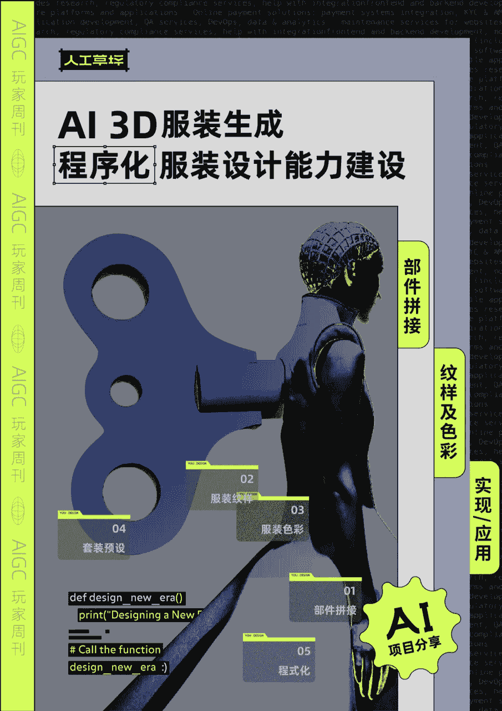

影视工业化是利用AI创新技术来提升内容制作的效率、质量，并降低成本。 内容制作涵盖了美术概念设计、服装造型、动作特效等多个方面，其中服装设计在整个制作过程中占据着相当重要的地位。 因此，我们选择了以3D服装为切入点，展开了一系列的设计探索与实践。 在这个过程中，我们遇到了一些挑战，但通过运用AIGC和3D等先进技术，成功解决了这些难题。

本文主要分为以下五个环节。 **首先是 服装部件的拼装 **，传统路径的生产成本较高，而服装的变量和扩量是一个难题。我们希望通过服装部件的组件化拼装，运用AI能力来解决扩量问题。 其次是 AI在纹样和色彩方面的助力 ，因为不同的动漫番剧具有不同的色彩调性和风格，对服装的色彩和纹理也有不同的需求，而这正是AI擅长的领域。 接下来是在3D应用阶段，需要实现服装的质感与样式的真实还原 。我们通过套装材质预设与程序化材质的结合，成功提升了虚拟制作的效率，并实现了对中国古代服饰质感与样式的还原与创新演绎。

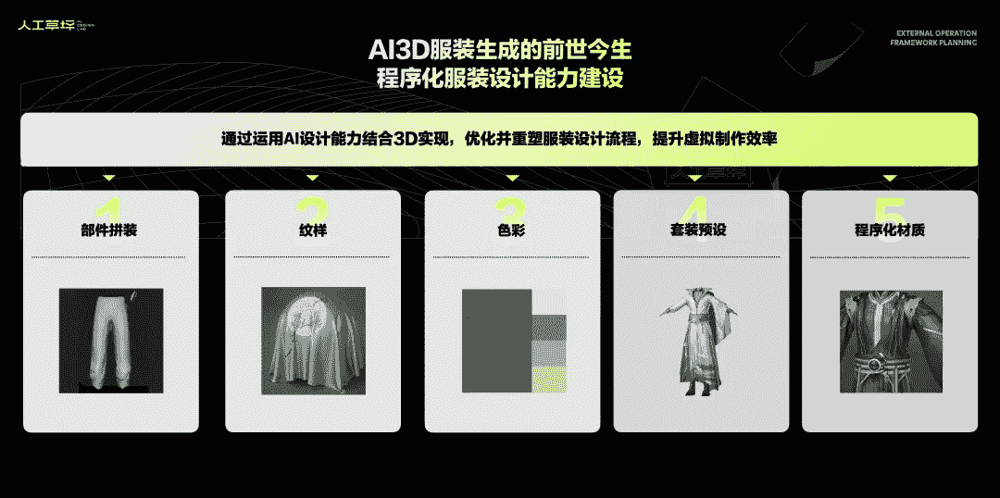

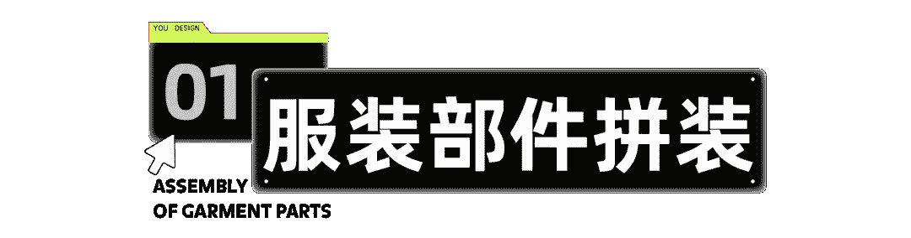

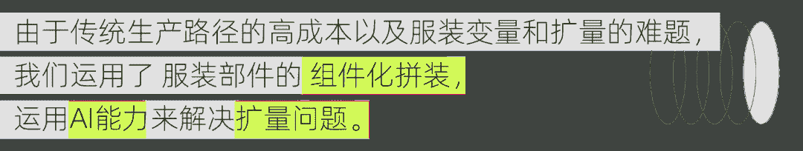

对服装部件拆分重组，是合理有效的程序化提效方式，可以帮助实现传统方式短时间无法达到的扩量效果。传统方式生产，每套服装都是需要单独重新做的，这种方式的结果是高度定制化的，资产复用率较低。而通过我们创造的这种创新生产方式，不仅提高了效率，降低了成本，还解决了在传统生产路径中难以解决的扩量难题。这种方法使得服装资产复用率大大提高，我们建立了一个部件库，使得原本库里的服装资产重新得到更广泛应用，使生产更加灵活、高效。

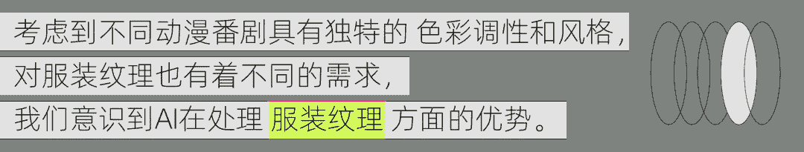

**1.纹样生成效果**

版本迭代对比，从一开始到第三版，对标S类服装还原，实现种类、样式、数量增长。

我们用不同种AI工具生成纹样，沉淀了每类纹样能稳定批量生成的工作流。原本需要每一张纹样人工设计绘制的工作量，在AI的辅助下，短短三四个月的时间内，建立了纹样库，帮助提效制作环节。

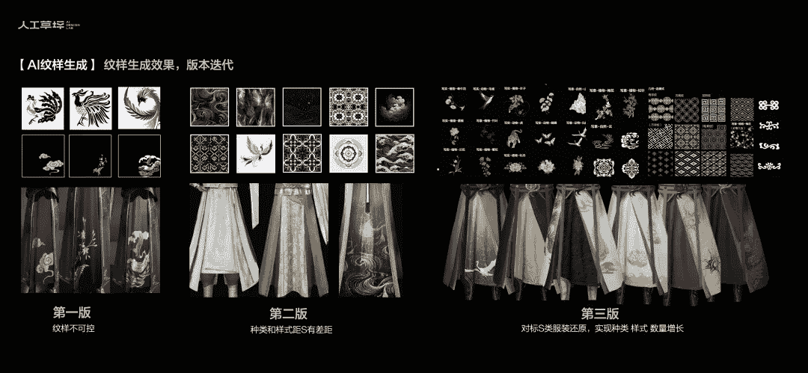

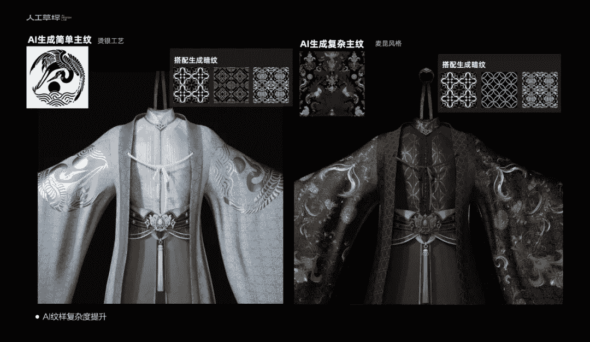

在不提高成本前提下，实现动漫服装的纹样达到更高品质

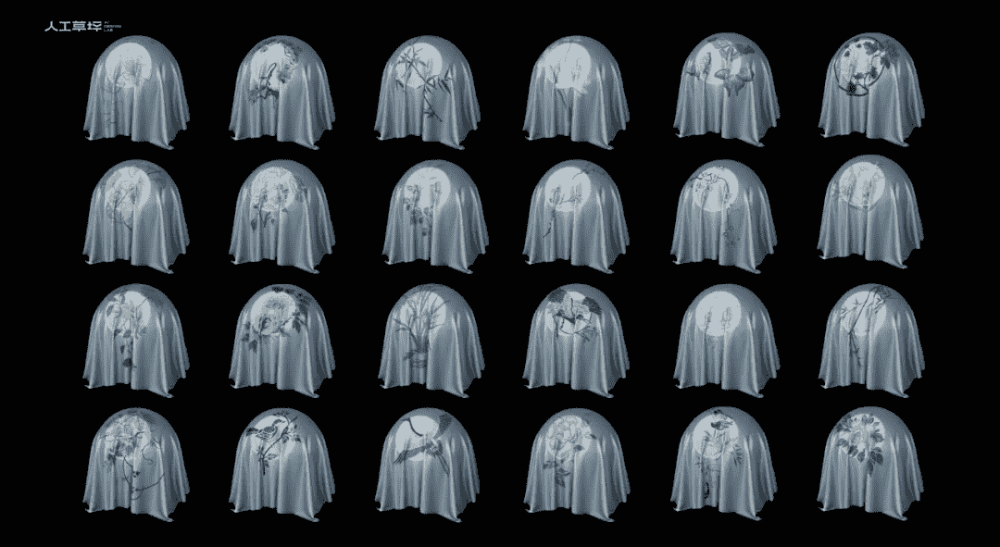

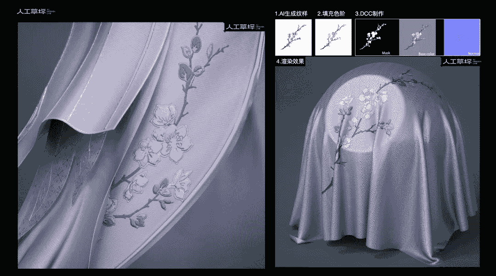

刺绣纹样制作效果

**2.建立纹样分类框架**

通**过**对3D国漫的服装纹样调研梳理， 从其中总结了服装上不同纹样的特征信息，研究适合古风3D国漫的服装纹样，建立了服装纹样标签和分类框架。

**3.AI 3D纹样生成能力**

根据不同特征的4种纹样，用5种不同AI生成能力实现

① 较具像纹样，用AI直接生成，例如仙鹤、鸟雀、蝴蝶

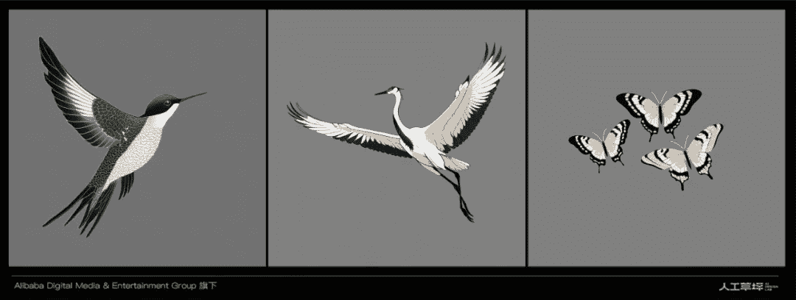

**② 不容易描述的抽象纹样，例如云、火，**由一张图，用AI生成多个由他发散的纹样

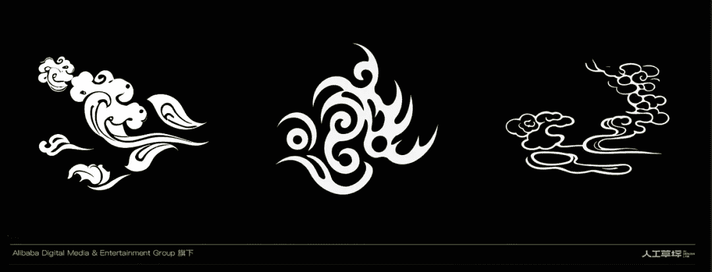

③ 不规则的连续性纹理用AI生成，用作大面积平铺的纹理

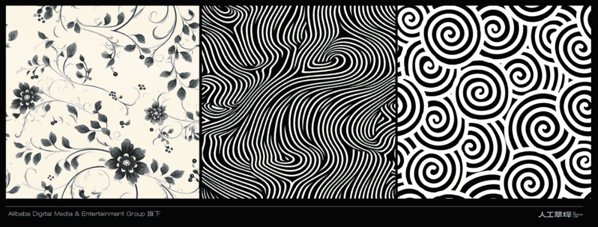

**④ 较规则的连续纹样用程序化生成，如几何纹样。使**生成结果更稳定可控，修改成本大幅度降低

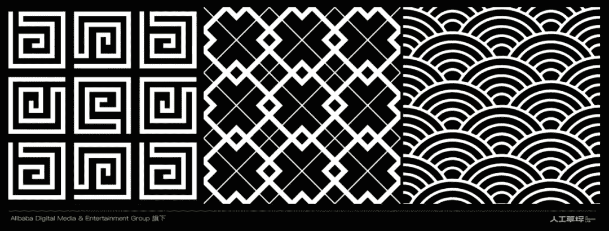

**⑤ AI直出生成，可以快速在服装上形成整套大面积**服装纹样，AI直出生成中式审美整幅纹样

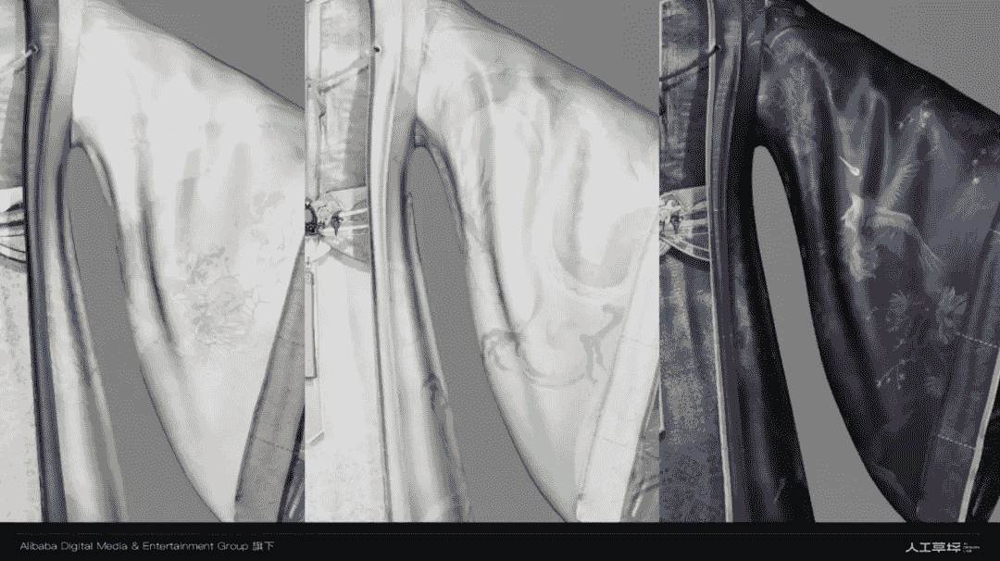

**落地衡量**

纹样规则，纹样应用

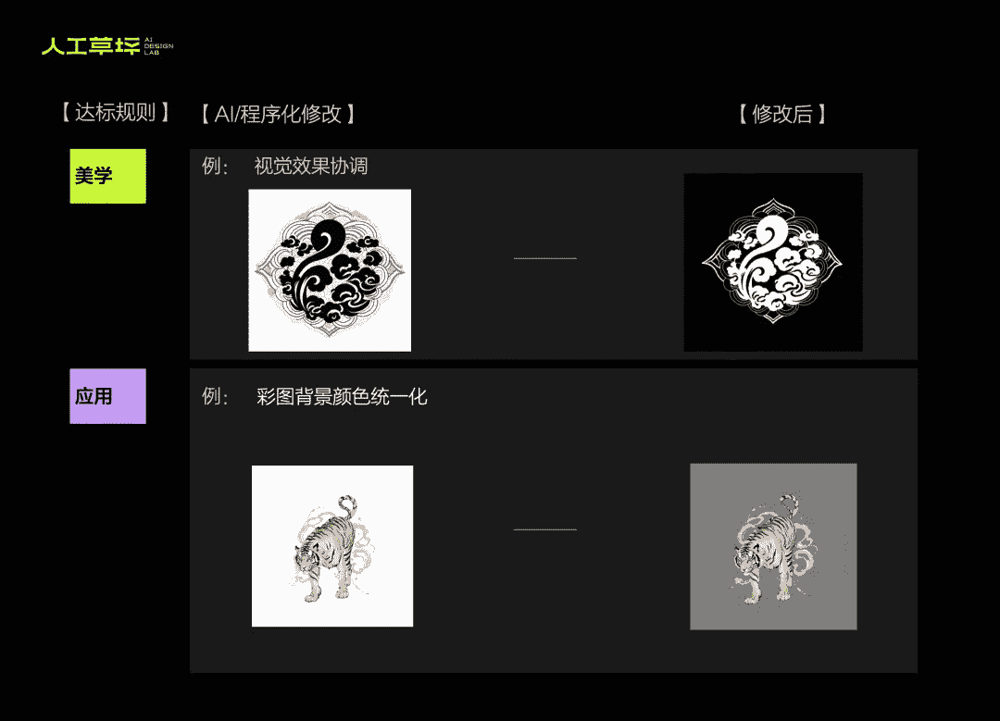

我们从美学与应用的角度出发，制定了输出衡量标准与对应的修改手段。传统上，一张纹样需要投入几天的时间去设计修改，纹样的人工修改成本较高，而借助AI能力，在短短几分钟内能做到修改输出多个版本供选择，AI/程序化修改的手段相比人工速度更快，质量好也更稳定，带来了更高的效率。在纹样应用上，设计师制定了纹样数量和疏密规则。数量规则，为根据不同角色需求规定纹样数量平均值；疏密规则，可以使纹样搭配合理且符合视觉美感。

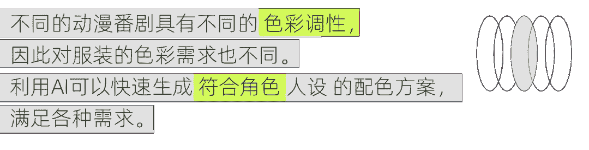

**1.最终效果**

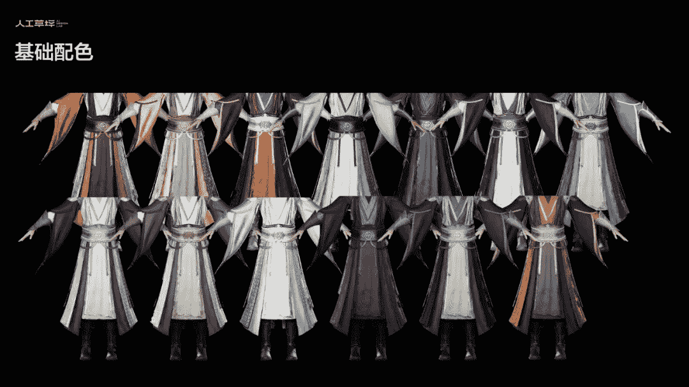

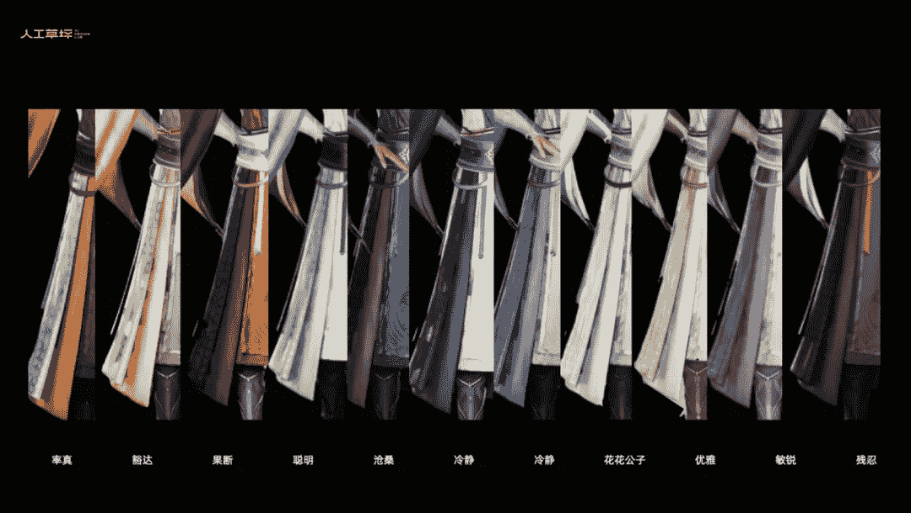

**2.美术**

① 3D服装配色的传统路径调研

调研了传统流程里的角色服装配色流程，和AI辅助原画流程。 配色和角色性格、小传提及因素、流行趋势、美术主观有关，配色逻辑有配比比例，也需考虑材质。 需要人工理解小传内容含义，和导演沟通，角色气质、性格、出身背景等信息出发，找到对应的参考图。

找参考图的过程需要大量图片，常用的参考图网站有Pin，花瓣，A站、behance等。 其中包含了具体服装图，也有同类动漫人物，风景图等任何插画图借鉴颜色。 也有细节如： 局部衣袖，细节、用来参考局部细节。

和导演、主美沟通确定一批参考图和角色服装主色后，一般进行平涂主色、根据色彩配色的理论基础、小传世界观定位、阵营、进行主色，点缀色的区分，通常是美学趣味点，需要放在性价比高的具备服装特征部位。 最后的上色时间取决于原画师的方案速度，通常第一稿绘制后，需产出大量配色图，后面如需修改，时间则继续增加。

对比传统配色方案，通过AI配色已经可以有效的产出，对比传统配色流程提高了产出速度。

**② 延展：AI配色7种颜色维度**

影响整体颜色的因素，个人倾向、剧集设定背景基调，影响配色风格。

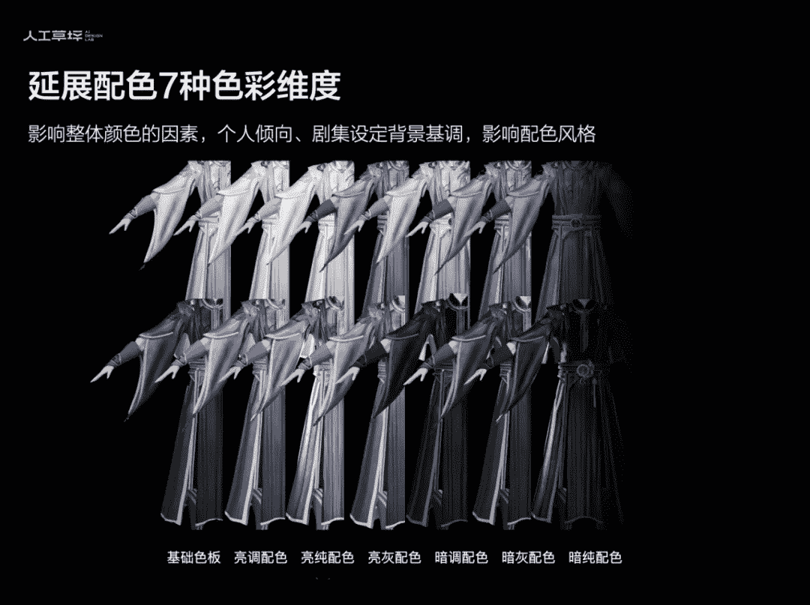

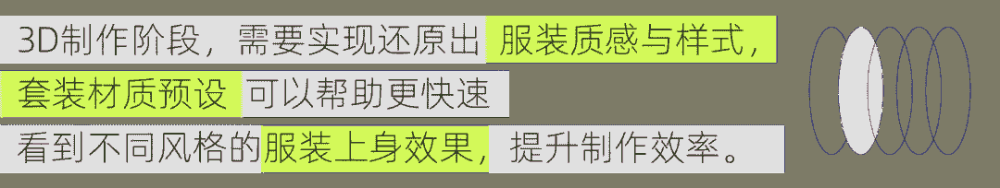

这些预设覆盖了从简约朴素到华丽繁复的各种风格，只需简单的选择与调整即可快速应用到不同的服装模型上。

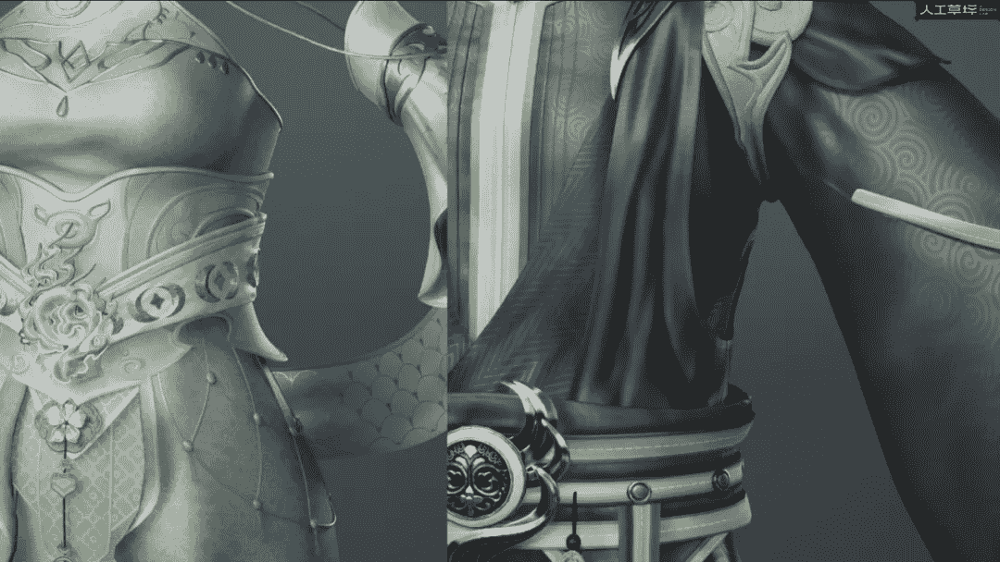

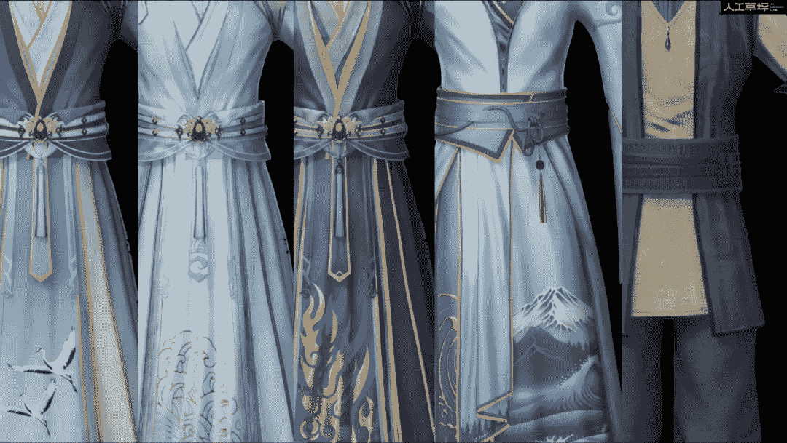

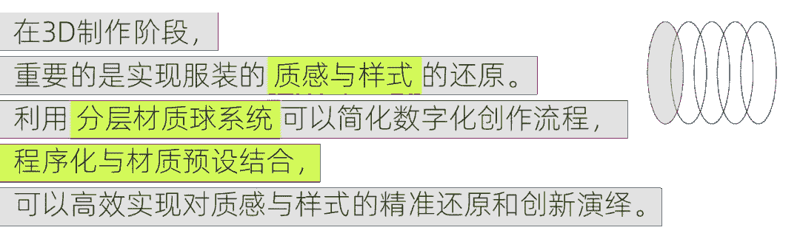

中国古代服饰以其繁复的纹理、精湛的工艺及深厚的文化内涵，成为数字艺术创作中的一大挑战。 在虚幻引擎5（UE5）的先进图形技术支撑下，通过高度模块化的设计思路，实现了对中国古代服饰质感与样式的精准复刻与创新演绎。

这套基于UE5的分层材质球系统，不仅简化了中国古代服饰的数字化创作流程，而且通过材质预设与程序化控制的结合，极大地拓展了设计的可能性。 它不仅为游戏、影视及虚拟现实领域提供了高效的艺术解决方案，也促进了对中国传统文化的数字化传承与创新表达。

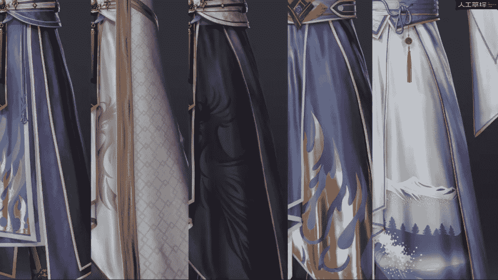

该系统采用分层材质逻辑，旨在程序化生成丰富多彩的中国古代服装质感与样式。 通过预设材质参数，该方案大大提高了创作效率，同时保持了设计的灵活性与艺术真实性。

**程序化材质纹样**

该系统可以模拟出各种不同材质效果，包括细腻丝滑的绸缎、粗犷质朴的麻布等不同材 质，增加服装质感； 还可以添加各式各样的纹样，增强服装的层次和立体感。 通过调节不同质感，可以实现金银线绣或丝绸光泽的生动效果； 还原刺绣的精妙细节，使刺绣图案跃然衣上，充满立体感； 局部的装饰细节，能够模拟金属配件的光泽，增添细节的精致度和 整体的完整度； 贴 花可以用 于处理服装表面的油污，血渍，做旧等效果。

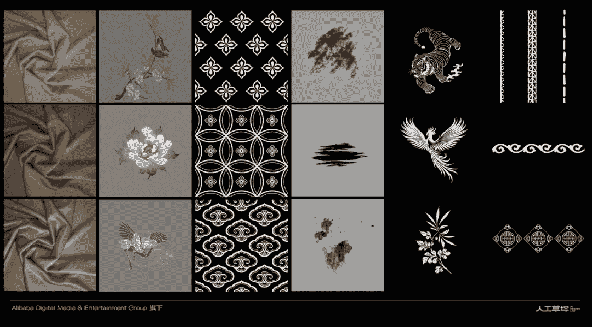

### **材质预设与程序化应用**

### 为提高工作效率并确保设计的一致性，针对每层材质设计了一系列预设参数。这些预设覆盖了从简约朴素到华丽繁复的各种风格，只需简单的选择与调整即可快速应用到不同的服装模型上。此外，通过蓝图或C++脚本，可以进一步实现材质参数的动态程序化控制，为美术设计师打开了新的创作维度。

通过服装部件拼装、纹样、色彩、套装预设和程序化材质这五个环节的具体介绍与分析，我们可以清晰地看到在每一个环节是如何有效地提高了服装生产的效率和质量。 首先，在服装部件的组件化拼装方面，成功解决了扩量的难题； 其次，AI在服装纹样和配色方面的助力不仅提高了制作效率，还带来了服装纹样和色彩的风格多样性和创意性； 在3D应用方面，套装材质预设与程序化材质的结合有助于还原出服装的质感与样式。 未来随着AI技术的不断进步和优化，预计将会有更多创新工具和方法出现。

因此，设计师需持续关注技术发展，以充分利用这些技术带来的机遇。

---

<https://my.feishu.cn/sync/CV7edZp1nspUQobYJhicxeP7nrb>