# 通往AGI之路

> 来源：[https://my.feishu.cn/docx/NDsAdX4spozsglxgqm7caJqdnVf](https://my.feishu.cn/docx/NDsAdX4spozsglxgqm7caJqdnVf)

# 🎯  愿景和目标

> 要实现通用人工智能（AGI）也许有很长的路要走，

> 我们的目标是让每个人的学习过程少走弯路，让更多的人因 AI 而强大。

# 🔖  简介  |  W[aytoAGI.com](http://waytoAGI.com)

欢迎来到通往 AGI 之路 / WaytoAGI社区是致力于人工智能学习的知识库与社区平台，提供系统全面的 AI 学习路径，整合资源、组织实践活动。覆盖近 900 万学习者，知识库访问量超 8000 万次，联动 180 所高校及 100 + 企业，举办 500 + 场活动。

[知识库介绍说明](https://waytoagi.feishu.cn/wiki/BE57wlWV2iDkOvkbYIockX11nTC)｜[通往AGI之路社区 业务](https://waytoagi.feishu.cn/wiki/PhZwwGR7jinzLVkqohOc7oofnzf)｜[WaytoAGI 品牌 VI ](https://waytoagi.feishu.cn/wiki/Cvu8wBkLXiATBckEwl7c6eSvncf)

👸号：通往 AGI 之路

[Bilibili](https://space.bilibili.com/259768893)｜[📕](https://www.xiaohongshu.com/user/profile/6457d2e4000000001f030dbe)｜[Twitter](https://twitter.com/WaytoAGI)

## **🥳加入飞书知识问答**

WaytoAGI知识库内10000+篇内容，现在一句话即可出现精准答案加原文链接！

[📌 提问入口（](https://ask.feishu.cn/shared-space/7226178700923011075?referrer=agi_zsk)[需先点击「](https://waytoagi.feishu.cn/wiki/KKF6wrrHBiXvJzkxP0wcD8dyn5f)[加入知识](https://waytoagi.feishu.cn/wiki/KKF6wrrHBiXvJzkxP0wcD8dyn5f)库」再提问）👉飞书客户端操作路径

## 🚗加入社区三部曲

» 1️⃣ 开源免费知识库，包含所有资料，最新动态和日常活动

解锁每月线下 AI 切磋大会、各类 AIGC 赛事...

资料地址（首页每日资讯+左上角目录可展开）

» [通往AGI之路](https://waytoagi.feishu.cn/wiki/QPe5w5g7UisbEkkow8XcDmOpn8e)

» 2️⃣ 日常共学：每天晚 8 点共学直播（必订！）：

一键订阅直播日历，每天上新知识不漏看！

或关注 #通往AGI之路视频号

»  [订阅日程](https://www.feishu.cn/calendar/share?token=e2b16267282604efa375f8829e3d2cc7)

» 3️⃣ 加入群聊：获取最新动态，参与交流共建

» [立即加入](https://waytoagi.feishu.cn/wiki/QPe5w5g7UisbEkkow8XcDmOpn8e#GjhAd91P5o988vxjOYwcdLPRn3c)

## 📝 欢迎投稿

**不错的教程见解等欢迎投稿：**

🔬 AI技术探讨与分析

💡 实践经验与案例分享

🚀 行业动态与趋势观察

💻 开发心得与技术教程

**投稿要求：                          **                    ✅ 原创、严谨、有深度

📊 配图说明更佳

🎯 观点明确，结构清晰

📏 建议字数1500-5000字

**审核流程：**

📬 提交后2-3工作日反馈

✍ 必要时沟通修改建议

»»»[立即投稿](https://waytoagi.feishu.cn/share/base/form/shrcndlVeIpGvhhWvnsVfMhuFbf?iframeFrom=docx&ccm_open=iframe)

## 🫐社区最新栏目：

### OpenClaw训练营报名中

[第五期：OpenClaw训练营](https://waytoagi.feishu.cn/wiki/WewVwPVkyipyaCka7twcwPZMnJf) 🔗 立[即报名 ](https://waytoagi.feishu.cn/share/base/form/shrcnbc5x1Aq9IKMdPWJ4uMDb7c)

[详解：OpenClaw/Moltbot/Clawdbot](https://waytoagi.feishu.cn/wiki/CCR4wl3upi6dF9kVE5YcAcGcnlU)点击查看各类部署教程&实战案例：

我们3月份的课程将带领学员从零到一部署 Openclaw 框架，打通云端环境，结合热门场景（如新媒体图文、内容自动化等）手搓高价值的 AI 智能体应用。

### 📺直播共学

所有历史直播回放看这里👇👇👇

[共学数据库（历史）](https://waytoagi.feishu.cn/wiki/UKqNw8Un0iaCsXkECfCcNkl0nGc?table=tbliNls1Wi1mV6bY&view=vewcZAYD0u)

4月7日[ 直播回](https://waytoagi.feishu.cn/minutes/obcnv1z6k17l3i4ax99qjk91)放

4月3[日 直播](https://waytoagi.feishu.cn/minutes/obcns9e7w2yk248vj183qp2o)回放

4月[1日 直](https://bytedance.larkoffice.com/minutes/obcnrz7a5ad1yu71n73u44r3)播回放

3月[31日 ](https://waytoagi.feishu.cn/minutes/obcnq81flll15oq7rr21tzig)直播回放

# 🎡近期活动

[WaytoAGI近期活动](https://waytoagi.feishu.cn/wiki/So9cwfj9yiuZJ8kSfLZce7a8nrf)鼓励大家以赛代练，多参加活动，和社区小伙伴一起动手实操

# 🎏 近 7 日更新日志

查看所有更新日志：[4.3 历史更新](https://waytoagi.feishu.cn/wiki/FjiOwWp2giA7hRk6jjfcPioCnAc)

###  4 月 8 日

+   《[一文看懂：Hermes Agent与OpenClaw全维度对比](https://waytoagi.feishu.cn/wiki/S7K6wfSAqi4qGfk5ScmcbA5Dntg?from=from_copylink)》AI圈正掀起Hermes Agent热潮，或许将复刻OpenClaw的FOMO现象。本篇文章清晰展现了它与OpenClaw的核心区别：Hermes轻量化易上手，以智能体为核心，具备独有的技能自我进化与经验沉淀能力，运行透明稳定，更适合个人打造专属协作智能体。同时还解读了迅猛上涨的市场数据与发展趋势，配套中英文文档，帮你精准判断到底哪款工具更适配自身需求，来抓住新一轮 Agent 风口。

+   《[系统工程：构建真正可用的 Agentic 软件](https://waytoagi.feishu.cn/wiki/RSOfwXS4kiu9cDkeAJQcn3DYnxe?from=from_copylink)》当下AI智能体开发普遍陷入局部优化误区，作者借鉴贝尔实验室系统工程思想，指出软件工程本质就是系统工程。构建可用的Agent软件需要打通智能体、数据、安全、界面、基础设施五层架构，摒弃零散工具堆砌，从整体视角实现协同设计。文中结合了开源项目Dash的实操演示，提供了可落地的架构方案，可以快速搭建稳定可靠的生产级智能体系统，快来借鉴一下！

+   《[Meta 发布全新大模型：Muse Spark](https://waytoagi.feishu.cn/wiki/GC4PwlwKmiYlv8kBmpyc5uKYndg?from=from_copylink)》今天凌晨，Meta 发布了全新的大模型 Muse Spark ，已上线到 Meta 旗下的各类产品。Muse Spark 是一个原生多模态推理模型 ，支持工具调用 、 视觉推理链（visual chain of thought） 和多Agent协同。

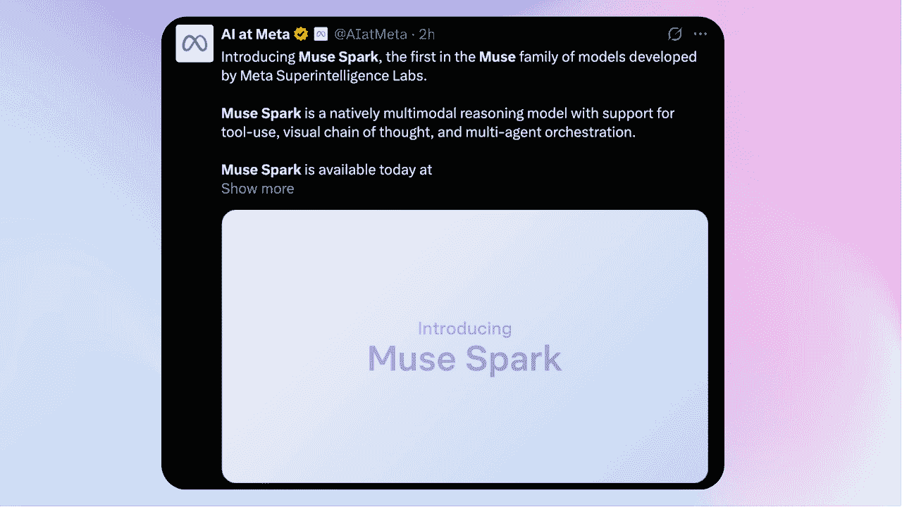

+   《[Mythos 全面解读：Anthropic 最强模型发布](https://waytoagi.feishu.cn/wiki/UiqJweUYGi5QPUkIzbfcmYArnyd?from=from_copylink)》Anthropic 发布了 Claude Mythos Preview 。这是一个通用前沿模型，定位在 Opus 之上，是 Claude 产品线的全新最高层级。Anthropic 同时宣布，Mythos Preview 不会公开发布，只向 12 家核心合作方和 40 余家关键基础设施组织开放，让我们来一探究竟！

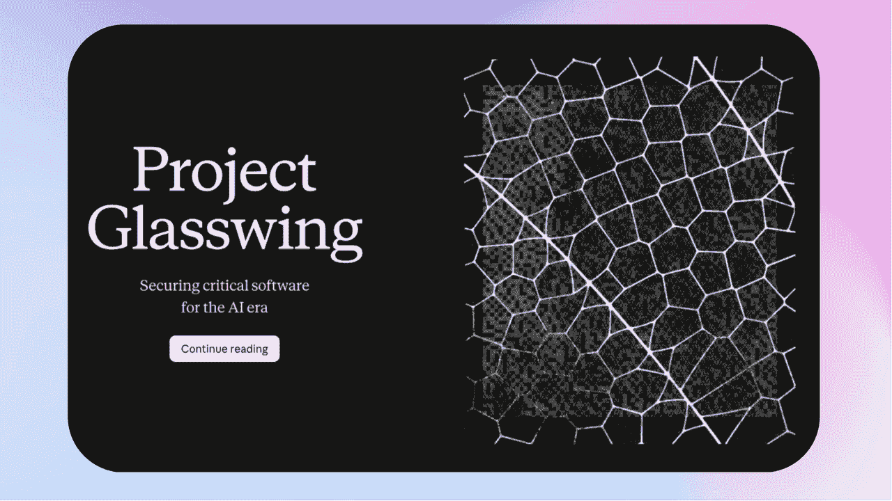

+   《[Claude Code 实战：如何用一个工具支撑整个小团队丨Aakash Gupta](https://waytoagi.feishu.cn/wiki/PbHRwt1oTihG9Ek2IXHc9pGDnBg?from=from_copylink)》Hannah Stulberg 是DoorDash的PM，前Google APM，她在 Claude Code上已经投入超过1500个小时，而且至今仍在每天改进自己的工作流。这期Aakash Gupta的播客里，她把自己的「Team OS」完整拆解给了所有人——一个让 PM 一个人撑起 20 人团队的共享知识库系统。如果你是 PM、工程师或设计师，正在思考如何用 AI 真正放大自己的工作效率，这篇文章值得认真读完。

+   《[贝叶斯定理：AI 决策背后的秘密](https://waytoagi.feishu.cn/wiki/MNDZwUCK1iYSN9karvAcI3MPnj6?from=from_copylink)》贝叶斯定理是概率论和机器学习中的一个核心思想。它告诉你，当你看到新数据之后，应该如何更新自己的判断。在这篇文章里，会把整个内容一块一块拆开来讲。

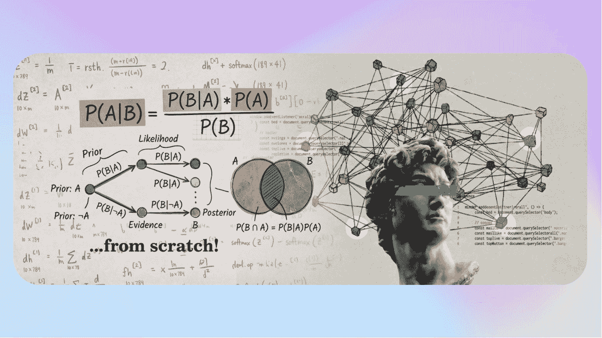

###  4 月 7 日

+   《[用Hermes封装并开源一个重要skill：从飞书文档一键发布到🛰️👸号](https://waytoagi.feishu.cn/wiki/TLofwkUtSi4HnfkPdWwcVKvGnJe?from=from_copylink)》如果你平时用飞书写内容，然后复制粘贴到👸号后台，一定会遇到这些头疼的问题：飞书里的图片要一张张下载再上传、表格复制过去格式全乱、代码块没有高亮，显示成纯文本、排版和预览时看到的效果不一致。这篇文章介绍一个开源工具，可以把飞书文档一键转成🛰️👸号草稿，图片自动上传，格式完整保留。

+   《[老金开源“元”概念落地项目雏形，一套让你能做任意你想做的项目的架构！](https://waytoagi.feishu.cn/wiki/D0WgwO44gila1EkKNO0cKpMAnVc?from=from_copylink)》AI编程常常会因为缺乏治而理在复杂项目中频繁出错。Meta_Kim则以“元”为核心，搭建了一个AI协作治理框架，通过规范分工、阶段管控与验证闭环，让AI开发更严谨可靠。框架支持多平台配置同步，自带经验沉淀与风险回滚机制，前期配置后可大幅降低重复试错成本。对从事跨文件、多模块工程开发的AI使用者而言，这套开源方案可以有效提升交付质量，帮你从无序调试走向标准化治理，快来试试。

+   《[解码 Transformer 架构](https://waytoagi.feishu.cn/wiki/ELr2wI0sSimXTMkWu6lcygSJn6L?from=from_copylink)》在这篇文章里，我们会通过逐块拆解的方式学习 Transformer 架构，理解每个组件的作用、它们如何协同工作，以及为什么这种架构支撑了每一个现代大语言模型（LLM）。当我们听到 “Transformer” 这个词时，它听起来很复杂。但别担心。如果我们把它拆成各个独立的部分来看，每一个部分其实都很简单。

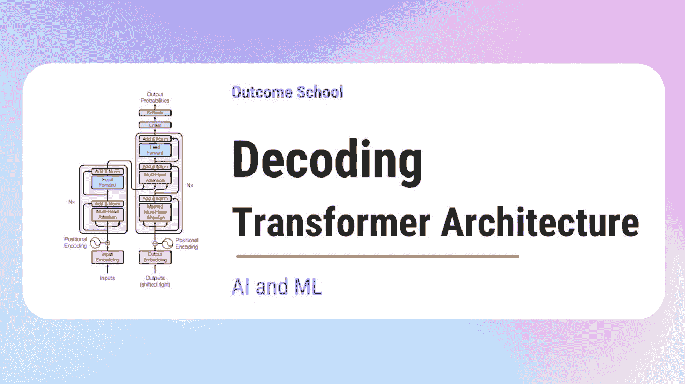

+   《[AI Agent的持续学习](https://waytoagi.feishu.cn/wiki/RXCswIHmUiJSJukLfetcBaR6nOc?from=from_copylink)》关于 AI 中持续学习的大多数讨论都聚焦于一件事：更新模型权重。但对于 AI 智能体来说，学习可以发生在三个不同层次上：模型、harness 和上下文。理解这三者的区别，会改变你构建可随时间持续改进系统的思路。

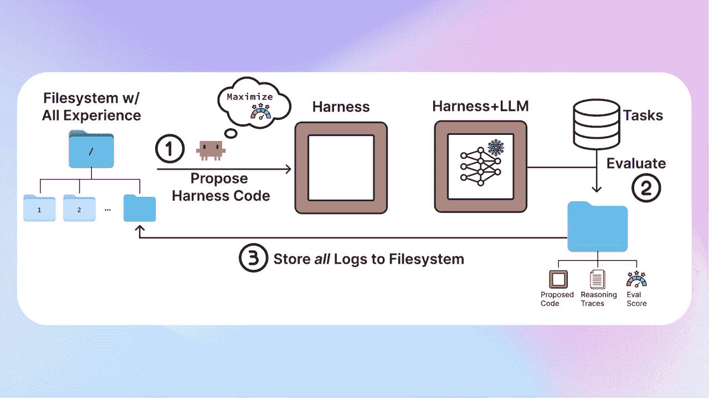

+   《[一文深度解析 Agent Harness](https://waytoagi.feishu.cn/wiki/LjEVw72ogiz5pukRrEhc7VDrnFe?from=from_copylink)》一篇深入解析，讲清 Anthropic、OpenAI、Perplexity 和 LangChain 实际上在构建什么。涵盖编排循环、工具、记忆、上下文管理，以及其他一切能把一个无状态 LLM 变成有能力的 agent 的部分。

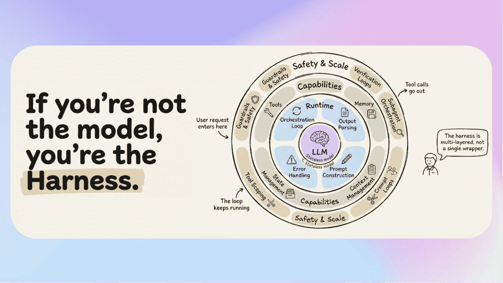

+   《[Anthropic增长主管：工程师越多，产品经理越稀缺丨Lenny's Podcast](https://waytoagi.feishu.cn/wiki/AY0fwzGTyiabBdkFm25cP2Ibnuf?from=from_copylink)》Amol Avasare是Anthropic的增长负责人。在他之前，他在MasterClass和Mercury做过增长，做过创始人，做过投资银行家。这一期他和Lenny聊的，是在史无前例的增速下，Anthropic的增长团队实际上在干什么，哪些传统打法彻底失效了，以及工程师生产力爆炸后PM和设计师的真实处境。

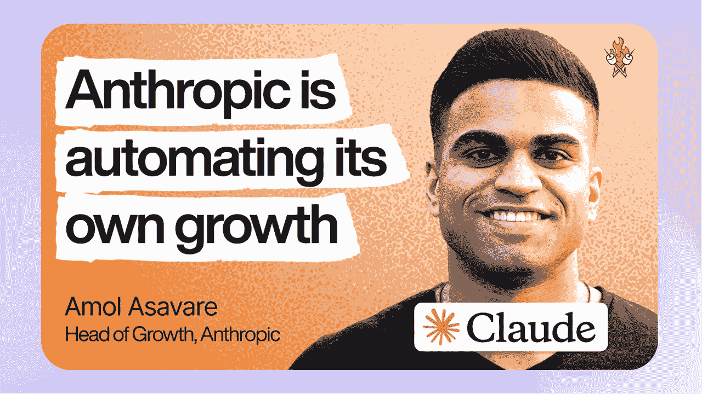

###  4 月 6 日

+   《[AI音乐周刊 W.A 022](https://waytoagi.feishu.cn/wiki/F2FkwPHeoiq345kq82VcR2M6nyf?from=from_copylink)》本周AI音乐领域技术与合规迎来新变化。阿里Qwen3.5-Omni实现音视频直接编程，ElevenMusic入局对标主流平台，海绵音乐、ProducerAI同步升级创作体验。与此同时，版权争议持续升级，美国权威机构质疑AI训练合理使用，TikTok上线技术严控变调侵权。但独立音乐人频遭AI声纹克隆与恶意版权勒索。快来一同查看AI音乐行业最新动态。

+   《[前Netflix AI产品总监：AI PM不是你想的那种，看完这个再去投简历丨Aakash Gupta](https://waytoagi.feishu.cn/wiki/NhglwdYcSiqx8WkxKr2cMLBxnze?from=from_copylink)》Jyothi Nookula 在 AI 领域工作了 13.5 年，持有 12 项 AI 专利，先后担任 Amazon SageMaker、Meta PyTorch、Netflix 开发者平台的 AI 产品总监。这期播客是一堂公开的 AI 产品经理速成课：不是职场鸡汤，是从岗位结构、技术选型、Agent 架构到三家大厂 PM 文化的真实拆解。

+   《[一文彻底打通AI底层逻辑：从LLM到Agent，所有核心概念拆解透彻](https://waytoagi.feishu.cn/wiki/VngEwIAxGikoOKkFQdQcNPoTnrc?from=from_copylink)》AI圈每天都在冒新名词——LLM、token、context、prompts、tool、mcp、agents、agent skill... 你真的能准确说出每个概念的确切含义吗？这是一篇从工程视角出发的硬核解析，没有虚头巴脑的商业概念，只有最底层的技术真相。 看完这篇，你对AI的理解将上升一个台阶 。

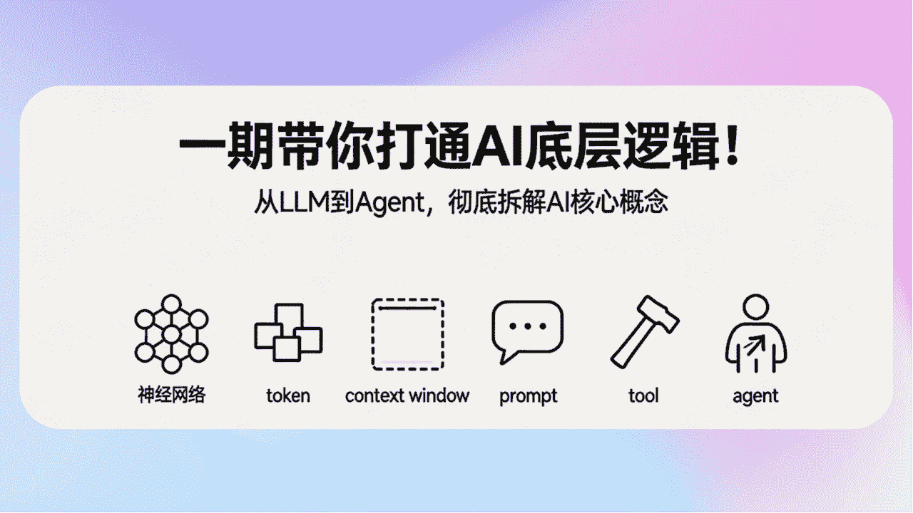

+   《[笑川：懒得重配100个 Skills？我用一套配置搞定 Claude Code+OpenClaw 双向同步](https://waytoagi.feishu.cn/wiki/R4OuwKIooitWvYkzeHtcgy68nfh?from=from_copylink)》重度使用Claude Code与AutoClaw的用户，常常会被多设备配置无法同步困扰。本文分享一套实用同步方案，借助Git仓库与符号链接，实现两台设备上的技能、工作流、代理配置实时互通，再配合定时任务自动同步。全文步骤详细、零基础可操作，还贴心标注避坑要点。配置完成后可随时随地调用完整工作流，大幅提升移动办公效率。

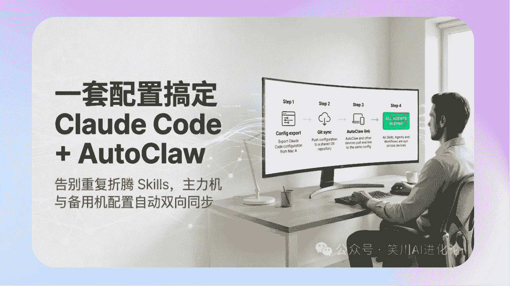

+   《[喝点VC｜红杉美国专访全球首个太空数据中心创始人：太空数据中心将成为算力终极形态，未来十年年投入近万亿美元](https://waytoagi.feishu.cn/wiki/SWhMwJfyjifUHpk14C4cUBIanLy?from=from_copylink)》Philip Johnston ， StarCloud 创始人兼 CEO ，全球首个实现太空数据中心在轨运行的创业者，深耕航天与算力基础设施。 Sonya Huang 、 Pat Grady ，科技领域资深主持人。这期对话则聚焦太空数据中心的技术、成本、规模化与商业未来。

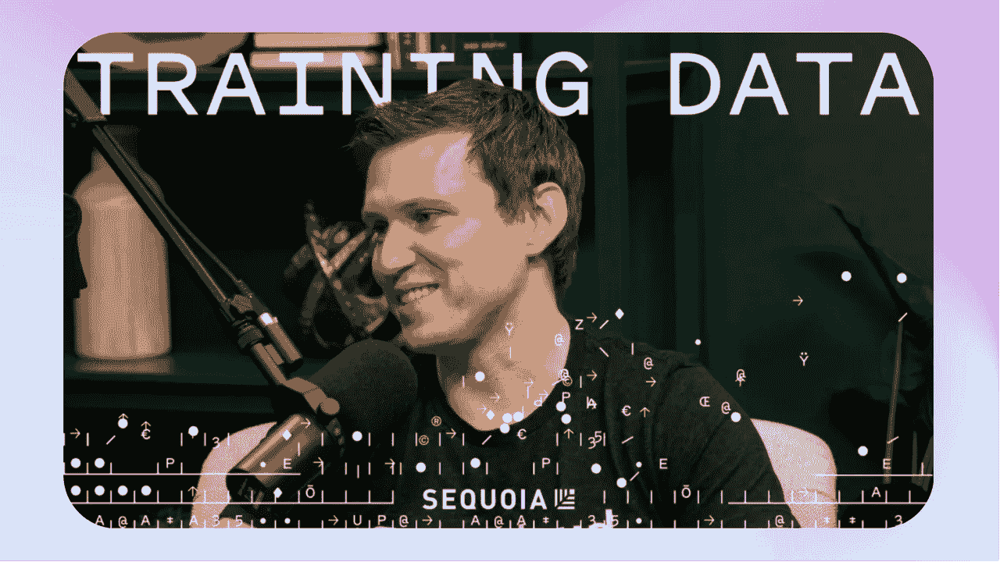

+   《[访谈｜Codex 团队如何用自己的产品构建产品——整个 Spec 只有 10 个要点](https://waytoagi.feishu.cn/wiki/DgCnwKSM0iehTPkY7SBcmTi5nIf?from=from_copylink)》OpenAI Codex 团队的 产品规格文档只有 10 个要点 。不是说每个功能的文档只有 10 个要点，而是整个产品的 spec 就这么多。 设计师写的代码量超过了六个月前工程师写的 。50 到 100 人的团队，直到最近才有了第二个产品经理。来让我们看看他们是如何用自己的产品构建产品！

###  4 月 5 日

+   《[Dazhuang Skill Creator](https://waytoagi.feishu.cn/wiki/B3bGwQdFai1uGnkVkUacgQWXnHh?from=from_copylink)》Dazhuang Skill Creator 基于 Claude Code 官方 skill-creator，但并不只是改几句提示词。作者把自己对提示词架构、Skill 架构，以及 CLI 工具运行机制的理解重新整合进去，对整体工作流、结构分层、bundled resources 和可维护性做了一次完整重构，整个 skill.md 非常轻量量，基本上只有规则和工作流程，优化起来像以前写提示词一样简单。快来安装试试！

+   《[图解：寻找并了解你的 SEO 竞争对手](https://waytoagi.feishu.cn/wiki/Eh3Eweg7aismEJk65f2ctgj4npW?from=from_copylink)》在规划和启动 SEO 时，对 SEO 做得不错的竞争网站有明确、详细的洞察是非常重要的。一方面，你以为你很懂客户，但你可能 不懂搜索用户在搜索什么，以及其背后的搜索意图 。另一方面，每个新站都应当做 SEO 竞争性分析，最起码能了解 SEO 流量渠道能不能做？现阶段该不该做？这篇文章分享了寻找并了解你的 SEO 竞争对手的方法。

+   《[我不想再教 AI 做事了：一个 AI 产品经理对工作方式的重新理解](https://waytoagi.feishu.cn/wiki/FsSBwwHMhiZLtDkdpJ2cJqhXnug?from=from_copylink)》这篇文章里，作者写了自己为什么离开传统制造，为什么会被 AI 这股浪潮推着往前走，也写了这半年里我是怎么靠一个个项目、一点点实践，把自己从原来的工作惯性里拽出来，最后真正拿到一份 AI 产品经理的工作。那篇文章更像一段转型复盘，讲的是选择、冒险、试错和跃迁。如果你也想转型AI产品经理，值得一看！

+   《[本周 AI 论文精选](https://waytoagi.feishu.cn/wiki/U1UVwlxafiSgH1kROw9cnQ1fnde?from=from_copylink)》本周AI精选论文覆盖模型安全、Agent架构、成本与效率等核心突破，极具实战与研究价值。Claude被证实存在情绪向量，为安全对齐提供新方向；AI Agent陷阱揭示网络攻击新形态，风险与责任亟待明确。多Agent异步协作、自组织架构大幅提升工程效率，Harness自动化优化与编码Agent替代长上下文，显著降低落地成本。

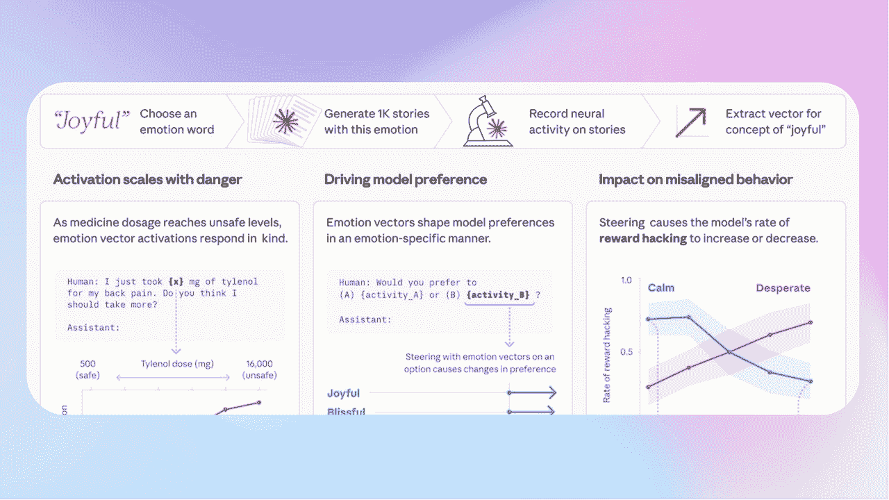

+   《[编程智能体的核心组件【译】](https://waytoagi.feishu.cn/wiki/Q6bwwf8Ifi6ir2kKtE7cHOx9nMc?from=from_copylink)》这篇文章和大家聊聊编程智能体（Coding Agent）和 Agent harness（智能体 Harness）的整体设计。它们到底是什么？怎么工作的？在实际应用中，各个部件又是如何协同配合的？

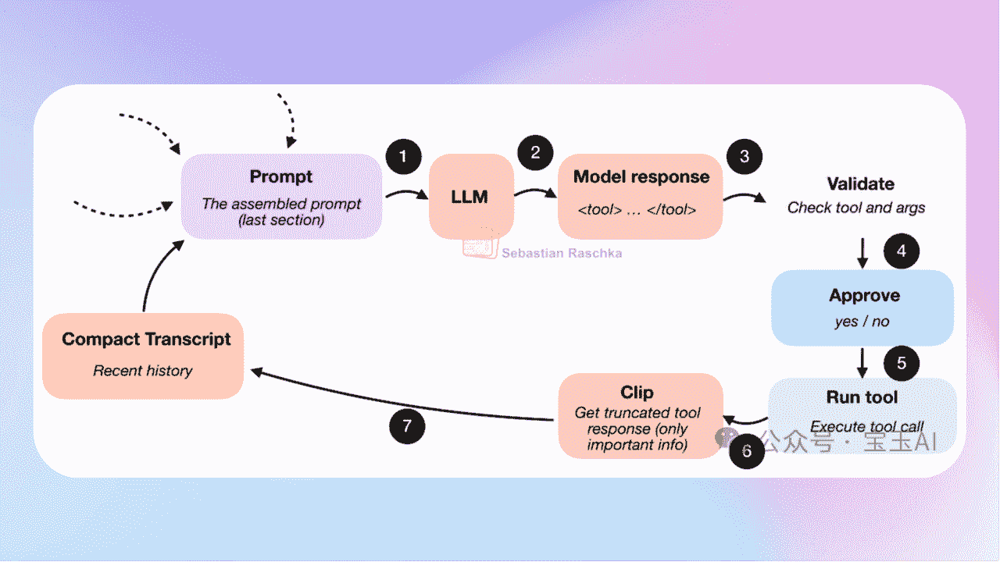

+   《[a16z联创：浏览器已死，这次 AI 真的不一样丨丨Latent Space](https://waytoagi.feishu.cn/wiki/J0qTwiRgIiwStvkRh5zc3hNcnDh?from=from_copylink)》Marc Andreessen 是少数几个亲历了互联网、移动端、云计算三次浪潮、且不只是"见证"了它们的人——他联合创立了 Netscape，写出了第一个商业浏览器，此后与 Ben Horowitz 共同创立 a16z，成为硅谷最有影响力的风险基金之一。这期对话是目前市面上最有密度、最少废话的一次一手回答，不容错过！

###  4 月 4 日

+   《[小ai：审批催办、会议纪要、日程管理……10个场景教你用OpenClaw把飞书“玩出花” ](https://waytoagi.feishu.cn/wiki/O5vJwu2nxiHOgzkkqUSc4kRhnxg?from=from_copylink)》本文分析了小龙虾打电话feishu-meeting-call技能架构与源码实现，拆解出核心公式（Token管理+API调用+业务逻辑+降级策略+智能触发）。基于此方法论，提出十大飞书高频场景的实战方案，展示如何利用新版skill-creator将普通飞书应用升级为个性化智能助理，实现从“使用技能”到“创造技能”的能力跃迁。

+   《[如何让RAG的内存效率提高32倍（代码详解）！](https://waytoagi.feishu.cn/wiki/HMzDwpGQMiWMyBkDoDtcVtdanbd?from=from_copylink)》RAG 特别吃内存，不优化就跑不动、跑太贵、跑太慢。通过这篇文章，来让我们看看Perplexity、Azure、HubSpot等众多公司如何使用二进制量化技术，使检索增强生成（RAG）的内存效率提高32倍（附代码解释）！

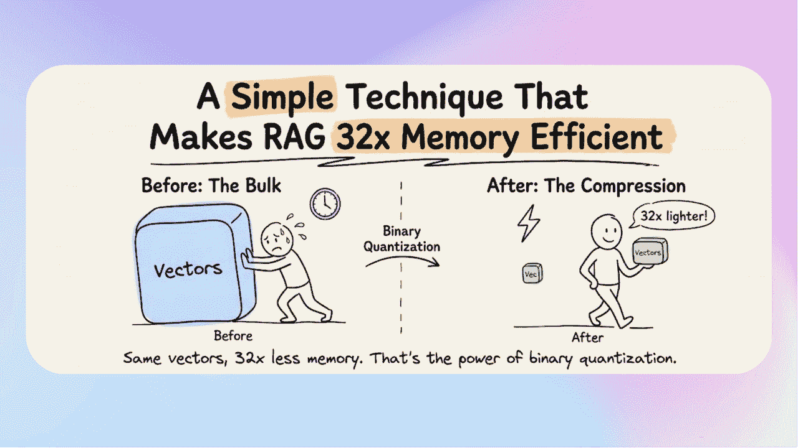

+   《[25个当下即可打造的实用Skills、Agent和自动化方案——完整清单](https://waytoagi.feishu.cn/wiki/D7A9wwzcriQ8hGkLu53cm3🐧nif?from=from_copylink)》大多数人学习了AI相关知识后，却完全不知道该打造什么作品。或许掌握了理论知识，熟悉各类工具，可一旦坐下来动手创作，就只能对着空白屏幕发呆。这份清单就是为了解决这个问题。25个项目按难度分级整理，每个项目都能在一个周末内完成，每个项目都能解决实际问题，每个项目所学到的技能，还能为后续项目打下基础、层层叠加。

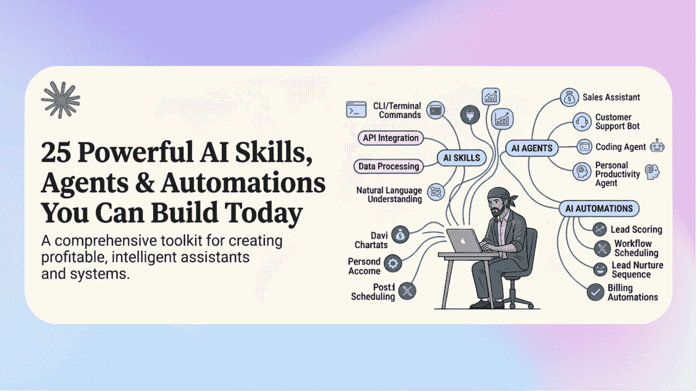

+   《[8 个 Claude Code Hooks 实战（译）](https://waytoagi.feishu.cn/wiki/AnJIwnyATiXRZekuJNtclt0qnrd?from=from_copylink)》在用Claude Code开发时误改配置、乱删文件、漏跑测试的痛点，靠Hooks就能一键解决。这篇文章推荐了8个Claude Code Hooks，对日常使用AI写码的人来说实用性极强，快上手试试！

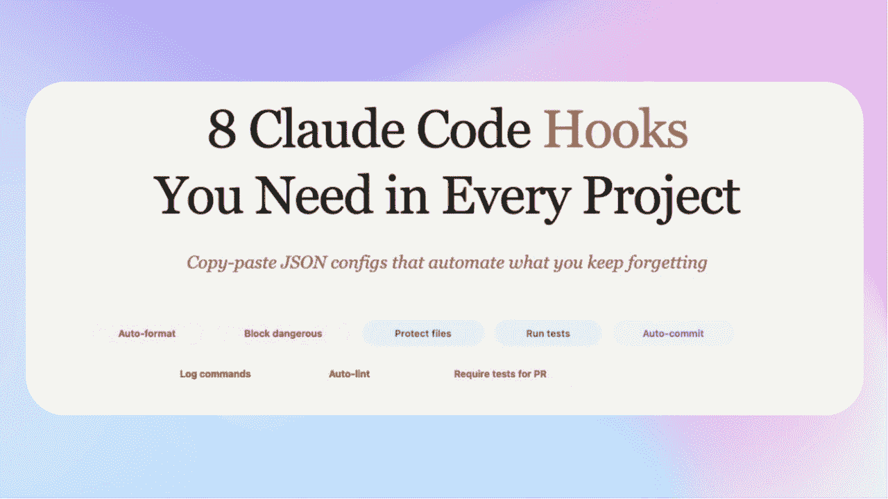

+   《[Anthropic 设计主管的工作流：垃圾进去，宝贝出来](https://waytoagi.feishu.cn/wiki/LXbFwrHp9ihq7ykvOXkciGUZn0b?from=from_copylink)》**Jenny Wen **，Anthropic 的设计负责人，Cowork 的设计主导者。她最近上了一期播客，完整展示了自己怎么用 Cowork 干活，还讲了 Cowork 的真实诞生过程，以及产品界面经历了多少次推翻重来。

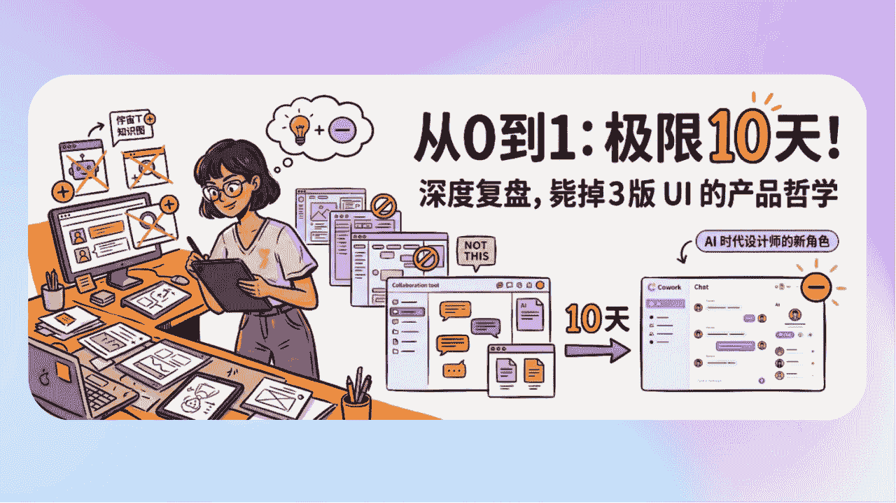

+   《[从Vibe coding到Dark factories：AI接管软件生产的完整路线图丨Lenny's Podcast](https://waytoagi.feishu.cn/wiki/PvQVw2GfziEbuIkYHEwcgDhZnsy?from=from_copylink)》Simon Willison 是 Django 的联合创始人——那个同时托着 Instagram、Pinterest、Spotify 的 Web 框架。他创造了"prompt injection"这个词，普及了"AI slop"和"agentic engineering"的概念，还有超过 100 个开源项目，其中 Datasette 已经成为全球调查记者的常用工具。在这期 Lenny's Podcast 对谈里，他带来的不是预测，而是一个在最前线工作的工程师，对这个行业正在发生的事情最诚实的描述。

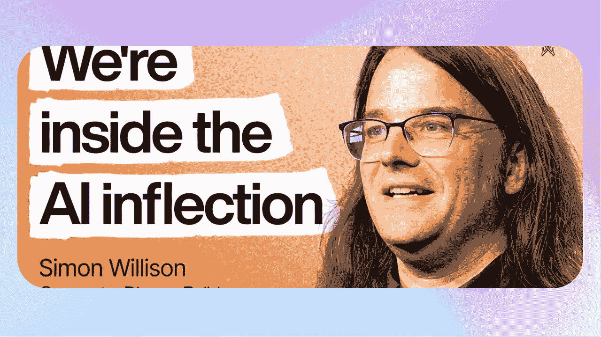

###  4 月 3 日

+   《[Harness Engineering 在讨论什么：三个 Scaling 维度的统一框架](https://waytoagi.feishu.cn/wiki/D0x2wz52MiSu2fkdrmRcZNginJh?from=from_copylink)》2026 年第一季度，OpenAI、Cursor 和 Anthropic 先后发布了各自在 agent-first 软件开发上的实践报告。三篇文章都被归入同一个术语：harness engineering。但仔细读下来，它们讲的几乎是三件完全不同的事。这篇文章提供了一个统一框架来理清这些讨论。

+   《[你真的了解GitHub吗？- 搜索篇](https://waytoagi.feishu.cn/wiki/BoYhw3w1piyrl5k1dhTcDOIfnAf?from=from_copylink)》或许你也经常看到很多推荐GitHub项目的文章，这篇文章帮助小白可以熟练上手GitHub，先从最简单的搜索开始。作者主要分享了GitHub项目信息的四种搜索方式，以及GitHub中都有什么信息。

+   《[驾驭 Claude 的智能 | 构建应用的 3 个关键模式【译】](https://waytoagi.feishu.cn/wiki/IATXwyj7HiE2wJkkLFucnj6kn0f?from=from_copylink)》Claude 平台团队技术人员 Lance Martin 分享了团队在构建应用时应该采用的三个核心模式。这些模式能帮助你的应用跟上 Claude 智能进化的步伐，同时兼顾延迟和系统成本。

+   《[你不知道的大模型训练：原理、路径与新实践](https://waytoagi.feishu.cn/wiki/ZrYUwM4MeiNrhZk07V1cBFUvnNc?from=from_copylink)》2026 年来看大模型效果真正拉开差距的地方，慢慢不再是预训练本身了，而在它更后面的那一大段：后训练、评测、奖励、Agent 训练、蒸馏，每一个步骤都在影响用户实际感受效果。你发现某个模型突然变强了，背后可能是这几块一起优化到位了，而非单一因素导致。本篇文章就按大模型训练链路顺序来讲，非专业背景的人也能读得懂。

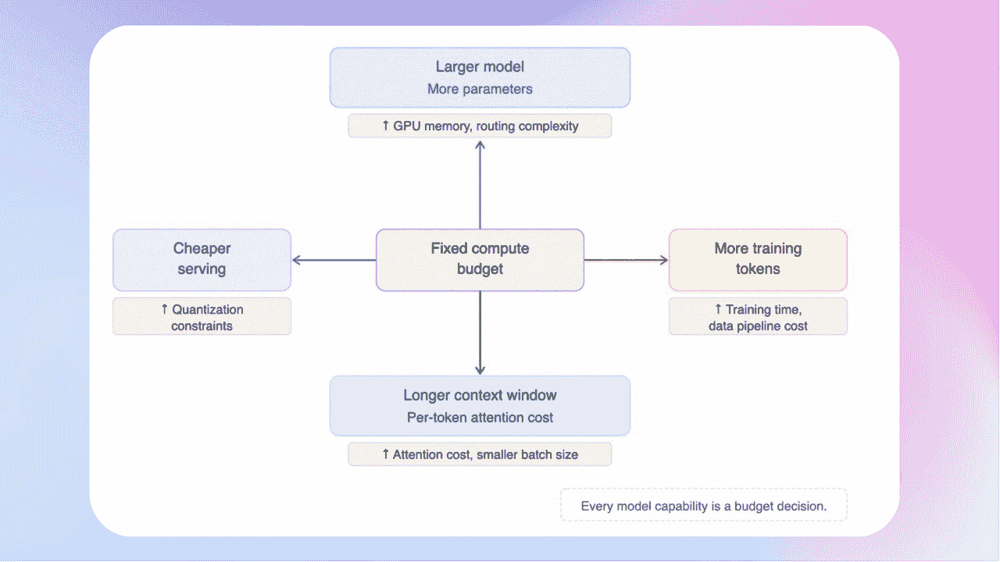

+   《[Google前高管：如何在下一阶段AI（2026-2027）到来之前做好定位 | Silicon Valley Girl](https://waytoagi.feishu.cn/wiki/YNlyw1dRjilC1Yko0MEccxdBnKd?from=from_copylink)》Mo Gawdat在谷歌X担任首席商务官超过十年，主导过上百个前沿科技项目的商业化探索。在这期对话里，他从七个维度拆解了未来就业市场的走向并给出了四条异常清醒的个人准备建议。

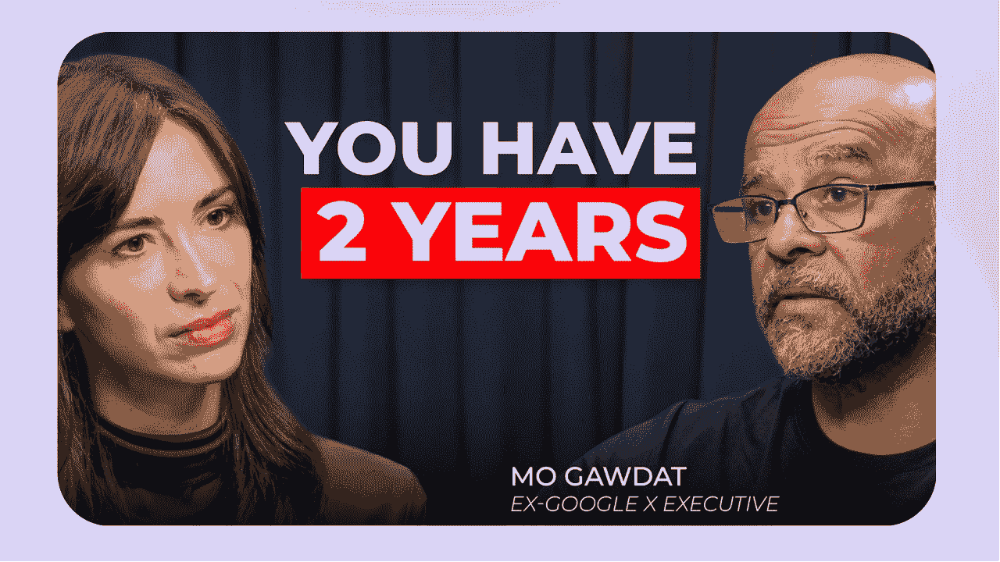

+   《[Wan2.7-Video 为创作自由而来](https://waytoagi.feishu.cn/wiki/ZQSFwp6LGiNHfxkY0v6caMVBnyf?from=from_copylink)》更可控 、 更全能 的 视频创作大模型 Wan2.7-Video 全新上线。除了“生成”，本次升级更是聚焦在 “创作” 全链路，覆盖 生成、编辑、复刻、重塑、驱动、续写、参考 …… 一个更低使用门槛、真正能导擅演、服务于创作者的视频创作套件，来了！

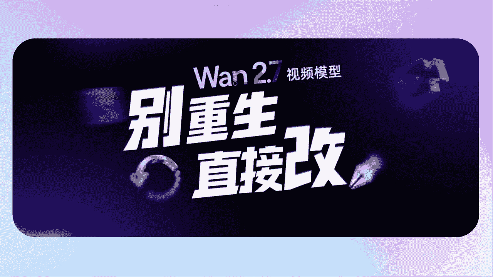

###  4 月 2 日

+   《[做了1年企业AI咨询后，我们决定把"怎么帮老板找AI场景"这件事开源](https://waytoagi.feishu.cn/wiki/IKgKw6cV9ijyM1kGppHcfFOVnkg?from=from_copylink)》一年来给企业做AI场景咨询，最常被问的就是"我们公司到底哪里能用AI"。不同行业、不同规模的企业，虽然业务千差万别，但"找AI场景"的方法论是通用的。所以作者的团队就把这套方法论产品化，做成了一个AI Agent可以自动执行的Skill。并且已经开源，快来上手试试！

+   《[小ai：一个比喻，秒懂skill-creator技能原理](https://waytoagi.feishu.cn/wiki/FXegwuNcAifqWkk1hfDcB9VmnPd?from=from_copylink)》skill-creator 是一个“教 AI 如何写好技能说明书”的工具，也是创建技能时最关键的一环。旧版只是教你写说明书，而新版不仅教你怎么写，还会帮你考核、打分、纠正问题，直到你写出一份真正好用的说明书为止。

+   《[OpenAI官方插件进Claude Code，老金装了后工作流省了这4步](https://waytoagi.feishu.cn/wiki/IDFFwXbdnipOGbkh8PacMWMxnmc?from=from_copylink)》都说OpenAI和Anthropic是死对头，但是上周OpenAI悄悄发布了一个东西，叫 codex-plugin-cc （OpenAI Codex的Claude Code官方插件），专门给在用Claude Code的人装的。它可以让你在Claude Code工作流里，直接调用Codex干活。

+   《[Google Gemma 4 开源｜全面解读](https://waytoagi.feishu.cn/wiki/UW8zwpk1piKki7k1EmQcC6sHnEh?from=from_copylink)》Google DeepMind 发布了新一代开源模型 Gemma 4：以 30B 左右的参数，逼近其他头部开源模型！

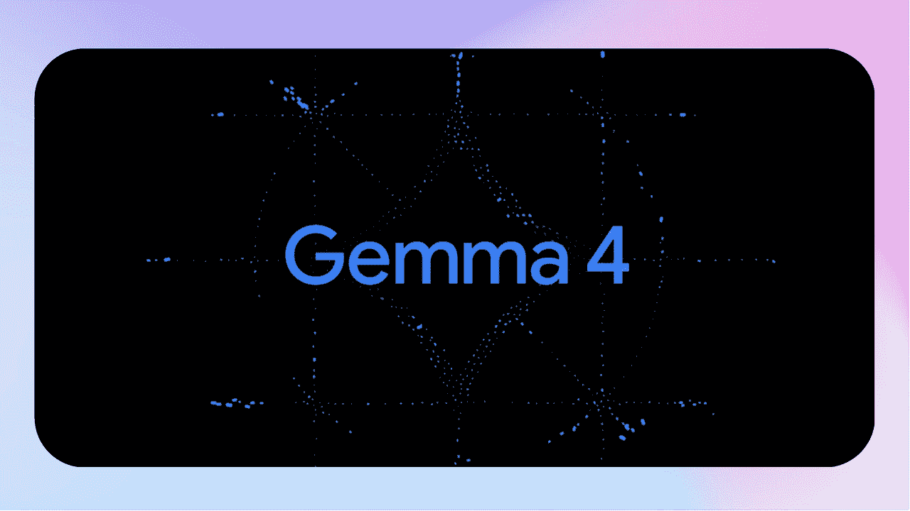

+   《[零基础如何构建你的第一个AI Agent——完整指南](https://waytoagi.feishu.cn/wiki/JsyFwEtAtibxJskilImcfhfUnVd?from=from_copylink)》本篇文章将从智能体框架、多智能体协同调度、智能体循环机制、工具调用、子智能体协作这几个方面一步步带你搭建出你的第一个真正意义上的AI Agent！

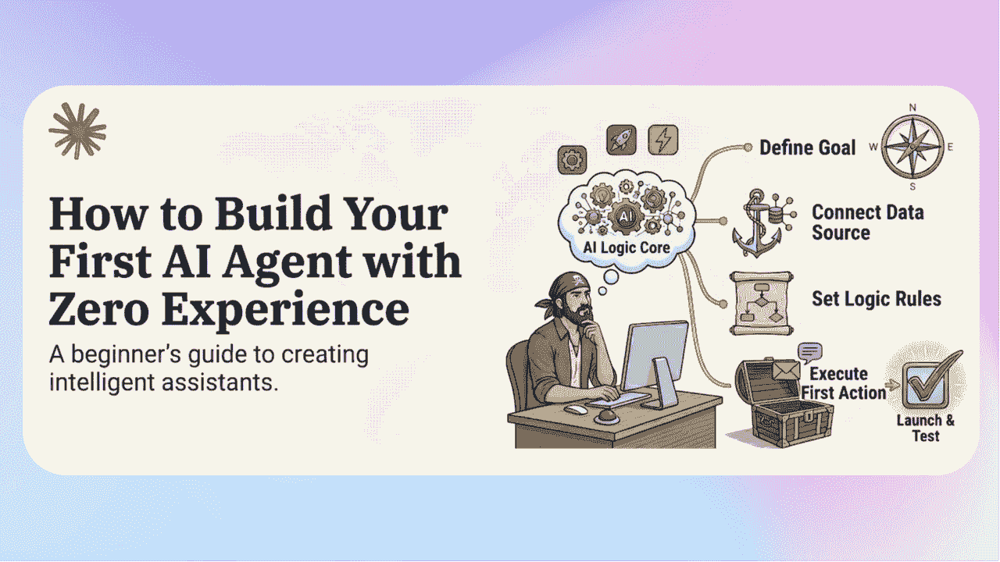

+   《[OpenAI 总裁 Greg Brockman：AI 自我改进、Super App 豪赌、通往 AGI 之路、算力扩张](https://waytoagi.feishu.cn/wiki/Veanw2x4QidHe7ksmqYcWxeFn4b?from=from_copylink)》OpenAI总裁访谈背后，藏着这家巨头的真实焦虑与战略赌局。砍掉Sora不只是技术聚焦，更是止损巨额烧钱与用户流失；即将推出的Super App想要整合聊天、编程与浏览器能力，意图打造统一 AI 入口，却直面微软与Anthropic的夹击。OpenAI 又将会如何应对？让我们来一探究竟！

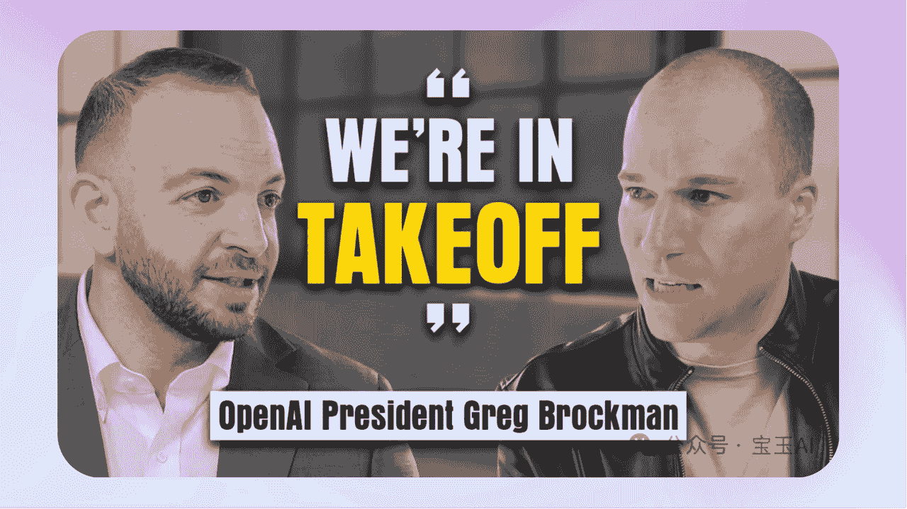

+   《[我做了一个精美 PDF 排版 Skill，以生成 100+ 页 Claude Code 系统报告为例](https://waytoagi.feishu.cn/wiki/ZfzSw4oidi1OJ1khFLzcGGbJnVe?from=from_copylink)》Claude Code 的完整源码被意外泄露，作者让Claude自己读自己的源码，做了一个精美PDF排版Skill，最终产出了一份超过 10 万字、覆盖 30+ 章节的深度技术报告。

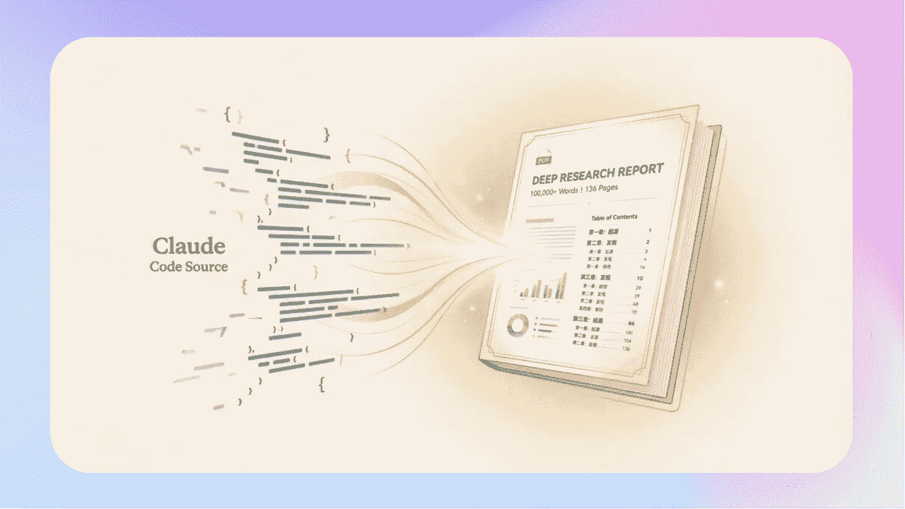

###  4 月 1 日

+   《[26年3月开源模型汇总！Agent很火，但模型貌似没跟上~](https://waytoagi.feishu.cn/wiki/GZFWwI4pGinY4FkTbxScNblJnud?from=from_copylink)》3月份，是OpenClaw制霸的一个月，各家主要以推出各种Claw为主，大模型这一块，超大尺寸的模型，基本上各家都是发布，但没更新，比如， 智谱的GLM5-Turbo模型 、 千问的Qwen3.5-Omni-Plus模型 、MiniMax的M2.7模型、 小米的MiMo-V2-Pro模型 等等。不过盘点下来，还是开源了不少模型，Qwen开源了3.5系列的小模型、美团开源了全模态和定理模型、腾讯开源了视觉&音频模型、📕开源了OCR&图像编辑模型。

+   《[Claude Code CLI 源码分析 : 从 Prompt 架构到工业级 AI Agent缓存黑科技+自我进化+多Agent协作+遥测监控](https://waytoagi.feishu.cn/wiki/EWgZw2kq3i8ZrIkFTIRcCn2vnKe?from=from_copylink)》Anthropic 这种量级的公司，他们会怎么设计 AI Agent？看完源码才发现，这不是“Prompt 工程”那么简单，而是 缓存架构 + 自我进化记忆 + 多模式编排 的完整基础设施。

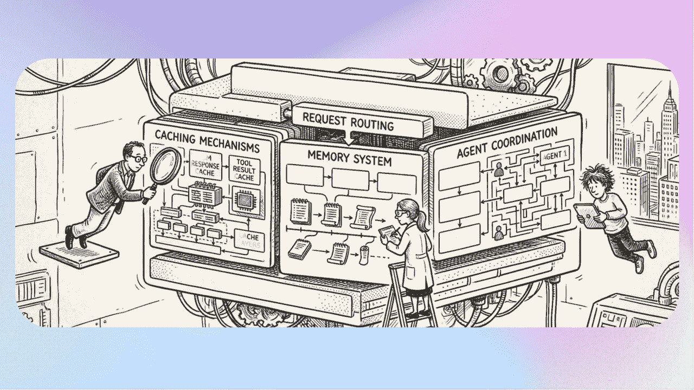

+   《[Claude Code 泄露代码隐藏的87个未发布功能 暴露其野心...](https://waytoagi.feishu.cn/wiki/PeSYwZR0kiiZmHkU6lccu1xAnZ0?from=from_copylink)》Claude Code 的完整源码泄漏后 有人说"44个隐藏feature flag"。小互翻完源码的实际数字是87个。让我们来一同看看这背后隐藏了哪些未上线的功能！

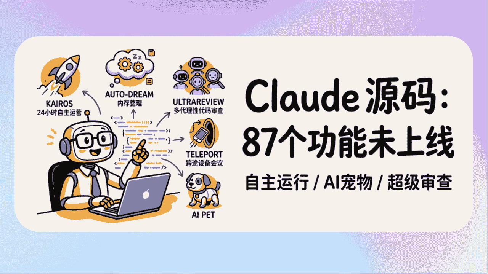

+   《[一文讲透如何构建Harness——六大组件全解析](https://waytoagi.feishu.cn/wiki/BgldwwYM4iOZTHkaSWBcxc2dnrd?from=from_copylink)》Agent = Model + Harness。 模型提供智能，Harness 让智能变得有用。这不是一个新概念，但它正在成为 2026 年 AI 工程领域最核心的共识。本文将从"裸模型的四个硬伤"出发，逐一拆解 Harness 的六大组件——文件系统、Bash + 沙箱、记忆（AGENTS.md）、Web Search + MCP、上下文工程、编排 + Hooks——带你看清 AI Agent 真正的竞争壁垒，不在模型层，而在 Harness 层。

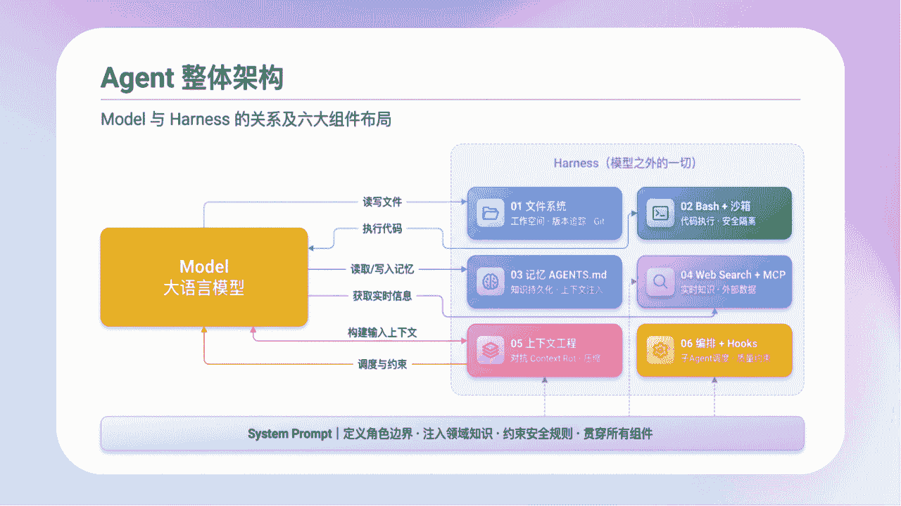

+   《[真开源！Claude Code75页橙皮书，带你从入门到精通](https://waytoagi.feishu.cn/wiki/Xc4gwuYxqio1vYkQArLc1rT8noe?from=from_copylink)》这份手册是作者和Claude Code一起写的。对，用CC写CC教程，它自己教你怎么用它。信息来源主要是Anthropic官方文档、Claude Code之父Boris Cherny的分享、吴恩达的Claude Code课程，再加上我自己用CC做了十几个产品踩过的坑。我用CC大半年了，每个月给Anthropic付200多美金（含税），烧过数十亿tokens，该踩的坑基本都踩了一遍。

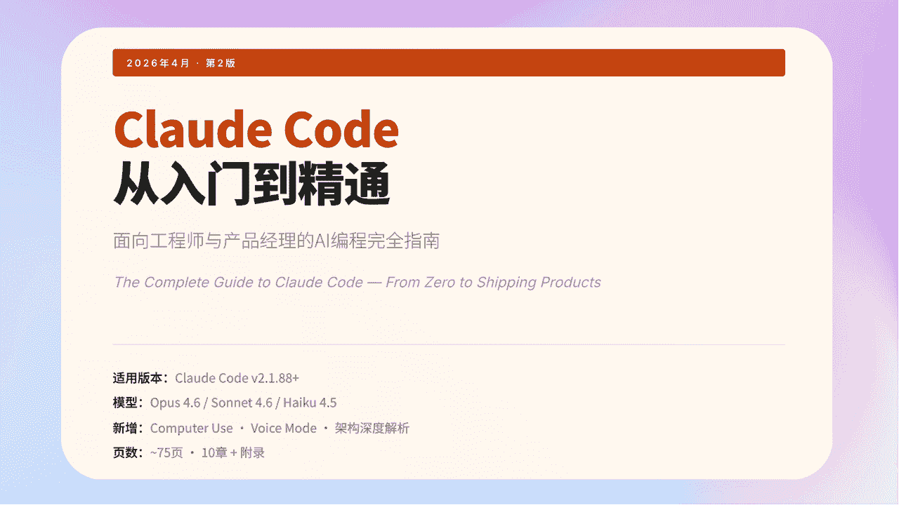

###

阅读更多：[4.4 历史更新](https://waytoagi.feishu.cn/wiki/FjiOwWp2giA7hRk6jjfcPioCnAc)

---

#   💬 飞书 & 🛰️交流群

#### **说明：**

1.  请填写下面问卷进群，群内会分享最新 AI 信息、社区活动；

1.  加入群后，欢迎大家积极分享，我们也会吸收进知识库，因为有你的参与才让知识库更加完善；

1.  飞书群内置 AI 智能机器人，可以回复任何与 AI 相关的问题，欢迎加入。

# 🏠加入WaytoAGI-填写后加入飞书/🛰️群

<https://waytoagi.feishu.cn/share/base/form/shrcnlIVMcuAn2jFHfJ2Bez7RWe?iframeFrom=docx&ccm_open=iframe>

---

# 🙏 友情推荐

1.  如果您对「飞书」这款效率工具感兴趣，或者您希望结交各行各业志同道合的朋友和他们交流企业/个人效率的提升，诚邀您访问「飞书官方社区——飞行社」

<https://www.feishu.cn/community?from=AGIknowledge>

1.  如需下载研究报告，我们[诚邀您加入知识星球](https://t.zsxq.com/18DnZxlrl)：

+   数百份涵盖 AI 各个方面的报告，并提供内容概要

+   自 2023 年上半年建立以来，保持长期活跃更新

+   扫码右侧二维码，加入知识星球

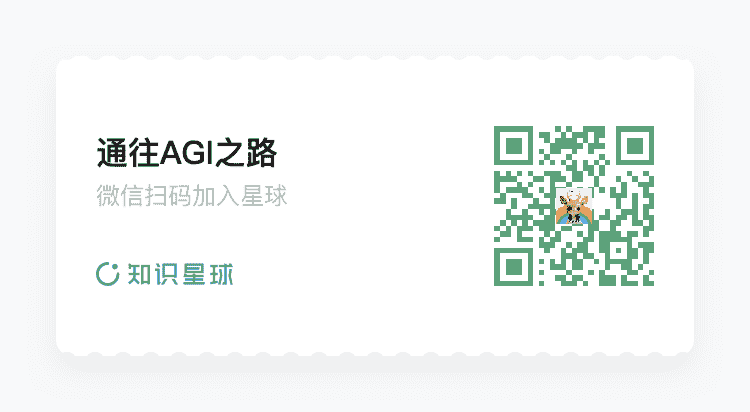

更多 [合作与咨询](https://waytoagi.feishu.cn/wiki/Wj77wBWjbi0yUAkyJWdc2TKFnmd)

# 👬 社区好朋友

[AIGC 周刊](https://quail.ink/op7418/)

歸臧整理的 AIGC 周刊

关注 AI 的朋友每周必读

[万能的小七姐](https://vxc3hj17dym.feishu.cn/wiki/RxnSw84QIiC63KkBrofc2altnuf?from=from_copylink)

连续创业者

Prompt 版块共建者

[硬地骇客](https://hardhacker.com/)

三位 10 年+创业者

[podwise 开发者](https://podwise.ai/)

[小互](https://weibo.com/u/1627825392)

「互联网的那点事」

🧣互联网观察家

ZHO

建筑师｜ComfyUI设计师

[野菩萨](https://www.xiaohongshu.com/user/profile/5513fe8ed39ea24fec6cf63b)

AIGC 社区野神殿创始人

[AI 艺术探索者](https://mp.weixin.qq.com/s/V7qEudwKzZy1-vqiKz3xDg)

赛博禅心

最新最快的 AI 资讯

作者大聪明

张蔚

华兴资本经理

架构和投资版块共建者

[向阳乔木](https://www.qiaomu.pro/)

热爱分享，永远好奇

AI 高质量社群组织者

汗青

产品经理｜AI设计师

[麦橘](https://www.xiaohongshu.com/user/profile/61d141f100000000210230d1)

麦乐园 MAILAND

𝐦𝐚𝐣𝐢𝐜𝐌𝐈𝐗模型的作者

[orange](https://twitter.com/oran_ge)

AI 领域产品经理

充满好奇心

[Web3 天空之城](https://space.bilibili.com/351754674)

推荐 B 站与🛰️👸号

高质量 AI 内容原创者

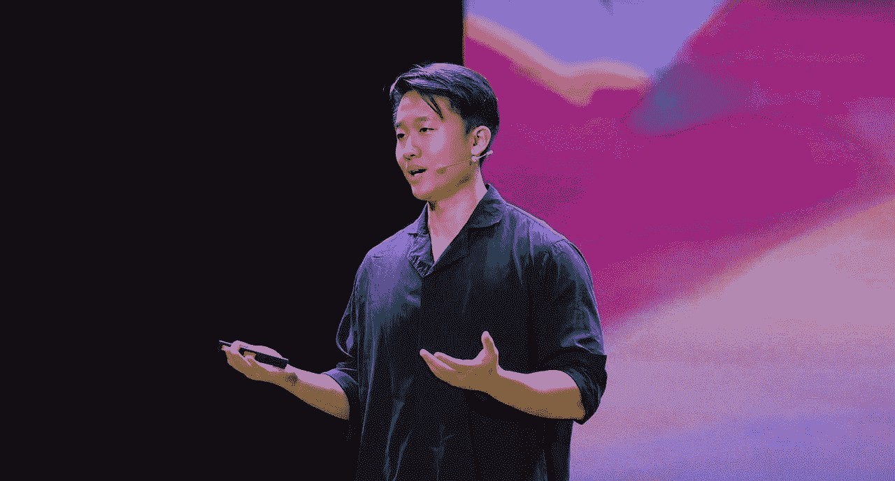

[Ragnar 瑞哥那](https://a135e91cro.feishu.cn/docx/JGWRdRlCNoa2yTxFSIMciotwnqe?from=from_copylink)

Base 上海 AI 商业社群

TEDx AI 演讲嘉宾

海辛

AI艺术家

[三思](https://www.xiaohongshu.com/user/profile/5cfd0e600000000016029764)

AI 数字艺术家

视觉设计师

[INDIGO TALK](https://www.xiaoyuzhoufm.com/podcast/62bbe7a66bad6a3c0c6222d3)

INDIGO 数字镜像播客

逻辑严谨、思考深入

[云中江树](http://feishu.langgpt.ai/)

AI 算法工程师

LangGPT 项目作者

陈财猫

Prompt Engineer

《进阶提示工程入门》

阿文

AI艺术家

[白马少年](https://mp.weixin.qq.com/s/UrMoEdntEX_Be3b5rhNPlw)

AI视觉设计师

Mr. 喜

ComfyUI设计师

汤团猪

ComfyUI设计师

[锐童学](https://waytoagi.feishu.cn/wiki/Tg24wLMX0iKwnik4prjcP6hKnVe)

AI艺术家

[唐百万](https://www.xiaohongshu.com/user/profile/5bb4de8459b9bf0001947966)

AI数字艺术家广告创意人

Snap

ComfyUI设计师

guahunyo

ComfyUI设计师

科林

ComfyUI开发设计师

OU椰🥥冬

ComfyUI设计师

🌱郭佑萌

ComfyUI设计师

Rui

ComfyUI设计师

trance

ComfyUI设计师

电子酒

AI春晚导演

---

# 😊 我应该从哪里开始？

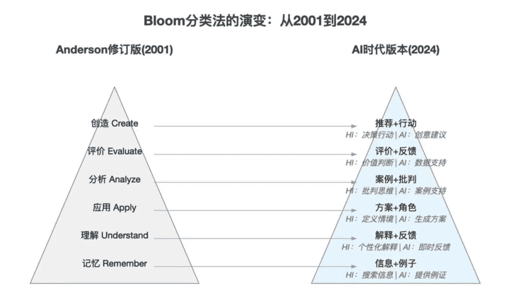

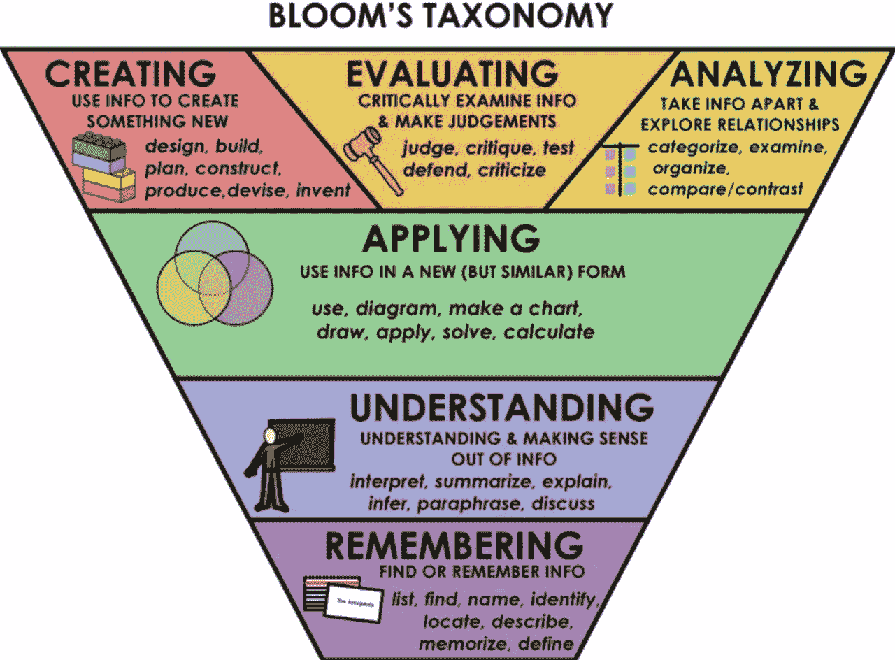

### 推荐布鲁姆分类法学习路径

1.  **记忆**：先从[ AI 的历史](https://ywh1bkansf.feishu.cn/wiki/PFXnwBTsEiGwGGk2🐧FcdTWrnlb?table=tbl1tOC3ZKbrcHVn&view=vewTtypUZc)、[基本术语](https://ywh1bkansf.feishu.cn/wiki/PFXnwBTsEiGwGGk2🐧FcdTWrnlb?table=tbltvr7KExCt7Jpw&view=vewjxk9tDu)、[重要人物](https://ywh1bkansf.feishu.cn/wiki/PFXnwBTsEiGwGGk2🐧FcdTWrnlb?table=tblLtN12KuvP5reO&view=vewuvGBXhd)、[方法和原理](https://ywh1bkansf.feishu.cn/wiki/PFXnwBTsEiGwGGk2🐧FcdTWrnlb?table=tblolGx2mprs1EQz&view=vewx5ROYtl)等开始了解，看看[入门课程](https://waytoagi.feishu.cn/wiki/ZYtkwJQSJiLa5rkMF5scEN4Onhd?table=tblWqPFOvA24Jv6X&view=veweFm2l9w)

1.  **理解**：进一步了解 AI 领域的[主要思想和概念](https://ywh1bkansf.feishu.cn/wiki/PFXnwBTsEiGwGGk2🐧FcdTWrnlb?table=tblC69kVi8xZMQ4B&view=vewFgR7hhS)，将[精选 AI 网站](https://ywh1bkansf.feishu.cn/wiki/BVmWwpSJGioFyJkfAI3crXWTnyb?table=tblrU3QwceYkyu5Y&view=vewhpVxSzR)和[ APP 产品](https://ywh1bkansf.feishu.cn/wiki/BVmWwpSJGioFyJkfAI3crXWTnyb?table=tblLFKWXaBNu2RC8&view=vewDRCDZJH)都试一试

1.  **应用**：深入[了解 Prompt](https://ywh1bkansf.feishu.cn/wiki/Q5mXww4rriujFFkFQOzc8uIsnah?table=tbldSgFt2xNUDNAz&view=vewo2g2ktO)，选择适合自己的[ AI 对话](https://ywh1bkansf.feishu.cn/wiki/QddLw0teKi7nUCkDRIecskn3nuc)、[绘画](https://ywh1bkansf.feishu.cn/wiki/Q5ddwxfkMiVUZBkQXN7cgXf4nOb)和[语音](https://ywh1bkansf.feishu.cn/wiki/ZXPiw2OuLi2YsxkkmaLcPTyInrc)产品，每天都用它，并使用[它们来解决实际问题或提升效率](https://waytoagi.feishu.cn/wiki/A0Y0wpBOcig7HLkSFNcceTA6nwb)

1.  **分析**：大量阅读[各类文章](https://ywh1bkansf.feishu.cn/wiki/YjJgwbKnriZBZ0kVn6Kc1gSKnsf?table=tblsQKR3a22uFqsp)、[视频](https://ywh1bkansf.feishu.cn/wiki/LEnvwwEy0iufT3k4kfVc8Ehenvf?table=tbllpoPWJn6MNOR6&view=vew68BlUHo)以及[行业报告](https://ywh1bkansf.feishu.cn/wiki/FnXcwGrwSimQxnkNo1kcJzPYn7f)，理解各知识之间的关系

1.  **评价**：通过[各类课程](https://waytoagi.feishu.cn/wiki/ZYtkwJQSJiLa5rkMF5scEN4Onhd?table=tblWqPFOvA24Jv6X&view=veweFm2l9w)与[书籍](https://ywh1bkansf.feishu.cn/wiki/PFXnwBTsEiGwGGk2🐧FcdTWrnlb?table=tbl2sA7TLn8L4uYp&view=vewjfsOgyJ)更深入学习，判断信息的价值、提出自己的观点和论证

1.  **创造**：积极参与[社区共创项目](https://waytoagi.feishu.cn/wiki/KexVwLKhYiHm7bk2IL9cym0WnTb)，创造你自己的新想法或产品

---

# 🧭 快速导航

### 0. 起点

💾 人[工智能简史 ](https://ywh1bkansf.feishu.cn/wiki/PFXnwBTsEiGwGGk2🐧FcdTWrnlb?table=tbl1tOC3ZKbrcHVn&view=vewTtypUZc)& A[I 绘画简史](https://ywh1bkansf.feishu.cn/wiki/PFXnwBTsEiGwGGk2🐧FcdTWrnlb?table=tblbBhy4ig3JTr5z&view=vewTtypUZc)

📝 10 篇从 0 到 1 的文章

🤔 1[0 篇深度文章](https://ywh1bkansf.feishu.cn/wiki/PFXnwBTsEiGwGGk2🐧FcdTWrnlb?table=tblC69kVi8xZMQ4B&view=vewFgR7hhS)

🧑‍🏫 10[ 个重要人物 &](https://ywh1bkansf.feishu.cn/wiki/PFXnwBTsEiGwGGk2🐧FcdTWrnlb?table=tblLtN12KuvP5reO&view=vewuvGBXhd) 10[0 位领军人物](https://waytoagi.feishu.cn/wiki/PFXnwBTsEiGwGGk2🐧FcdTWrnlb?table=tblPSIB8sJSwq8bb&view=vewuvGBXhd)

👄 言[之有物 | 金句引用](https://ywh1bkansf.feishu.cn/wiki/PFXnwBTsEiGwGGk2🐧FcdTWrnlb?table=tblnGZ55rkjJxQKJ&view=vewa05IP7l)

🗃 8[0+名词解释](https://ywh1bkansf.feishu.cn/wiki/PFXnwBTsEiGwGGk2🐧FcdTWrnlb?table=tbltvr7KExCt7Jpw&view=vewjxk9tDu)

📚 2[0 本 AI 中文书籍](https://ywh1bkansf.feishu.cn/wiki/PFXnwBTsEiGwGGk2🐧FcdTWrnlb?table=tbl2sA7TLn8L4uYp&view=vewjfsOgyJ)

📖 豆[瓣 9 分以上的英文书籍](https://ywh1bkansf.feishu.cn/wiki/PFXnwBTsEiGwGGk2🐧FcdTWrnlb?table=tblgNFDO4ySr9ks7&view=vewjfsOgyJ)

🎬 豆[瓣 8 分以上的 AI 电影](https://ywh1bkansf.feishu.cn/wiki/PFXnwBTsEiGwGGk2🐧FcdTWrnlb?table=tblB56vIgfZImxP2&view=vewUunvDn1)

🖼 一[图胜千言 | AI 好图分享 ](https://ywh1bkansf.feishu.cn/wiki/PFXnwBTsEiGwGGk2🐧FcdTWrnlb?table=tblyh76bHrCi4PXq&view=vewUunvDn1)

### 1. AI 入门系列

> 陆奇：未来，唯一有价值的是你有多大见解

🛣 A[I 学习路径推荐](https://ywh1bkansf.feishu.cn/wiki/RJofwtPcci6YMJkzBP2cRFFOnIR)

🗄 a16z 整理的 AI 典藏文章

💬 P[rompt 最佳实践](https://waytoagi.feishu.cn/wiki/NbqXwHXrkiYWKVkFTbmcwxQqntb)

🔥 G[PTs：构建你的 AI 助理](https://waytoagi.feishu.cn/wiki/IawKwd3IgiHbezkB1KrcAFPRnbf)

[💬 ChatGPT 入门](https://ywh1bkansf.feishu.cn/wiki/QddLw0teKi7nUCkDRIecskn3nuc)

[🧭 ChatGPT 官方指南](https://ywh1bkansf.feishu.cn/wiki/As6FwBSktiDMDGkTKOXcqq6snKc)

🎨 A[I 绘画入门 ](https://ywh1bkansf.feishu.cn/wiki/Q5ddwxfkMiVUZBkQXN7cgXf4nOb)& 必[须关注的博主](https://waytoagi.feishu.cn/wiki/NuRCwmGfyig1QWk4VNmcH0NcnUc)

🎵 A[I 语音与数字人初探](https://waytoagi.feishu.cn/wiki/IOO6wQKDKiMrmzk1oDxcGFpFnFh)

### 2. AI 精选系列

> 不要让 AI 代替你思考，而是让 AI 激发你思考

[🌐 AI 网站精选 ](https://ywh1bkansf.feishu.cn/wiki/BVmWwpSJGioFyJkfAI3crXWTnyb?table=tbl9F9lhTKPbNhRR&view=vew9VrzWWo)

📺 A[I 视频精选](https://ywh1bkansf.feishu.cn/wiki/LEnvwwEy0iufT3k4kfVc8Ehenvf?table=tbllpoPWJn6MNOR6&view=vew68BlUHo)

📻 A[I 播客精选](https://ywh1bkansf.feishu.cn/wiki/LEnvwwEy0iufT3k4kfVc8Ehenvf?table=tblj6NXbS3ftRrCM&view=vew1fNFZic)

⚖ [全球 AI 法规手册](https://waytoagi.feishu.cn/wiki/ZvMawDHnUik6TIk10HXccVpdnac)

📃 A[I 资讯与论文精选](https://waytoagi.feishu.cn/wiki/YjJgwbKnriZBZ0kVn6Kc1gSKnsf?table=tbltxLmczQ0fdHaN&view=vewuqMbDMU)

📔 A[I 研究报告精选](https://waytoagi.feishu.cn/wiki/WvhZwk16WiEnSvk8AcpcdZetnMe?table=ldxthSdnltXbtSvg)

[🎓 教程与学习手册精选](https://waytoagi.feishu.cn/wiki/ZYtkwJQSJiLa5rkMF5scEN4Onhd?table=tblenNiaJkoTiQDQ&view=vewZ12GaXz)

🛠 资[源与项目精选](https://waytoagi.feishu.cn/wiki/YjJgwbKnriZBZ0kVn6Kc1gSKnsf?table=tblMw78mOVBQs22X&view=vewU1XdpuK)

### 3. AI 应用与前沿

> Sam Altman：不要小打小闹，要干就干大事，满怀希望地去行动

🛠 AI 实际应用的案例（工作/学习/生活...)

🧰 辅[助学习工具精选](https://waytoagi.feishu.cn/wiki/FVGfwjMtriTDUvkwqvwcYisongh?table=tblp81WDObH3I20H&view=vewM2PB3Iu)

🤩 小[互每日观察动态](https://waytoagi.feishu.cn/wiki/T2fUwmHBSiHU6Ukq9Imcu7n7nMh)

🤹 A[I Agents 入门文章 ](https://waytoagi.feishu.cn/wiki/XGEzwjiJTiAr83kbHlgceRHxnwc?table=tbl3t7DVsBk7zOxV&view=vewBk3R2Jb)& 精[选项目](https://waytoagi.feishu.cn/wiki/KdN2wM9fSiw6RBkTcyWcFrfJnOf?table=tblMk8RPhVaSzmSF&view=vewrtQbBai)

[🤖 A](https://waytoagi.feishu.cn/wiki/XGEzwjiJTiAr83kbHlgceRHxnwc?table=tbl3t7DVsBk7zOxV&view=vewBk3R2Jb)[I 与机器人相关文章](https://waytoagi.feishu.cn/wiki/HvinwkBD3ii0rkkUazVcfaGqnZc?table=tblADfqTsdQoEpel&view=vewBQjDoAv)

💰 中[国 AI 生态投资地图](https://waytoagi.feishu.cn/wiki/ZcRRwwkXvia2TPk29PGcO5cEnkf)

---

# 📅 周刊与兴趣小组

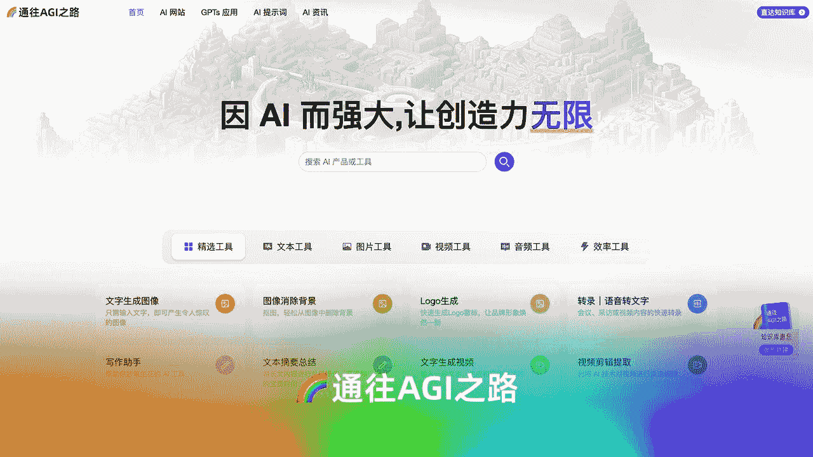

[WaytoAGI.com 网站](http://www.waytoagi.com)

内置知识库 AI 助手

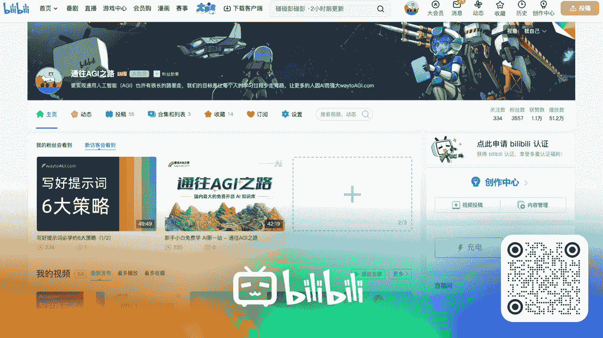

[B 站｜Bilibili](https://space.bilibili.com/259768893)

以视频普及 AI 知识

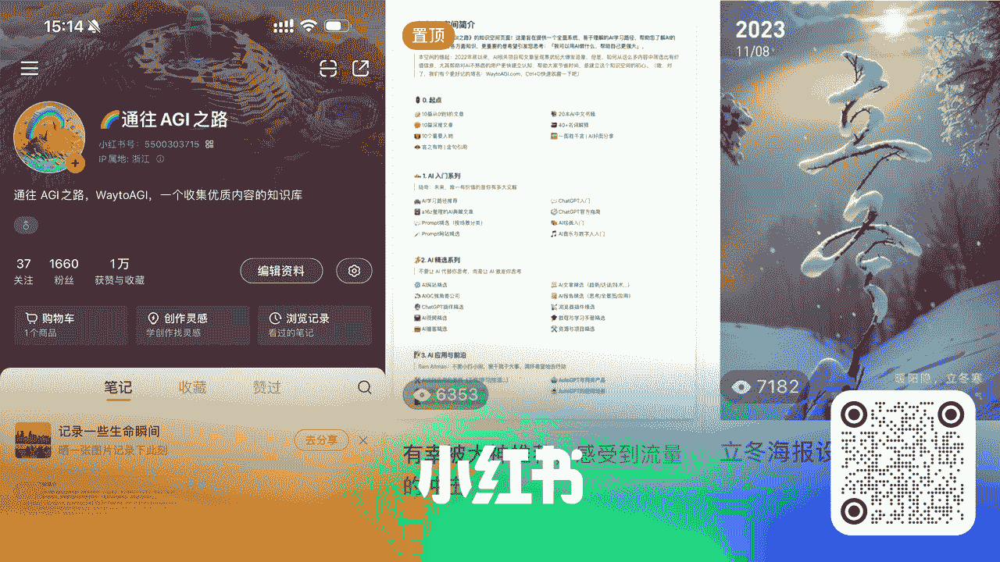

[📕](https://www.xiaohongshu.com/user/profile/6457d2e4000000001f030dbe)

AI 消息及时传递

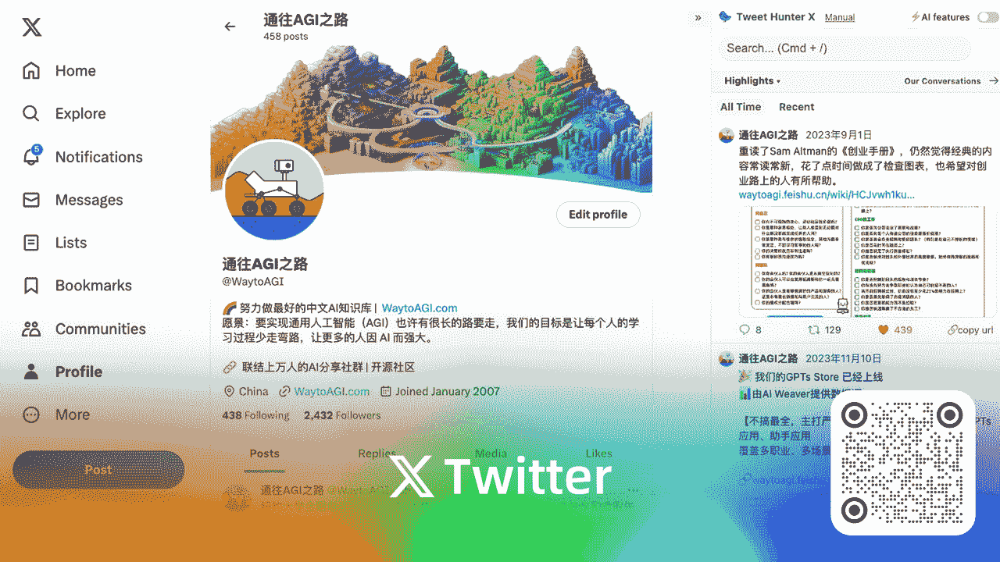

[ X ｜ Twitter](https://twitter.com/WaytoAGI)

知识库精选内容同步

有小伙伴说：WaytoAGI 像个大学城，各个群就是兴趣社团，都是小伙伴们即兴发起的，也欢迎你来参与和发起。

|  | 要求 | 进群方式 | 备注 |
| --- | --- | --- | --- |
| 🌈 AI 音乐之路 | 热爱音乐 |  | 添加左侧🛰️ |
| 🌈 关键词学社 | AI 绘画群：一起根据群中的每天给出的关键词，通过出图测试关键词效果，有 Midjourney 账号，喜欢 AI 绘画即可。进群请加 大狐，把你拉进群 |  | 添加左侧飞书群  备注：关键词学社 |
| 🌈 SD 学社 | 学习 Stable diffusion 的相关操作和每周两个案例实操，申请链接 |  | 添加左侧飞书群  备注：SD 学社 |
| 🌈 AI 视频学社 | 至少参加一次活动或出图（其实很简单，都有教程，可以尝试动手一下出一张图就可以进群 pk） |  | 添加左侧🛰️  备注：视频学社 |
| 🌈 🛰️机器人搭建 | [熊猫大侠：基于COW框架的ChatBot实现步骤](https://waytoagi.feishu.cn/wiki/YNNuwEqCXiSj2akS5mlcjpZgnrb) |  | 添加左侧🛰️  备注：机器人 |
| 🌈  AI编程 | [2.0 AI 开发](https://waytoagi.feishu.cn/wiki/Pxj8wsMmOii7ZSkN0mYc8xdtnHb) |  | 添加左侧🛰️  备注：编程 |

<https://www.feishu.cn/community/articles/wiki?from=AGIknowledge>

---

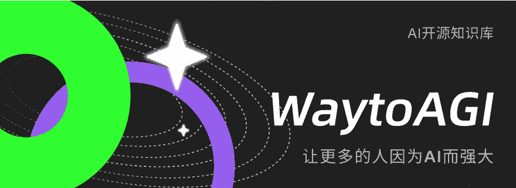

[🤖入门AI学习路径](https://waytoagi.feishu.cn/wiki/RJofwtPcci6YMJkzBP2cRFFOnIR)

[💬Prompt（提示词）](https://waytoagi.feishu.cn/wiki/Q5mXww4rriujFFkFQOzc8uIsnah?table=tbldSgFt2xNUDNAz&view=vewo2g2ktO)

🧠A[I Agents（智能体）](https://waytoagi.feishu.cn/wiki/GFS0wJB78izVBmk3LVgcCn2MnCh)

[🎨AI 绘画](https://waytoagi.feishu.cn/wiki/Q5ddwxfkMiVUZBkQXN7cgXf4nOb)

[🎬AI 视频](https://waytoagi.feishu.cn/wiki/SPXQwl5TXiau0mkKb1zcqHxVnEm)

[🎶AI 音乐](https://waytoagi.feishu.cn/wiki/P7N8wwy0tirs79klAgJc6FlCn0d)

[🎙️AI数字人+语音合成](https://waytoagi.feishu.cn/wiki/IOO6wQKDKiMrmzk1oDxcGFpFnFh)

[🏗️AI 3D](https://waytoagi.feishu.cn/wiki/TRJEwdbQEiJjvykq8nJc6juvn6g)

[🔄ComfyUI工作流](https://waytoagi.feishu.cn/wiki/AxZPwElC6iZ0aqk2hjOcI3Y9nFg)

[👩‍💻AI开发](https://waytoagi.feishu.cn/wiki/Pxj8wsMmOii7ZSkN0mYc8xdtnHb)

[📅社区共学日历](https://waytoagi.feishu.cn/wiki/UET1wIVi7i8DhSkriNBcIHEKnmc?table=tblHgpm6a5ric3KB&view=vewxxF51yJ)

[🐻社区共创项目](https://waytoagi.feishu.cn/wiki/KexVwLKhYiHm7bk2IL9cym0WnTb?table=tblHgpm6a5ric3KB&view=vewxxF51yJ)

# 🎯  愿景和目标

> 要实现通用人工智能（AGI）也许有很长的路要走，

> 我们的目标是让每个人的学习过程少走弯路，让更多的人因 AI 而强大。

# [🌈  去官网 ](https://www.waytoagi.com/zh)

# [📖  返回知识库 ](https://waytoagi.feishu.cn/wiki/QPe5w5g7UisbEkkow8XcDmOpn8e)