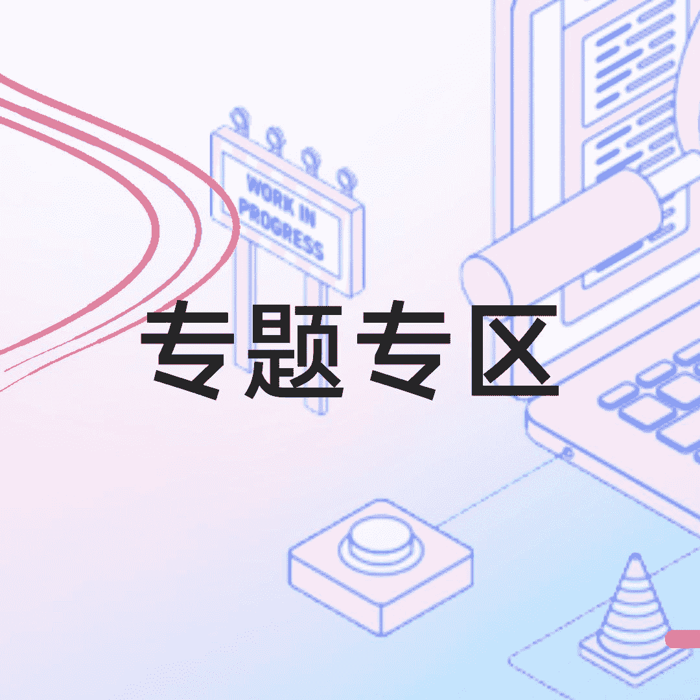
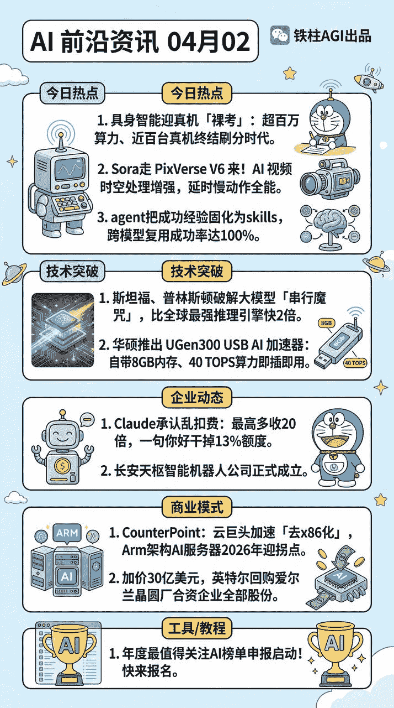
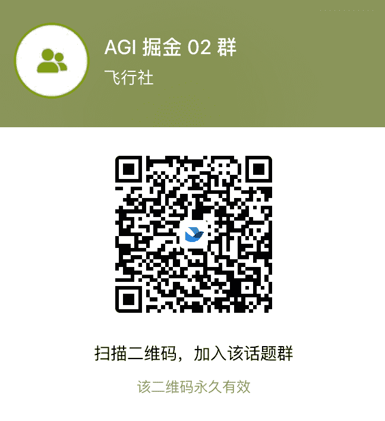

# AGI 掘金知识库

> 来源：[https://my.feishu.cn/docx/Y088dI4GToZ2vGxGOqZcy2MonCh](https://my.feishu.cn/docx/Y088dI4GToZ2vGxGOqZcy2MonCh)

# 💎 欢迎来到 AGI 掘金

> AGI 掘金知识库开始于 2024 年 7 月，是一家专注于 AGI 相关研究和应用的创新型知识平台。我们的使命是推动 AGI 技术和 AI 应用的落地与发展，并将其应用于各个行业，为人类社会创造更大的价值。我们提供 AGI 技术最新讯息、应用解决方案、组织各种有趣的服务，致力于成为行业的领军者。AGI 掘金期待你的加入！

> 知识库地址：[AGI 掘金知识库](https://km3dl0ffdl.feishu.cn/wiki/UvJPwhfkiitMzhkhEfycUnS9nAm?fromScene=spaceOverview)

> Captain 邀请你加入[飞书群](https://applink.feishu.cn/client/chat/chatter/add_by_link?link_token=1een0752-e36a-4d11-8aa6-677b0c33de0d)，快点击加入吧！

# ⚗️ 愿景

> 致力于让 AI 技术触手可及，为每位 AI 爱好者提供个性化的知识和工具。

> 通过持续创新和跨界合作，构建一个开放共享的 AGI 学习系统，让每个人都能参与并受益于 AGI 革命。

# 🪩 知识库主要内容

[**每天 AI 快报**](https://km3dl0ffdl.feishu.cn/wiki/UvJPwhfkiitMzhkhEfycUnS9nAm#CHp1d6NJWoNrzXx16CecclYxnze)

[**热门应用排行榜**](https://km3dl0ffdl.feishu.cn/wiki/A4Hhwzl7tijUppkvqNcc69SHnpH)

[**学术研究更新**](https://agijuejin.feishu.cn/wiki/YfAHwRoGwitjbAkMKfgc3XEinfg)

[**AI 基础学习**](https://km3dl0ffdl.feishu.cn/wiki/JEWpwDijZihVwGkcW9AcO8OendA)

[**技术干货学习**](https://km3dl0ffdl.feishu.cn/wiki/PFKCw7lUAifSi1kQaCxc30Fxn0e)

[**智能体学习**](https://agijuejin.feishu.cn/wiki/JUSPw6EDZiVpKckRLUicc1iAnOg)

[**技术前沿应用**](https://agijuejin.feishu.cn/wiki/EtoiwSfomiHnmukOCDncsdnenYd)

[**行业热点和应用**](https://km3dl0ffdl.feishu.cn/wiki/SW3dwTLmmits1TkWujfc5juenlu)

[**报告资源下载**](https://agijuejin.feishu.cn/wiki/JRM4wpD8rieLM8kUWRacNDY9nAb)

[**AI Coding编程**](https://agijuejin.feishu.cn/wiki/E5tmwojbjiOPipkgsS3cEAUknvc)

[**Deepseek专区**](https://agijuejin.feishu.cn/wiki/BAghw0NywidpvIkQpdPcZ2eZnzT)

（以上正在更新中）

# [2.2 AI Coding 编程](https://agijuejin.feishu.cn/wiki/E5tmwojbjiOPipkgsS3cEAUknvc)‍💻 AI Coding 编程专区（正在更新中）

[Trae.ai](https://agijuejin.feishu.cn/wiki/MN7bwMqcHiAX48kXRsHc3R1qnOd)[基础入门](https://agijuejin.feishu.cn/wiki/OSZbw3sZ6iVOBkkxIkAcFKPNnNa)[进阶](https://agijuejin.feishu.cn/wiki/UzSvw4xHgiXjwhkf73SckKOBnub)

[应用开发](https://agijuejin.feishu.cn/wiki/T3RrwufoBimahIk6XCJc484vnLf)

[Cursor](https://agijuejin.feishu.cn/wiki/WXZawGl33ioUsGkBdfKcGvmynEe)

[基础介绍](https://agijuejin.feishu.cn/wiki/Mi0Swfv33iyVjmkImZQcDlornAe)

[进阶](https://agijuejin.feishu.cn/wiki/WY3PwA1kZiztbVkyjc6c6fBvn6g)

[应用开发](https://agijuejin.feishu.cn/wiki/F3GxwL7iMiVJQskPLJdc0T97nCc)

[豆包 MarsCode](https://agijuejin.feishu.cn/wiki/MeKAwnsB9i3FPEkHgnwc2ZOsnKb)

[基础介绍](https://agijuejin.feishu.cn/wiki/HCE6wnoQHiIAKvkRBOMcAgh7nKd)

[进阶](https://agijuejin.feishu.cn/wiki/Uh21wTvE4iMgTfk4UVrcKQvJnIf)

[应用开发](https://agijuejin.feishu.cn/wiki/HWBQwsFLkilSIikdaiDcVbJ4n0d)

[Windsurf](https://agijuejin.feishu.cn/wiki/Cil0wTee7iy9jGkVhArcwTTcntD)

[Bolt.new](https://agijuejin.feishu.cn/wiki/TF7gw7UWiiIvhakELjVc33h5nid)

[V0.dev](https://agijuejin.feishu.cn/wiki/TLsKwX2JziwHlskdxwacIcbgnUg)

[Devin](https://agijuejin.feishu.cn/wiki/XoWlwLdKIiRuLckWeCbctRgInjh)

# 💡 本周AGI 视界周刊 | 每周更新

> 每周，我们都会精选一周汇总 [AGI 掘金视界周刊第 11 期](https://agijuejin.feishu.cn/wiki/BJc5wQmT1iIUvakeGQtcIPaznJx)

> 过往汇总：[AGI 掘金视界周刊](https://agijuejin.feishu.cn/wiki/D8S6wWFvRiHHVNkeEmqc24aNncc)

# 🔑 AGI 洞察 | 不定期更新

> 这一模块提供对最新 AI 产品的深入分析，包括技术特点、市场表现和未来发展趋势。我们的专家团队将为您解读每一个产品的核心技术，并预测其在未来市场中的表现。

> 历史存档：[1.4 产品洞察](https://km3dl0ffdl.feishu.cn/wiki/If2bwJW9QiFGeBklFrzc2d56n4b?from=from_copylink)

# 🗒️ AI 快报推送

> **AI 快报历史****归档：**[2026 年 AI 快报历史归档](https://agijuejin.feishu.cn/wiki/DjLqwMCPuiq4utke9Ssc739Cnpc)

> [欢迎加入 AGI 掘金社群](https://applink.feishu.cn/client/chat/chatter/add_by_link?link_token=bd4t8bb8-3fc9-461f-b8b2-10c57e2ea62a)，申请进群的请详细介绍自己，否则可能不予通过。

> [欢迎加入 AGI 掘金社群](https://applink.larkoffice.com/client/chat/chatter/add_by_link?link_token=890h8ad3-71e6-4140-af64-39dff6b2ba1f)

---

### 🚀 技术突破

1.  EA[ID](https://mp.weixin.qq.com/s?__biz=MzA3MzI4MjgzMw==&mid=2651024977&idx=1&sn=54de96702b5aa4a41f10478815ac262b)C 终结具身智能刷分时代 (链接)：全球首届具身智能开发者大会通过72小时真机“裸考”检验模型，20支队伍在统一硬件与超百万算力支持下，于真实环境中完成套环、分拣、插线、拼词等任务，旨在推动开源生态与真实泛化能力。

1.  **SSD 破解大模型推理串行瓶颈** ([链接](https://mp.weixin.qq.com/s?__biz=MzA3MzI4MjgzMw==&mid=2651024977&idx=3&sn=0822e79ac232d10242b5f0c10689410b))：斯坦福、普林斯顿等团队提出SSD框架及SAGUARO算法，实现草拟与验证并行化，推理速度比当前最强引擎快2倍。

1.  **PixVerse V6 发布** ([链接](https://mp.weixin.qq.com/s?__biz=MzIzNjc1NzUzMw==&mid=2247879591&idx=1&sn=5aca906a42c51bb5e4aec7fa266aaa81))：爱诗科技推出AI视频模型PixVerse V6，实现电影级视听质感、复杂运镜控制与物理级真实还原，支持延时拍摄与慢动作，并推出团队计划与实时世界模型R1升级。

1.  **Agent固化技能跨模型复用** ([链接](https://mp.weixin.qq.com/s?__biz=MzIzNjc1NzUzMw==&mid=2247879591&idx=3&sn=dec29add1f405202592b1d9b6e6b54c7))：SkillCraft研究让Agent将成功工具链固化为可复用技能，显著提升效率并降低成本，高质量技能可跨模型复用，如Claude创建技能在其他模型上成功率100%。

1.  华硕[推全](https://www.ithome.com/0/935/125.htm)球首款 USB AI 加速器 (链接)：华硕推出全球首款支持经典与生成式AI的USB边缘AI加速器UGen300，搭载Hailo-10H处理器，提供40 TOPS算力、8GB内存，即插即用。

### 🏢 企业动态

1.  Cl[au](https://mp.weixin.qq.com/s?__biz=MzIzNjc1NzUzMw==&mid=2247879591&idx=2&sn=7d39b57cd592ec5702cab4147227f6a2)de Code 被曝乱扣费 (链接)：Anthropic 承认 Claude Code 计费存在严重问题，因缓存失效等 bug 导致用户使用额度被多扣 10-20 倍，一句“你好”即可消耗 13% 额度。

1.  An[th](https://www.ithome.com/0/935/132.htm)ropic 误删数千 GitHub 仓库 (链接)：在清理 Claude Code 源代码泄露时，因下架请求范围判断失误，导致约 8100 个仓库（含自身开源项目分支）被波及，引发用户不满。

1.  **长安天枢机器人公司成立** ([链接](https://www.ithome.com/0/935/084.htm))：长安汽车成立机器人公司，以“1+N+X”战略布局具身智能，发展人形机器人及多机器人产业，并计划三季度前用固态电池搭载机器人验证。

1.  鸿蒙[ 6](https://www.ithome.com/0/935/081.htm) 负一屏内测关联 Claw 智能体 (链接)：智慧助手内测版本支持关联 Claw 智能体，可提供 AI 任务完成提醒等服务，并新增晨间简报、AI 搜索等功能。

### 💼 商业模式

1.  **云巨头加速去 x86 化** ([链接](https://www.ithome.com/0/935/138.htm))：CounterPoint 预测 Arm 架构 AI 服务器 CPU 份额将从 2025 年的 25% 飙升至 2029 年的 90%，替代趋势将在 2026 年下半年显著加速。

1.  英特[尔加](https://www.ithome.com/0/935/106.htm)价30亿美元回购爱尔兰晶圆厂股份 (链接)：英特尔宣布以142亿美元从Apollo手中回购其爱尔兰Fab 34晶圆厂49%的股权，恢复完全控制，较2024年出售价高出30亿美元。

1.  天钡[ M](https://www.ithome.com/0/935/091.htm)ACO 47 迷你主机发售 (链接)：搭载 AMD 锐龙 AI 9 HX470 处理器，板载 32GB RAM，准系统版本首发价 5299 元。

### 🛠️ 工具/教程

1.  20[26](https://mp.weixin.qq.com/s?__biz=MzIzNjc1NzUzMw==&mid=2247879591&idx=4&sn=913e78fac93c3bfc4618f0bb3d387bd3)年度AIGC榜单申报启动 (链接)：量子位发起2026年度值得关注的AIGC企业与产品评选，申报截至4月27日，结果将于5月中国AIGC产业峰会公布。

# 🌈 大模型&热门应用排行榜”

> 在这里，我们展示 AGI 的热门榜单，展示市场最火最热应用和大模型相关性能排行。

> 点击查看更多数据详情：[2.1 AIGC应用榜](https://km3dl0ffdl.feishu.cn/wiki/A4Hhwzl7tijUppkvqNcc69SHnpH?table=blk6VoQ4vbxOLZKc)

### TOP200 热门应用榜单部分展示

### [**大模型排行榜：**](https://km3dl0ffdl.feishu.cn/wiki/A4Hhwzl7tijUppkvqNcc69SHnpH?table=blk6VoQ4vbxOLZKc)**（进入表格查看详情）**

# 🤝 加入社群

知识库地址：[AGI 掘金知识库](https://km3dl0ffdl.feishu.cn/wiki/UvJPwhfkiitMzhkhEfycUnS9nAm?fromScene=spaceOverview)

Captain 邀请你加入[飞书群](https://applink.feishu.cn/client/chat/chatter/add_by_link?link_token=1een0752-e36a-4d11-8aa6-677b0c33de0d)，快点击加入吧！

# ✍️ 友情链接

> 共建和合作联系：captain 🛰️号：229199157

# 🚀 社区共建者

**Captain**

AGI 平台组织者

wechat：229199157

**安仔**

架构师，创业 7 年

《Coze 从入门到实践》

掘金小册作者

**Ada**

KCI 创新咨询-管理顾问

[AI培训和智能体咨询服务](https://www.kciagent.com/)

[飞书AI 职场人学习知识库](https://sat2tjmapq6.feishu.cn/wiki/OoiWwxxd5iOE6tku9QzcrCDMnVe)

**云中江树**

AI 算法工程师

LangGPT 结构化提示词

板块共建者

**铁柱AGI**

👸号：铁柱AGI

wechat：AI_tiezhu

万象AI实验室技术支持

**煮酒四郎**

大模型排行榜共建者

**       ****蓝衣剑客**

AIGC思维火花创始人

WaytoAGI专栏作者

LangGPT核心成员

曾担任多个国家级标准、报告代表及顾问

> 更多资源点击：[1.1 行业报告](https://agijuejin.feishu.cn/wiki/JRM4wpD8rieLM8kUWRacNDY9nAb)