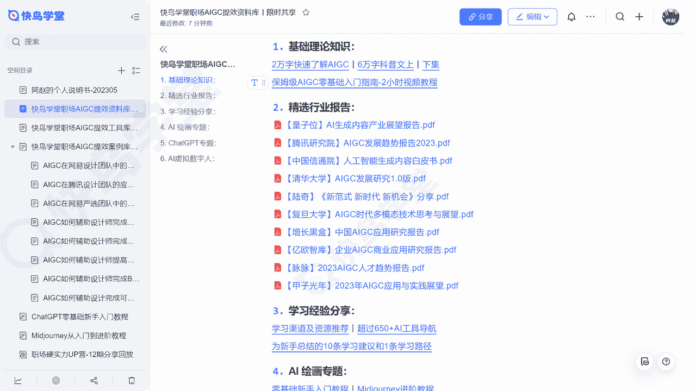
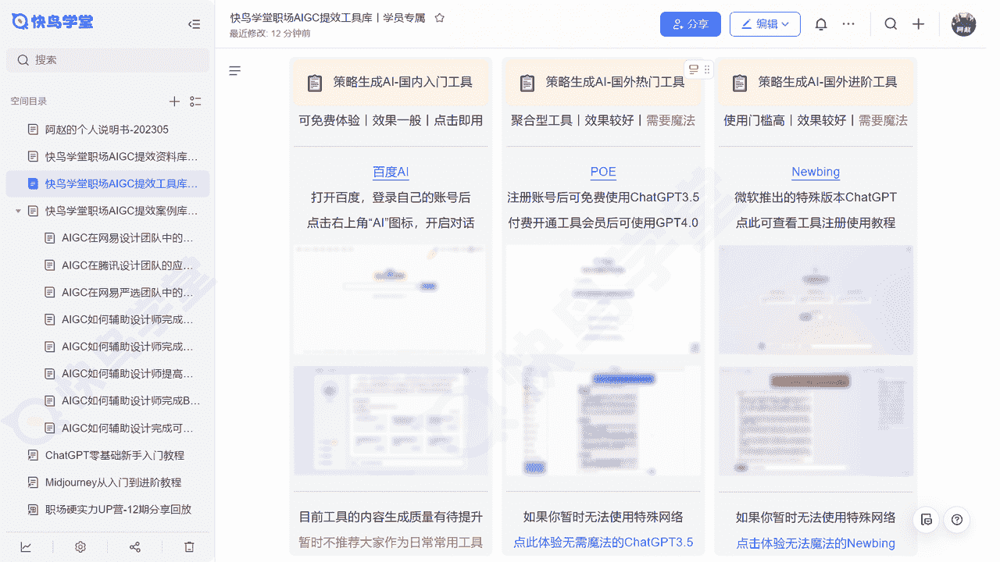
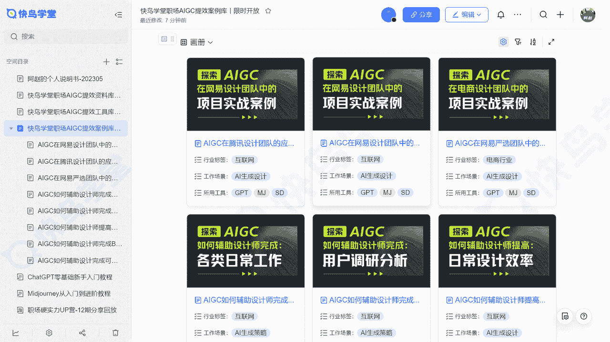
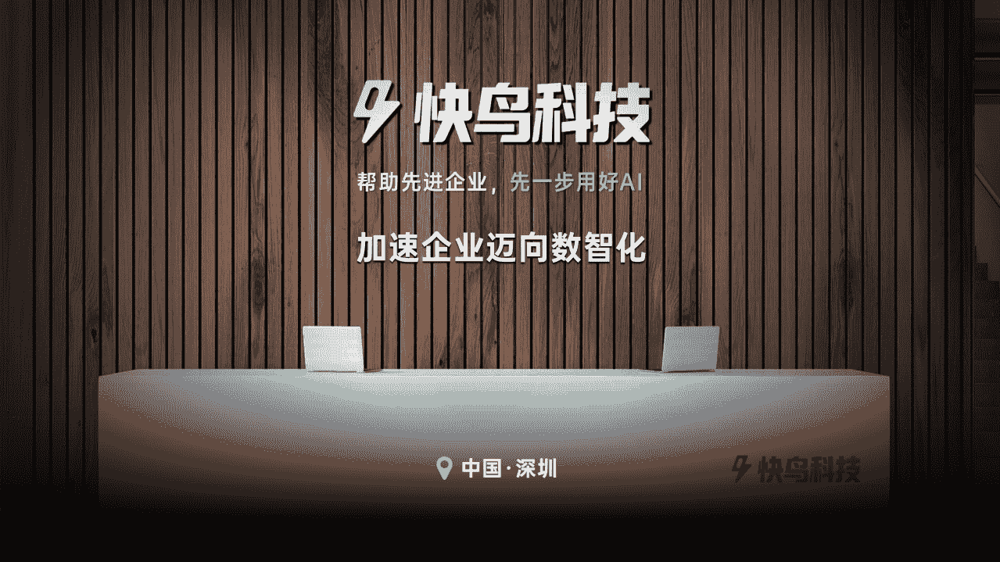
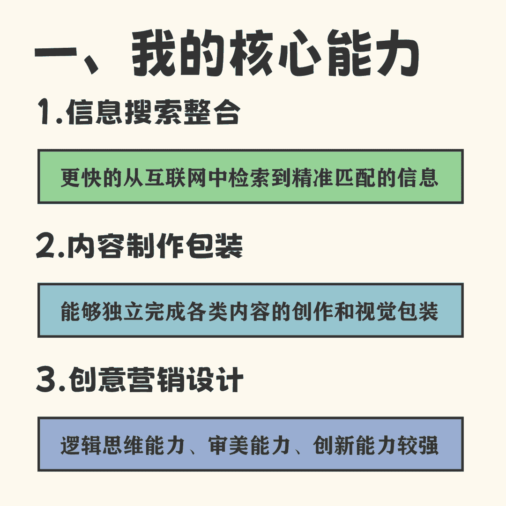
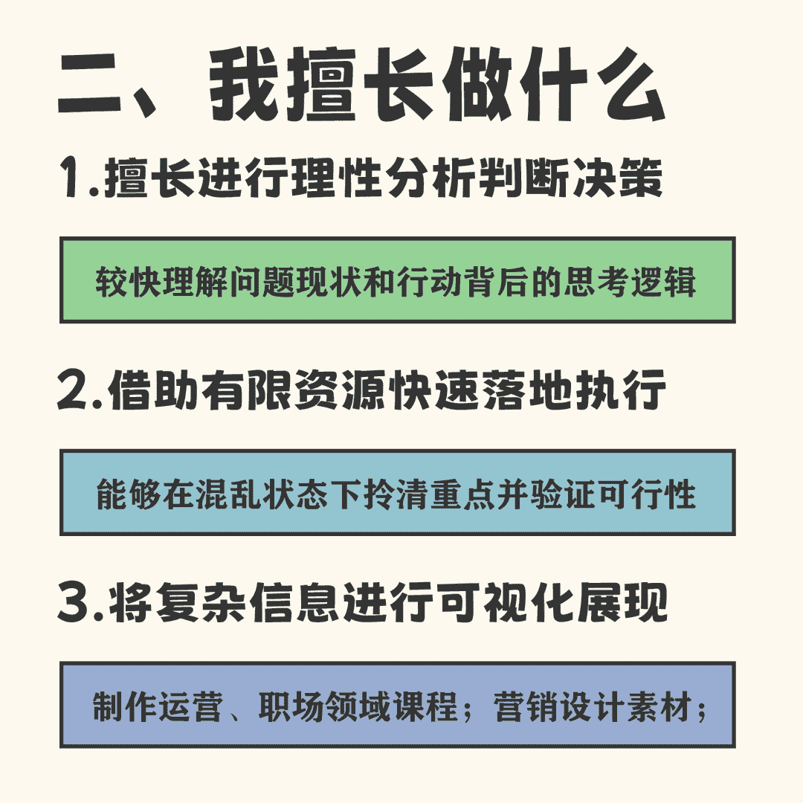
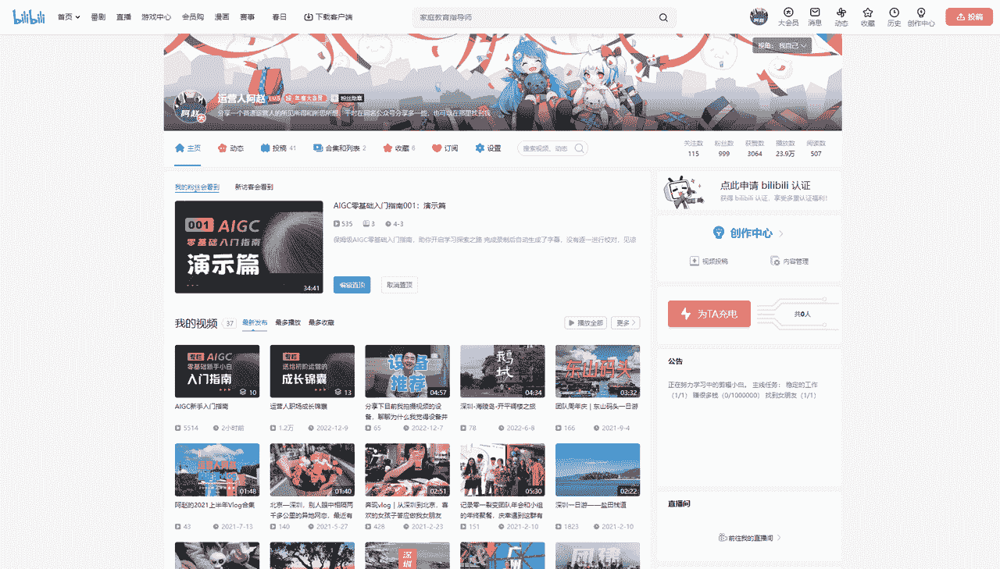

# 阿赵的知识库

# 阿赵的个人说明书

> 来源：[https://my.feishu.cn/docx/OlSJdhLzfoW0MFxOx0uc1jvln6T](https://my.feishu.cn/docx/OlSJdhLzfoW0MFxOx0uc1jvln6T)

> 哈喽，我是阿赵，希望这份个人介绍能够帮助你更快了解我，期待后续的沟通~

# 我的个人介绍：

> 快鸟科技创始人丨AI领域商业顾问

> 馒头商学院、深圳人社等合作导师

> 客户：欧莱雅、平安集团、创维等

> 擅长AI在企业营销环节的应用实践

> 线上AI学习教程已超过50万人学习

# 我的内容分享

> 公众号丨[B站](https://space.bilibili.com/21391009?spm_id_from=333.1007.0.0)丨[小红书](https://www.xiaohongshu.com/user/profile/61fdcb7a0000000010004f68?xsec_token=YBRG7o2sq281kkCcCgfpr6pUa47FH6LWM8SfSsxzUr92M%3D&xsec_source=app_share&xhsshare=CopyLink&appuid=61fdcb7a0000000010004f68&apptime=1743407634&share_id=a66b64066e30492e9e56c7ddd7c19621&share_channel=copy_link)丨抖音 账号名称：**阿赵的所见所得**

# 我的AI知识库

> 可前往：[阿赵的AI资料库](https://mq1nzy47gs.feishu.cn/wiki/IxFew33ruiHG7Skp115c0G2Pnsd)

> 可前往：[阿赵的AI工具库](https://mq1nzy47gs.feishu.cn/wiki/KHmYwQs9BipuPrkGcgPcRfH3njh)

> 可前往：[阿赵的AI](https://mq1nzy47gs.feishu.cn/wiki/GawxwZqvDimNLgkL4yzckMfpnph)[案例库](https://mq1nzy47gs.feishu.cn/wiki/GawxwZqvDimNLgkL4yzckMfpnph)

# 目前主要业务：

## 企业服务

> **主要通过培训、工具、咨询等**服务，帮助先进企业，先一步用好AI，详细业务介绍可查看下方刊例

[快鸟科技-帮助先进企业，先一步用好AI.pdf](https://internal-api-drive-stream.feishu.cn/space/api/box/stream/download/all/NQXybVKgjozvAzxiP33c6sFQnze)

# 我的能力优势和短板：

> 主要研究：AI如何更好的帮助企业经营提效和业务创新，如何更好进行落地应用实践

> 专业经验：**丰富的内容营销、产品运营经验**（用户增长、私域运营、视频号直播、营销SaaS工具等领域）

> 能力优势：不断提升的**设计审美、内容制作、学习能力，**较强的思维逻辑、项目统筹、落地执行能力

> 朋友评价：善于拆解复杂的问题、擅长把内容做得更吸引人、喜欢挑战更难的事情、持续分享所见所得

> **我不擅长的领域有很多，**也有很多缺点，在改善前，希望减少一些误会：

> **我不擅长维系关系，有问必答，**但很少主动沟通，不熟悉的人会觉得冷漠；

> **我不擅长沟通修饰，**简单理解就是说话很直，表达太过直白，没有那么委婉；

> **我不擅长安慰别人，**比起提供情绪价值，更倾向给出解决方案或劝你放弃；

>

> 我也和大家一样会累会沮丧，只是很少表现出来，如果我的行为让你感受到了焦虑，不妨尝试换个角度：我也是一个不完美的人，只是每次分享都希望展现出自己最好的一面，仅此而已。

>

> 可能我还有很多自己还没有察觉到的不足，请尽管指出，我非常乐意接纳~

# 过往分享的内容合集：

> 在充满不确定性的当下，**我有时也会陷入迷****茫****，为****了避****免偏航，我希望通过创**作找让内心回归平静，保持独立思考；

> **为了****及时纠错，我****希望****通过分享把自己的不足曝光**在大家注视下，促进自己更快改正迭代，所以一直都在坚持分享。

> 更重要的是，分享的这些文字/图片或视频，是我的成长记录、是我的经验所得、是我某一刻的思维切片。

> 借助这些内容，你可以和过去的阿赵进**行对话，因为过往每**次点击发布按钮时，都是为了能投递到当下时空，和此刻的你进行交流，分享我的所见所得：

---

> **职场&创业****经历：**

> 2017年毕业后从新媒体入行，用两年时间做到百万大号团队负责人

> 后来从郑州来到深圳，加入了一家创业公司，又继续做了5年运营

> 陪伴公司从50人发展到800人的路上，学到了很多新的知识和技能

> 7年来的职场经历复盘：点此可以完整了解: 一个普通运营人的七年

>

> 2023年6月，**我决定辞职创业，**主要方向是：帮助企业用好AI

> 创业很难，我想通过记录自己的观察、决策、行动复盘，避免偏航：

> [创业复盘day0](https://mp.weixin.qq.com/s/GvKX2Inmw4JjP-mKoWaYiw)丨[第30天](https://mp.weixin.qq.com/s?__biz=MzIwNzU5MDk2NQ==&mid=2247493974&idx=1&sn=c8541c6b2635c7634167aec424d7b927&chksm=9712aa0ca065231ac3f4de7c4ab22b52102438a7b91b5132c7aa70aa3a7dfd27029bf3525733&scene=21#wechat_redirect)丨[第90天](https://mp.weixin.qq.com/s?__biz=MzIwNzU5MDk2NQ==&mid=2247494126&idx=1&sn=49d08e1f47736560543f04c4924380c4&chksm=9712aab4a06523a226e1c55862479de39c794f18fe072b0fe4bebf45e5b6f6cbea79c3bc9715&scene=21#wechat_redirect)丨[第150天](https://mp.weixin.qq.com/s/mCHPKLvRn1pI9UahjTlkpw)丨[创业半年后的复盘](https://mp.weixin.qq.com/s/h67W8uF75rxiLdp5v1Mikg)

### **个人动态**

+   60张图:从学习到工作，从郑州到深圳

+   大家眼中跨越2000多公里的网恋奔现

+   [阿赵的2022年复盘](https://mp.weixin.qq.com/s?__biz=MzIwNzU5MDk2NQ==&mid=2247490786&idx=1&sn=f4e5d5b2aef645170ff180443ebba2eb&chksm=97115fb8a066d6ae39b04515afd7079b09ad7593b5016d3aaa94024e2afcfba79cd6578b09af&scene=21#wechat_redirect)丨[2023年度规划](https://mp.weixin.qq.com/s/dNqsNXJMCDwzD7hi4g_gcw)

+   七年职场经历复盘，聊聊成长、梦想

+   辞职创业，前往AIGC领域进行探索

+   阿赵的创业复盘Day30-坦诚聊一聊

+   创业复盘day150-披荆斩棘，小有成果

+   一人公司，如何通过内容打造创始人IP

+   一人公司，是创业MVP可行性测试

### 职场经验

+   [为运营新人制作的新手入门教程](https://space.bilibili.com/21391009/channel/collectiondetail?sid=1254274)

+   [行业洞察之四篇文章搞懂在线教育](https://mp.weixin.qq.com/s?__biz=MzIwNzU5MDk2NQ==&mid=2247486099&idx=1&sn=fe5950f692dee6987a98d3304415d4ed&scene=19#wechat_redirect)

+   爆卖8000份的爆款案例库项目复盘

+   零一裂变SaaS工具的Tob运营策略

+   [从能力模型拆解到学习输入输出](https://mp.weixin.qq.com/s/V6to71KoTNLKnYe1sI9HkQ)

+   [为新晋运营管理者准备的认知手册](https://mp.weixin.qq.com/s?__biz=MzIwNzU5MDk2NQ==&mid=2247489518&idx=1&sn=46a3cebfc7141376d6624c657033be7b&scene=19#wechat_redirect)

### 认知思考

+   焦虑青年的《问题解决手册2.0》

+   [最有效的沟通技巧就是没有技巧](https://mp.weixin.qq.com/s?__biz=MzIwNzU5MDk2NQ==&mid=2247486153&idx=1&sn=4b729b59aa427128320df5feb5c2dd3c&scene=19#wechat_redirect)

+   [从野蛮成长到想要影响更多的人](https://mp.weixin.qq.com/s/F5RGAYnZXgsXr-8zF1-HIQ)

+   [人生课题/自我衡量标准/驱动力](https://mp.weixin.qq.com/s?__biz=MzIwNzU5MDk2NQ==&mid=2247489841&idx=1&sn=d2dbafa43f16e80e8f9e2611402cc115&scene=19#wechat_redirect)

+   [嘿，朋友，这是送你的一首小诗](https://mp.weixin.qq.com/s/fnEqAH4D737UoZocfo0Xnw)

---

### AIGC专题

关于如何入门AIGC，借助AI工具提高效率、创作出更好更优质的内容，以下这些是我的学习经验和实践分享，希望可以同样帮到你：

> 可前往：[阿赵的AI资料库](https://mq1nzy47gs.feishu.cn/wiki/IxFew33ruiHG7Skp115c0G2Pnsd)

> 可前往：[阿赵的](https://mq1nzy47gs.feishu.cn/wiki/KHmYwQs9BipuPrkGcgPcRfH3njh)[AI工具库](https://mq1nzy47gs.feishu.cn/wiki/KHmYwQs9BipuPrkGcgPcRfH3njh)

> 可前往：[阿赵的AI案例库](https://mq1nzy47gs.feishu.cn/wiki/YJr5wpanBiRCdvkI0bFcRehZnlg)

**陪你从零开始了解AIGC**

[2万字快速了解AIGC](http://mp.weixin.qq.com/s?__biz=MzIwNzU5MDk2NQ==&mid=2247490903&idx=1&sn=2da244bfe26aa29958522da047305620&chksm=97115e0da066d71b9b76167da653e151c391359a61c6dd8b221f38d52a9049f40a3ef65e9a3e&scene=21#wechat_redirect)丨[6万字科普文上](http://mp.weixin.qq.com/s?__biz=MzIwNzU5MDk2NQ==&mid=2247491381&idx=1&sn=38356a26f5e9f38afc10541774a89808&chksm=97115c6fa066d579ab5b1cd9b83a882ebccfd88fbc3d21aee3eed9a3920efee04bf217075e6f&scene=21#wechat_redirect)丨[下集](http://mp.weixin.qq.com/s?__biz=MzIwNzU5MDk2NQ==&mid=2247491381&idx=2&sn=5947de4b64190b34080793851dbbb848&chksm=97115c6fa066d57980238753bec9a69cfba430a17ca1374a5b5ec98c36949fd329fb55fbfdb8&scene=21#wechat_redirect)

保姆级AIGC零基础入门指南-2小时视频教程

浙大设计公开课：大模型基础入门知识科普

阿赵是如何学习AIGC的？有哪些经验技巧？

《ChatGPT使用手册：最佳实践和进阶技巧》

耗时1个月，我做了本《AIGC入门小黑册》

**头部企业正在如何用AI？**

腾讯运营团队在不同业务场景下的使用技巧

[漫画《AI创世纪》预告](http://mp.weixin.qq.com/s?__biz=MzIwNzU5MDk2NQ==&mid=2247493688&idx=1&sn=3eefba7dd5c3d1a9d69fb9cca5577cc3&chksm=9712ab62a0652274ebf9ac65164eeebd52db2384a232954252ba03b1120f9ea9bb692570f657&scene=21#wechat_redirect)丨[故事背景](http://mp.weixin.qq.com/s?__biz=MzIwNzU5MDk2NQ==&mid=2247493722&idx=1&sn=b55898885ce6e1d4316e3c3f3ba5bf8c&chksm=9712ab00a06522169d3117934cdb75a2d1c725d306bb7afdedf00bc99338f9f71965eaaa9811&scene=21#wechat_redirect)丨[首篇内容](http://mp.weixin.qq.com/s?__biz=MzIwNzU5MDk2NQ==&mid=2247493737&idx=1&sn=754d8b5c5d5c7faec22c2827c0740788&chksm=9712ab33a06522250a2584a73f8797bc414fe35dfec92634232e7bd49dd4f283c6d0795e071d&scene=21#wechat_redirect)

[腾讯、网易内部应用案例](http://mp.weixin.qq.com/s?__biz=MzIwNzU5MDk2NQ==&mid=2247492726&idx=1&sn=35816e4be4e2128cba20860beb06a3a6&chksm=9712a72ca0652e3ad6ea463259388fd73053ead71c5b1dfd594955a6a359ad15465acf7424a6&scene=21#wechat_redirect)丨[电商行业+AI案例](http://mp.weixin.qq.com/s?__biz=MzIwNzU5MDk2NQ==&mid=2247493756&idx=1&sn=cef4e8b232e98e184e24942638b8011b&chksm=9712ab26a06522308b6b9d775d08e48002a0073bc0db508b135db01a9c62a1a7de43f8884ba2&scene=21#wechat_redirect)

[AI设计实战案例解析](http://mp.weixin.qq.com/s?__biz=MzIwNzU5MDk2NQ==&mid=2247494446&idx=1&sn=23a920de9d6e041b21b435588b70b544&chksm=9712a874a0652162d45302d5c038d4b33120dd44f13e45b7cddf78e7dcf9253ca23131c2da04&scene=21#wechat_redirect)丨[AI+设计四大商业价值](http://mp.weixin.qq.com/s?__biz=MzIwNzU5MDk2NQ==&mid=2247494446&idx=2&sn=e3a5ecc6b055bbca85cabb0bfd3ca443&chksm=9712a874a0652162610babbe55021900c243dec4a2f86f209bb91e941c75fe372a7b4b133540&scene=21#wechat_redirect)

私域营销+AI如何落地实践？8000字复盘

案例：美团设计团队AIGC应用实践案例解析

京东借助AI制作营销创意视频幕后工作流程

AI时代，蒙牛正在借助AI驱动新智生产力

阿里设计团队正在如何用AI为企业做设计

创维集团2024年AIGC职业技能培训开班啦

**企业数智化用什么AI？**

快鸟AI上线啦！助力企业高效创作营销内容

企业智能办公工具WPS 365-基础功能介绍

企业智能办公工具WPS 365-企业解决方案

万字长文带你搞懂百度-AI智体解决方案

企业智能招聘解决方案的优劣势及适用场景

个体&企业如何用好AI，做好内容

作为创作者，好内容的标准是什么？

不同企业落地AI的应用场景有哪些？

企业AI落地实践第一步，从哪开始？

为什么做内容要趁早？主要难在哪？

学会善用AI，用AI所长，避其所短

AI辅助制作课程最新解决方案演示

用两年前写的歌词生成一首说唱歌曲

[AI生成视频入门篇](http://mp.weixin.qq.com/s?__biz=MzIwNzU5MDk2NQ==&mid=2247494854&idx=1&sn=29849086b675b6804796a1c7dfd93df9&chksm=9712af9ca065268aae7fa5b3ce88831bdfb3ffb6c78313dbf0274d04b5a0210685e218e1f4a1&scene=21#wechat_redirect)丨[实践经验&案例](http://mp.weixin.qq.com/s?__biz=MzIwNzU5MDk2NQ==&mid=2247495192&idx=1&sn=1a2b554de95b5a41b725930dcd2f8f0a&chksm=9712ad42a065245426472c7c68e21173aa1f148b095599c1fec3d18ae8e4d939e47ec74de6cb&scene=21#wechat_redirect)

全球创作者正在如何用AI创作视频？

Agentic Workflow：AI重塑工作流

---

### [🎥前](https://space.bilibili.com/21391009?spm_id_from=333.1007.0.0)[往B站可以查看过往分享的视频](https://space.bilibili.com/21391009?spm_id_from=333.1007.0.0)

# 和阿赵一起变得更强：

> 除了分享这些零碎的内容，我还在思考和探索一个重要的课题：如何实现持续、高效、跃迁式的成长？

> **到目****前为止，我还没**有明确的答**案，我的****做法****是：定期****进行成****长复盘，回**顾自己的精力投入和收获，从复盘中找到影响自己状态或阻碍学习分享的问题，然后在下阶段付出行动，努力改变现状。

> 如果你想围绕个人成长、职业规划、创作分享、AIGC等领域和我聊聊，欢迎随时找我，期待和你的沟通~

### 扫码添加阿赵微信沟通

---

[XXX的个人说明书模板 副本](https://mq1nzy47gs.feishu.cn/docx/G4qTdrCCfoy8R0xCFa9cITilnqL)果你也想拥有一份像这样的《个人说明书》，可以参考  进行制作