# 8大实战案例！AIGC在网易落地项目中的运用

> 来源：[https://docs.feishu.cn/docx/AuhKd8hCdo53jAx3kM3cgZF2n5f](https://docs.feishu.cn/docx/AuhKd8hCdo53jAx3kM3cgZF2n5f)

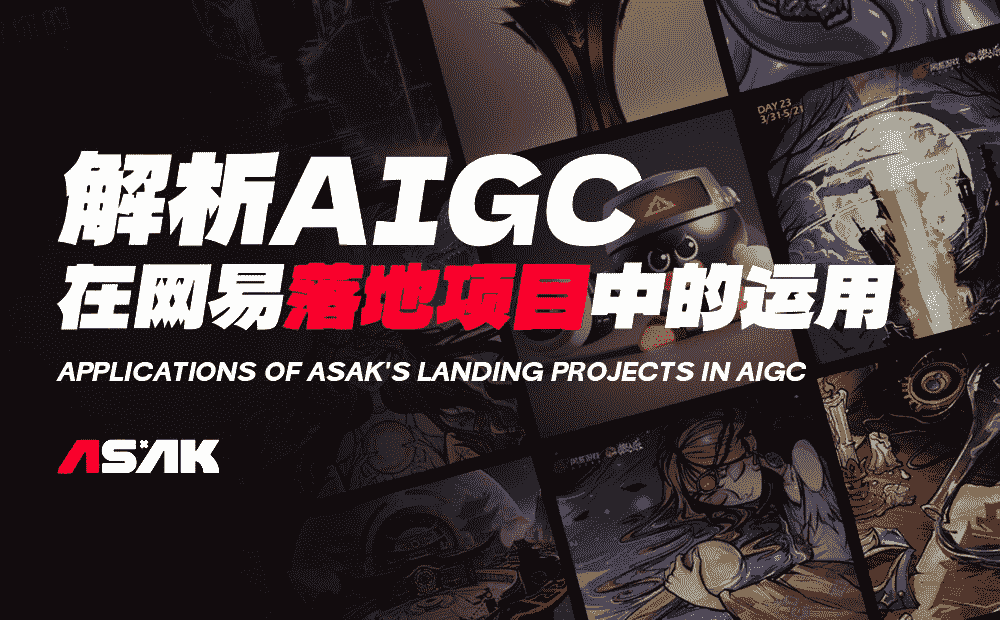

A[IGC ](https://www.uisdc.com/tag/aigc)全称 AI Generated Content，是利用人工智能技术来生成内容，AIGC 绘画属于 AIGC 的分支。

近半年，以 [Midjourney](https://www.uisdc.com/tag/midjourney) 和 Stable Diffusion 为代表的 AIGC 绘画迎来爆发式发展，掀起了一场生产力革命。

Midjourney 和 Stable Diffusion 强大的创造力和无与伦比的高效性，使设计师通过它们提升生产力成为了必然。然而 Midjourney 和 Stable Diffusion 作为开放性工具，本身具有随机性与不可控性，很多设计师很难在工作中运用，仅沦为娱乐工具。

本篇文章基于网易 ASAK 设计团队实际运用案例，带你破除 AIGC 绘画工具的不可控性，让它们成为你设计路上披荆斩棘的神器。

通过 Midjourney 和 Stable Diffusion 已落地项目类型分类，全文大纲如下：

设计提效

活动弹窗设计

勋章图标设计

IP 设计

KV/海报设计

场景设计

动画分镜设计

物料设计

设计师后记

## 一、设计提效

当未使用 Midjourney 和 Stable Diffusion 时，通常设计师流程如下：

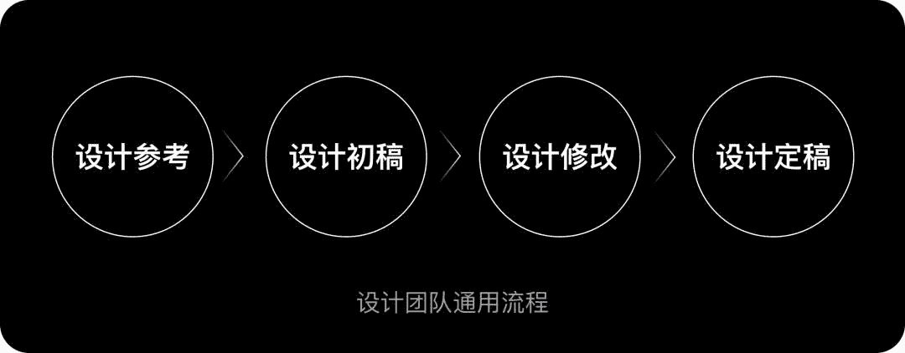

在设计参考阶段，设计师需要找大量的参考图，这一过程需要 0.5-1 天。设计师基于设计参考，完成设计初稿，这一过程至少需要 1 天。

而 Midjourney+Stable Diffusion 在整个设计流程中，可以极大地缩短概念风格、设计初稿和设计终稿的反复沟通时间。如下图所示：

使用 Midjourney 或 Stable Diffusion 直接生成设计图，设计师再做细节优化。整个设计流程提升效率 25-55%。

## 二、活动弹窗设计

先运用 ChatGPT 获取弹窗的设计思路，从多角度切入设计，使设计方案更完善，如下图所示：

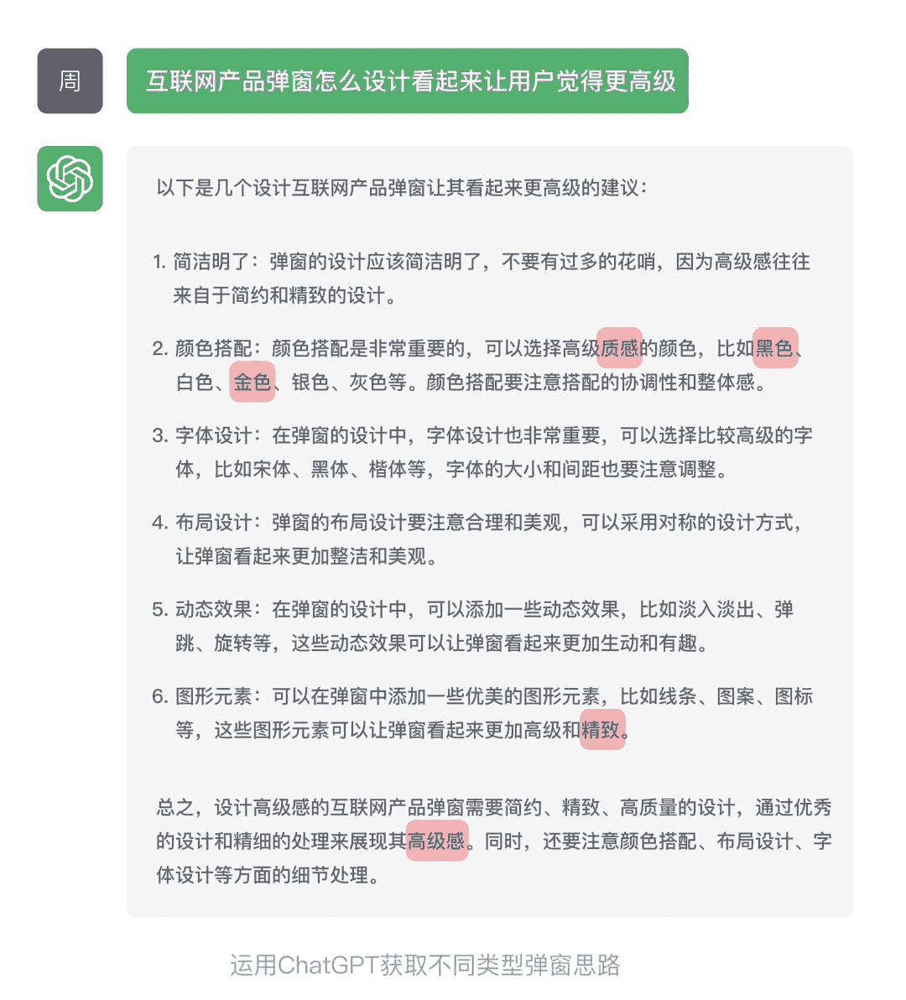

通过 ChatGPT 分析后，我们可以从中提取的关键词：黑金、高级感、精致、质感。

继续具象延伸，再添加宝石、荣耀感、坚硬感和钻石等关键词。为了让元素更加立体，可以带上 3D 和三维渲染器等相关关键词。

转化成对应的英文后，关键词如下：

Prompt: Shining gemstone, high class, noble sense, glory sense, 3D, hard, diamond, Octane Render

Negative prompt: Low saturation, deformity, sketch, blur

将初稿中的钻石图放进 Stable Diffusion 图生图功能。输入关键词，重复幅度调到 5 以下，反复多批量产出后筛选出想要的结果，如下图所示：

通过 Stable Diffusion 生成更有质感和高级感的设计主体元素，节省大量设计细节的时间。下图为初稿、AI 辅助和终稿:

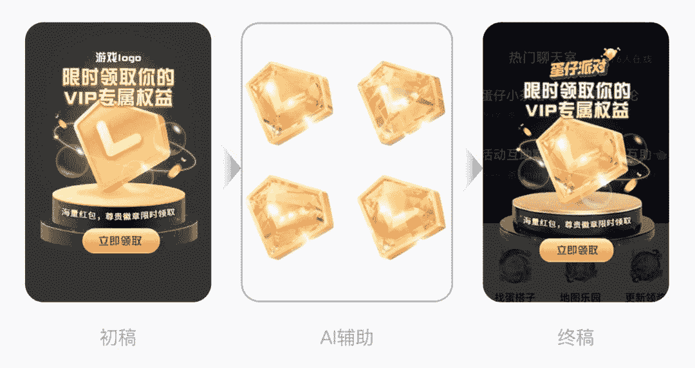

## 三、勋章图标设计

Midjourney 和 Stable Diffusion 也可以制作勋章图标。

勋章一般需要简化版和精细版，用于不同尺寸的使用场景。

以网易大神梦幻西游武神坛勋章为例，借助 Stable Diffusion，只需要输出简化版本的设计，让 Stable Diffusion 去深入刻画。

然后用生成最满意的图继续下一轮刻画，以达到最贴合自己需求的出图。

勋章自带荣誉感属性，因此可以从这个思路出发，得到宝石、金属质感、闪耀感和高级感等关键词。转化成对应的英文关键词如下：

Prompt: Metallic texture, Shining gemstone, high class, noble sense, glory sense, 3D, hard, diamond, Octane Render

Negative prompt: Low saturation, deformity, sketch, blur

输入对应的关键词后，得到设计图如下所示：

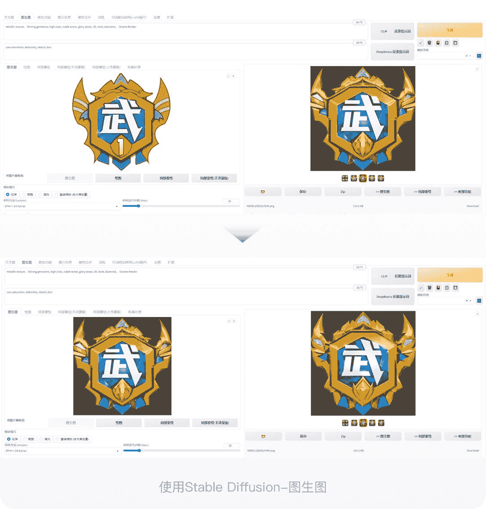

## 四、IP 设计

在设计 IP 前期，设计师需要先确定 IP 的应用场景，根据应用场景来确定 IP 的角色动作。

在这一阶段，设计师可以通过 Stable Diffusion 输入相关动作的关键词，来提取灵感参考。

以网易大神 IP 霸哥为例，讲解如何用 Stable Diffusion 制作 IP 素材。

下图 1 是设计师手绘草稿，下图 2 是最终 Stable Diffusion 完成的 IP。

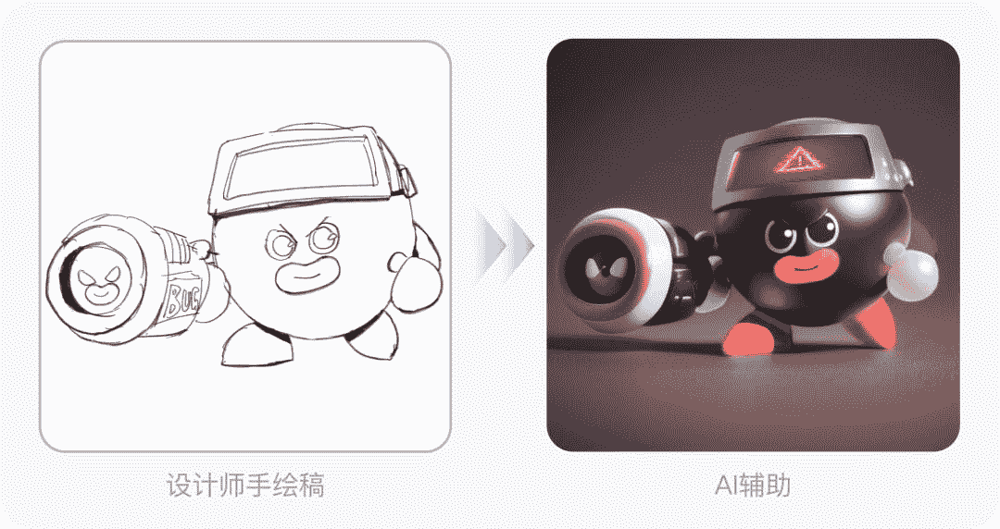

### **第 1 步：绘制角色动作线稿**

确定好角色动作后，开始给角色绘制草图线稿。我们给霸哥设定的动作是单手持玩具枪，眼神坚毅地望向前方。如下图所示：

注意：草图线稿最好较为干净连贯，以免 AI 识别不完整，导致输出的图片出错（示例图的草稿还是有些随意，建议自己做的时候再精细一点）。

### 第 2 步：选择并下载合适模型以及插件

这一阶段，我们需要结合 IP 形象的特点，有针对性地选择模型和插件。

考虑到霸哥形象整体呈圆形，风格偏可爱，抓住角色的这些特点，我们可以去到 C 站（civita）上选择相对应的模型。

我们选择的大模型是：MeinaMix；Lora 插件是：blindbox。（模型选择不是唯一的，有感觉适合的也可以尝试使用。）

### 第 3 步：设置 controlnet 面板

在文生图界面，往下滑找到 ControlNet 这一栏（要先安装部署好 controlnet 插件），将绘制好的线稿草稿上传至相应位置。并将启用勾选上，如果线稿图片背景为白色，可以把反色模式也一起勾选。

接着在下方的预处理器和模型上，选择好 canny（边缘检测）以及 control_any3_canny [95070f75]模型。

有时候模型显示不出来可以点击旁边的刷新按钮，刷新一下就有了，这一步非常重要，切记不要忘记设置！否则输出的模型会与线稿没什么关联。

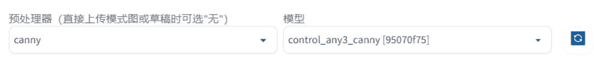

设置好后，其余的参数可以不动，也可以根据自己的需求做调整。

### 第 4 步：输入关键词并设置参数

关键词如下图所示：

Prompt：(masterpiece),(best quality),(ultra-detailed), black body, thick red lips, The body is a black ball with thin arms, wearing white gloves on its hands It has round black eyes, and short legs with red shoes, Wearing a display screen on the head, Holding a toy gun in its hand

Negative prompt：(worst quality, low quality, medium quality:1.4), low-res, (bad_prompt_version2:0.7), easy negative, bad-hands-5, red hands, white shoes, EasyNegative, text, blob

身体的颜色，手脚的颜色和嘴巴特征主要描述了霸哥的形象特征。

采样方法（Sampler）上，因为我们想做的是三维模型，所以选择偏写实风格的 DPM++2M Karras（该采样方法不唯一）。其余参数没有特定要求，可根据输出的图片效果灵活调整。

### **第 5 步：产出图片/后期调整**

前期出图可能效果会有些偏差，这时候可以灵活调整一些参数，并多生成几次。挑选出最接近霸哥形态的图片进行后期处理即可。下图为其中一个生成示意图：

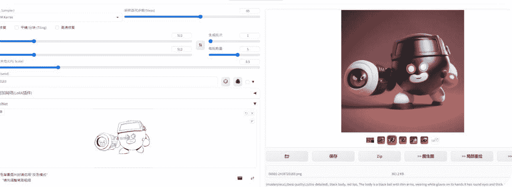

## 五、KV/海报设计

### **1. KV 设计**

在设计前期，设计师希望得到的画面是：预言家在中心操控着魔法球，两边的魔法狼群围绕着她，然后中心散发光芒，头发飞舞为画面的核心。

其中风格关键词：暗黑风，神秘，狼人，夜晚，哥特。

结合 chatpgt 转化成故事描述，获得精准关键词。

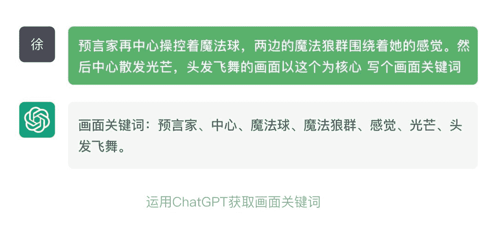

按照 Midjonrney 的语言描述：客观描述+风格。

其中客观描述如下：

A beautiful seer is holding a glowing magic ball in the center of the picture, with orange-red hair fluttering around her, surrounded by a group of transparent blue magic wolf heads

插画风格如下：

Illustration, Drawing, Hand-Drawn, Isometric, Saturated, Split-Complementary-Colors, 2-Dimensional, Rays of Shimmering Light

使用 Midjonrney v5 输入关键词后，不断调试后得到如下图所示：

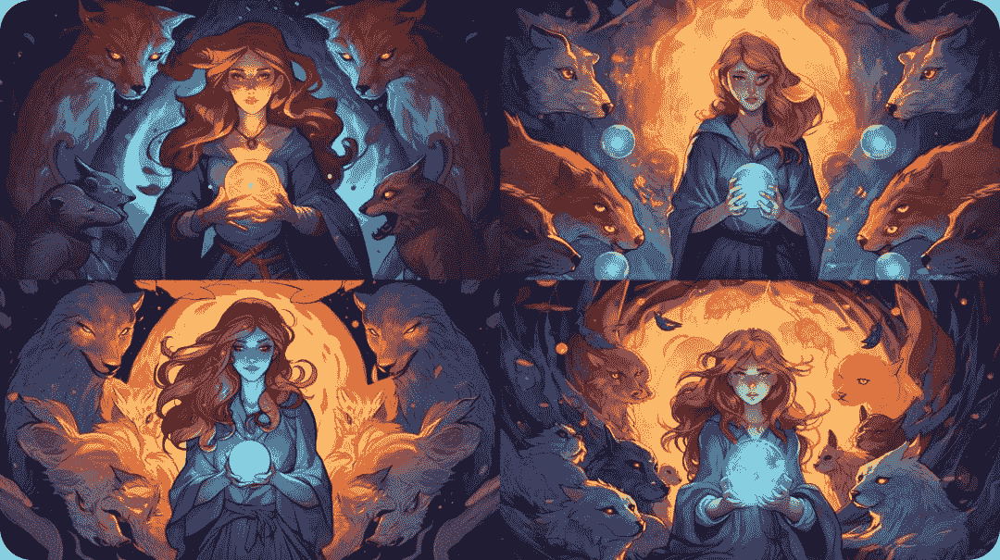

上述图片风格非平面插画类，那么继续优化关键词，这次加入关键词：Graphic illustration（平面插画）重新放在 Midjonrney 里面，并且把引擎模型改成 niji 得到如下图：

将上述 AI 生成的图，给业务方评估风格，这样需求方可以更清晰直观地感觉后续设计风格，有利于提出更有建议性的意见。最后设计师从气氛、构图和整体细节进行调整。完成线稿后，基于线稿快速实现设计终稿。

下图 1 为线稿，下图 2 为最终稿：

如果没有 Midjourney 的话，那么设计师至少需要出一版设计初稿给业务方，业务方根据设计初稿提修改意见。

有了 Midjourney，可以快速实现脑海画面，拥有更多更快试错机会。

在这个流程中 Midjourney 承担着设计初稿的执行角色。

### **2. 海报设计**

设计团队接到狼人杀游戏赛事的 3 张倒计时天数海报。

需求风格：暗黑哥特漫画风格手绘。

业务方希望设计交付时间为 3-4 天。然而一张纯手绘的时间需要 2 天（三张则是 6 天），时间完全不够，所以需要借助 AIGC 来提高效率，做到准时交付。

接到需求后，设计开始了前期提案。先用 Midjourney 完成我们的设计表达，让需求方更清晰直观地感觉到设计稿的风格感。

我们以倒计时还有 1 天的海报为例。

#### 第 1 步：实现脑海画面

海报构思画面：狼人变身，一条光柱表示 1 的形式。关键词如下：

A transformed beam of light soars into the sky, amazing Abigail Larson style, Illustration, Hand-Drawn, Macro, Depth of Field, Dichromatism, 2-Dimensional --iw 0.5 --s 1000 --ar 9:16

画面重点关键词：光柱

虽然上述生成效果图不太完美，但可以让需求方更清晰直观地感觉到设计稿的方向。

#### 第 2 步：根据已确认方向，背景图制作

因为古堡和大月亮构图已较为常见，所以我们直接用 Midjourney 进行基础的背景绘制，关键词如下：

Abigail Larson, an original painting of a scene, a broken village in the middle of the night, a white full moon in the night sky, clouds and mist around the moon, dark blue background --ar 2:4

画面重点关键词：古堡，月亮。

#### 第 3 步：最终细化绘制，完成作品

从生成图中挑选数张，选取每一张突出的地方进行合成、重制笔触和添加细节后，得到如下图所示的背景图：

最后加上狼人和光束变身特效后，进行简单排版就完成了终稿。

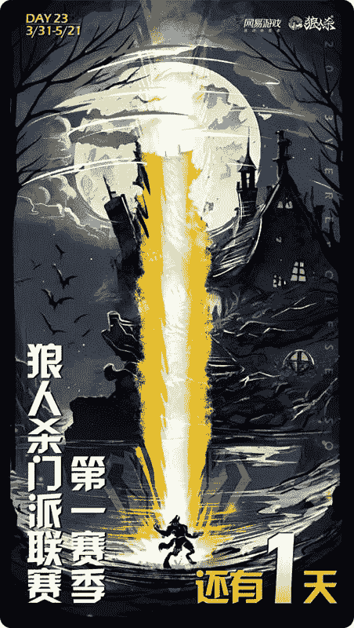

倒计时还有 2 天和 3 天运用类似上文 kv 设计思路，最终三张交付稿如下所示：

按照传统提案过程，需要寻找大量参考，然后合成拼凑出一张接近效果的图，三张海报的提案需要大概 1.5 天。

现在使用 Midjourney 进行批量出图，写出对应的关键词，出来的效果非常接近最后呈现的感觉，0.5 天就能完成三张提案效果图。并且需求方能清楚了解到最后效果，更快做出审核。

三张手绘倒计时海报，在 Midjourney 辅助下，从 7 天左右的工作量缩减到 3-4 天，对于设计和质量都有较为正向的反馈，值得继续深入研究并在工作中推广。

## 六、场景设计

### **1. 倩女幽魂虚拟演播厅**

以倩女幽魂演播厅概念图设计为例，讲解 Midjourney 是如何定向控制，生成设计师和业务方想要的设计稿。

倩女幽魂这次的太一斗魂坛，需求方想要的风格元素是唐朝建筑、墨子机关元素和整体以红色建筑为主。

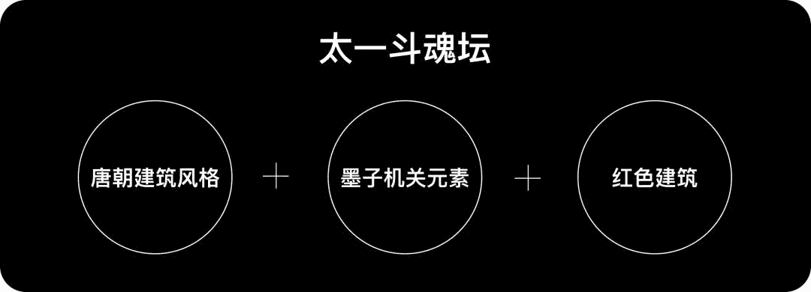

设计师开始尝试用 Midjourney 做前期框架搭建。

#### 第 1 步：关键词生成概念图

开始以雄伟的中国式建筑和红色机关等关键词跑图。对应的关键描述如下：

Chinese palaces surround the central stage, there are mechanical gears on the building, Chinese style, red, Volume cloud, Volume light

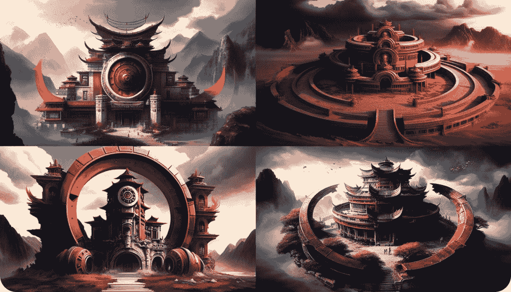

然后调整关键词如下图所示：

Many red Chinese-style buildings surround the central stage, and there are mechanical gears on the buildings, clear structure, Volume cloud as background, Magnificent atmosphere, Unreal Engine 4

生成新的概念图如下图所示：

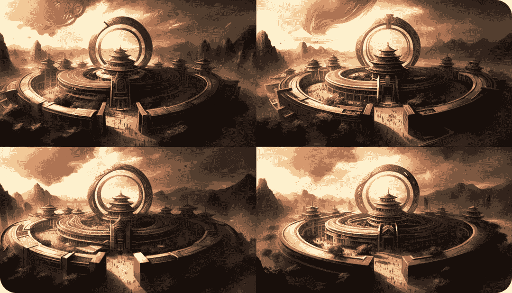

#### 第 2 步：优化关键词

上述生成的概念图虽然有红色中国风建筑和机关元素，但擂台的感觉不够强烈，缺少建筑缠绕的感觉。

重新修改了关键词加入擂台和建筑环绕中心舞台等元素，关键词如下：

Many red Chinese-style buildings surround the central stage, and there are mechanical gears on the buildings, Clear structure, Volume cloud as background, Magnificent atmosphere, Unreal Engine4, --ar 16:9

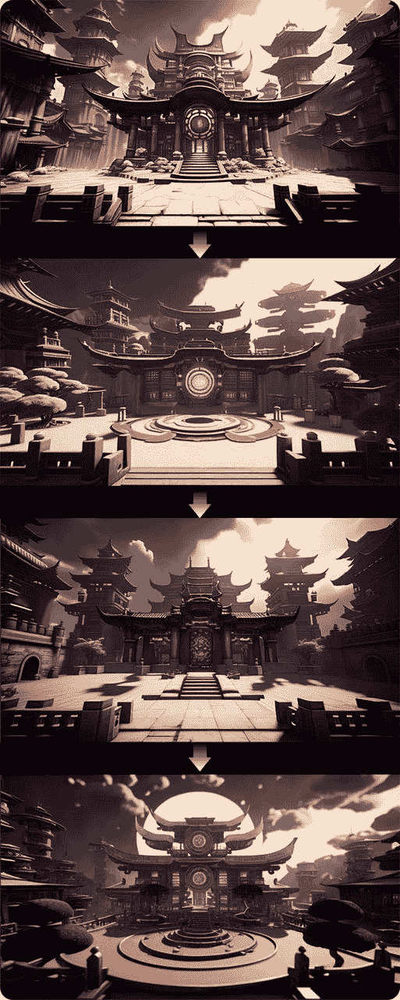

#### 第 3 步：精选效果图合成初稿

上面几张概念图已经比较接近我们想要的效果。

最后设计师进行二次修改、合成和手绘后得到设计稿，如下图所示:

#### 第 4 步：Midjourney 快速修改

需求方审核后，需要临时调整整个构图，画面改成悬空建筑擂台，空中需要漂浮的岩石，所以我们修改了关键词为悬空擂台、漂浮在空中的中国风建筑等。关键词如下：

A piece of Chinese architecture floating in the sky, the building is built on floating rocks, the center of the rock is a stage, and the buildings surround the stage --ar 16:9

这次改动如果不借助 Midjourney，我们就要大面积重新制作，而使用 Midjourney 来制作浮空岛的场景，只需要将我们之前合成好的建筑场景后期替换进去。

经过多张类似的推演，我们得到了一张适合通过后期手绘合成的图，做出的设计图如下所示：

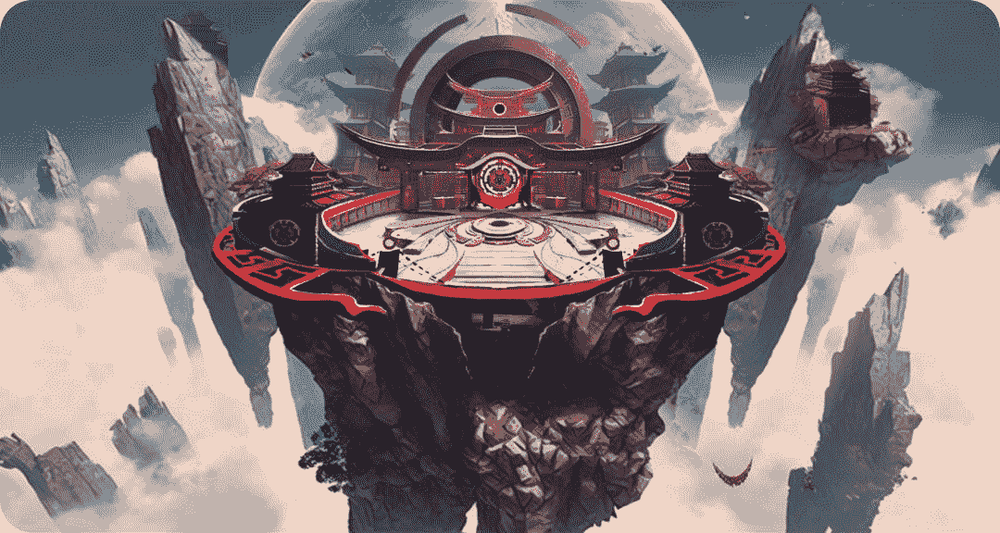

设计稿经过需求方顺利通过后。交付给 AR 部门进行舞台搭建工作。

#### 第 5 步：AR 虚拟搭建演播厅

AR 部门搭建演播厅的设计图，如下所示：

下图虚拟演播厅中的解说桌也是使用类似的 AI 辅助流程完成的制作：

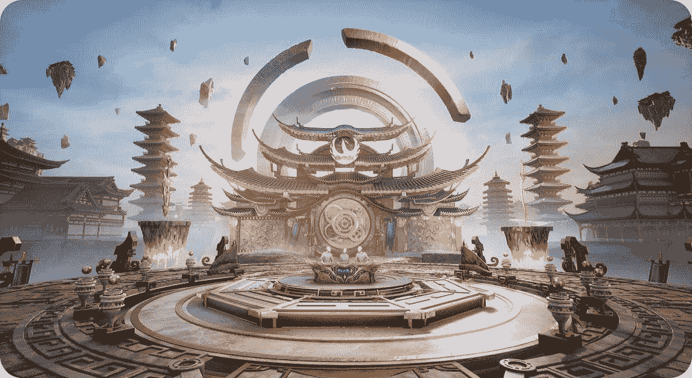

### **2. AR 氛围概念参考**

AR 技术在电竞赛事应用中已经相当普及，AR 即增强现实，为电竞提供了全新表现形式。

此次永劫无间赛事，由于场地空间的限制，设计师希望通过 AR 场景与舞台效果结合，让观众和用户有更好的观赛体验。

#### 第 1 步：投喂风格图

用前期赛事 KV 草图和官方概念图投喂到 Midjourney 中，下图为投喂图：

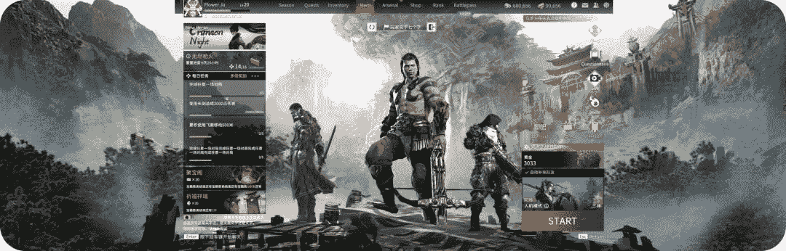

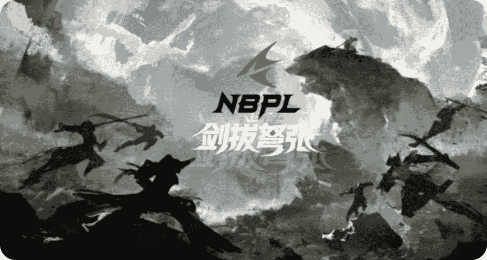

#### 第 2 步：生成场景图

配合关键词如下：

Mountain forest style, concept art, sunshine, been invaded, god ray, there is Tiger Mountain in the distance, and there is a waterfall on the mountain on the right, high detail, hyper quality, scene type, high resolution, with waterfall, forest style, sunshine, god ray, scene type, waterfall on the right, concept art, and stage in the mid shot, foreground close to water, wooden bridge in the foreground, dilapidated wooden bridge, tiger mountain and bandits in the foreground, --ar 16:9

我们成功地生成了山林主题的场景概念图，如下图所示：

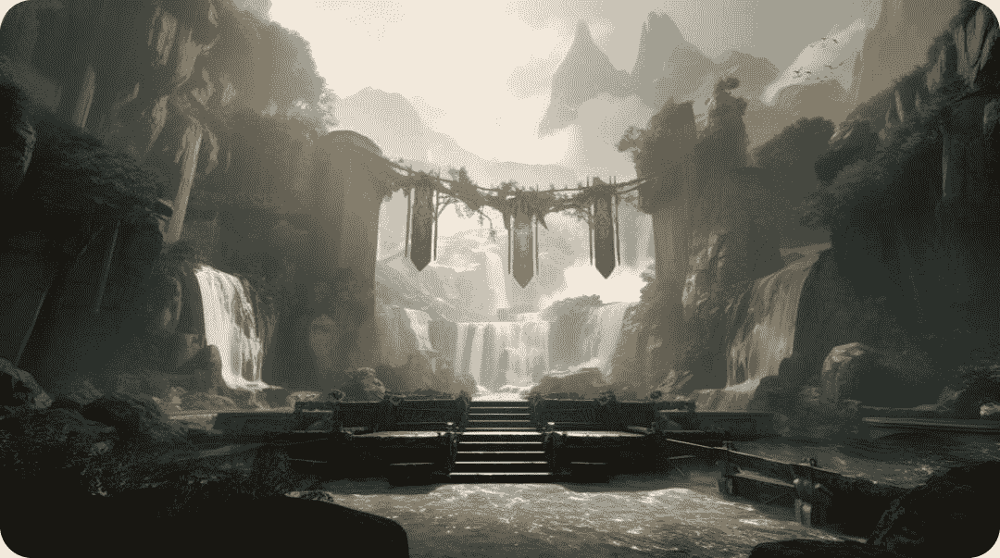

#### 第 3 步：合成初步效果

结合赛事舞台设计制作的渲染图，如下所示：

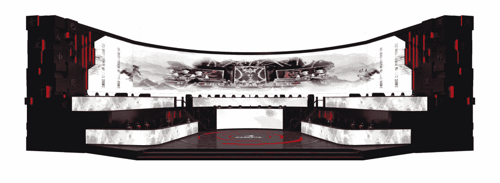

将 Midjourney 生成的概念图与舞台设计制作的渲染图合成后，最终的舞台整体效果，如下：

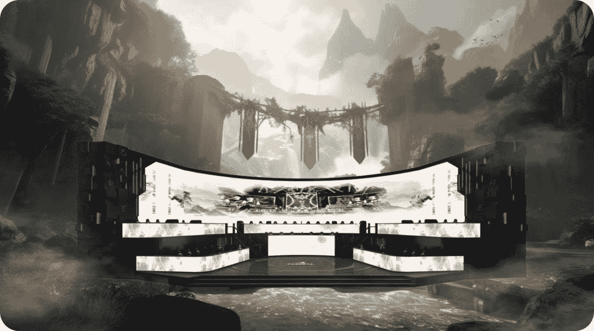

#### 第 4 步：三维建模和 UE 场景搭建

在上述基础上，进行三维模型制作以及 UE 场景搭建，形成最终的赛事场景效果图，如下图所示：

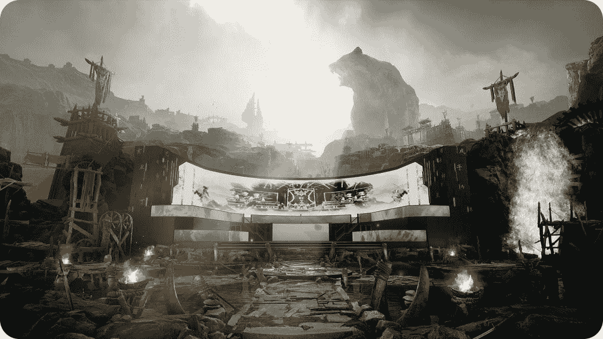

## 七、动画分镜设计

设计师手绘的动画分镜图，如下图所示：

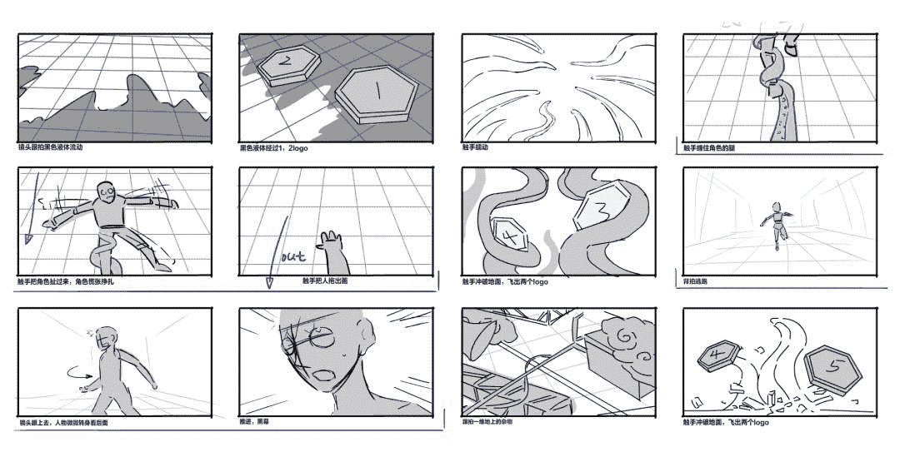

上述分镜较为简陋，尝试运用 Stable Diffusion 来进行上色优化。

### 第 1 步：优化 controlnet 可识别范围

根据已有手绘分镜，按照应用场景使用 controlnet 插件功能：seg（语意分割）和 canny（线稿）。这两个功能在脚本使用中频率较高。

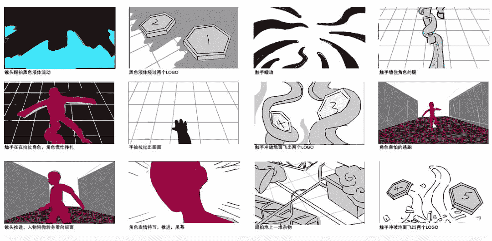

### 第 2 步：方式①使用controlnet的语意分割功能，实现画面分区

手绘分镜的 P1/P5/P9/P10 使用的是 seg 功能。通过在 Photoshop 中划分颜色来告诉 AI 这部分要的是什么物体。

以 P8 为例，两侧为墙壁 #787878，地面为地板#503232，中间为人物#96053e（可通过 ADE20K_classes 表格来获取色值信息）。

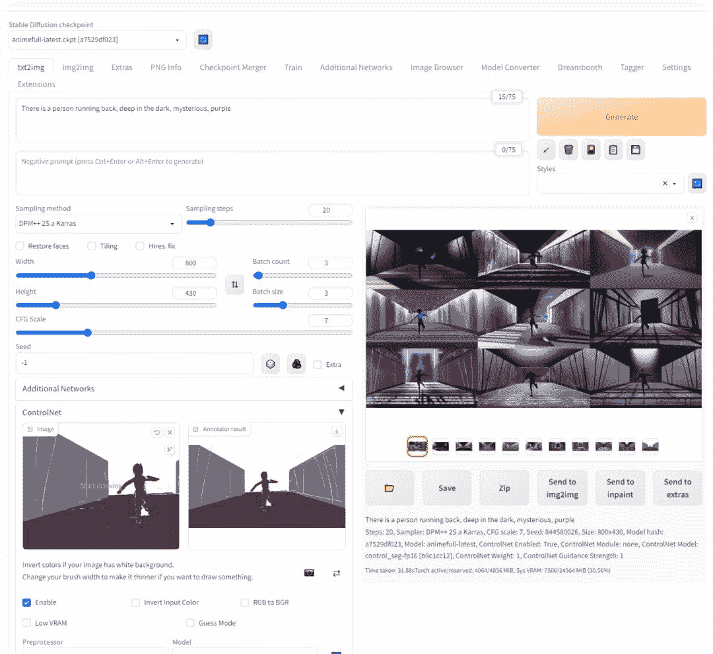

在手绘图上大概划分好颜色区域后添加到 Stable Diffusion 的 controlnet 中，因为我们在 Photoshop 中已经做了一些前期工作，所以就不用启用预处理模式，直接选择 seg 模型然后预处理。

开始添加 tag，我们拿到的脚本是角色慌张地逃跑，那么我们可以优化为“有一个在往前跑，黑暗深处，神秘，紫色等词来描述翻译后得到：There is a person running back, deep in the dark, mysterious, purple. Tag 交给 Stable Diffusion 来生成。

第 2 步：方式②应用controlnet的线稿功能，进行区域上色

以手绘 P12 为例，我们使用的是 canny（线稿）模式。直接把草图给到 controlnet，优化词为：紫色的章鱼触手从地面出来、碎石、破碎、两颗棋子。翻译后得到英文关键词如下：

Purple octopus tentacles come out of the ground, gravel, broken, two pawns

上图中的 P6 是符合我们的需求，将 P6 使用图生图中做二次细化，如下图所示：

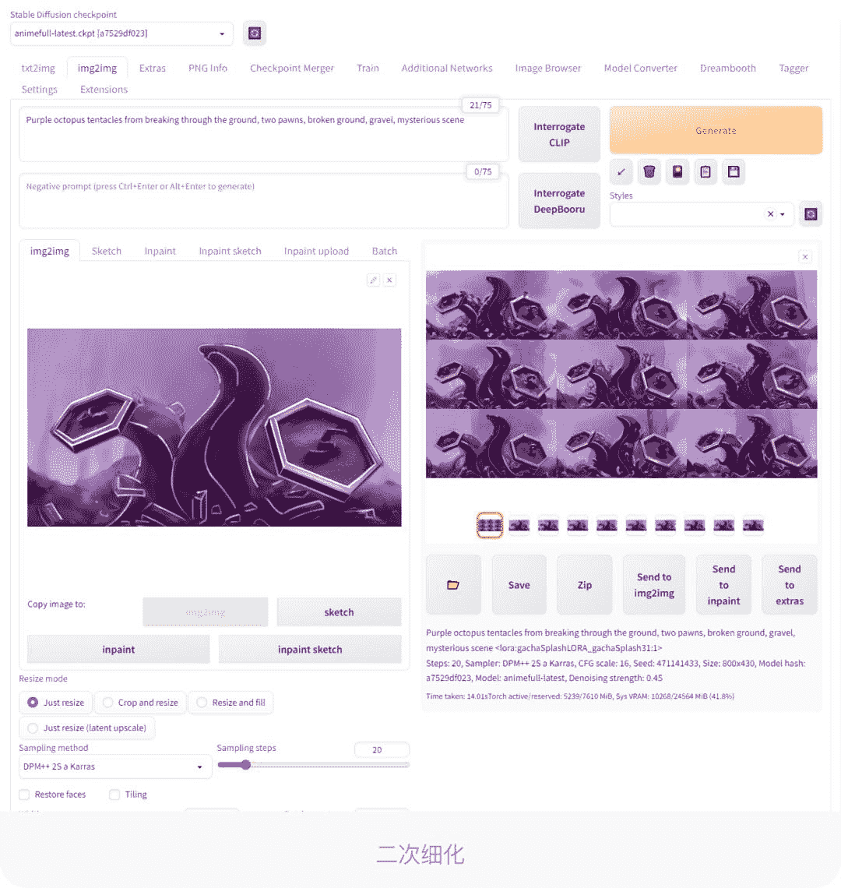

### 第 3 步：上色氛围分镜输出

运用 Stable Diffusion 来进行上色氛围，让需求方更直观地了解整个分镜效果，同时可以为后续视觉静态稿提供氛围参考。

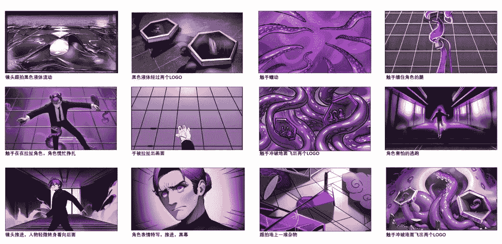

## 八、物料设计

游戏赛事中的奖杯是设计需求中不可或缺的一环。设计师可以利用 Midjourney 和 Stable Diffusion 进行大量的前期素材储备。

以下是需求之外，完成对赛事奖杯的素材储备。

### 第 1 步：使用 Midjourney 生成灵感素材

下图是使用 Midjourney 生成的各种奖杯概念图。

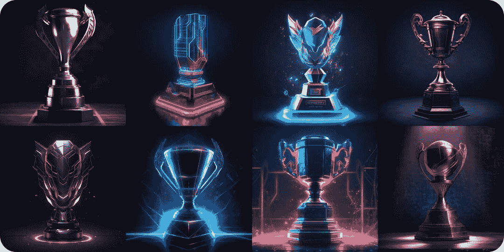

### 第 2 步：绘制草图

根据 Midjourney 生成的概念图，设计师手绘生成奖品草图。

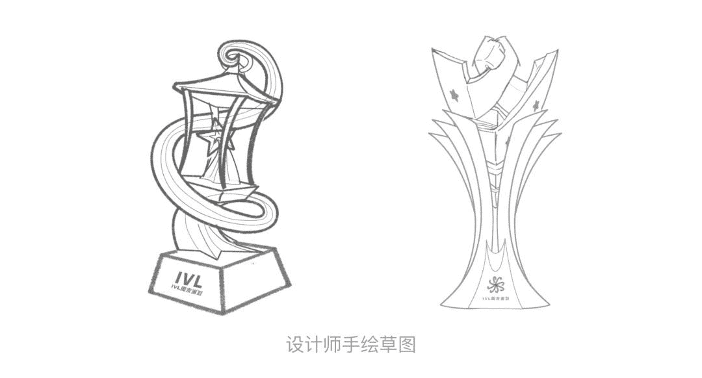

### 第 3 步：Stable Diffusion 二次创作

根据草图，使用 Stable Diffusion 精准控制上色，完成最终的奖杯素材，如下图所示：

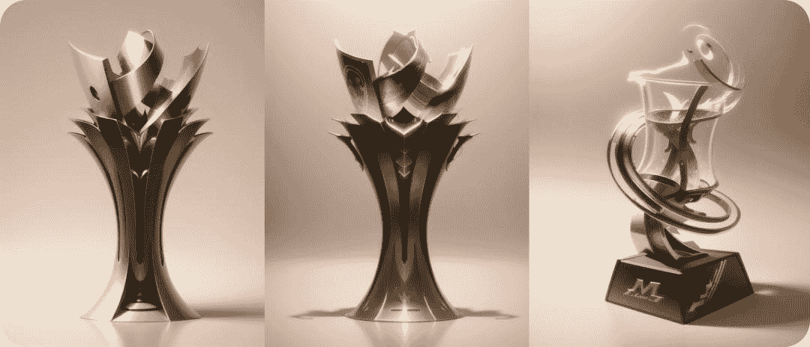

这些储备可以为后期其他设计项目提供素材，进一步提升设计效率。

## 九、设计师后记

Midjourney 和 Stable Diffusion 的崛起，导致很多设计师焦虑，担心被取代。通过上面的案例可以看出 Midjourney 和 Stable Diffusion 只能完成项目中的一部分，无法做到独立完成项目，都需要设计师二次创作。

早期 UI 设计师的工具是 Photoshop。后面出现高效的 Sketch。到如今设计师使用更高效的协同工具 Figma。

而 AIGC 本质上还是提效辅助工具，需要设计师去掌握更高超的操作技能。

决定设计的成败从来是人，而不是工具。