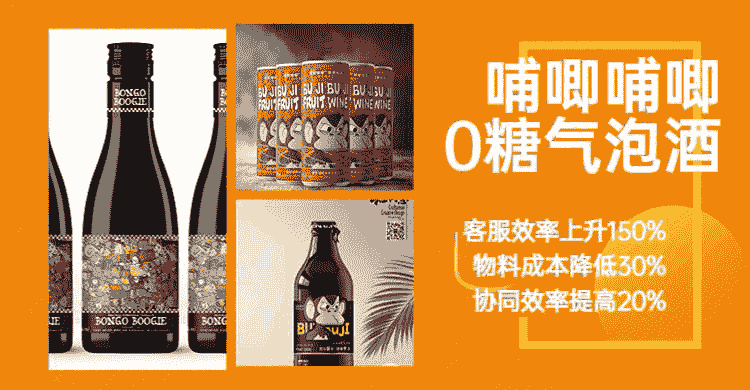
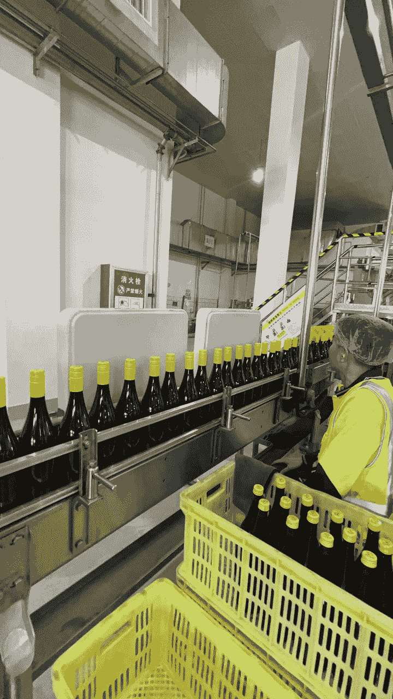
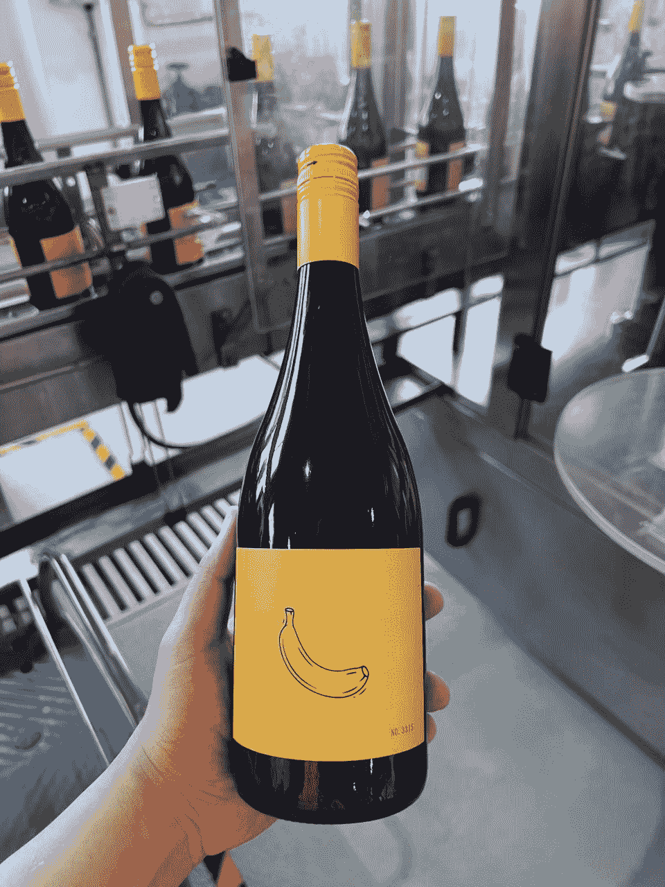
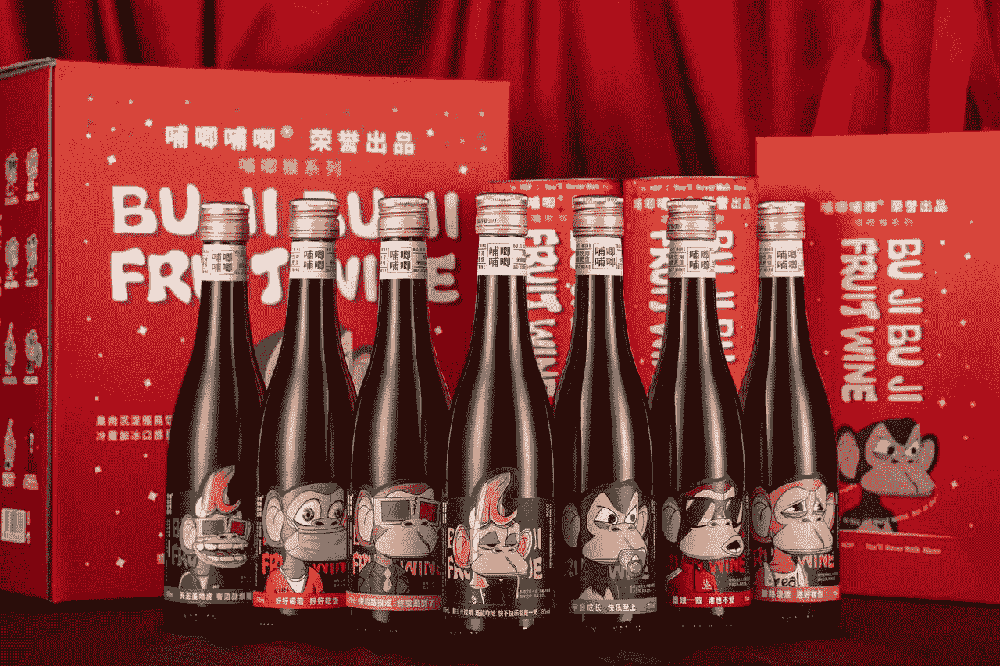
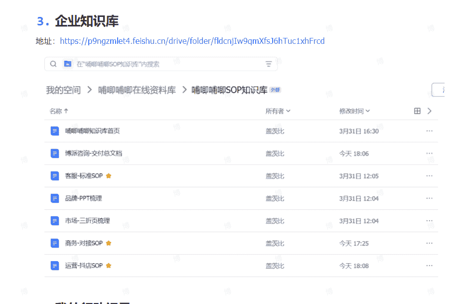
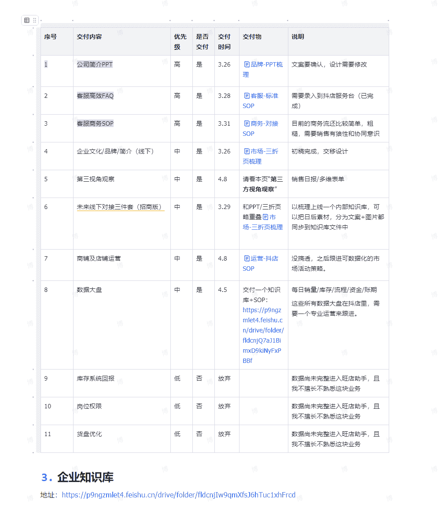
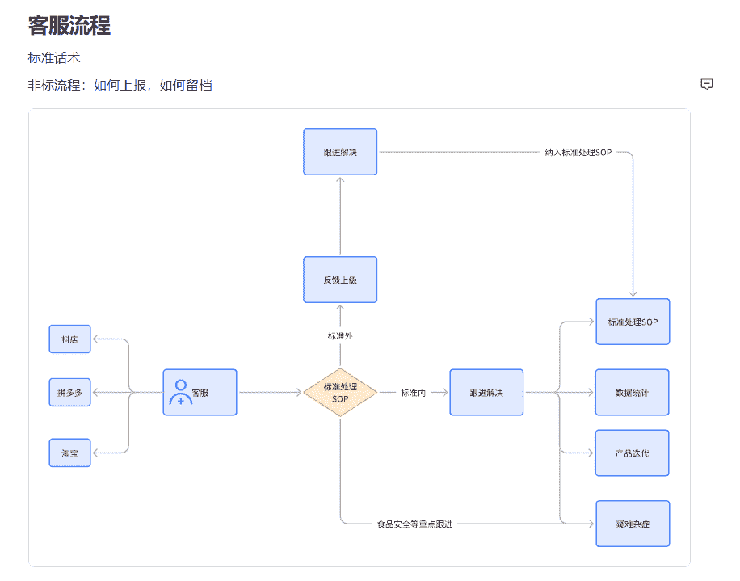
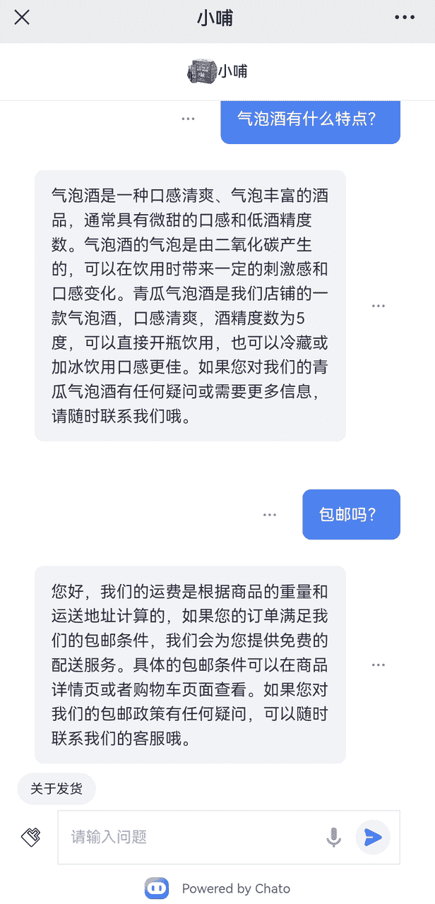

# 哺唧哺唧：用AIGC降本增效，打造满分抖音店铺

> 来源：[https://docs.feishu.cn/docx/OKlrd7WtBolqHwxEmPKc7XZSnRp](https://docs.feishu.cn/docx/OKlrd7WtBolqHwxEmPKc7XZSnRp)

对于直播电商行业来说，市场瞬息万变，清晰战略、创新产品、降本增效是团队基本能力。博派Ai咨询针对企业实际情况，用飞书、Midjoureny、ChatO等不同Ai工具流，以极低成本搭建了更为高效的管理系统。让组织动作“快速、清晰、可理解”，为哺唧哺唧的高速增长打下基础。

### **公司介绍**

**哺唧哺唧，谐音“不急不急”，**是一家成立于2022年10月的新锐中国饮料企业，目前旗下以哺唧猴为核心IP，主打0糖，0脂，0色素的系列饮品。拥有哺唧猴-莫吉托、青瓜薄荷起泡酒等热门汽泡酒和果酒产品线。

上线2个月期间就成为抖音气泡酒类目月销量冠军，店铺评分长期保持满分。哺唧哺唧的运营团队规模10+，抖音店铺全职运营更是惊人的只有1人。

“我们希望像Coca-Cola一样，能够生产更多经典美好的饮品，需要一套更完整的流程来定义它，使得我们的品质稳定、健康。”

作为连续创业者，CEO祖振不仅拥有远大的梦想，希望创造出消费者喜爱的、极具性价比的年轻潮饮，更在意团队的执行和成长。如何带领团队在一片红海的新消费品行业脱颖而出，创新和效率都必须做到极致。通过Ai技术和数字化实现更有利的降本增效，支撑千万业绩，提高人效成为唯一选择。

我和CEO深入沟通后，直接到仓库实地调研，驻场办公，梳理战略和流程中可以用AI增效的部分。

哺唧哺唧当时面对的主要挑战是：

挑战1:  对外缺乏清晰统一的宣传物料。创业早期未重视信息整理和搜集，使得诸如企业文化、理念、基础物料等信息极为零散。缺乏清晰、统一的PPT、三折页、UI资源等物料。

**挑战2：售后管理不高效**。

因为涉及到顾客、管理者、客服和仓库的多方沟通，并且信息琐碎、过程冗长，一旦产生遗漏，极易产生客诉。

**挑战3**：**抖店+商务管理标准化不足**。

抖店缺乏足够专业的运营，缺少BD主播的商务策略、标准话术、标准商务流程；商务之间不愿意分享经验。

**解决方案1**：

看起来是物料问题，背后则是创业公司的愿景、理念和策略不清晰的问题。博派咨询师和CEO彻夜讨论梳理后，落地到文字中，帮助一把手梳理产品和策略。

之后，手把手教员工，使用Midjourney+ChatGPT+StableDiffusion+稿定Ai的组合，使得哺唧哺唧得以用非常低的成本，完成企业日常物料设计。

**解决方案2：**

博派Ai 手把手梳理客服SOP，更新于一个文档中，主播/客服只需点开对应文档，搜寻对应问题，即可获得最新解答。之后，将上述文档投喂到本地私有智能客服机器人，利用最新大语言模型做AI辅助。提高客服效率20%。

**解决方案3：**

充分使用飞书多维表单，0代码搭建业务工作流。并通过电商资源圈子，提供抖店流量获取的实战策略。

博派Ai查看现场，选择针对各类非常细碎的问题，做一体化交付。

不是站在旁观者视角的指点江山，而是下场实操，制定拿来即用的SOP，标准文档+落地培训。

根据需求，终于完成一套针对问题的5W字的SOP知识库。

博派Ai将字节跳动的成熟经验，手把手帮助哺唧哺唧落地，帮助其梳理内部信息、整理成完整的知识库，并接入Ai机器人。将飞书文档作为“动态话术标准”，最新话术都更新于一个文档之中。利用文档多人协作、实时更新的特性，免去繁琐的本地文档发送过程。

## 总结：数字化工具+Ai，让小团队效能提高3倍

借助飞书+ChatGPT本地机器人+Midjourney+串联工作流的实操经验，博派Ai不仅交付了一套清晰、可迭代的SOP方法论，手把手帮助企业落地。

对于初创电商/消费品公司，先进团队最应该把所有重心放在打造好的产品上，而针对流程、脚本增效的环节，可以借助ai，以及大厂成熟、但有效的经验，使得团队的组织管理更为流畅。

目前Ai落地生产力的最佳实践仍然处于早期，如何从上千款工具中选择合适稳定的工具流，帮助企业降本增效，成为所有企业的核心思考。未来，博派也会和哺唧哺唧一起，在更多场景利用ai降本增效。