# 图像生成在商业当中的运用价值研究2023

> 来源：[https://docs.feishu.cn/docx/FLIbdqYeIo06MexmFMJcH5UqnOd](https://docs.feishu.cn/docx/FLIbdqYeIo06MexmFMJcH5UqnOd)

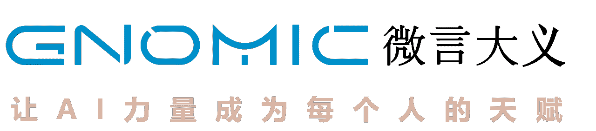

> 本文版权归**提示工程师之家**所有，欢迎转发。

# 简述

## 前沿

图片生成技术:

**一个聪明****勤奋的实习生**,拥有丰富的知识,但还需要在社会实践中积累经验。

图片生成技术拥有强大的潜力,正在快速发展,像一个充满求知欲和创造力的实习生。它已经掌握了文本到图像,图像到图像等转换技术,并在图像质量、功能、易用性等方面不断进步。但是作为一个尚在成长的技术,它仍需在伦理规范、版权保护等方面积累经验,以适应商业环境。就像一个才华横溢但仍需社会实践的实习生。

视觉内容生产者:

一个富有经验和智慧的管理者，指导实习生成长，和实习生建立良好的关系。

视觉内容生产者像一个管理者,拥有丰富的专业知识和经验。他们看清图片生成技术的潜力,能够利用这项新技术提升工作效率,但也清楚其局限,需要人类智慧指导其健康成长。既能启发实习生的创造力,也能规范其行为。他们发挥经验的优势,与“实习生”互相促进,共同进步。不因为新技术的出现而感到惊慌,而是主动与其建立良好合作关系。他利用学生的能力提升效率,同时也传授独特的人类情感和智慧。视频制作人看清大势所趋,既不抵制新技术,也不盲从崇拜,而是融合利用。

## 调研目标

本报告旨在研究 AI 图像生成技术在商业上的应用前景和相对应的市场潜力，为相关的决策提供支撑。

## 高度总结

本报告旨在通过分析图像生成的市场数据、现状、图像生成模型的基本和扩展能力、图像生成在专业群体（如平面设计和视频制作）中的应用、图像生成工具的成本、开源技术、商业服务和性能评估、等多个维度，探讨图像生成在2023年商业应用的价值。报告还提供了一些图像生成工具的示例，如DALL-E 2、Midjourney、Stable Diffusion和Adobe Photoshop，并讨论它们如何在各行业和领域中增强内容创作、设计和创新。报告得出结论，图像生成是一项快速增长和有影响力的技术，可以为企业带来重大利益，但也需要负责任的指导方针和规定来减轻其潜在风险。

## 关键发现

+   AI图像生成是人工智能最具活力和前途无量的子领域之一，具有蓬勃发展的市场潜力和采用率。

+   目前四种主要的AI图像生成工具为：DALL-E 2、Midjourney、Stable Diffusion和Adobe Photoshop。每个工具代表不同的图像生成领域和用例，例如应用程序开发、消费产品、新生代 AI生产力工具和传统生产力工具集成 AI 功能。

+   增强创意过程、提高产出质量和数量以及实现定制和个性化的AI图像生成示例。目前已经在商业项目中有所运用。

+   通过Midjourney 的成功模式，可以看见一个趋势：在未来，算力将会是堪比人力的企业实力之一。

+   AI图像生成很快将成为企业内容工作流程和策略的标准组成部分，但同时也警告需要解决伦理、来源和潜在版权问题。

# 图像生成市场洞察

## 市场应用现状

AI图像生成技术的采用和增长呈现繁荣态势，并有巨大的市场潜力。

根据麦肯锡的数据[20]，包括图像生成在内的生成式AI工具已经得到爆炸性的普及，其中1/3的调查受访者报告称至少在一个业务功能中定期使用。近25%的C字级别公司高管（如 CEO、CTO 和 COO 等）正在自行使用生成式AI工具。40%的受访者预计，由于生成模型的迅速发展，使他们有意向增加总体上对AI方面的投资。

AI图像生成技术如Stable Diffusion和Midjourney，对中国的游戏艺术行业亦产生了重大影响。虽然这些进步降低了开发成本，但也导致了人类插画师的失业[22]。根据一名杭州游戏招聘者Leo Li 在对 Rest of World 的采访回应中的描述，2022 年的原画师岗位已经减少了 70%，其中一方面是因为国内游戏发行的管控机制，另一方面是因为 AI 作为生产力的引入。某行业巨头游戏公司的游戏原画师表示，以前一个人一天只能出一张图，而现在 AI 技术已经可以每天出 40 张供领导挑选的图。中国科技巨头如腾讯和网易，已经公开表示引入图像生成技术在其项目当中[22]，拥有在几秒钟内生成复杂游戏艺术品的能力，并积极采用人工智能降低游戏开发预算。网易旗下的《永劫无间》在2023 年 3 月 17 日推出了“AI·智绘·时装共创计划”，玩家可在活动页面点赞喜爱的AI生成时装灵感图，提升特定灵感词排行。点赞三次可解锁“AI智绘”功能，生成自己的设计并加入候选[24]。这种自动化一方面使得企业的生产力得到提升，但也同时导致了许多人类插画师失去工作或面临工作量增加。

虽然开发人员坚称，人工智能主要是支持而不是取代艺术家，但一些人预测，随着越来越多的职业受到创意任务自动化的影响，焦虑可能会蔓延。为了减轻对艺术家和伦理的不利影响，可能需要制定负责任的指南和再培训计划，但同时也是一个培训艺术家学会 AI 工具的商机。尽管面临挑战，但设计行业为人工智能与人类在创意领域的合作提供了一个早期的例子。具备 6 年经验的设计师张小枫利用 Midjourney 生成的图片给商业项目提供灵感，从而替代了原先需要手绘灵感图的工作流程。类似的应用场景也在视频制作方面有所体现。随着生成模型的能力提高，长期影响仍然不确定。

各种因素正在推动大规模采用，其中包括但不限于：

+   企业高管对生成式AI能力的认识提高了

+   像是Stable Diffusion和Dreambooth这样的开源算法和技术解决方案降低了运行的成本

+   新的用户友好界面和工作流程，如 Stable Diffusion WebUI 和 Midjourney 这样对于非技术出身的用户较为友好

+   图像生成质量和定制化能力的迅速提升，如 Stable Diffusion WebUI 的开源社区陆续推出各式各样的扩展插件，以及 Midjourney 推出的一系列新功能，包括 Infinite Zoom等

这些趋势共同指向AI生成很快将成为商业内容工作流程和战略中的标准组成部分，该技术可以加速构思流程、增加产出量，并提升定制和个性化能力。

与此同时，伦理、溯源跟踪和潜在版权问题仍然存在。一些玩家批评AI生成的艺术缺乏人类创造力，称其为“数字尸体”。为了回应这一批评，中国政府正在实施规定，要求AI艺术必须明确标注并尊重版权。

总体上看，AI 应用的潮流不可抵挡。企业应该开始制定战略，思考如何让AI图像生成有益地增强他们的内容、设计和创作。

## 图片生成市场细分

生成式人工智能最初主要应用于文本生成，通过深度学习的方式，使得机器可以自动学习语言的规则和结构，从而生成高质量的文本。然而，近年来，随着技术的发展，生成式人工智能在图像、音频和视频方面也取得了显著进展，如OpenAI的DALL·E和Stability AI 的Stable Diffusion。这些技术已被应用于媒体行业和游戏设计，帮助设计师创造出更加逼真的场景和角色。此外，在营销领域，生成式人工智能也具有一定的应用，用于生成广告和其他营销内容，从而提高了营销效率和效果。然而，这些技术的应用也挑战着现有的人才、变现和知识产权商业模式，需要不断探索和创新。[20]

DALL-E 2、Midjourney、Stable Diffusion和Adobe Photoshop的AI功能位列最具商业应用前景的顶级AI图像生成器之一。[21]4 大图像生成 AI 工具分别代表了各自主攻的细分领域：

+   DALL-E 2通过直观的提示和可扩**展的API访问实现了轻松的图**像生成，主打面对开发者的应用开发生态支持。

+   **Midjourney**可以生成高评分的图像质量和美学吸引力，主打消费级的图像生成产品。

+   **Stab****le**** Diffusi**on为技术熟练用户提供了可定制性，主打新生代 AI驱动的生产力工具。

+   Adobe Photoshop将AI图像编辑集成到现有的创意工作流程中，主打图像生成技术和传统生产力工具的结合应用。

## 开源技术

在本次的调研当中，Stable Diffusion 在开源图像生成技术上独占鳌头，是仅有的在开源图像生成领域中，用于生产力的开源技术。故在本次调研中重点探讨 Stable Diffusion。

### Stable Diffusion

Stable Diffus[ion 是一个 Sta](http://civitai.com)bility AI 推出的图片生成模型系列，目前已经有Stable Diffusion V1.5/V2.0以及最新发布的XL 1.0。目前模型分享社区，如 civitai.com、LiblibAI·哩布哩布AI-中国领先原创AI模型分享社区、以及AIGODLIKE-开源AI冒险社区等，上面发布的模型，基本上是依托 Stability AI 发布的模型训练的。

目前在这些分享平台上的模型都可以免费下载使用。

#### Stable Diffusion WebUI

Stable Diffusion 的原始调用方法是通过代码脚本进行调用，和其他人工智能模型一样。为了减少用户的学习成本，开源社区用户 AUTOMATIC1111自行研发了一套图形化用户界面来给非技术背景的人使用。这一套 UI 系统本身可以免费使用。

#### 启动器

Stable Diffusion WebUI 本身的部署也需要一定的技术，这一块也需要一定的学习成本。所以国内的一些专业技术人员就自行研发了各式各样免费的 WebUI 整合包，又称“启动器”。其中，Bilibili 用户秋叶研发的启动器最为广泛流传。其特点是可以一键启动，在本地轻松自动化部署，无需专业的技术知识就可以使用 Stable Diffusion 进行图像生成。启动器的诞生，大幅减少了用户的学习成本。

#### 软件封装

由于WebUI 的启动器仍然基于[ WebU](https://www.bilibili.com/video/BV1tV411N7H7/share_source=copy_web&vd_source=ea8ff8b35d13c7feee8dbce908a37078)I，而一些用户不太喜欢 WebUI 的操作逻辑，再加上本身也不太像是一个软件。所以就出现了一些开发者自行研发的，以 Stable Diffusion 或者其他图像生成模型的软件封装。目前比较有影响力的有：Adobe Photoshop，道玄1.0，InvokeAI，以及 Stability AI 自行推出的 Stable Studio。

开源图像生成的使用成本包括：学习成本和硬件成本。以下是一个成本估算的表格：

## 商用服务

### Midjourney

Midjourney是由旧金山独立研究实验室Midjourney，Inc.创建和托管的生成人工智能程序和服务。Midjourney从自然语言描述（称为“提示”）生成图像，类似于OpenAI的DALL-E和Stable Diffusion。它目前仅通过其官方Discord服务器上的Discord机器人、直接向机器人发送消息或邀请机器人到第三方服务器上进行访问。Midjourney是领先的文本到图像AI生成器，可以将您的文本提示转换为图像。目前，它仅通过Discord平台提供。

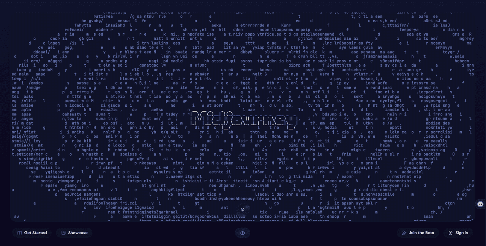

Midjourney可以根据文本提示或原始图像生成逼真而艺术的图像。截止至2023 年 4 月，已经有超过1480万名Discord平台用户，并在美国艺术展中赢得了数字艺术类别的相关奖项。并且在公测版上线的第二个月，且没有外部融资的情况下实现了盈利。[23]

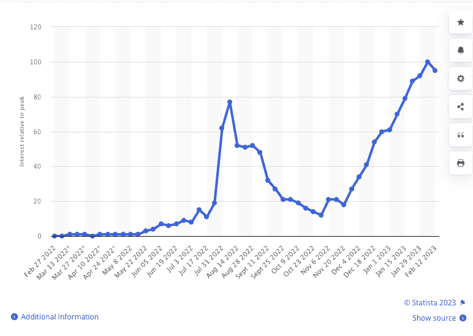

截至2023年2月，过去12个月中，AI驱动的文本到图像工具“Midjourney”在Google搜索中出现了两个高峰。这个工具最初在Discord上推出，是一个具有专用服务器的平台，用户可以使用集成的Discord机器人创建和共享图像。截至2023年1月，Midjourney成为该平台上最受欢迎的服务器，拥有约950万Discord用户。在2022年7月该平台公开发布后不久的8月7日，“Midjourney”关键词的搜索量得分达到了77个指数点，然后开始下降。但在2022年12月，“Midjourney”的Google搜索量再次上升，并于2023年2月5日达到100个指数点的高峰。

公司员工数量只有 11 名，控制了人力成本。根据报告提要，Stable Diffusion 类型的图片生成模型训练成本为 60 万美元，约合 480 万人民币，借助成熟的社区平台 Discord 实现引流。

一些风险和缺点：例如训练数据集和生成图像的侵权风险，对于人工智能生成图片缺乏版权保护，可能会受到基于OpenAI和微软技术的DALL-E2竞争，资源和应用入口，以及Midjourney生成结果不如 Stable Diffusion 可以借助开源社区的插件来进行高度控制。

### DALL-E

DALL-E是一种生成式人工智能程序和服务，由OpenAI开发。它可以根据自然语言描述生成图像。DALL-E的算法使用了一种称为“扩散”的过程，该过程从随机点的模式开始，并在识别到图像的特定方面时逐渐将该模式改变为图像。目前 DALL-E 提供了对外的 API，赋能开发者。

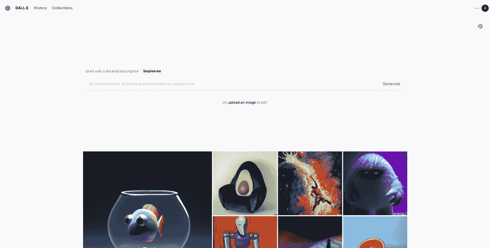

### 文心一格

百度文心一格是百度推出的一款免费AI人工智能绘画在线工具。用户只需要输入一句话，AI就能为你批量生成创意画作，实现了人人都能“一语成画”。它支持多种画师风格，如中国风、艺术创想、二次元等等。同时，文心一格还支持在线图片编辑。

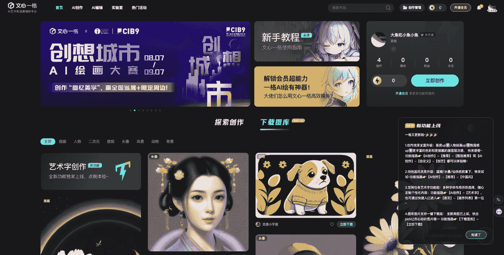

### Clipdrop

Clipdrop是一款AI辅助的图像处理工具，由Stable Diffusion 的公司Stability AI 推出。可以帮助用户轻松地修改你的图像。它有很多强大的功能，包括背景删除、物体删除、文本删除、色调调整、锐度增强等等。它还可以生成高分辨率逼真的图像，将用户的涂鸦转化为真实图像，自动从图片中删除对象、人物、文本和缺陷，提取主题等等，且支持 SDXL 1.0生成图像。提供 API 给开发者。

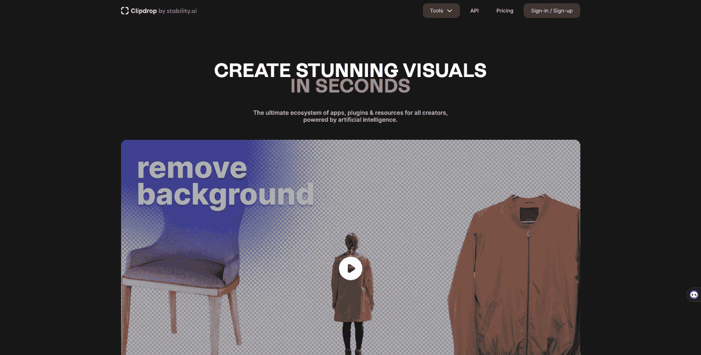

# 图片生成模型基础能力

模型的基础能力中主要对比的是其生成图片的质量和真实程度。总体来看，商业模型Midjourney在少量提示词的状态下会表现得比开源模型Stable Diffusion要好一些。但是开源模型Stable Diffusion有很多独立训练者训练的模型，有的模型有不错的表现，所以无法一概而论。另外，Stable Diffusion最新发布的SDXL 1.0的生成效果也可以和Midjourney持平，这就使得目前商业模型和开源模型之间的能力差距没有那么明显。

## 主要排名

### Fréchet Inception Distance (FID) by MS-COCO 256*256 FID-30K

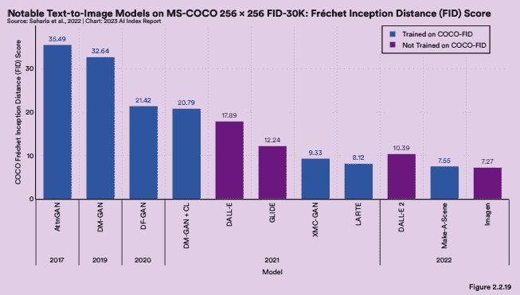

### Image Generation on CIFAR-10

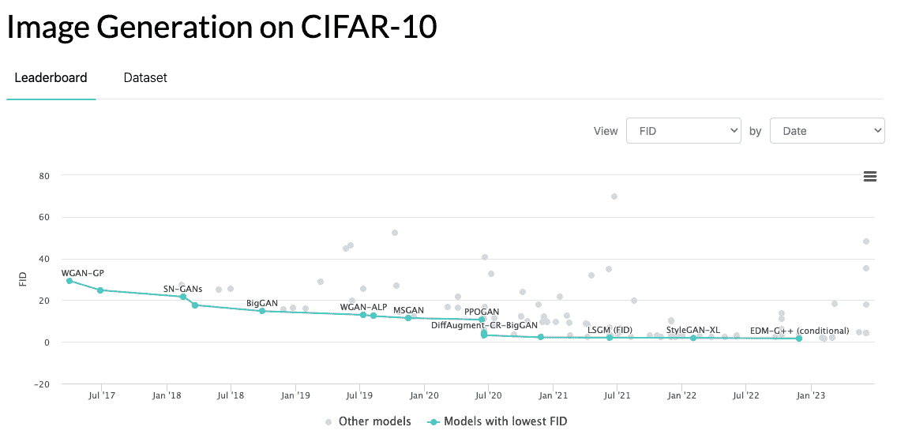

### Parti Prompts Leaderboard

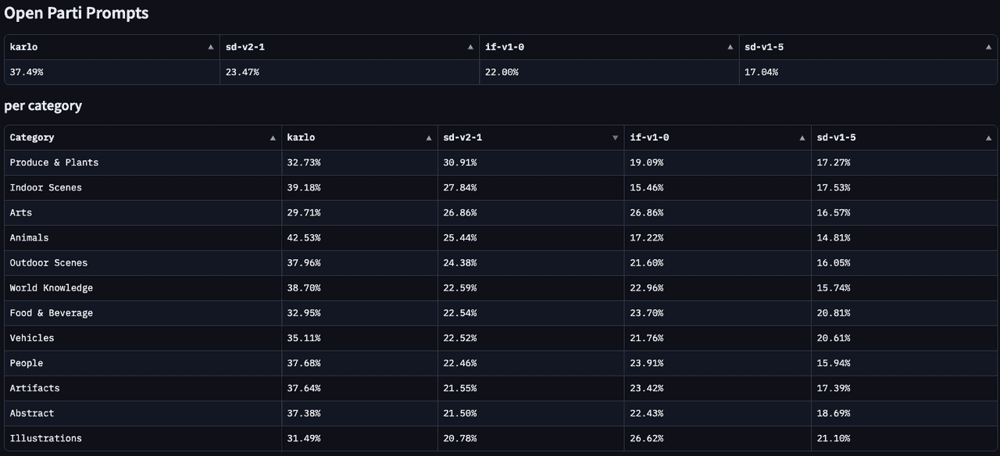

## 文生图（txt2img）

无论是在商业模型，如DALL-E和Midjourney，还是在开源模型，如Stable Diffusion中，根据文字描述生成对应的图片是图片生成模型的基础能力之一。但因为每个模型的能力不同，导致需要的提示词复杂程度也不太一样。比如在Midjourney中可以直接出图的提示词，可能在Stable Diffusion里面就没有办法达到同样的效果。

| 因素 | Midjourney | Stable Diffusion |
| --- | --- | --- |
| 图像质量 | 生成的图像质量更高，更逼真 | 质量取决于模型，但在正确输入的情况下可以生成高质量图像 |
| 功能 | 模型变种有限，没有修复或扩展功能 | 提供修复、扩展等功能，以及用于放大的各种模型 |
| 价格 | 付费服务（$10-$60/月） | 免费且开源 |
| 易用性 | 面向非技术用户的友好的基于网络的服务 | 需要技术知识和编码能力才能访问和使用模型 |

## 图生图（img2img）

图生图是一种可以从输入图像和相应的文本提示生成新图像的AI技术，也是一项图片生成AI中重要的基础能力。它被应用于Stable Diffusion和其他一些图像生成AI上。输出图像保留了输入图像的原始颜色和构图。该过程涉及通过编码器对图像进行编码,将图像转化为潜在表示,并通过OpenCLIP-ViT/H文本编码器对文本提示进行编码。文本编码器的输出然后通过交叉注意力馈入潜在扩散模型的UNet主干。以著名开源模型 —— Stable Diffusion为例，其中的Img2Img的关键特性包括:

1.  **图像到图像转换:**Img2Img从已绘制的图像或文本提示中创建图像,遵循现有图像的相同颜色模式和整体外观。

1.  **输出相似度控制:**存在一个参数,允许您控制输出与输入的相似程度,更高的值会导致输出更多地偏离输入。

1.  **保留原始颜色和构图:**输出图像保留输入图像的原始颜色和构图,使其成为将简单草图转换为成品的工具。

# 图片生成模型扩展能力

扩展能力指的是除了上一个章节当中提到的图片生成能力之外，其他的一些附加能力。这一点在开源模型上表现的尤为突出。以Stable Diffusion为首的开源模型来说，通过其WebUI，可以挂载由开源社区开发的一众插件，从而实现各种基础模型没有办法做到的功能，比如：指定区域重绘、生成视频、将视频转换成指定风格、训练和挂载LoRA、高清重绘以及蒙版生成等。这些能力的实现使得开源模型在专业领域的应用有了可能，让AI图片生成模型成为了类似于平面上的Photoshop和3D上的Maya这一类的美术生产力工具。

本章节将会从图片生成模型实际上可扩展的能力角度进行探讨。

## 精细控制

### 人物姿势

在图像生成模型中，控制图像中姿势的方法有多种。以下是一些常见的方法：

1.  控制生成码Z的分布范围：通过控制生成码Z的分布范围，可以控制生成的人脸类型，如性别、人种、年龄等粗略类型[4]。

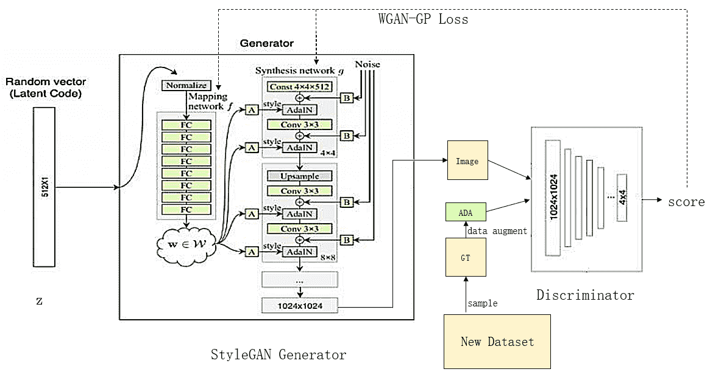

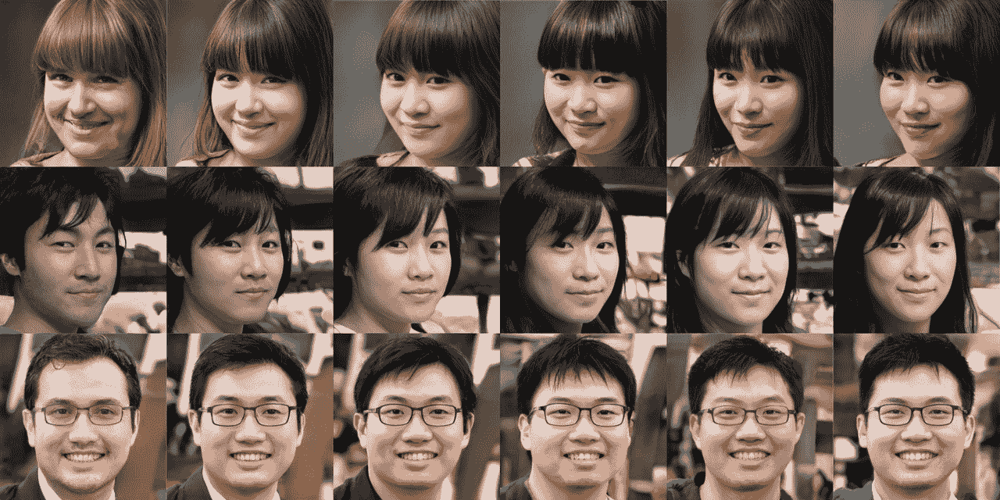

1.  优点：可精确控制需要控制的元素

1.  缺点：使用成本较高，需要有算法方面的技术储备和可供参考的数据集

1.  适用于有一定技术背景的用户，且有特定的应用场景

1.  使用ControlNet插件：Stable Diffusion的ControlNet插件能够根据给定的控制点/线稿精准生成图像，明显提高图像生成的可控性。ControlNet可以根据边缘检测、草图处理或人体姿势等各种条件来控制图像生成[5]。

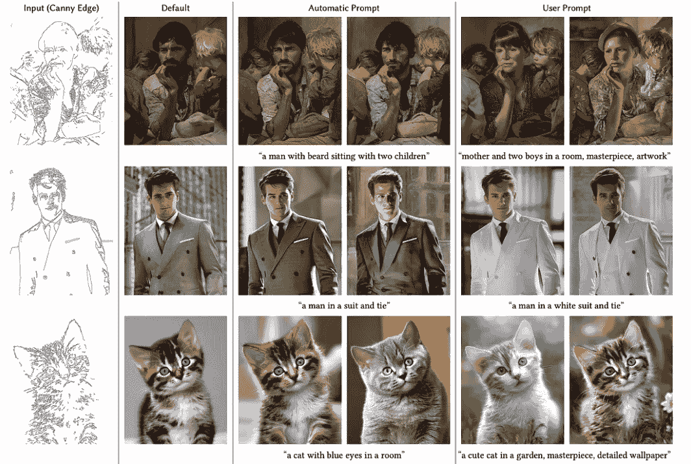

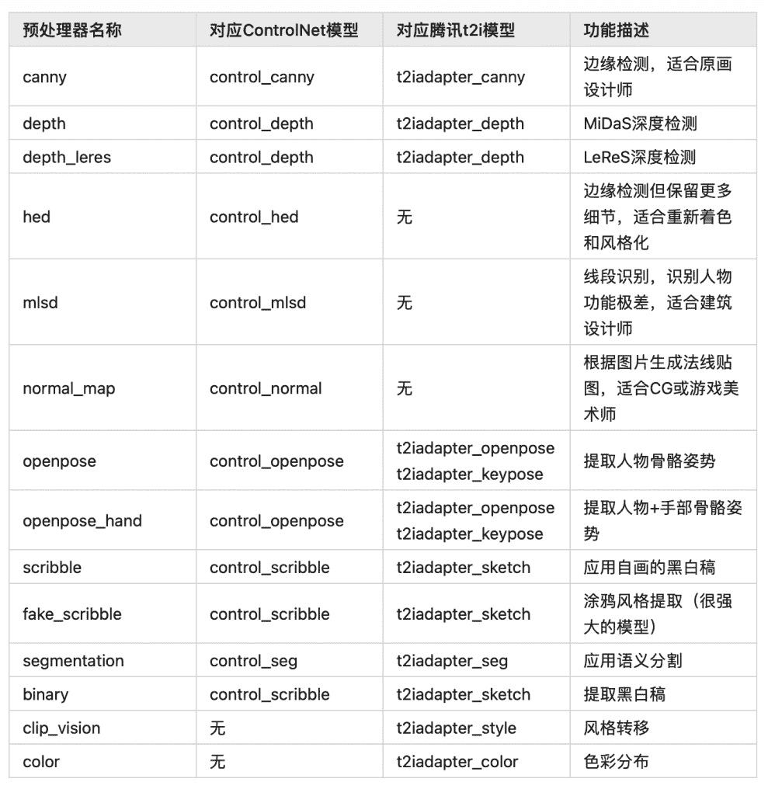

1.  优点：接入Stable Diffusion WebUI后学习成本大大降低，不需要预先准备数据集。适用于多种美术创作场景。

1.  缺点：仍然需要学会调整大量参数，以及对于输入图片素材质量的深入理解（如果输入图片质量不达标，生成的效果无法保证），才能生成较为优秀的图片

1.  适用于临时对画面内容有调整，或者对画面具体内容有调整需求的用户。

1.  使用Lora模型：Lora模型是一种专注于不同方面优化的模型，可以通过调整权重并结合多个Lora模型来实现特定的效果，例如控制面部和画风[5]。下图为 Civitai 上的部分 LoRA 展示。

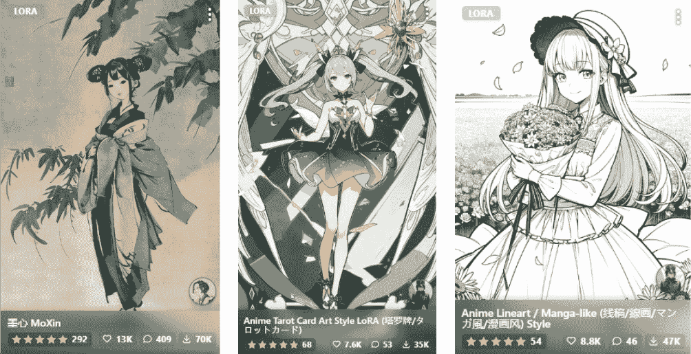

1.  优点：学习成本相对于方法1来说更低。虽然也需要准备数据集，但是数量最低可以在20张左右。

1.  缺点：需要一定的算力支持，否则训练速度过慢，或者无法训练。

1.  适用于对于模型生成图片质量有一定要求，需要重复性地生成特定风格或具备特定要素的图片，且算力资源较为充足的用户。

通过这些方法，可以在一定程度上控制生成图像中的姿势。不过，需要注意的是，这些方法需要一定的技术知识和实践经验才能达到理想的效果。另外，上述的方法可以叠加使用。

### 画面内容

除去文生图和图生图中间的提示词和输入图片，以及上述的几种办法，对于画面内容的控制，创作者可以通过自行绘制线稿或者草稿的方式进行图片生成后内容上的控制[6]，减少了创作时候涉及到的时间成本。在 Stable Diffusion 的 WebUI 中，用户可以通过蒙版的方式指定 AI 来重新绘制的区域，从而达到修复特定部位的效果，如修复手部、修复脸部以及替换画面中的元素等。

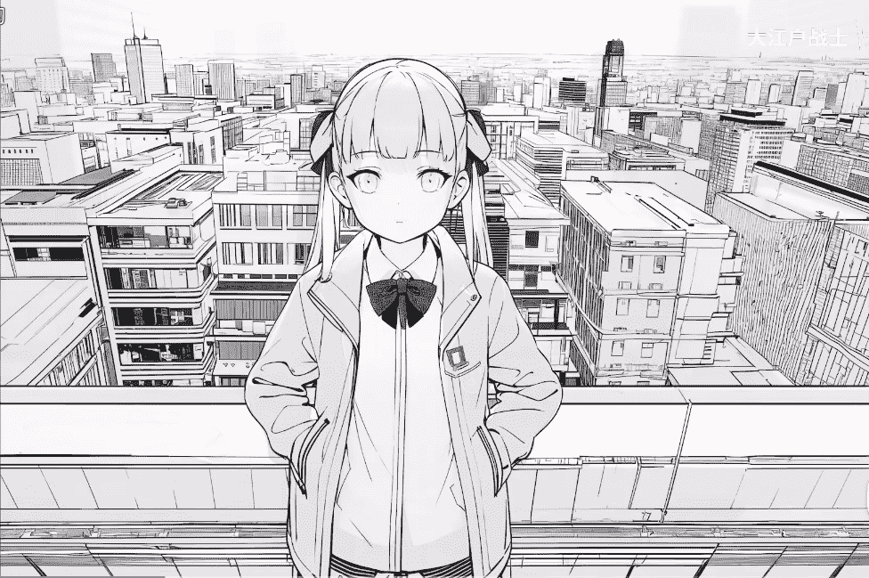

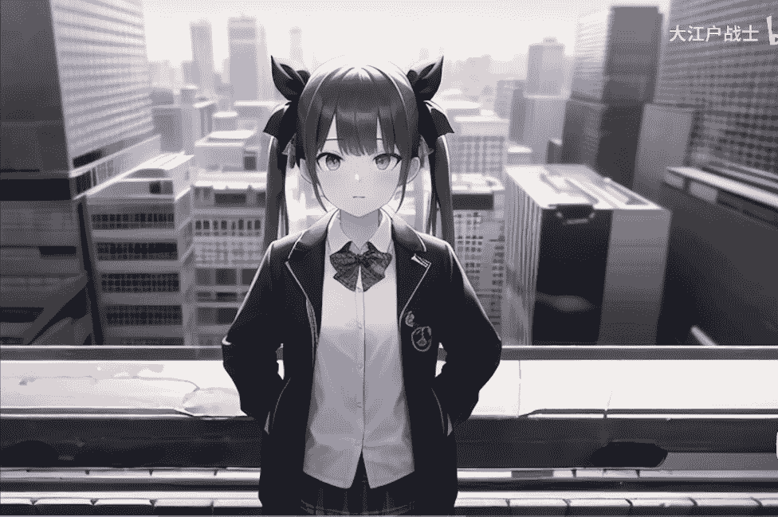

### 增加细节

增加图片细节的功能可以通过 Stable Diffusion 的高清重绘（Highres.fix）来进行实现。或者通过 Multi-Diffusion 这样的插件来进行图片的放大和细节的补充。

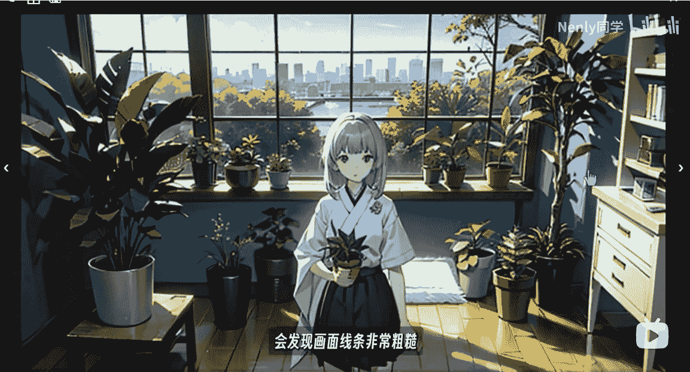

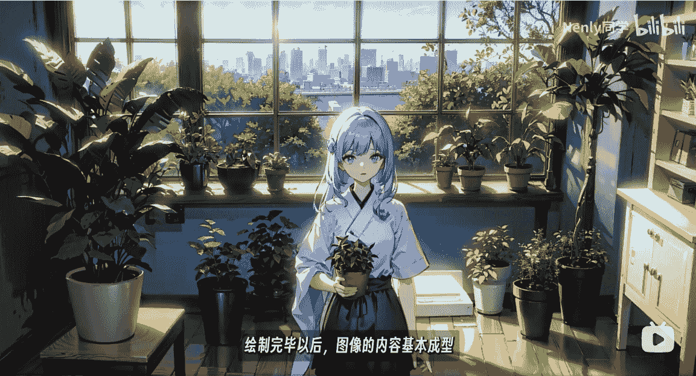

而在商业模型，如 Midjourney 当中，可以直接进行高清大图的输出。

## 插件应用

在目前的图像生成模型里面，开源模型 Stable Diffusion 系列凭借其 WebUI，从而获得了安装扩展插件的能力。而商用模型，如 DALL-E 和 Midjourney 都没有这方面的能力。这就让 Stable Diffusion 更容易成为生产力工具。

下面是一张目前较为流行的 Stable Diffusion 插件列表：

| 扩展名称 | 描述 |
| --- | --- |
| ControlNet | 对生成内容进行精确控制，提高图像生成效果 |
| Dreambooth | 训练图片生成模型的 UI 界面，大大降低训练模型的学习成本 |
| Deforum (动画) | 用于使用 AI 生成动画 |
| Dynamic Prompts | 可以在生成图像时，对提示词进行动态调整 |
| CLIP Interrogator | 提供与 CLIP 模型互动的界面，可以让用户从图像中反推出提示词 |

## 模型定制

商用模型，如 Midjourney 和 DALL-E，目前尚未开放模型定制的功能。但是开源模型，Stable Diffusion，目前已经有一系列的衍生模型可以使用，且有开源社区可供下载和发布创作者自行训练的模型[9]，且最新的 SDXL 1.0 模型也已经开源[8]。

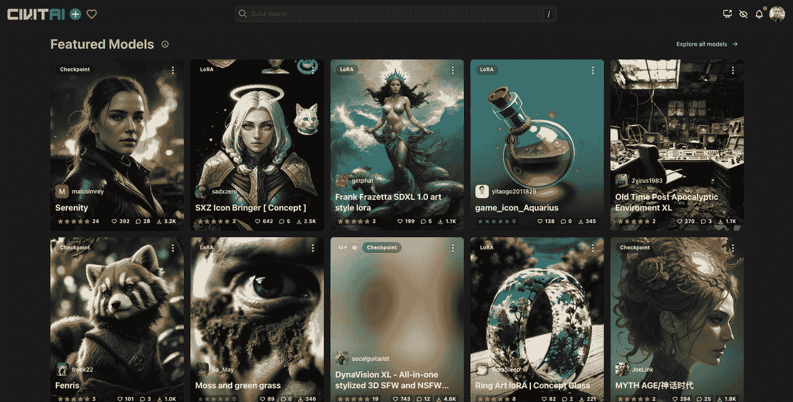

# 在专业群体中的应用

## 定义

这里讨论的专业用户群体特指原先在美术相关行业已经有工作经验的人群。他们的日常任务当中涉及到美术相关的活动，如平面设计 视频制作、以及绘画等。

## 意义

将专业用户群体的应用纳入调研中，可以探索图片生成技术在生产力上的现状和潜力。如果专业用户可以运用这项技术，这就意味着图像生成技术已经不再是一个玩具，而是一个真正意义上的生产力工具。

## 行业总体应用情况概览

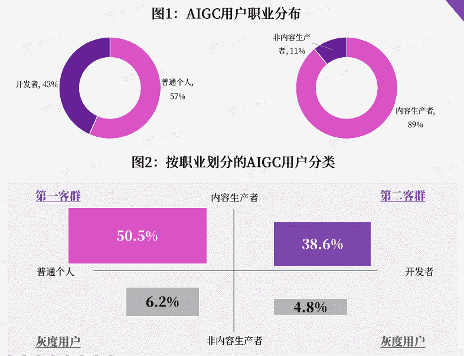

从甲子光年的统计结果来看，非开发者的内容生产者，如设计师、文字创作者以及自媒体等，占据了 50.5%的采集样本，而开发者排行第二，占据38.6%的采集样本。真正意义上落实到普通个人身上的 AIGC 相关应用较少。

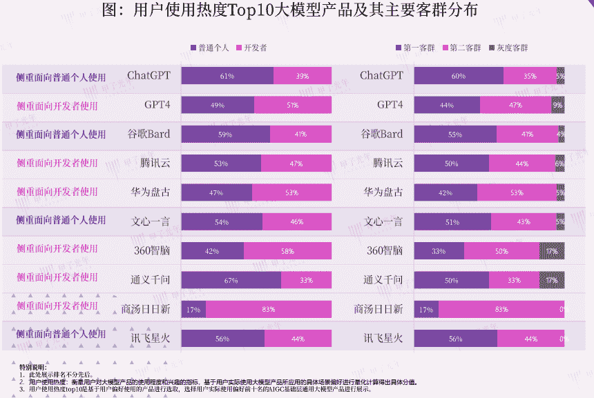

目前市场上的一个现象是：生成式AI 的主要用户群体在于不会编写代码的普通人，而市面上主要的产品均面向开发者（面向开发者的标注为浅紫色，面向普通个人的标注为深紫色。）。

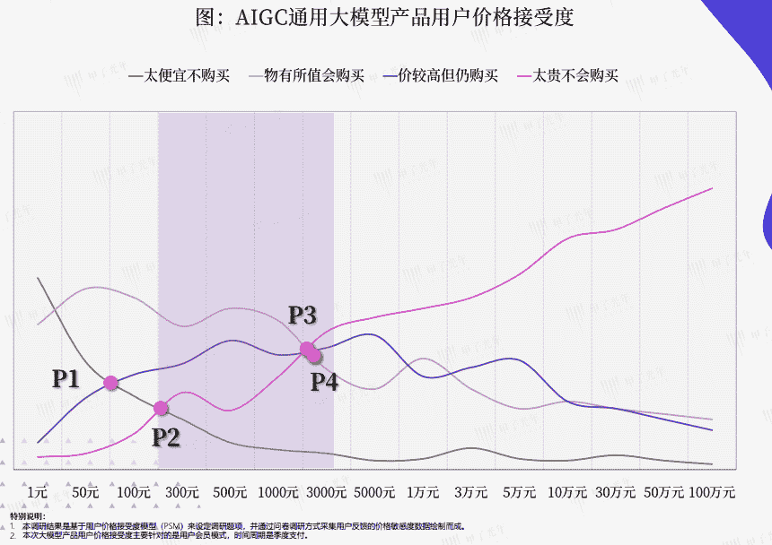

从调研结果可以看出，用户接受的最优价格为 300 - 3000 元/季度。低于和高于这个价格区间，用户的购买意愿就会下降。

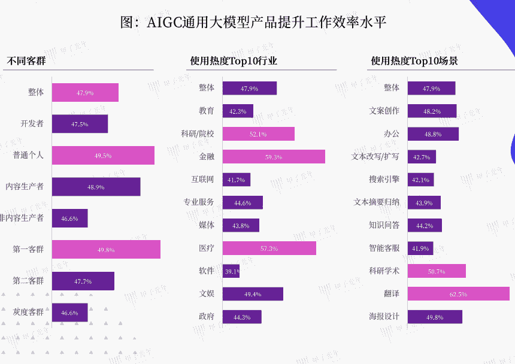

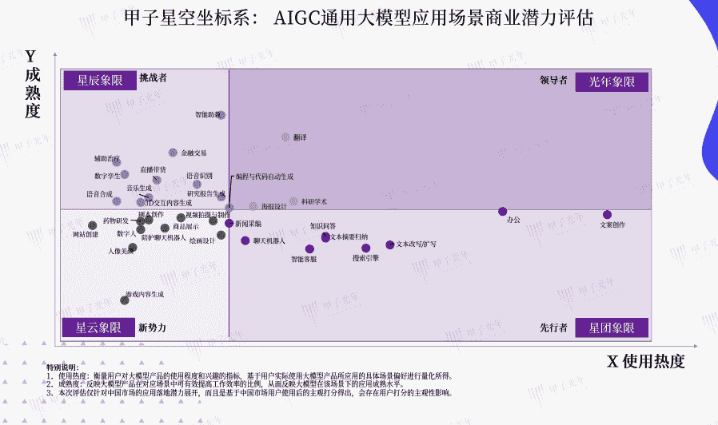

在生成式人工智能的Top 10运用场景当中，整体上都有百分之 40 以上的效率提升，表现可观。而在科研学术和翻译领域，效率提升显著。而位列第三使用热度的就是报告当中研究的柱体——海报设计。从右侧的调研结果也可以看出，绘画设计虽然也是生成式人工智能的一个应用领域，但是目前仍处于探索阶段。

## 图片生成在平面设计工作流程中的运用

### 平面设计师Linus Boman

Linus是一位资深的平面设计师，同时也是一名字体迷。他的视频频道深入探讨字体、标志和设计的日常艺术背后的故事。他非常热衷于与领域外的人分享自己的热情，并且喜欢停下来分解形成这些设计的因素。他认为，我们在日常生活中遇到的几乎所有东西都是由某人设计的，这些设计都有其独特的故事和背景。因此，他的视频内容不仅可以让人们更好地了解设计领域，同时也可以让大众更深入地理解他们日常生活中所接触到的各种设计。[16]

在 Linus 于2022 年出品的一个有关生成式人工智能是否能够取代平面设计师的 YouTube 视频中，他对行业内的工作人员进行了采访，得出的结论是：虽然由人工智能生成的图像正在改变平面设计领域，但平面设计师不会变因此淘汰。他们的角色不仅仅是视觉艺术创作，还必须通过应用逻辑和视觉问题解决帮助客户有效地传达信息。这是一套独特的技能，无法被人工智能所替代，使得平面设计师成为设计过程中必不可少的一部分。

本章节着重探讨 Linus在他的视频当中提到的生成式人工智能对平面设计一块的影响。

#### 平面设计师只是在画图吗？

虽然平面设计师通常被认为是创造视觉艺术的人，但他们的角色实际上不止于此。他们通过应用逻辑和视觉问题解决的组合来帮助客户有效地落地视觉维度的解决方案。这意味着平面设计师不仅必须擅长创建视觉吸引人的设计，还必须理解客户的需求，并使用他们的设计来传达特定的信息或解决特定的问题。因此，平面设计师不会因为他们的工作需要一组独特的技能而变得过时，这些技能不会被人工智能生成的图像所取代。

Linus 的视频里面提到了数学家和计算器的关系，以此来比喻AI 图像生成技术不会替代特定领域的专家。他采访了自己一个数学家朋友 Chris，问了这样一个问题：“72894*6321.6等于多少”。Chris 听到这个问题后直接陷入沉默，然后爆出一句“哈？（What？）”。Linus 通过这个例子解释了专业领域的工作者不仅仅是在解决基本问题。数学家不只是做简单的运算工作，平面设计师也不只是做简单的画图工作。实际上，专业领域的工作者是在解决更加复杂的问题，例如解决实际中的问题或者创造出新的设计，他们需要运用专业知识和技能来解决这些具有挑战性的问题。所以，根据 Linus 的论点，单纯的图片生成无法做到取代平面设计师。

#### DALL-E 在绘图当中的运用

Jina AI 的 CEO —— Han Xiao了解到专业摄影师会在 600 多张图片里面挑选一个最满意的照片。之后 Han Xiao 就在想，如果人工创作需要产生这么多图片，最后要进行挑选，那么为什么不能用AI来进行这项需要大量人力投入的重复性工作呢？

之后他的开源项目DALL-E Flow[15]采用“Human-in-the-Loop（人工干预）”方法进行工作。首先，生成初始的一组图片，并为第二轮生成选择一张图片。第二轮生成时，保持图片的原始结构，但丰富具体细节。然后基于第二轮的生成结果，选择其中一个并将其放大到更大的尺寸，最终完成图片的输出。这样的方式比较贴近一个传统的绘图流程：客户提供需求，设计师进行创作，客户挑选满意的图片，最终输出结果。

但是，Linus 表示，这样的工作流程比起真正的商业设计工作流来说，还是过于简单了。因为在商业的设计流程当中，设计师需要帮助客户梳理需求。有的时候客户自己也不明白自己的需求，提出的需求会有互相矛盾的地方。这个时候就需要设计师帮助客户进行梳理。而往往这个梳理本身是需要进行多轮沟通完成的，无法单纯地通过一个“prompt”就一言以蔽之。

提示词是一个梳理明确的需求。根据实际使用的经验的反映，越具体的需求可以让生成式人工智能生成得越符合期望。但在真正的应用场景当中，无法期望客户本身就能够自行梳理需求。所以生成式人工智能如果想要获得更深度的应用，一个前提就是可以自动化梳理需求这个步骤，或者诞生更高智慧的模型，本身就具备梳理和挖掘的能力。

结合 Linus 的角度和Jina AI 的开源项目来看，如果引入 LLMs 来为图像生成模型开发一个智能前端，让 LLMs 根据和用户的多轮对话来撰写最终生成图片的 prompt，是否就可以在某种程度上模拟了设计师的沟通工作了呢？这一点可以作为日后的调研课题。

#### 从业者对于生成式人工智能应用的看法

Linus 认为：**文生图 ****AI**** 可以在创意头脑风暴和重构中补**充传统素描，从而潜在地改善传统设计工作流程。然而，文生图 AI 无法替代设计过程中的大多数步骤。创意工作是繁重且耗费精力的。AI 可以通过根据少量样例素描生成数百个变体来补充传统素描。AI 可以通过基于艺术指导的情绪板进行优化，并通过反馈进一步完善。而这些都需要专业设计师的介入，而非全自动的 AI 流程。

不过，Linus 也认为**AI**辅助设计将会打破创意产业，特别是库存摄影和插图领域，并且只会影响其中的一部分平面设计师。AI辅助设计将会取代库存图片是因为，它每次都能生成独特的图像，并更好地适应具体的应用场景。另外，专门设计唱片封面、音乐、海报和纺织品印花的设计师将会面临和 AI 的直接竞争，但他们的生存能力尚不确定。颠覆性技术总是从市场底部进入，而AI辅助设计已经占据了业务的底端，例如LOGO生成器、海报模板和市场平台。

和接下来会提到的影片制作人Chris一样，Linus 也认为图片生成技术的诞生会让设计师的创造力进一步加强。对此，Linus 提供了一个有关创造力的总结：“创造力源自于限制，在限制下工作会强制地让我们思考原生的解决方案。（Creativity is born from restraints, and working within limitations forces us to think of original solutions）”

最后，Linus 认为，使用书面语言创造视觉效果就像使用摄影创作代码一样。虽然LLMs的存在使代码编写更具备可接近性，但并不意味着人类开发者会变得无足轻重。随着 AI 技术的成熟，用户界面将变得更加图形化、直观和精确。AI 生成的模仿著名艺术家、建筑师或设计师风格的艺术作品可能会存在版权侵权的不确定性。

### 平面设计师张小枫

根据一位有着6年设计行业从业经验的设计师张小枫[12]在实际工作流程中对生成式人工智能的使用，图像生成技术在设计行业中有以下5个应用方向：

#### 提供灵感创意

张小枫提到可以使用Midjourney通过文字描述生成大量参考,从中获取设计元素和色彩搭配等创意灵感,帮助构思新概念，如下列例子：

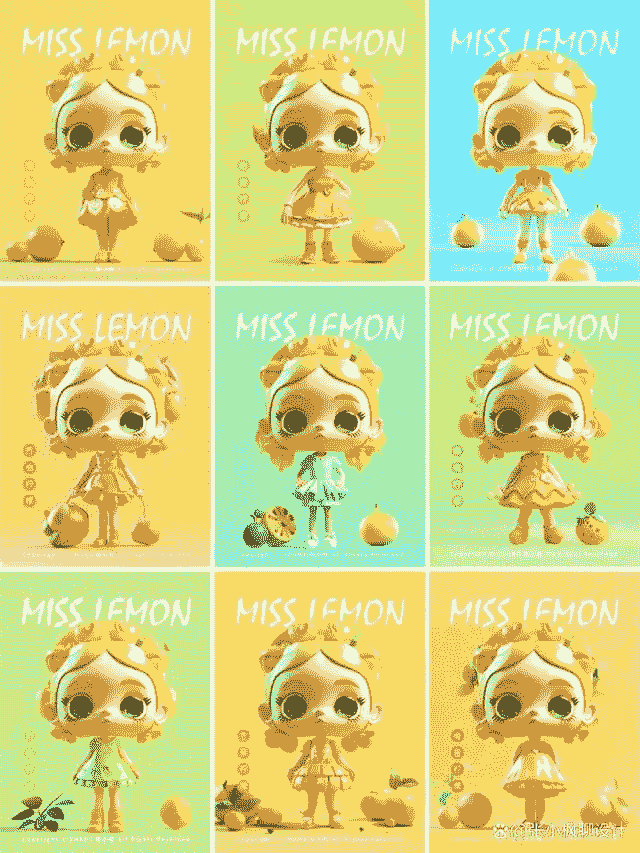

> 下面这一组是小哈使用 Midjourney 关键词生成的 IP 形象：柠檬小姐。从人物设定、故事概念到 9 个变装主题效果的展现，仅仅用 1 天就完成了。

> 虽然画面中仍有不完善的造型、元素与结构，但已经有了大方向上效果的呈现，同时我们可以看到，在发型服装上，都有柠檬在造型上的融入，提供更多的创意灵感。

> 接下来我会根据这个效果图进行二创，优化不成熟不完善的地方，再通过建模让它得以落地。

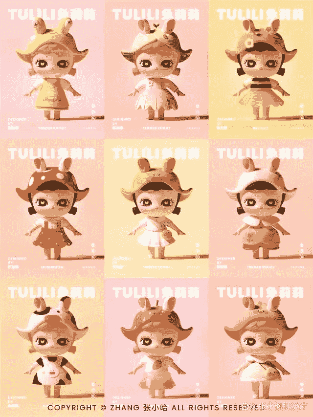

> 下面（左侧）是我原创的 IP 作品兔莉莉，从人物设定、故事概念到基础形象的设计，一般我需要想 3-4 天，才能把故事逻辑理清，基础造型设计完善，后续的变装设计和建模、渲染、后期就需要更多时间了。

#### 沟通理解

可以生成多种样式草图,配合文字说明,帮助客户更好理解设计意图,提高沟通效率。根据张小枫的描述，在以往的工作流程当中，设计本身只占用 50%的时间，而其余的大部分时间都是在沟通需求上面。也就是说，如果可以降低沟通成本，那么设计效率将会有明显的提升。

过去，张小枫可能需要手绘一个这样的插画和客户沟通：

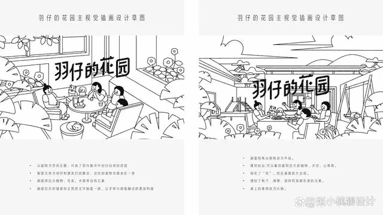

现在，张小枫可以通过 Midjourney 来生成设计草图，直接敲定需求：

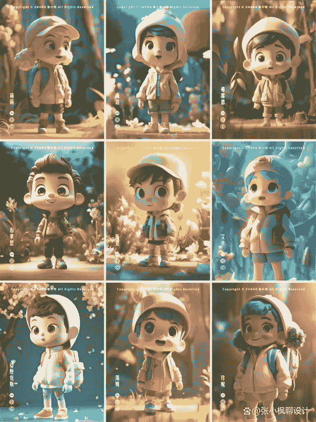

#### 发散思维

可以从一个原创概念延伸创作出更多系列作品，例如张小枫提到的以一张作品为基础,延伸创作出Floral系列作品的案例。根据张小枫的描述，现在已经有客户希望可以授权这个 IP 的使用。

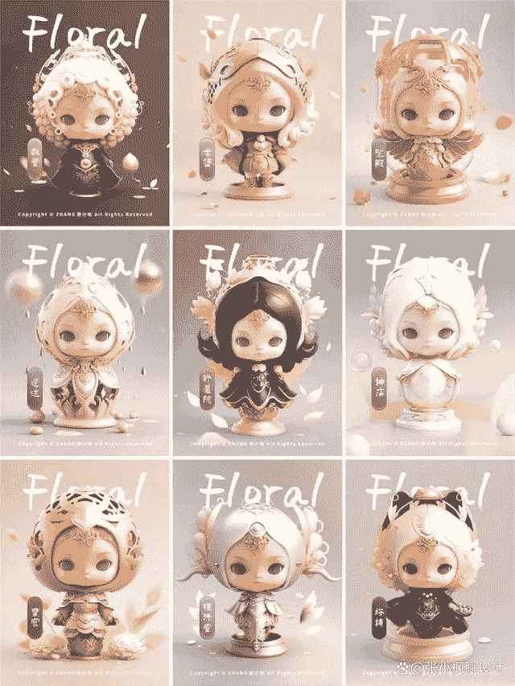

#### 提升空间感

可以生成不同视角和多视图的图像,帮助训练空间想象力。张小枫也提到这可以帮助绘画初学者理解透视关系。

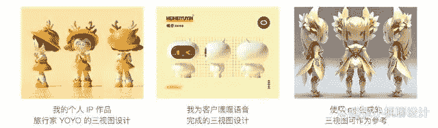

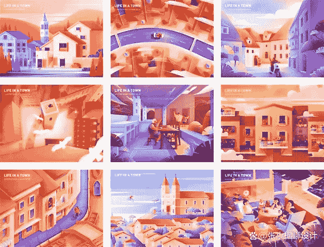

#### 直接参与商业应用

一些轻量项目可以直接使用AI生成图像,但需要注意版权问题。张小枫提到一些案例如海报、地铁广告等已应用AI绘画。

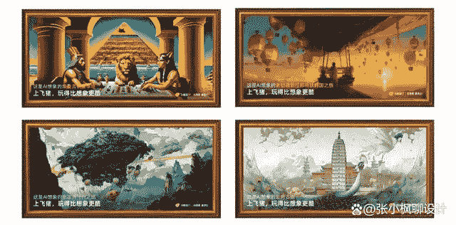

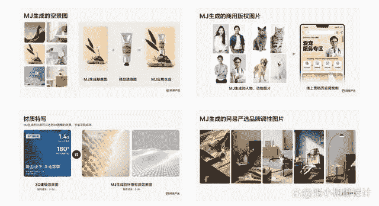

## 图片生成在视频制作工作流程中的运用

随着生成式人工智能和机器学习等人工智能工具的出现，视频营销的格局发生了转变。正如Erin Rodrigue在她采访视频制作人Chris Lavigne的稿件中[14]所阐明的那样，当代的人工智能生成工具在辅助专业人士的能力上发挥作用，而不是完全取代他们。生成式人工智能协助视频制作专家在包括编剧、编辑和制作等领域，加快了整个制作工作流程。例如，Wistia的Chris Lavigne能够借助人工智能优化流程，以更快的速度构思视频创意并将其付诸实践。然而，虽然人工智能提高了效率，但一些人担心它可能也会产生平庸、普通的内容，并危及人类视频创作者的生计。

在[14]中，Lavigne提出应将人工智能视为视频营销人员的补充，而非替代品。他认为人工智能仍然存在局限性，特别是在唤起人类情感和创造力方面。正如Lavigne所言，仍然“无法替代真实人类的拍摄”[14]。这表明人工智能尚未掌握以真实方式吸引观众情感的艺术。

### 纯 AI 视频制作工作流程

Lavigne进一步观察到，优秀的视频内容将人工智能自动化与人类艺术和叙事技巧巧妙地结合在一起。那些将人工智能视为“创作助手”，同时融入其独特视角的视频营销人员将在接受人工智能生成内容的情况下获得优势[14]。

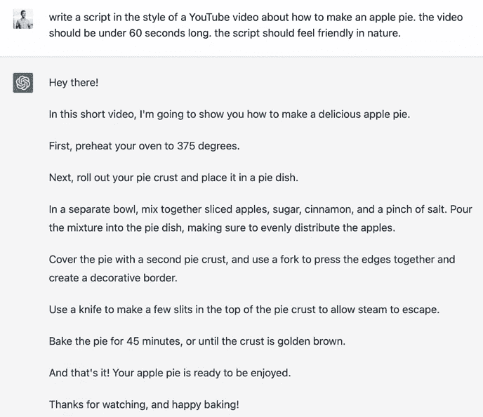

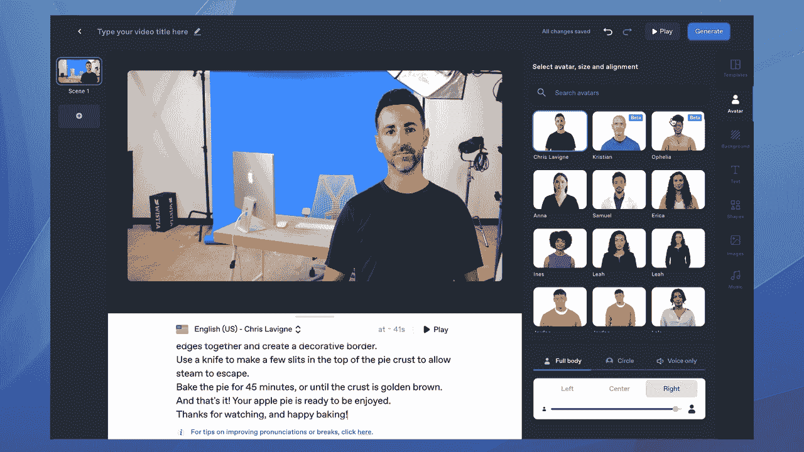

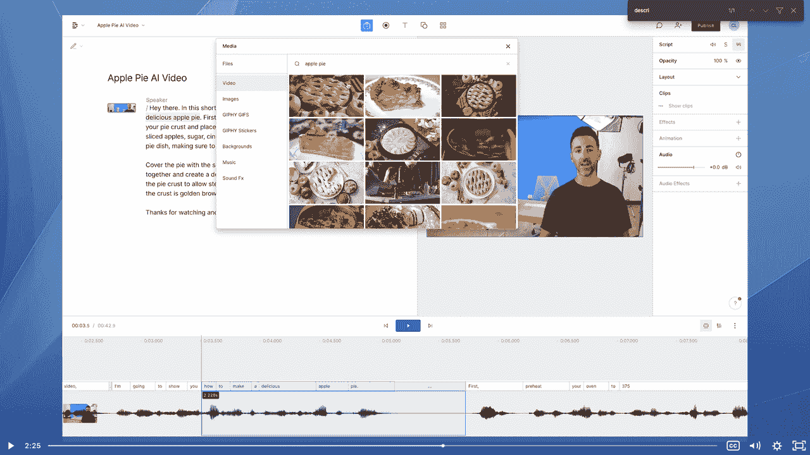

### 生成式AI 真的可以取代视频制作人吗？

当前人工智能工具的一个主要局限性是它们无法真正以真实的方式吸引人类情感和心理。正如文章中[14]所述，一个视频制作人在制作视频的时候，决策通常受情感驱动，因此视频营销人员必须利用能够在情感层面上与观众建立联系的视觉元素，以产生影响。

然而，人工智能尚不能与人类的创造力和艺术直觉相媲美，而这些因素恰恰在制作引人入胜的情感视频时起到作用。正如Chris所观察到的，人类编辑者了解如何运用节奏、摄像机运动、音乐选择和其他技术，有意识地唤起特定情感和与目标受众共鸣的感觉。他们有意识地地把握情感的节奏和微妙之处。而相比之下，虽然人工智能可以模仿人类模式，但其情感智能仍然很基础。正如Chris指出的，当涉及捕捉真实的人类反应、面部表情和情感时，仍然“无法替代真实人类的拍摄”。人工智能生成的人类化身缺乏真实人类的深度和细微差别，无法触动人们的心弦。

这表明，虽然人工智能可以简化某些例行制作任务，如脚本创作、创意发散和剪辑辅助等，但仍需要人类的创造力、共情能力和情感智能来制作能够建立真实联系的视频内容。唤起情感的艺术是一种复杂的人类技能，人工智能尚未完全掌握。意识到这一局限性的视频营销人员可以在最大程度发挥人工智能的能力的同时，仍需要优先考虑能否使他们的内容引人入胜的真实人类情感，而这恰恰是在视频制作方面结合人类智慧和 AI 能力的关键所在。

展望未来，随着人工智能逐渐成为视频制作者的帮手，生成式人工智能将对视频制作领域产生影响[14]。一个关键问题是：人工智能是否会将视频营销引导到有利的方向。一些人预测，随着人工智能的可访问性增加，将会涌现出大量枯燥乏味的低质量视频充斥互联网，比如目前国内互联网中涌现的“注意看，这个男人叫小帅”的梗，就是源于这种利用 AI 大批量制作低质量视频的现象。但 Chris 认为，这反而可能会激励人类视频创作者加倍努力，创作出更有情感的内容。就像摄影没有使画家完全淘汰一样，人工智能不会取代视频制作者。

### 埃德蒙·贝拉米肖像

"埃德蒙·贝拉米肖像"是由位于巴黎的艺术集体Obvious开发的人工智能程序创建的艺术作品。该肖像是使用生成对抗网络（GAN）和一个包含了14世纪至20世纪间绘制的1.5万幅肖像的数据集生成的。这件艺术作品呈现出一位略显模糊的男性，印在帆布上，尺寸为27.5 x 27.5英寸，置于镀金木框内。图像在右下角用一部分产生它的算法代码签名。

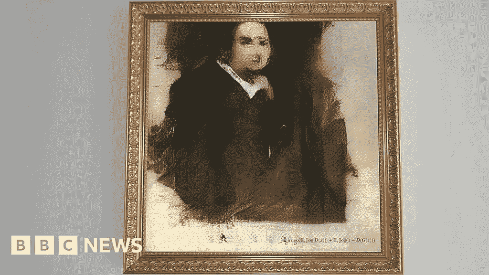

这幅肖像是由Hugo Caselles-Dupré、Pierre Fautrel和Gauthier Vernier共同创作的虚构贝拉米家族的11幅独特肖像之一，他们组成了Obvious团体。这个系列以GAN的发明者Ian Goodfellow的名字命名，而“good fellow”在法语中大致翻译为“bel ami”（亲爱的朋友）。这件艺术品在纽约的佳士得拍卖行以432,000美元的价格售出，远远超出了预估的售价7,000至10,000美元。[10]

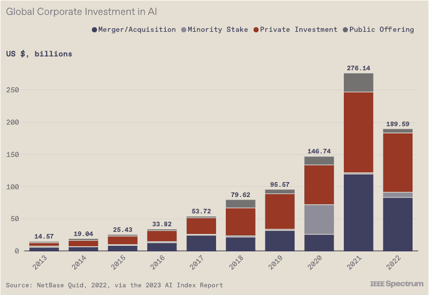

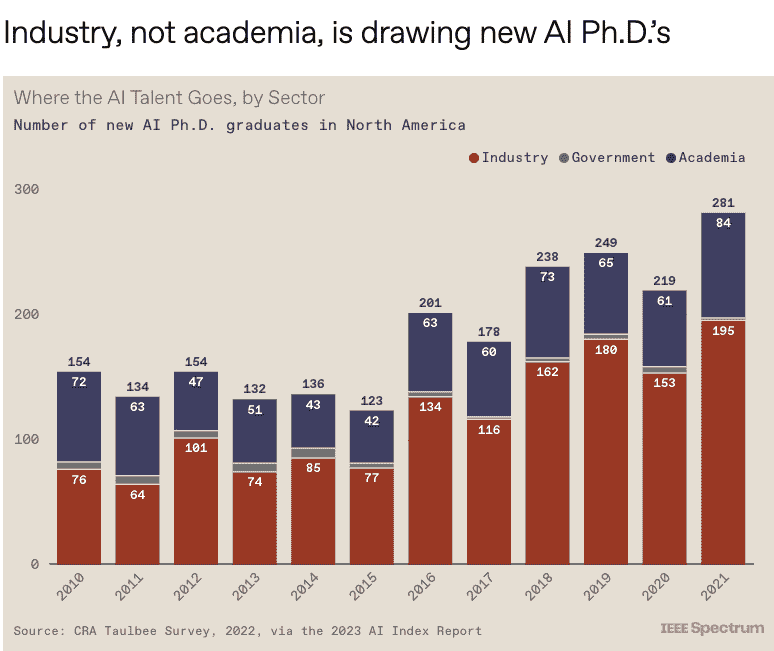

埃德蒙·贝拉米肖像在 2018 年出世，而在 2018 年，全球的 AI 投资正处在一个飞速上升期——投资量首次迎来了高达 250 亿美元的增长，为当时的历史最快速增长。同一时期，以北美的 AI 人才市场为例，有大量的人才涌入 AI 产业，从侧面说明了 2018 年左右，AI 产业呈现飞速的发展，埃德蒙·贝拉米肖像应运而生。

埃德蒙·贝拉米肖像以432,000美元的价格售出，从中可以看出 AI 生成图片技术的部分商业价值如下：

1.  **引起大众的好奇心理：**这幅艺术作品是第一幅由主要拍卖行出售的AI生成肖像，吸引了收藏家和广大公众的关注。AI生成艺术的新颖性可能对高售价有所贡献，因为它代表了艺术界的一个新前沿。

1.  **创造话题性：**AI生成的肖像拿出来拍卖本身在当时就具有可以讨论的空间。由于AlphaGo 在当时已经产生了相当的影响，让人类社会开始更广泛的讨论 AI 和人类的关系。一个 AI 生成的肖像可以被用于拍卖，引发了媒体的报道，从而进一步推动了人们对AI生成艺术及其在包括营销在内的各个行业中的潜在应用的兴趣。

1.  **技术应用：**这幅肖像展示了AI和机器学习在艺术创作中的能力，展示了AI生成艺术在营销活动和其他业务应用中的潜力。而目前的 Stable Diffusion 和 Midjourney 这些图像生成模型，已经比当时生成肖像的模型获得了更广泛的运用。

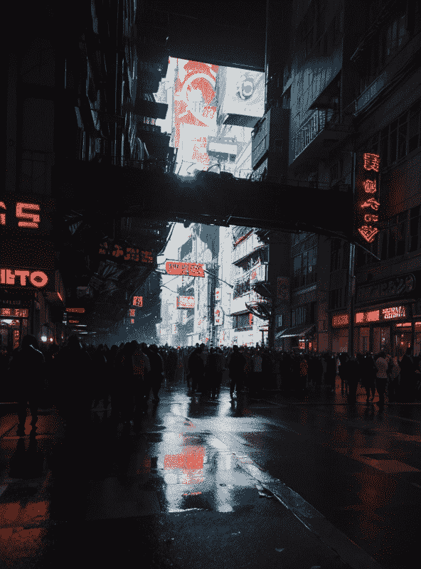

了解了埃德蒙肖像背后的逻辑后，也就不难理解为什么最近 Stable Diffusion 上的光影字体和二维码会爆火。二者兼具了唤醒大众在 AI 技术领域的好奇心和话题性。

## 图片生成在数据收集方面的运用

合成数据在生成式人工智能时代变得越来越重要。虽然合成数据技术在成本效益和隐私方面得分很高，但它确实存在重大风险和限制。合成数据的质量通常取决于创建它的模型和开发的数据集的质量。使用合成数据需要额外的验证步骤，例如将模型结果与人工注释的真实世界数据进行比较，以确保结果的保真度。

根据Gartner的预测[25]，到2030年，合成数据将完全取代AI模型中的真实数据。合成数据通常被视为低质量的替代品，并在真实数据难以获得、昂贵或受到监管限制时使用。然而，这种反应忽略了合成数据的真正潜力。合成数据可以是构建准确、可扩展的AI模型的更好注释数据的有效补充或替代品。当与真实数据结合使用时，合成数据创建了一个增强的数据集，通常可以弥补真实数据的弱点。

合成图像生成可以通过创建合成图像数据来解决图像数据稀缺或不可用的业务问题。合成图像生成是一种可用于机器学习项目的合成数据生成类型(27)。合成图像生成可以与真实世界数据结合使用，以训练AI模型并创建基于通用场景描述(OpenUSD)的3D模拟(28)。

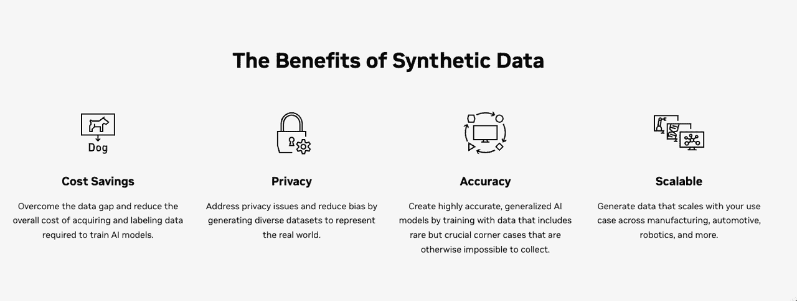

合成数据是另一个AI普及的推动因素。使用合成数据，专业人士将信息注入他们的AI模型中，并获得比直接观察更有价值的人工生成数据。此外，合成数据可以提高机器学习模型的准确性。现实世界的数据是偶然的，并不包含真实世界可能发生的所有条件或事件的所有排列组合。

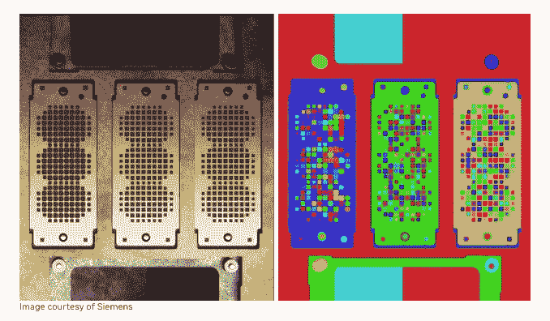

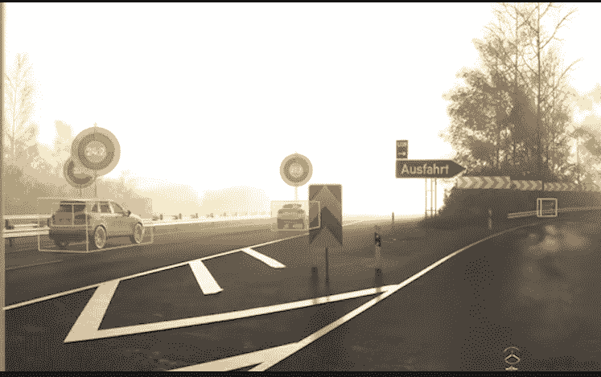

介绍生成对抗网络（GAN）图像合成的概念。本文提供了一种用于图像合成的方法分类法，回顾了不同的文本到图像合成和图像到图像转换模型，并讨论了一些评估指标以及GAN图像合成可能的未来研究方向。本文可用作参考，以提供更多关于GAN在图像合成中方法和应用的见解。

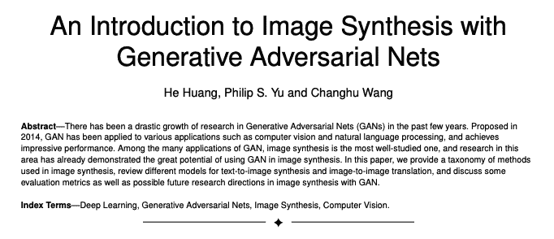

# 在不同行业中的应用

## 电商：制作产品海报、数字模特

[传统三维海报制作方法](https://www.bilibili.com/video/BV1TT411H75M/?spm_id_from=333.999.0.0)

AI 生成：

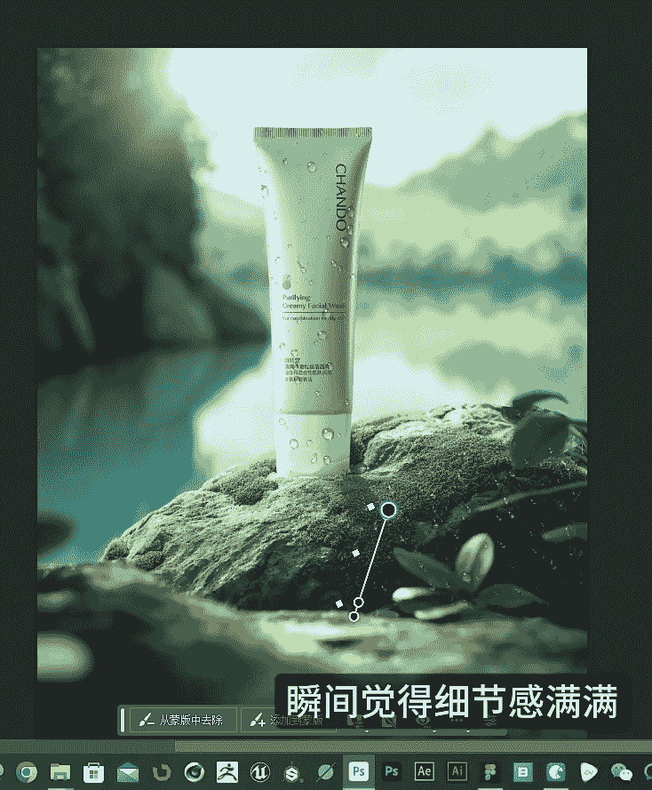

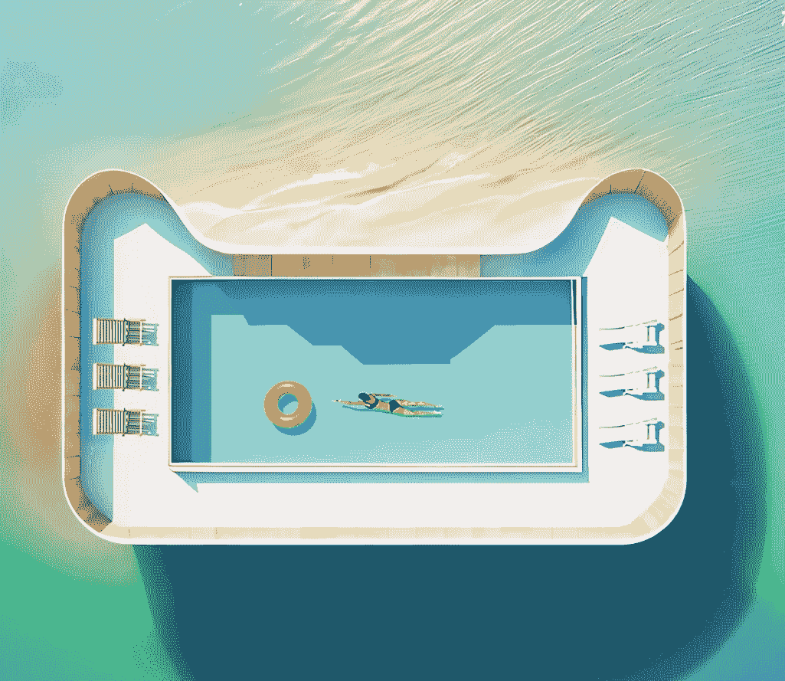

## 游戏：AI 绘制材质贴图

[传统三维材质绘画方法](https://www.bilibili.com/video/BV1TT411H75M/?spm_id_from=333.999.0.0)

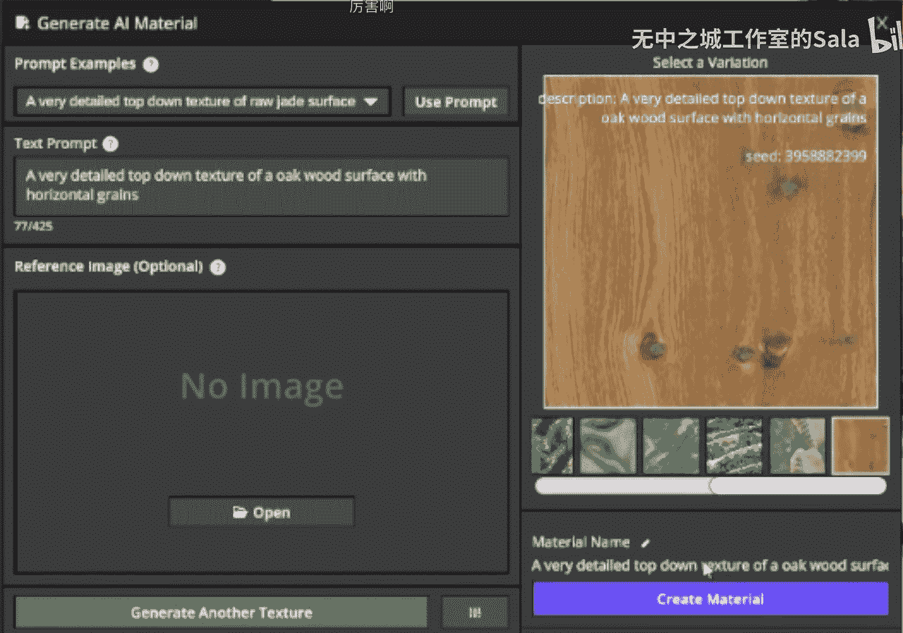

## 设计：海报背景生成

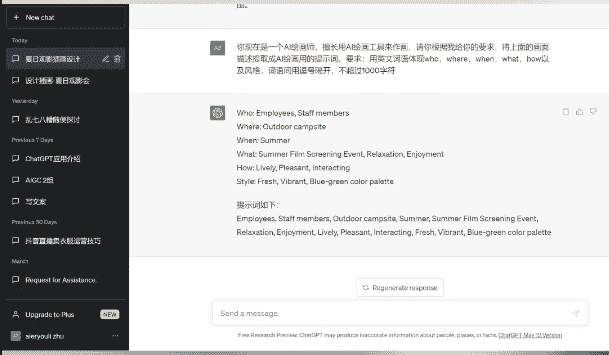

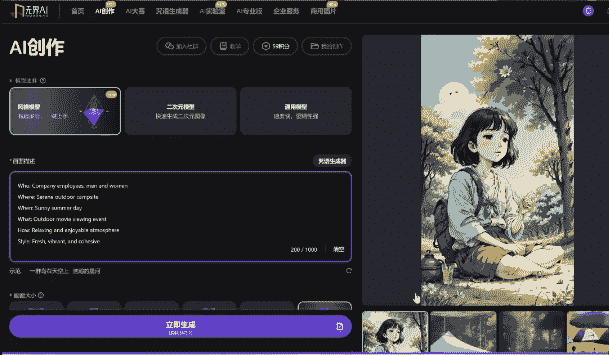

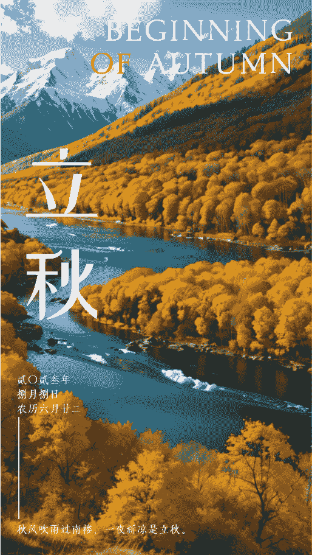

# 成本

目前市面上在图像生成技术领域，大致上可分为开源的 Stable Diffusion 以及封装成服务提供的 Midjourney 和 DALL-E。虽然 Bing Chat 也提供图片生成服务，并且免费使用，但由于没有找到商业领域应用的实际案例，故不放在本报告中作为讨论对象。

开源图像生成技术，如 Stable Diffusion 可以在本地部署使用。由于开源技术本身需要一定的技术能力，所以对于使用者来说，也需要投入时间成本来进行学习和使用。除此之外，成功在本地运行也需要一定的算力支持，即便是开源的软件免费，但硬件不会，而这也是隐藏的价格成本。

在商用服务性质的图像生成技术方面，以 Midjourney 和 DALL-E 为首的技术主要以会员订阅制为主。用户只需要购买订阅就可以进行图像生成，且不需要考虑硬件算力和技术维度的问题。

## 效能评估

|  | Stable Diffusion WebUI | Midjourney | DALLE-E | 文心一格 | Clipdrop |
| --- | --- | --- | --- | --- | --- |
| 年费 | 使用一张 2080ti 22G 生成图像为例的话：  ~ 500 CNY（显卡单价/5年寿命） | 672 - 9216 CNY | 按使用次数付费 | 828 - 4068 CNY | 588 CNY/ 80万 CNY 每 100万次API Call |
| 生成速度 | DPM++ SDE Keras采样器，11.6秒 | 60秒 | 3秒 | N/a | SDXL 1.0，6秒 |
| 生成质量 |  | N/a |  | N/a |  |
| API？ | 支持 | 不支持，非官方 API | 支持[17] | 支持[19] | 支持[18] |

总体上来说，图片生成是一个重度需要算力支持的技术。从个人部署 Stable Diffusion WebUI 的成本上可以看出，如果单人的硬件成本是 500 元，而各大服务提供商的价格都在这个价格之上 300 元的范围，那么可以看出，这样的生成服务目前也是在以算力作为核心成本。

# 结论和思考

AI图像生成技术正在迅速被采用和发展，具有巨大的市场潜力。据麦肯锡称，包括图像生成在内的生成式AI工具已经看到了“爆炸式的采用”，其中1/3的调查受访者在至少一个业务功能中定期使用它们[20]。这表明AI生成很快将成为商业内容工作流程和策略的标准组成部分。

像Stable Diffusion这样的开源解决方案为愿意从技术维度投入精力的用户提供了可定制性，而Midjourney和DALL-E等商业服务则专注于消费者友好性。例如，Stable Diffusion的插件生态系统使得它能够实现修复和动画生成等功能。相比之下，Midjourney可以通过简单的提示生成高质量的图像[21]。每个解决方案在某些子领域表现出色。

对于像平面设计师和视频制作人这样的专业用户来说，AI可以增强构思、沟通和生产工作流程。设计师Linus Boman表示，AI可以“作为对于传统手画草稿的补充，是一个潜在的、可以改善传统设计工作流程中获取灵感和迭代的工具（...potentially improve traditional design workflows by supplementing traditional sketching for ideation and iteration...）”[16]。然而，像素材库这样的服务可能会受到干扰，因为AI能够生成针对特定用例，生成符合要求的图像[16]。

> ... ...这张海报（指动画电影《去你的岛》）图全程由AI制作。制作过程中用到了图片生成AI 工具Midjourney、Stable Diffusion，以及最新发行的GPT4模型。由人类设计师给出设计理念与关键词，然后利用ChatGPT来完善指令，再把指令输入到Midjourney中，生成图片后根据效果不断修改指令微调，最后再用Stable Diffusion调整局部效果，一张精美的海报就在设计师和人工智能的通力合作下完成了... ... [29]

AI正在增强的关键能力包括概念灵感（效率增加50.5%）、素描迭代（构思速度提高60%）、添加细节（高清重绘）、空间感训练（多视角生成）、在某些项目中直接商业使用（地铁广告）以及自定义模型训练（LoRA模型）[12][13]。Stable Diffusion的插件生态系统显著扩展了其功能。

在图像生成的使用成本上，个人使用的成本已经可以压制到每年 500到 800 元的区间。但个体可能仍然需要对参数调整和提示词工程方面有一定的研究。除此之外，版权问题仍然是一个灰色地带。

Midjourney 的商业模式说明了一个 AI 时代，公司运作的新模式。即：减少人力方面的投入，将资金投放在人工智能模型的部署、研发以及更重要的算力上。这意味着，AI 时代的公司，算力可能比人力更需要获得关注。

总体而言，AI图像生成正在成为内容创作和设计不可或缺的一部分。设计师张小枫在项目中采用了5种运用图像生成的运用方式[12]。也就是说，现阶段利用图像生成技术来提高生产力的模式是：“人类创造力和思考+AI 落地执行=更高的生产力”。公司应该开始制定将它们整合到业务运营中的策略，从而为对应领域的工作增加效率。

# 引用文献

1.  S. Wang and J. Zhang, “Image generation in commercial applications: A survey,” in arXiv[ preprint](https://arxiv.org/pdf/2301.01914.pdf) arXiv:2301.01914, Jan. 2023. [Online]. Available: arxiv.org

1.  Papers With Code. (n.d.). CIFAR-10 Benchmark (I[m](https://paperswithcode.com/sota/image-generation-on-cifar-10)age Generation) [Web page]. Available: Papers with Code - CIFAR-10 Benchmark (Image Generation)

1.  OpenGenAI. (2023, May 17). Parti Prompts Leaderboard- a Hugging Face Space by OpenGenAI [Web page]. Available: Parti Prompts Leaderboard - a Hugging Face Space by OpenGenAI

1.  SeePrettyFace. (n.d.). Research Notes. Retrieved August 8, 2023, from https://www.seeprettyface.com/research_notes.html

1.  UISDC. (2021, December 22). Stable Diffusion 4. Retrieved August 8, 2023, from https://www.uisdc.com/stable-diffusion-4

1.  Bilibili. (2021, August 7). 【AI绘画】使用ControlNet给线稿上色的技巧 [Video]. Bilibili. https://www.bilibili.com/video/BV1pv4y18793

1.  Bilibili. (2021, August 7). 【Multi Diffusion + Tiled VAE + ControlNet Tile模型，低显存打造AI绘画超高清6K分辨率体验！SD扩展插件教程】 [Video]. Bilibili. https://www.bilibili.com/video/BV1Su4y1d7Dp

1.  李一, “SDXL1.0 新模型调研,” Feishu, 2023, [Online document]. Available: https://uvisyn41q4.feishu.cn/docx/YAI8du3GpoFPyqxH21RcEySdnOd [Accessed: Aug. 8, 2023].

1.  Civitai. (2023, January 5). Stable Diffusion WebUI. Civitai. https://civitai.com/articles/1299/stable-diffusion-webui

1.  BBC[ News, “Portra](https://www.bbc.co.uk/news/technology-45980863?source=post_page---------------------------)it by AI program sells for $432,000,” BBC News, 25 October 2018. [Online]. Available: (1). [Accessed: Aug. 8, 2023]

1.  IEEE Spectrum, “10 Graphs That Sum Up the State of AI in 2023,” [IEEE Spectrum,](https://spectrum.ieee.org/state-of-ai-2023) 08 April 2023. [Online]. Available: (1). [Accessed: Aug. 8, 2023].

1.  X. Li. “AIGC在设计商业项目中的应用 | 5 点思考.” 百度百家号. https://baijiahao.baidu.com/s?id=1766027974924550180&wfr=spider&for=pc (accessed Aug. 8, 2023).

1.  用户对大模型产品的价格接受度与使用热度调研报告 (User Acceptance and Usage of Large-Scale AI Models: A Survey Report), 甲子光年智库 (Jiazi Light Year Think Tank). . Accessed on: Aug. 9, 2023.

1.  E. Rodrigue, "Is AI the Future of Video Creation? We Asked Wi[s](https://blog.hubspot.com/marketing/ai-video-creation)tia's Head of Production," HubSpot Blog, 27 Mar. 2023. [Online]. Available: https://blog.hubspot.com/marketing/ai-video-creation

1.  Jina AI. (2021). DALL-E Flow. GitHub. https://github.com/jina-ai/dalle-flow

1.  "W[hat is MECE? A Simple E](https://www.youtube.com/watch?v=LMT-RO-_TbA)xplanation," YouTube, uploaded by MConsultingPrep, May 11, 2020, https://www.youtube.com/watch?v=LMT-RO-_TbA. Accessed on: August 10, 2023.

1.  OpenAI. (2022, November 3). DALL·E API now available in public beta. [Blog post]. Retrieved from https://openai.com/blog/dall-e-api-now-available-in-public-beta/

1.  C[lipdrop. (20](http://clipdrop.com)23). Clipdrop APIs. [Online]. Available: clipdrop.com

1.  [Baidu Cloud. (2023, January 4). Natural Lang](https://baike.baidu.com/item/%E6%96%87%E5%BF%83%E5%8D%83%E5%B8%86/62987586?fr=ge_ala)uage Processing. [Online]. Available: https://baike.baidu.com/item/%E6%96%87%E5%BF%83%E5%8D%83%E5%B8%86/62987586?fr=ge_ala

1.  M. Chui, J. Manyika, and S. Ramaswamy, “The economic potential of generative AI: The next productivity frontier,” McKinsey & Company, 2022.

1.  A. Johnson, “Here Are The Best AI Image Generators,” Forbes, 28-Apr-2023.

1.  J. Kuo, “China’s video game artisans fear for their jobs in the age of AI,” Rest of World, 2022.

1.  Stock.us. “CN Report: 传媒[行业跟踪分析：Midjourney：AI绘画“小”模型的成](https://www.tiantianyanbao.com/article/44520.html)功之道.” Stock.us. https://www.tiantianyanbao.com/article/44520.html (accessed Aug. 12, 2023).

1.  T. Liu, “网易伏羲AI助[力《永劫无间》共创活动，玩家参与游戏皮肤设计](https://new.qq.com/rain/a/20230322A01Y6Z00),” in 腾讯新闻, Mar. 22, 2023. [Online]. https://new.qq.com/rain/a/20230322A01Y6Z00 [Accessed: Mar. 23, 2023].

1.  Gartner (2022). Is Synthetic Data the Future of AI? Newsroom Q&A.

1.  Analytics Vidhya (2022). An Introduction to Synthetic Image Generation from Text Data.

1.  Medium (2022). Generate Synthetic Image Data for Your Next Machine Learning Project.

1.  NVIDIA (2022). Synthetic Data for AI & 3D Simulation Workflows.

1.  IEEE cit[a](https://www.scribbr.com/ieee/ieee-website-citation/)tion E. Wang. “AI 生成的肖像拍卖，为什么能卖出 432 万美元？” https://www.ewang.com/n/5582.html. 1 (accessed Apr. 16, 2023).

1.  “光线传媒释出首张AI绘制海报，动画电影产能步入加速期” Mar. 22, 2023. [Online]. Available: . [Accessed: Mar. 22, 2023].

---

**微言大义官方社群（无广纯享版）**

扫码加入，获取更多提示工程调研

