# Stable Diffusion 调研文档

> 来源：https://docs.feishu.cn/docx/VStSdRxecorypGxDbbsc8UTRnGb

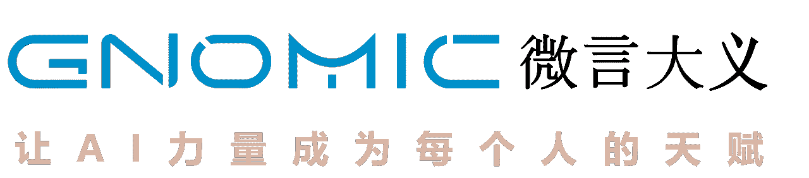

> 本文版权归提示工程师之家所有，欢迎转发。

# 简介

1. 开源图片生成式人工智能
1. 目前有`AUTOMATIC-1111`的网页端图形界面，可以部署在本地或者服务器，操作直观
1. 可以定制自己的模型，也可以在开源社区下载别人生成好的模型
1. 可以安装插件，实现更多功能

# 基本原理

1. `Diffusion`是`Stable Diffusion`的前身。后者比前者的资源使用优化要更好，可以部署在个人电脑上运行。`Dall-E`和`Midjourney`均采用`Diffusion`。
1. `Stable Diffusion`是将图片进行噪点化后，再用`U-Net`预测噪点、用不同的方法去除噪点，从而达到生成图像的目的。
1. 通常情况下，我们会通过输入提示词、`ControlNet`、`图生图`以及加载`LoRA`等方式，对去除噪点的过程进行干预，从而达到生成想要的图像的目的。
1. `Stable Diffusion`会将图片从`RGB`色彩空间压缩到更低维度进行处理，从而达到节省运算资源的目的。这一过程采用`VAE`（`Variational Auto-Encoder`）生成式模型。因此，在生成图像的时候如果颜色有问题，那么就需要考虑是否为`VAE`的问题。

# 启动命令

1. 在启动`Stable Diffusion WebUI`时候可以键入的命令。较为常用的有：
1. `--device-id 0`（启用`0`号`CUDA`设备）
1. `--api`（开启`SD`的`API`后台）
1. `--xformers`（开启`xformers`，优化迭代速度）
1. https://github.com/AUTOMATIC1111/stable-diffusion-webui/wiki/Command-Line-Arguments-and-Settings

# 经典问题汇总

## 生成高清大图

1. 使用`Highres.fix`。不要直接生成大图，因为那样会很消耗资源。
1. 使用`Tiled Diffusion`。这个比`Highres.fix`更节省资源。但推荐先用`Highres.fix`进行修复
1. 使用`txt2img`时，采用`ControlNet Tile` + `Tiled Diffusion`。`ControlNet Tile`用来上传原图，固定需要高清化的内容，`Tiled Diffusion`用来放大图片和增加细节。
1. 注意：这里的高清大图指的是同时具备高分辨率且拥有足量细节的图片，并非单纯地放大图片而已。

## 控制人物姿势或者画面内容

1. 建议最高同时使用2个`ControlNet`，常见的组合有：
1. `OpenPose + Depth`：控制人物姿势和场景深度
1. `Canny + Depth`：控制人物或者主体形象和场景深度
1. `Scribble + Canny`：增加对画面细节的控制
1. 不建议叠加过多的`ControlNet`，因为会严重加剧资源的消耗
1. 这里的思路是：通过2个`ControlNet`结合使用，来互补每个`ControlNet`的特色。
1. 假如想生成一张手挡在脸上的一张图片。如果单纯地用`OpenPose`，那么`SD`有概率没法还原你的意图。但如果加上`Depth`，则可以告诉`SD`：我需要你把手放在脸上。

## 提示词编写

1. `civitai.com`上面集成了很多对应模型的提示词和预览效果。可以直接照抄。
1. 但如果想增强提示词功力，那么需要大量阅读优秀案例的提示词，同时关注他们使用的`LoRA`和采样器等参数。
1. 提示词格式：
1. 画面质量描述+主体描述+场景描述+灯光效果等描述
1. 越往前写的提示词，权重越高
1. 可以通过`(prompt:1)`的写法来增加权重
1. 相关插件：`All in one prompt`
1. 截止至`SDXL 0.9`, 位置相关的提示词暂时起不了作用。

## 提示词自动且变换地插入

1. 使用`Dynamic Prompts`插件

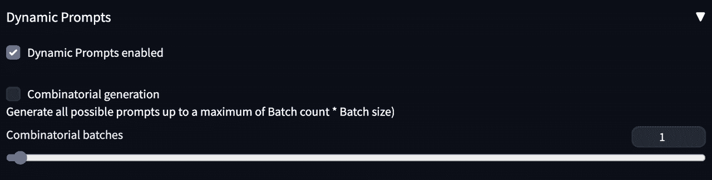

1. 提示词书写示范：

> `A girl with {long straight hair|short hair|curvy hair|sing tail|twin tail} hair in {pink|black|gold|silver|purple|cyan} color`

1. 插件会从“`{}`”中的提示词进行抽取来生成图片
1. 每个提示词需要用“`|`”隔开
1. 加上“`2$$`”则意思是选择两个一起生成：`{2&&pink|black|gold|purple|cyan}`
1. 英文半角字符输入，且不需要空格

## 手部效果优化

1. 手指问题用`LoRA`解决：
1. `bad_prompt_version2-neg`
1. `BadDream`
1. `badhandv4`
1. `By bad artist -neg`
1. `Easynegative`
1. `negative_hand-neg`
1. `ng_deepnegative_v1_75t`
1. 负面提示词更新
1. `bad_prompt_version2-neg,BadDream,badhandv4,By bad artist -neg,easynegative,negative_hand-neg,ng_deepnegative_v1_75t,NSFW,nude,illustration,3d,sepia,painting,cartoons,sketch,(worst quality:2),(low quality:2),(normal quality:2),lowres,bad anatomy,bad hands,normal quality,((monochrome)),((grayscale:1.2)),futanari,full-package_futanari,penis_from_girl,newhalf,collapsed eyeshadow,multiple eyebrows,vaginas in breasts,holes on breasts,fleckles,stretched nipples,gigantic penis,nipples on buttocks,analog,analogphoto,signatre,logo,2 faces,`

## 生成图片扭曲

1. 如果发现你生成的图片，人物面部扭曲，或者画面物体扭曲，那么检查一下是不是生成时候的分辨率太低了。
1. 一个解决办法是开启`highres.fix`来进行生图。这样可以在低配置的电脑上也能跑大图。
1. 或者使用`tiled diffsuion`在图生图里面进行修复。

# Stable Diffusion XL

1. `XL 0.9`版本中，`SD`引入了`"Refiner"`的概念。即，在原来生成图片的基础上，增加一个对于生成好的图片的润色机制，从而大幅提高了图片的生成质量。这一用`AI`来审核`AI`的用法，也可以应用在别的领域来提高生成结果的质量，比如`GPT`中的文案生成。
1. 用户对于`XL`和其他`SD`基础模型版本结果的评价。可以看出，使用和未使用`Refiner`的`XL`基础模型，得到的评分均比先前的版本要好：

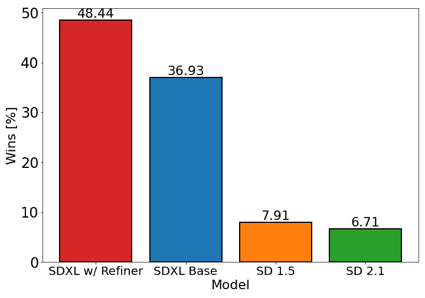

1. 值得注意的是，`SDXL`在文字生成的方面已经取得了提升（参看左下角）：

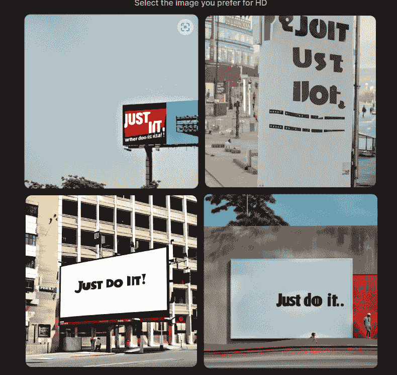

# 相关插件

1. `openOutpaint`: https://github.com/zero01101/openOutpaint-webUI-extension
1. `Save Intermediate Images`: https://github.com/AlUlkesh/sd_save_intermediate_images
1. 这个插件可以把图片生成的过程保存下来，用于研究不同步数之间的差异
1. 可以生成视频
1. `Autocompletion`: https://github.com/DominikDoom/a1111-sd-webui-tagcomplete
1. `Dreambooth`: https://github.com/d8ahazard/sd_dreambooth_extension
1. `Dynamic Prompts`: https://github.com/adieyal/sd-dynamic-prompts

# 详细操作说明

## 基本参数说明

1. `Sampler`（采样器/采样方法）

选择使用哪种采样器。`Euler a`（`Eular ancestral`）可以以较少的步数产生很大的多样性，不同的步数可能有不同的结果。而非`Euler a`的采样器都会产生类似的图像。`DPM`相关的采样器通常具有不错的效果，但耗时也会相应增加。

1. `Euler`

`Euler` 是最简单、最快的采样方法。

1. `Euler a`

`Euler a` 更多样，不同步数可以生产出不同的图片。但是太高步数 (`>30`) 效果不会更好。

1. `DDIM`

`DDIM` 收敛快，但效率相对较低，因为需要很多 `step` 才能获得好的结果，适合在重绘时候使用。

1. `LMS`

`LMS` 是 `Euler` 的衍生，它们使用一种相关但稍有不同的方法（平均过去的几个步骤以提高准确性）。大概 `30 step` 可以得到稳定结果。

1. `PLMS`

`PLMS` 是 `Euler` 的衍生，可以更好地处理神经网络结构中的奇异性。大概需要`50`步。

1. `DPM2`

`DPM2` 是一种改进 `DDIM`，减少步骤以获得良好的结果。它需要每一步运行两次去噪，它的速度大约是 `DDIM` 的两倍，生图效果也比较好。

1. `UniPC`

`UniPC` 速度非常快，但效率不高，不常用。

1. 其他

其他一些采样器是基于原采样器迭代出来的，其中`DPM++ 2S a Karras`的效果还不错，其他的类型还需继续检测。

1. `Sampling Steps`（采样步数）

`Stable Diffusion` 的工作方式是从以随机高斯噪声起步，向符合提示的图像一步步降噪接近。随着步数增多，可以得到对目标更小、更精确的图像。但增加步数也会增加生成图像所需的时间。增加步数的边际收益递减，取决于采样器。一般开到 `20~30`。

| 不同采样步数与采样器之间的关系 |
| --- |
| 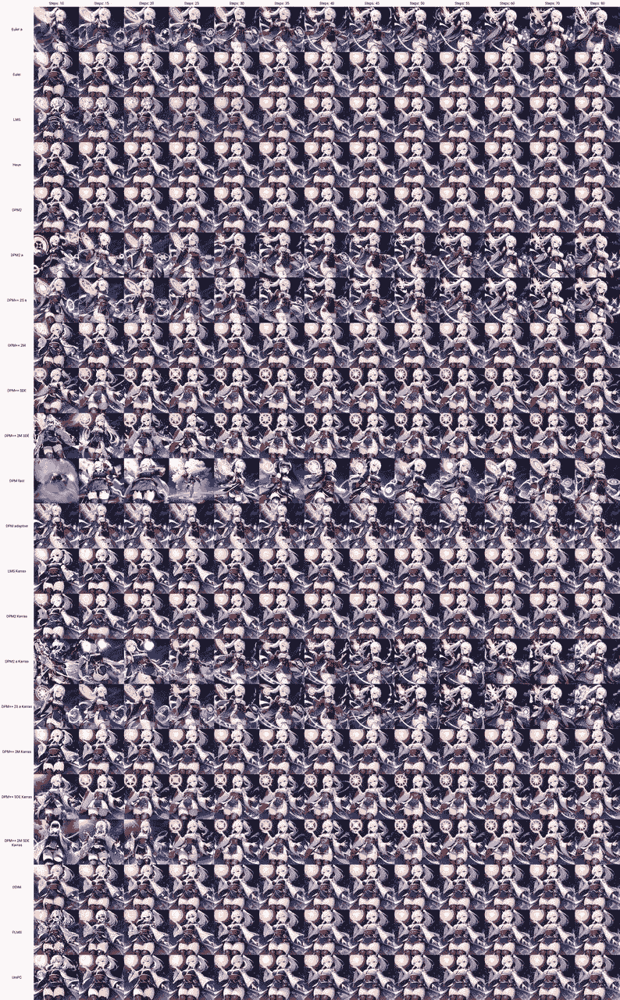 |

1. `CFG Scale`（提示词相关性）

`CFG Scale`（提示词相关性）图像与你的提示的匹配程度。增加这个值将导致图像更接近你的提示，但它也在一定程度上降低了图像质量。可以用更多的采样步骤来抵消。过高的 `CFG Scale` 体现为粗犷的线条和过锐化的图像。一般开到 `6~11`。

| `CFG` Scale 与采样器之间的关系 |
| --- |
| 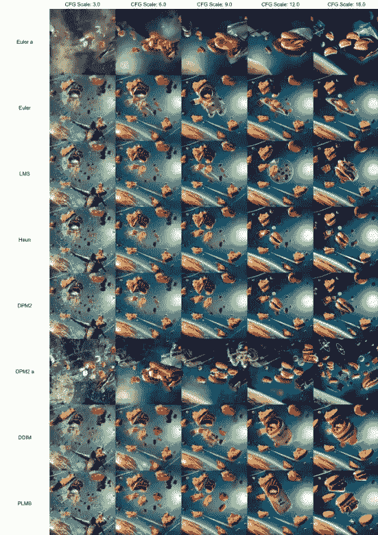 |

1. `Batch count`（生成批次）

可调节**每次生成图像的组数**。一次运行生成图像的数量为“批次* 批次数量”。

1. `Batch size`（每批数量）

调节**同时生成多少个图像**。增加这个值可以提高每批图片的数量，但也需要更多的显存。提高每批数量需要消耗巨量显存，需要根据显卡和内存的实际情况调节。

1. `Width & Height`（图像尺寸）

指定**图像的长宽**。出图尺寸太宽时，图中可能会出现多个主体。`1024` 之上的尺寸或者`512`之下的尺寸可能会出现不理想的结果，建议保持默认尺寸（`512*512`）分辨率+高清修复（`Hires fix`）的方式来生成较大尺寸的图像。

修改分辨率时，建议保持为`64`的倍数。

1. `Seed`（种子）

种子决定模型在**生成图片时涉及的所有随机性**，它初始化了 `Diffusion` 算法起点的初始值。

理论上，在同一模型中应用完全相同参数（如 `Step`、`CFG`、`Seed`、`prompts`）的情况下，生产的图片应当完全相同。

1. `Hires. fix`（高清修复）

通过勾选 `"Highres. fix"` 来启用。默认情况下，文生图在低分辨率下会生成较模糊的图像。如果使用高清修复，模型首先按照指定的尺寸生成一张图片，然后通过放大算法将图片分辨率扩大，以实现高清大图效果。最终尺寸为（原分辨率*缩放系数 `Upscale by`）。

1. 放大算法

放大算法中，`Latent` （潜变量）在许多情况下效果不错，但重绘幅度小于 `0.5` 后就不够理想。`ESRGAN_4x`、`SwinR 4x` 对 `0.5` 以下的重绘幅度有较好支持。

1. `Hires step`（高清修复采样次数）

`Hires step` 表示在**进行这一步时计算的步数**。

1. `Denoising`（重绘幅度）

表现为最后生成图片对原始输入图像内容的变化程度。该值越高，放大后图像就比放大前图像差别越大。低 `denoising` 意味着修正原图，高 `denoising` 就和原图就没有大的相关性了。一般来讲阈值是 `0.7` 左右，超过 `0.7` 和原图基本上无关，`0.3` 以下就是稍微改一改。

1. `Restore faces`（面部修复）

修复画面中人物的面部，但是非写实风格的人物开启面部修复可能导致面部崩坏。

| 未开启面部修复 | 开启面部修复 |
| --- | --- |
| 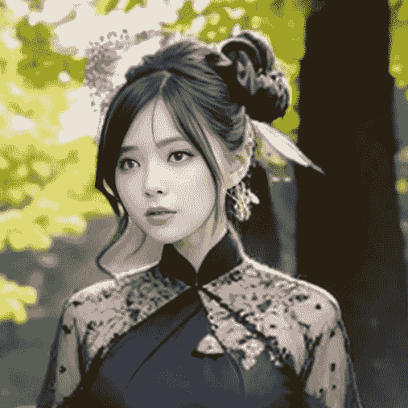 | 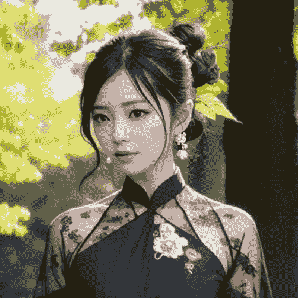 |

## 提示词(Prompt)

提示词所做的工作是缩小模型出图的解空间，即缩小生成内容时在模型数据里的检索范围，而非直接指定作画结果。提示词的效果也受模型的影响，有些模型对自然语言做特化训练，有些模型对单词标签对特化训练，那么对不同的提示词语言风格的反应就不同。

1. 提示词内容

提示词中可以填写以下内容：

1. 自然语言

可以使用描述物体的句子作为提示词。尽量使用英文输入，避免复杂的语法。

1. 单词标签

可以使用逗号隔开的单词作为提示词。一般使用普通常见的单词。单词的风格要和图像的整体风格搭配，否则会出现混杂的风格或噪点。避免出现拼写错误。（详情可参考相关网站上作品的咒语）

1. 颜文字 Emoji (`💰👨👩🎅👼🍟🍕`)

表[情符号也是可以使用并且](https://unicode.org/emoji/charts/emoji-list.html)[非](https://unicode.org/emoji/charts/emoji-list.html)常准确的。因为 `Emoji` 只有一个字符，所以在语义准确度上表现良好。关于 `emoji` 的确切含义，可以参考`Emoji List, v15.0 (unicode.org)`，同时 `Emoji` 在构图上也有影响。

1. 提示词语法

1. 一般格式

根据自己想画的内容写出提示词，多个提示词之间使用英文半角符号隔开 `[ , ]`，如：

`masterpiece, best quality, ultra-detailed, illustration, close-up, straight on, face focus, 1girl, white hair, golden eyes, long hair, halo, angel wings, serene expression, looking at viewer`

（杰作，最佳质量，超详细，插图，特写，直拍，面部聚焦，1女孩，白发，金色眼睛，长发，光环，天使翅膀，平静的表情，看着观众）

1. 通用模板

一般而言，概念性的、大范围的、风格化的关键词写在前面，叙述画面内容的关键词其次，最后是描述细节的关键词，大致顺序如：

(画面质量提示词), (画面主题内容),(风格), (相关艺术家), (其他细节)

1. 提示词权重

在模型中，每个词语本身自带的权重可能有所不同，如果模型训练集中较多地出现某种关键词，在提示词中只输入一个词就能极大地影响画面。

反之如果模型训练集中较少地出现某种关键词，我们在提示词中可能输入很多个相关词汇都对画面的影响效果有限。

提示词的顺序很重要，越靠后的权重越低。关键词最好具有特异性，譬如 `Anime`(`动漫`)一词就相对泛化，而 `Jojo` 一词就能清晰地指向 `Jojo` 动漫的画风。措辞越不抽象越好，尽可能避免留下解释空间的措辞。

可以使用括号人工修改提示词的权重，方法如：

`(word)` - 将权重提高 `1.1` 倍
`((word))` - 将权重提高 `1.21` 倍（= `1.1` * `1.1`）
`[word]` - 将权重降低至原先的 `90.91%`
`(word:1.5)` - 将权重提高 `1.5` 倍
`(word:0.25)` - 将权重减少为原先的 `25%`
`(word)` - 在提示词中使用字面意义上的 `()` 字符
`( n )` = `( n : 1.1 )` `(( n ))` = `( n : 1.21 )` `((( n )))` = `( n : 1.331 )` `(((( n ))))` = `( n : 1.4641 )` `((((( n )))))` = `( n : 1.61051 )` `(((((( n ))))))` = `( n : 1.771561 )`

注意：权重值最好不要超过 `1.5`。

1. 提示词模板

详情见 `4.生成技巧 - c.提示词编写 - i.`

## 扩散控制网络(ControlNet)

`Controlnet` 允许通过线稿、动作识别、画风信息、深度信息等对生成的图像进行控制。

注意：在使用前请确保 `ControlNet` 设置下的路径与本地 `Stable Diffusion` 的路径同步。

1. 基本参数

1. `Enable`（启用）

点击“启用”开启该项 `ControlNet`

## Preprocessor（预处理器）

将对输入的图像进行`preprocessor`预处理。如果图像已经符合预处理后的结果，请选择“无（`None`）”。譬如，图中导入的图像已经是 `OpenPose` 需要的骨架图，那么“预处理器（`preprocessor`）”选择“无（`None`）”即可。

## Weight（权重）

在`Weight`下，可以调整`ControlNet`在合成中的影响权重，与在`prompt`中调整的权重类似。

## Guidance Start(T)（引导介入时机）

在理解此功能之前，需要先知道生成图片的步数（`Step`）功能，步数代表生成一张图片要刷新计算多少次，设置为0即代表开始时就介入。

## Guidance End(T)（引导退出时机）

和引导介入时机相对，如设置为1，则表示最后退出介入，默认为1。

## Invert Input Color（反色模式）

表示启动反色模式，如果输入的图片是黑色线条白色背景的时候开启。

一般用于绘画的线稿生成图像时的黑白反转，导入到 `ControlNet` 中使用 `invert` 预处理器和 `canny` 模型对线稿进行上色。

## Low VRAM（低显存优化）

表示开启低显存优化，需要配合启动参数 `--lowvram`。

注意：开启后生图速度会变慢。千万不要显存够用还开。

## Model（模型）

选择想要使用模型，应该与输入的图像或者预处理器对应，如 `canny` 预处理器就要对应 `canny` 模型。

注意：预处理器可以为空，但模型不能为空。

## 可用预处理/模型

### Canny（Canny 边缘检测）

用于识别输入图像的边缘信息。`Canny`模型主要就是把原图的边缘提取出来并生成线稿，然后通过线稿和提示词进行二次绘制。这个模型适合复原线稿，对细节的复原能力很强。

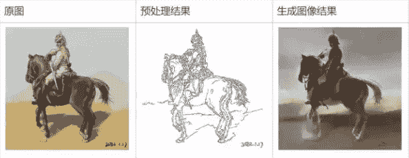

### Depth（深度检测）

用于识别输入图像的深度信息。从图片中提取黑白两色，越黑则离镜头越远，越白则离镜头越近，适合还原图片的空间关系和结构，尽量用真实照片或者三维照片做参考。

注意：预处理器中`MiDaS`和`LeReS`为`Depth`的两种不同的深度算法，根据实际情况选择。

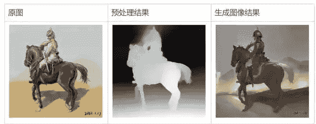

### SoftEdge（软边缘）

用于识别输入图像的边缘信息，边缘更柔和。跟`Canny`基本相似，都是边缘检测提取线稿，唯一的不同是，`Canny`提取的线稿边更锐利，像铅笔画出来的，`SoftEdge`的线稿边缘更柔和，像毛笔画出来的。如果是做毛发或者动物之类的，`SoftEdge`更合适一些。

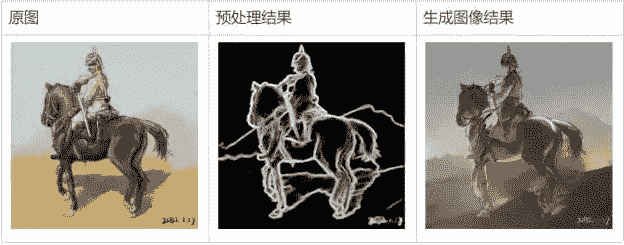

### Lineart（线稿）

用于识别输入图像的边缘信息，一种轻量级的边缘检测。它对横平竖直的线条非常敏感，因此更适用于于室内图的生成。

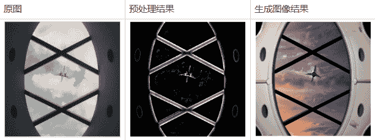

### OpenPose（姿态检测）

用于识别输入图像的动作信息。生成骨骼图，摆脱提示词控制人物骨骼姿势，建议使用真实照片。

`OpenPose Editor` 插件可以自行修改姿势，导出到文生图或图生图。需要注意的是，在人物出现身体部位重叠的情况，`OpenPose`是无法识别的，这是因为该模型为2D数据，在这种情况下最好搭配 `depth` 使用。

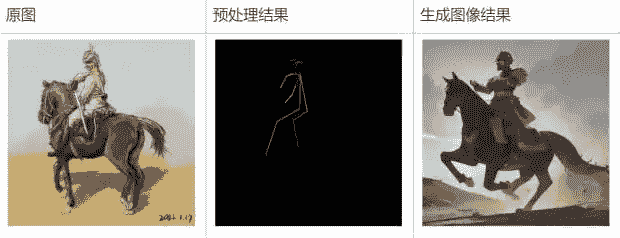

### OpenPose hand（OpenPose 手部检测）

`OpenPose hand`支持手部骨骼检测，极大概率解决了AI一直不会画手的问题。

### clip_vision（风格转移）

`clip_vision`可以把一张照片的风格转移到另外一张上，适合在无法获取原图模型及参数的情况下，快速提取原图画风的方法。

### color（色彩分布）

可以检测出原图中色彩的分布情况，需要注意的是图像的分辨率会影响色彩块的大小，生成图像的颜色会和检测出来的颜色分布趋于一致。

### Scribble（涂鸦）

将输入图像作为线稿识别。如果线稿是白色背景，务必勾选“`Invert Input Color`”，你甚至可以通过画一只王八，来生成一个王八战舰。更适合抽象画手宝宝体质的模型。

| 原图 | 提示词中将“乌龟”等修改为“飞船”等 |

| --- | --- |

| 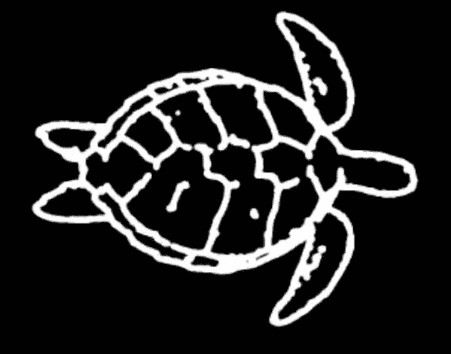 |  |

### Seg（ADE20k语义分割）

识别输入图像各区域分别是什么类型的物品，再用此构图信息生成图像。具体表现为对图像中的多个物体，比如建筑、天空、花草树木等，进行区块分割。

如果想绘制一张符合 `segementation` 规范的图像，可以使用以下色表绘制。

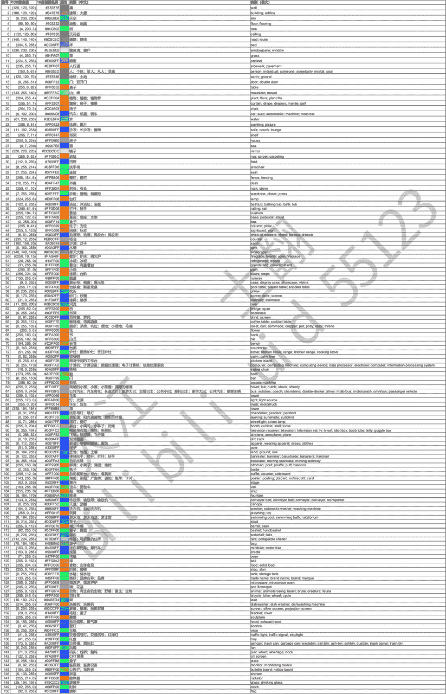

[大江户战士整理的Seg分隔.pdf](https://internal-api-drive-stream.feishu.cn/space/api/box/stream/download/all/NKWgbX07ooRPWFxHpddcJY2Ln4f)

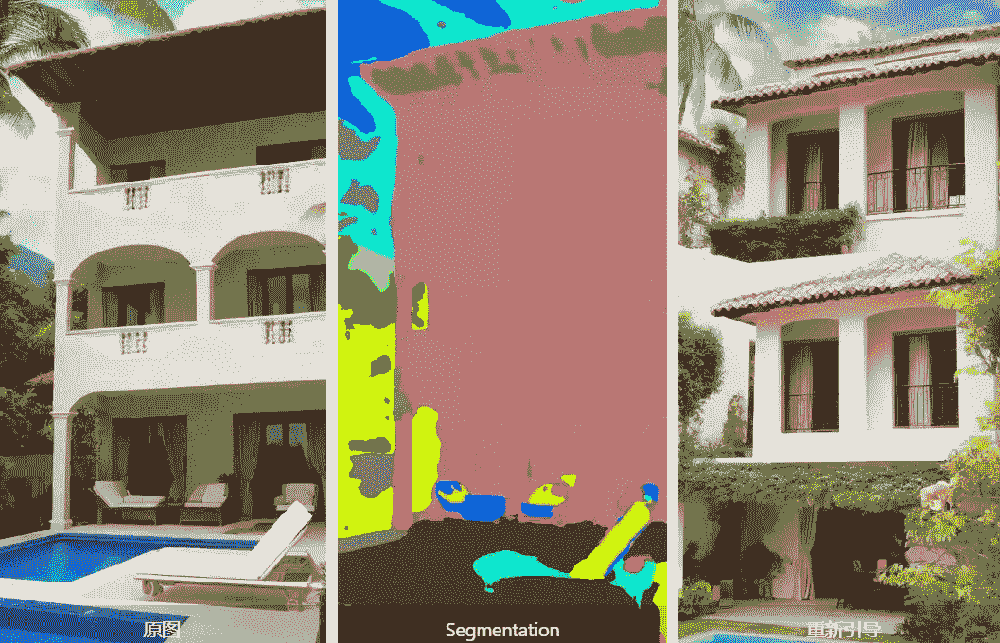

## 模型（Model）

模型能够有效地控制生成的画风和内容。常用的模型网站有：

[Civitai](https://civitai.com/) | Stable Diffusion models, embeddings, hypernetworks and more

Models - Hugging Face

[SD - WebUI 资源站](https://www.123114514.xyz/models/ckpt)

[元素法典 AI 模型收集站 - AI 绘图指南 wiki](https://aiguidebook.top/index.php/model/) (aiguidebook.top)

### 模型安装

下载模型后需要将之放置在指定的目录下，请注意，不同类型的模型应该拖放到不同的目录下。

### 模型使用

### 基础模型（Base Models）

基础模型的扩展格式主要分为：`checkpoint(.ckpt)`和`safetensors(.safetensors)`

模型直接影响生成图片的风格，是基础模型。在不挂载`LoRA`等模型的情况下，这个模型决定了生成画面的风格和质量。

### LoRA 模型

对`LoRA`模型，在 `ckpt` 模型上附加使用。在 `webui` 界面的 `Additional Networks` 下勾选 `Enable` 启用，然后在 `Model` 下选择模型，并可用 `Weight` 调整权重。权重越大，该 `LoRA` 的影响也越大。不建议权重过大（超过 1.2），否则很容易出现扭曲的结果。

多个 `LoRA` 模型混合使用可以起到叠加效果，譬如一个控制面部的 `LoRA` 配合一个控制画风的 `LoRA` 就可以生成具有特定画风的特定人物。因此可以使用多个专注于不同方面优化的 `LoRA`，分别调整权重，结合出自己想要实现的效果。

### Embedding 模型

`Embedding` 模型。在提示词中加入对应的关键词即可。大部分 `Embedding` 模型的关键词与文件名相同，譬如一个名为 `SomeCharacter.pt` 的模型，触发它的关键词检索 `SomeCharacter`。

### 模型训练

需要较大的显存。优点在于可以生成自定义风格或者人物的模型。

微言大义官方社群（无广纯享版）

扫码加入，获取更多提示工程调研

