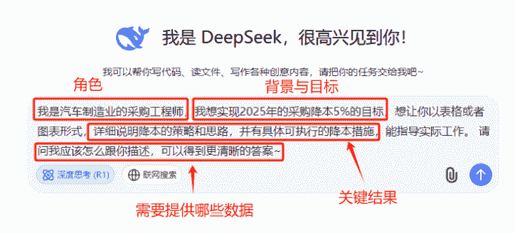
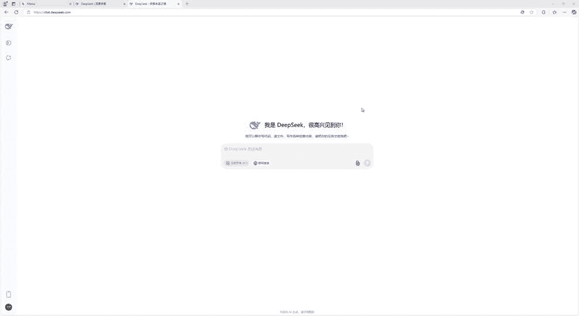

# 采购如何使用Deepseek辅助实现降本目标？

> 来源：[https://rxq0zfnkm77.feishu.cn/docx/Sjcwd1KOwoPZeAxBVTScPwvOngf](https://rxq0zfnkm77.feishu.cn/docx/Sjcwd1KOwoPZeAxBVTScPwvOngf)

首先同步思路，Deepseek的优势是独立思考能力出众，所以很多时候，需要让Deepseek去替代我们思考，而不是让Deepseek直接给出答案，下面以“Deepseek辅助实现降本目标”，来演示一下：

我们需要明白如何与Deepseek对话~

使用高效的对话框架可以更精准的得出我们的需求方法及方案

我们可以把框架拆解为：①角色 ②背景 ③目标 ④关键结果 ⑤需要提供的信息

如下图：

初始Deepseek提示词：

我是汽车制造业的采购工程师，我想实现2025年的采购降本5%的目标，想让你以表格或者图表形式，详细说明降本的策略和思路，并有具体可执行的降本措施，能指导实际工作。 另外请问我应该怎么跟你描述，可以得到更清晰的答案~

思考过程（未剪辑）

[20250307_115712.mp4](https://internal-api-drive-stream.feishu.cn/space/api/box/stream/download/all/FNxhbUIYroBQ7mxtEc1cOc5YnOg)

下面的流程就是按照Deepseek的需求，继续提供资料，就可以得出更清晰的方案。