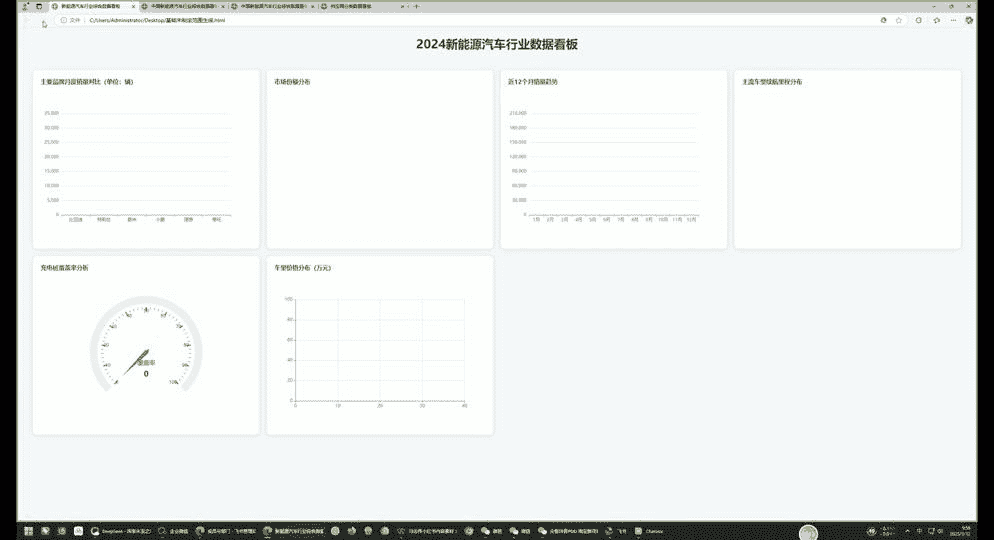
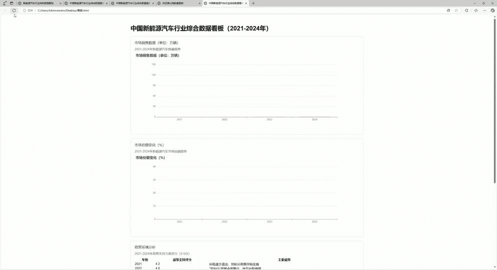
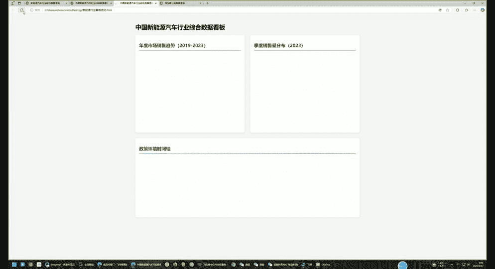
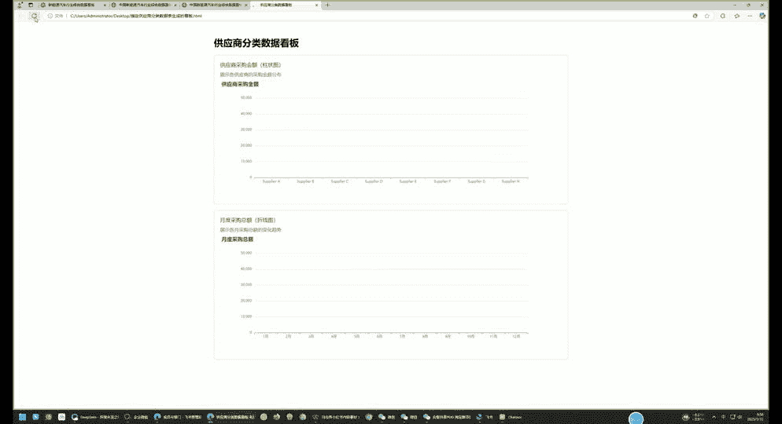

# Deepseek生一个针对中国市场的新能源汽车行业综合数据看板 提示词文档

> 来源：[https://rxq0zfnkm77.feishu.cn/docx/ZNL9dhFqRoXEoqxrSjecHjN4n79](https://rxq0zfnkm77.feishu.cn/docx/ZNL9dhFqRoXEoqxrSjecHjN4n79)

#### 简单版（测试演示使用）

生成一个新能源汽车行业综合数据看板，要求包含可视化设计和数据展现，用html格式输出，确保文件可执行

[新能源汽车行业综合数据看板-1.mp4](https://internal-api-drive-stream.feishu.cn/space/api/box/stream/download/all/DBUobPHAEo5NlHxRy27c4Ly3nlb)

#### 优化版（定向效果展示）

生成一个针对中国市场的2021年-2024年新能源汽车行业综合数据看板，包含可视化设计和数据展现，使用HTML格式输出并确保文件可执行。看板应关注市场销售数据和政策环境，采用柱状图和折线图的可视化方式，填充基础的数据信息。

[2021年-2024年新能源汽车行业综合数据看板.mp4](https://internal-api-drive-stream.feishu.cn/space/api/box/stream/download/all/Xj8YbTo9BotD9nxoMiVcYmwdn8g)

#### 优化进阶

生成一个针对中国市场的新能源汽车行业综合数据看板，包含可视化设计和数据展现，使用HTML格式输出并确保文件可执行。看板应关注市场销售数据和政策环境，采用柱状图和折线图的可视化方式，主要用于战略决策。考虑展示过去五年的历史数据，并提供季度更新。

[中国市场的新能源汽车行业综合数据看板-1.mp4](https://internal-api-drive-stream.feishu.cn/space/api/box/stream/download/all/WTLRbsLi6o9CdyxK8WEc9Wktnvc)

#### 定向数据生成（定向效果展示）

请基于提供的表格文件生成一个综合数据看板，包含可视化设计和数据展现，使用HTML格式输出并确保文件可执行。看板采用柱状图和折线图的可视化方式，并填充基础的数据信息。

[基于定向数据生成-1.mp4](https://internal-api-drive-stream.feishu.cn/space/api/box/stream/download/all/Q0vsbbBvYon9ugxhTzxcLuRAnfe)

#### 新建html文件 教程

新建文件后，用记事本打开，将 Deepseek生成的代码粘贴后保存关闭，在桌面点击打开即可。

[新建html文件 教程.mp4](https://internal-api-drive-stream.feishu.cn/space/api/box/stream/download/all/FC1EbcLH8ociXMx3aUBcPIocnnb)

#### Deepseek生成的内容文档含html代码