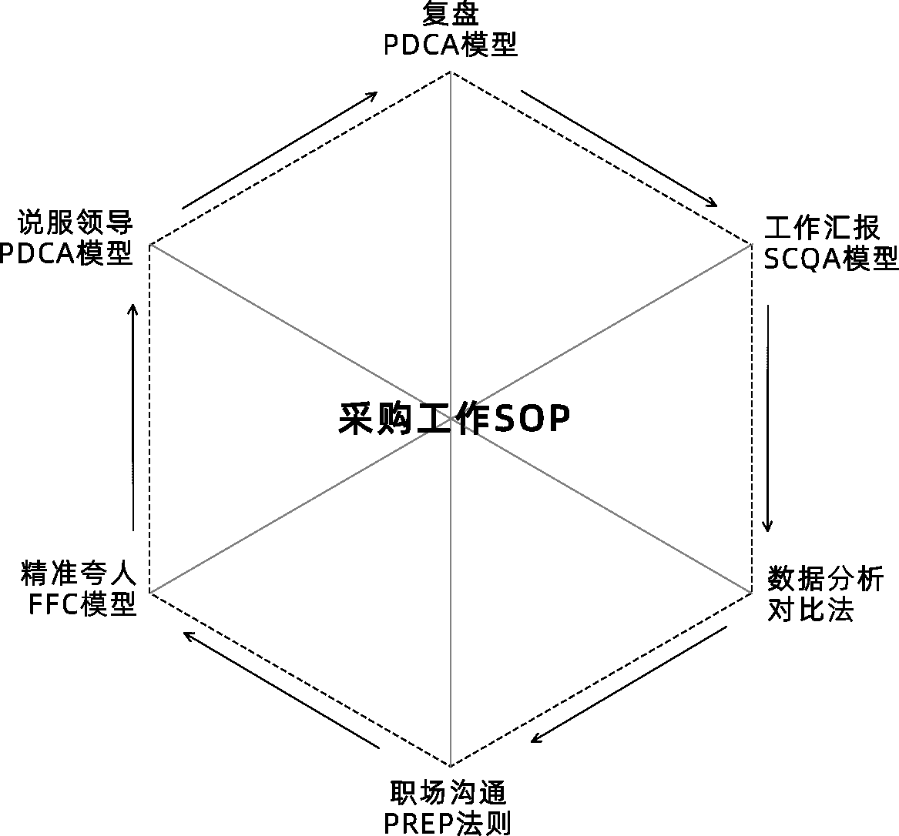

# 采购轻松搭建自己的工作SOP

> 来源：[https://rxq0zfnkm77.feishu.cn/docx/AmGBdCqPNoQHfXxihZicYqQbnWc](https://rxq0zfnkm77.feishu.cn/docx/AmGBdCqPNoQHfXxihZicYqQbnWc)

为什么采购人要搭建自己的工作SOP?

如果你想在采购职位持续进步，就需要把自己从执行者升级为策略制定者，而梳理工作SOP可以帮助你打造这个基础~

复盘SOP:PDCA模型（从学会复盘开始，精进的第一步~）

工作汇报SOP:SCQA模型(工作留痕，让领导对你工作更清晰)

数据分析对比法：（工作方法 供应链供应商选择~）

职场沟通：PREP法则（提高专业度背书）

精准夸人：FFC模型（表达对对方的良好感受，基于事实依据，并对比因为对方行为起到的正向作用）

说服领导：RIDE模型（领导支持=成功一半）

### 一**、采购搭建SOP的益处**

#### **1. 对个人：效率与专业度提升**

+   **减少重复劳动**：模板化流程（如SCQA汇报）节省60%以上准备时间。

+   **降低决策风险**：数据对比法避免“拍脑袋”选择供应商。

+   **增强职场影响力**：

+   PREP法则让建议更易被采纳；

+   FFC夸人法改善跨部门关系，推动协作。

#### **2. 对团队：协同与目标一致**

+   **PDCA复盘**：让团队问题显性化（如供应商质量缺陷TOP3），聚焦改进。

+   **SCQA汇报**：快速对齐领导关注点（如成本VS交期优先级）。

+   **数据透明化**：减少部门间扯皮（如证明采购成本合理性）。

#### **3. 对业务：结果可量化**

+   **成本优化**：通过PDCA循环，年均降本可达3%-5%。

+   **风险可控**：供应商评估数据化，减少断供概率。

+   **决策加速**：标准化流程（如比价模板）缩短采购周期20%。

#### **4. 对职业发展：塑造专业标签**

+   **系统化能力**：SOP成为个人职场“方法论”，助力晋升答辩。

+   **数据说服力**：用BI工具展示降本成果，凸显业绩。

+   **沟通软实力**：FFC+PREP组合在360度评估中加分。

### 二**、SOP流程（采购场景适配）**

#### **1. 复盘：PDCA模型**

+   **Plan（计划）**：

+   案例：某季度采购成本超预算5%。

+   执行：分析超支原因（如原材料涨价、供应商谈判失误），制定下季度降本目标（降低3%）。

+   **Do（执行）**：

+   引入新供应商比价，优化付款条款（如账期延长）。

+   **Check（检查）**：

+   对比实际节省金额与目标差距（如仅完成2%），发现供应商交付质量不稳定导致返工成本增加。

+   **Act（改进）**：

+   更新供应商评估标准，增加质量权重，淘汰不合格供应商。

#### **2. 工作汇报：SCQA模型**

+   **S（情境）**：

+   “上季度A类物料采购成本上涨10%，影响整体利润率。”

+   **C（冲突）**：

+   “但市场同类物料价格波动仅5%，内部谈判策略可能失效。”

+   **Q（问题）**：

+   “如何在下季度控制成本并保障供应稳定性？”

+   **A（答案）**：

+   提出解决方案：

+   引入期货锁价对冲原材料波动风险；

+   与战略供应商签订阶梯降价协议（量增价跌）。

#### **3. 数据分析对比法**

+   **场景**：供应商选择决策。

+   **执行**：

+   横向对比：三家供应商报价（单价、MOQ、交期）。

+   纵向对比：同一供应商历史价格趋势（如铜价涨跌对成本影响）。

+   综合评分表（例）：

| 供应商 | 价格（40%） | 质量（30%） | 交期（20%） | 服务（10%） | 总分 |
| --- | --- | --- | --- | --- | --- |
| A | 85 | 90 | 80 | 75 | 85 |
| B | 95 | 70 | 90 | 85 | 83 |

+   **结论**：选择总分更高的供应商A，而非单纯低价供应商B。

#### **4. 职场沟通：PREP法则**

+   **P（观点）**： 沟通中的黄金法则，让对方清楚你的目的和观点

+   “建议将X物料的采购模式从零星采购改为年度框架协议。”

+   **R（理由）**： 陈述原因，提供有效、有说服力的依据证明结论的可靠

+   “过去半年零星采购导致单价波动15%，且频繁下单增加物流成本。”

+   **E（案例）**：  有理还需有事例，生动形象饱满，使得对方接受度更高

+   “同类物料Y采用框架协议后成本降低8%，交期缩短20%。”

+   **P（重申）**：  将发散的思维回归结论，强化聚焦观点

+   “因此，集中采购可显著优化成本和效率，建议下周启动供应商谈判。”

#### **5. 精准夸人：FFC模型**

Feeling（感受）：表达你对对方的良好感受

Fact(事实）:并说出给你良好感受的事实依掘，相当于证据

Compare(对比）：并且对比说出，因为对方行为，对你起到的正 向作用

#### **6. 说服领导：RIDE模型**

Risk（风险）：开头先说采纳你的建议，会带来什么风险

Interest (利益）：接受你的建议会带来什么利益

Dffern(差)建其方的差异之处

Effect(影响):适当说一下你建议的瑕疵，增加可信度

---

### **三、采购SOP落地建议**

1.  **工具配套**：

+   用Excel/在线文档固化模板（如供应商评分表、SCQA汇报框架）。

+   在OA系统中嵌入PDCA复盘节点（如每月自动触发提醒）。

1.  **案例库积累**：

+   记录典型场景（如疫情期缺货应对），形成内部知识库。

1.  **迭代机制**：

+   每季度更新SOP（如新增ESG供应商评估维度）。

---

### **总结**

这套SOP的本质是将采购经验转化为可复用的方法论，既能应对日常琐碎工作（如对账、催货），也能在关键时刻（如成本谈判、风险危机）展现结构化思考。对于采购从业者而言，掌握它相当于拥有了“职场加速器”——从执行者升级为策略制定者。