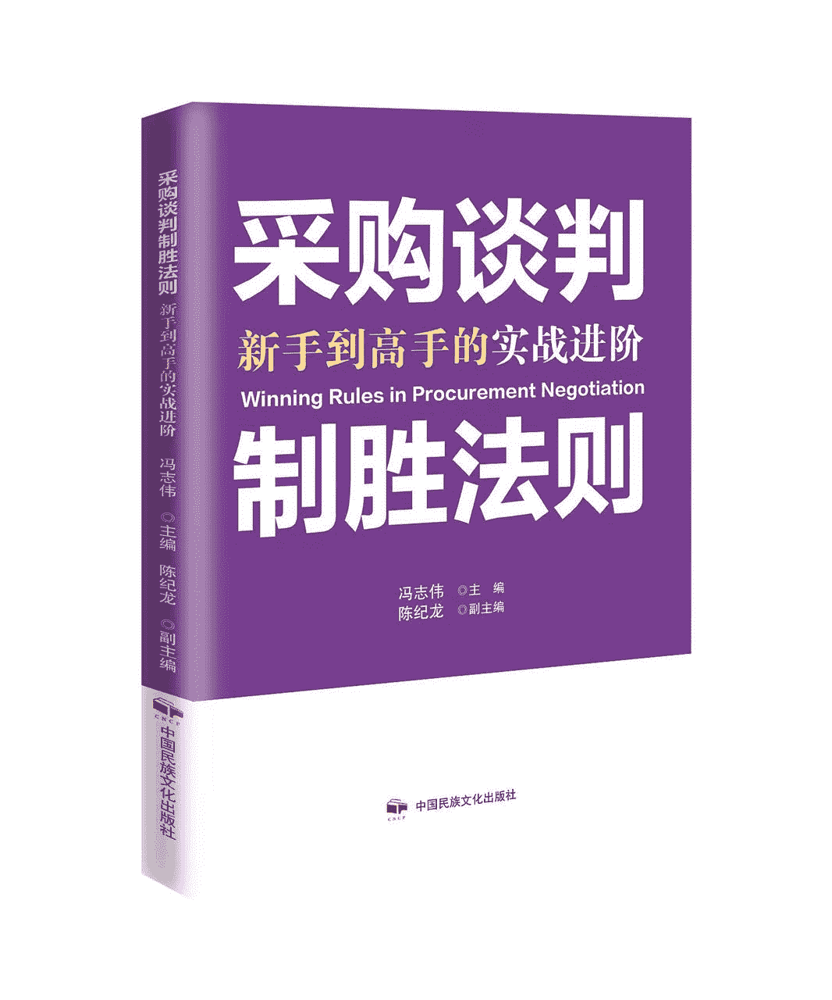
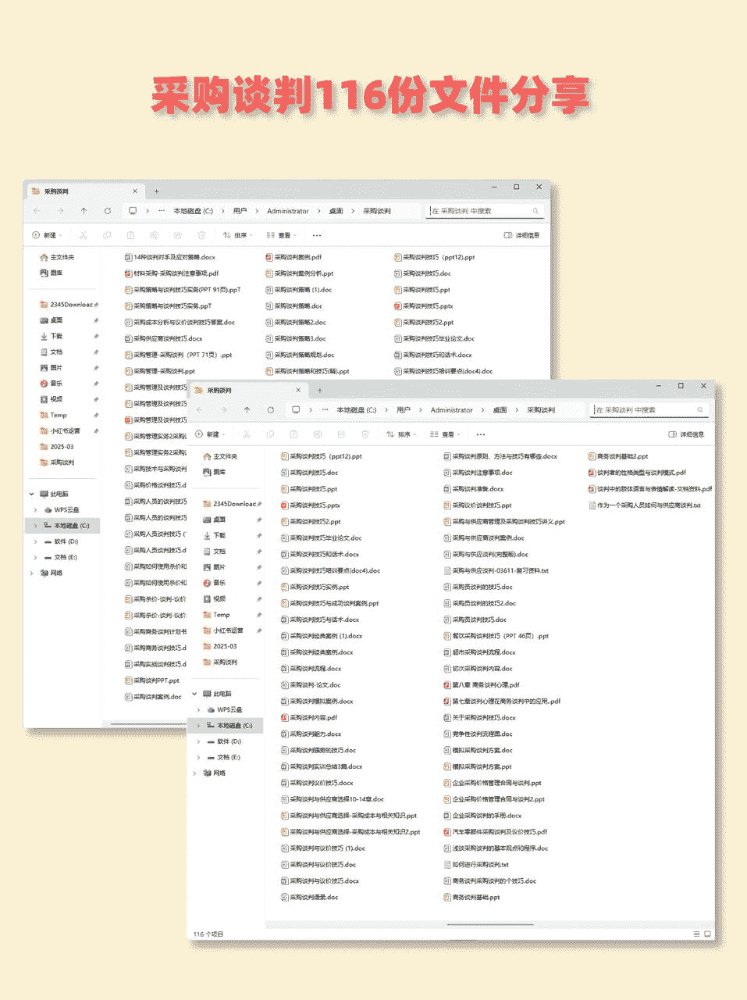

# 采购谈判的隐藏王牌：不懂心理学，怎么玩转供应商？

> 来源：[https://rxq0zfnkm77.feishu.cn/docx/GU0ldWTvKoag3LxwyqccakL3nSd](https://rxq0zfnkm77.feishu.cn/docx/GU0ldWTvKoag3LxwyqccakL3nSd)

从“讨价还价”到“掌控全局”，揭秘采购高手的心理战术！

### 为什么采购高手都是“心理学家”？

“同样是谈判，为什么有人被供应商拿捏，有人却能轻松压价20%？

答案很简单：采购的本质不是‘买东西’，而是‘攻心战’。

今天，我们从心理学视角拆解采购谈判的底层逻辑，助你从执行者进阶为策略家！”

### 一、采购的核心战场：平衡需求与人性博弈

**1. 采购的三大核心挑战**

+   **成本与质量的博弈**：供应商总说“一分钱一分货”，但如何用数据打破心理防线？

+   **交付周期的心理战**：“加急费”是常态？学会用长期合作价值替代短期施压。

+   **关系维护的隐性成本**：逢年过节的“人情往来”，是润滑剂还是陷阱？

**2. 供应商谈判的三大心理暗流**

✅ 底线试探：供应商的开场高价，80%是虚张声势。

✅ 情绪操控：对方突然发怒？可能是刻意制造的压迫策略。

✅ 决策偏好：家族企业重人情，外企重流程——对症下药才能破局。

**💡 案例：**

某制造业采购经理通过分析供应商决策层背景（技术出身），改用数据而非人情谈判，成本直降15%。

### 二、心理学四招：让你从“小白”变“谈判杀手”

#### 招式1：认知心理学——预判对方的决策逻辑

+   **锚定效应实战**：

+   **错误示范**：“您的报价太高，能便宜吗？”（被动接受对方基准）

+   **高手操作**：抢先抛出行业均价：“我们调研显示，同类产品合理价是X元，您的方案是否包含额外服务？”（设定谈判锚点）

+   **框架效应话术**：

+   将“降价”转化为“避免损失”：“若无法达成目标价，我们可能被迫更换供应商。”（触发损失厌恶心理）

#### 招式2：社会心理学——3分钟建立信任关系

+   **模仿技巧**：

+   语速同步：对方说话快，你适当加快节奏；对方慢，你放缓语气。

+   肢体镜像：自然模仿对方手势（如托腮、点头），潜意识拉近距离。

+   **互惠原则**：

+   用小让步换大利益：“我们接受付款周期延长15天，但希望单价降低8%。”

#### 招式3：情绪管理——破解供应商的“压力战术”

+   **识别微表情**：

+   抿嘴=犹豫，摸鼻子=隐瞒信息，频繁眨眼=紧张。

+   **冷处理话术**：

+   “您的要求我们需要内部评估，明天14:00前反馈如何？”（避免当场对抗）

#### 招式4：说服心理学——让供应商主动让步

+   **稀缺性制造**：

+   “本月采购预算仅剩最后100万，合作需本周确认。”（紧迫感驱动决策）

+   **权威背书**：

+   “某行业TOP3企业采用同样方案后，库存周转率提升30%。”（数据增强说服力）

**💡 场景演练：**

**供应商**：“这个价格已经是底线，没法再降！”

**你**：“理解您的立场，但如果按此价格，我们只能缩减50%订单量。若您调整5%，我们承诺明年独家合作。”（框架效应+互惠原则）

---

### **三、采购人心理学速成指南**

#### **1. 必读“心法秘籍”**

推荐冯志伟老师“心法秘籍”**，采购谈判制胜法则。**书籍预售中，底部助理二维码可咨询。

#### **2. 每天10分钟实战训练**

+   **模拟谈判录音**：回放时标注自己的语言漏洞（如“可能”“大概”暴露不确定感）。

+   **供应商行为日志**：记录每次谈判中对方的习惯动作、高频话术，寻找规律。

#### **3. 行业专家私藏建议**

+   **“采购老鸟”经验谈**：“谈判桌上，20%谈价格，80%谈心理。供应商的茶杯空了，主动倒一杯茶，可能比降价更有用。”

### 结语：从“采购执行”到“战略掌控”

“真正的采购高手，早已看透谈判的本质——

不是拼价格，而是拼谁更懂人性。

从今天起，用心理学武装自己，让供应商从‘对手’变成‘盟友’！”

最后送各位采购从业者，116份采购谈判技巧文件~

采购谈判116份文件扫码免费领取~