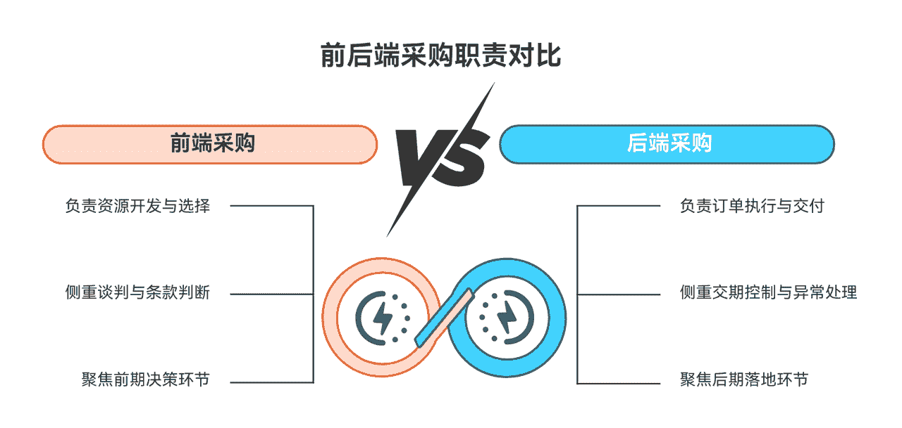
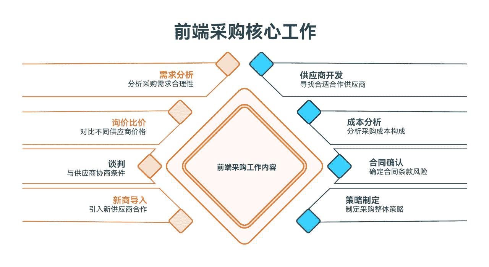
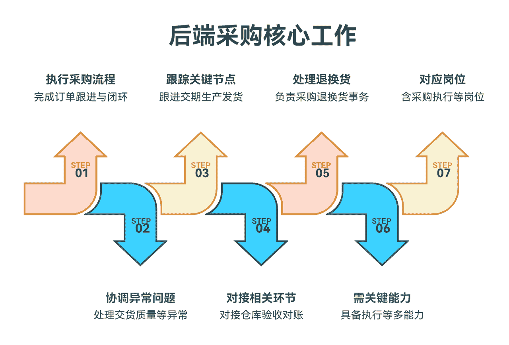

# 前端采购和后端采购区别在哪？为什么会有这个区别？

> 来源：[https://rxq0zfnkm77.feishu.cn/docx/WeQZdSbH1oY7qixG7OgcSNAlnoc](https://rxq0zfnkm77.feishu.cn/docx/WeQZdSbH1oY7qixG7OgcSNAlnoc)

# 前端采购和后端采购，为什么会有这个区分？

很多刚入行的朋友，一听“前端采购”“后端采购”，第一反应都是：

采购不就是买东西吗，为什么还要分前端、后端？

这个问题，其实挺正常。

因为在很多小公司里，采购岗位本来就是一个人从头做到尾：

接需求、找供应商、比价、谈判、下单、催货、验收、对账，基本都要自己来。

但只要企业规模一上来，采购量一大，品类一多，供应商一复杂，

你就会发现：一个人很难把所有事情都做深、做细、做稳。

这时候，采购工作自然就会开始分工。

说白了，企业之所以会区分前端采购和后端采购，核心就三个原因：

### 第一，采购链条变长了

采购不是“找到供应商就结束”，后面还有订单执行、交付跟进、异常处理、对账结算。

前面偏“选择”，后面偏“落地”，事情本来就不是一类事。

### 第二，专业要求不一样了

前端采购更偏资源开发、价格谈判、条款判断、供应商选择；

后端采购更偏订单推进、交期控制、异常闭环、流程执行。

两边要的能力结构，本来就不一样。

### 第三，企业想提高效率、降低风险

如果让同一个人既管前面开发谈判，又天天盯后面下单催货，

最后很容易出现两种情况：

+   要么前面选得不够深；

+   要么后面盯得不够紧。

所以企业把采购拆成前端和后端，本质上不是为了把岗位叫得更复杂，

而是为了让不同阶段的事情，有更清晰的人来负责。

前端采购，是把“买谁、怎么买”这件事先想明白；

后端采购，是把“买回来、交得上、闭得环”这件事真正做扎实。

也正因为这样，采购岗位里才慢慢有了前端采购和后端采购的区分。

很多刚入行的人，一听“前端采购”“后端采购”，会觉得像互联网分工。

其实采购里说白了，没那么玄。

前端采购，核心是“决定买谁、怎么买”；

后端采购，核心是“确保买得回来、交得上、对得齐”。

前端更偏资源开发、供应商选择、价格和条款谈判。

后端更偏订单执行、交付跟进、异常处理、对账结算。

---

## 一、前端采购，主要在做什么？

前端采购，一般更偏这些事：

+   需求分析

+   供应商开发

+   询价比价

+   成本分析

+   谈判

+   合同条款确认

+   新供应商导入

+   采购策略制定

它更像在回答几个问题：

+   这东西该不该买？

+   应该找谁买？

+   这个价格合理不合理？

+   这家供应商值不值得长期合作？

+   条款怎么谈，风险怎么控？

所以前端采购更偏**“选择”和“判断”**。

### 前端采购看重的能力，通常是：

+   供应商开发能力

+   谈判能力

+   成本分析能力

+   风险判断能力

+   跨部门沟通能力

+   合同意识

很多公司里的这些岗位，都可能算前端采购：

+   采购开发

+   战略采购

+   资源采购

+   Sourcing

+   CommodityBuyer

+   供应商开发工程师（部分职责重叠）

---

## 二、后端采购，主要在做什么？

后端采购，一般更偏这些事：

+   下采购订单

+   跟催交期

+   跟进生产与发货

+   协调来料异常

+   对接仓库验收

+   跟进对账付款

+   处理退换货

+   做采购台账和流程闭环

它更像在回答几个问题：

+   订单发出去没有？

+   供应商什么时候交？

+   延误了怎么处理？

+   到货数量和质量对不对？

+   这笔款什么时候能付？

+   异常怎么闭环？

所以后端采购更偏**“执行”和“落地”**。

### 后端采购看重的能力，通常是：

+   执行力

+   节点跟踪能力

+   异常处理能力

+   沟通协调能力

+   细节管理能力

+   留痕与流程意识

很多公司里的这些岗位，都可能算后端采购：

+   采购执行

+   采购跟单

+   订单采购

+   Purchaser

+   Buyer

+   采购专员（偏执行型）

+   供应链协调/订单管理（部分职责重叠）

---

## 三、两者最本质的区别，不是忙不忙，而是工作重心不同

很多人会误以为：

前端采购就是“高级采购”，

后端采购就是“打杂采购”。

这个理解不对。

真正的**区别，不在谁高级，

而**在于你解决的是哪一段问题。

### 前端采购更关注：

+   资源

+   价格

+   条款

+   供应商池

+   采购策略

+   中长期优化

### 后端采购更关注：

+   订单

+   交期

+   到货

+   异常

+   对账

+   流程闭环

前端做得不好，问题通常出在前面：

+   选错供应商

+   谈价没空间

+   条款模糊

+   风险识别不够

后端做得不好，问题通常出在后面：

+   交付延误

+   来料异常没人盯

+   对账付款混乱

+   事情一直在补锅

所以你会发现：

**前端采购决定“选得对不对”；****

后端采购决定“落得稳不稳”**。

---

## 四、举个最实在的例子，你就明白了

比如公司要采购一批电机。

### 前端采购会干什么？

+   跟需求部门确认技术要求

+   开发几家合适的供应商

+   询价比价

+   分析成本和价格差异

+   谈交期、付款、质保

+   评估供应商资质和产能

+   最后确定谁中标、怎么签合同

### 后端采购会干什么？

+   根据合同下采购订单

+   跟进供应商排产进度

+   催交期

+   协调发货

+   到货后跟仓库/质量确认验收

+   处理不良和补货

+   跟进对账和付款

+   把整单闭环收口

你看**，前端不**是不用管交付，后端也不是完全不懂供应商。

只是主责不同。

---

## 五、职业发展上，哪个更值得做？

这个问题，很多人都会问。

我直接说结论：

如果你想长期往更高价值的采购岗位走，前端能力一定要补。

因为前端更接近：

+   供应商资源

+   谈判权

+   成本控制

+   策略制定

+   业务价值创造

这部分，通常更容易体现采购的“不可替代性”。

但这不代表后端不重要。

恰恰相反，很多采购人真正的基本功，都是在后端练出来的：

+   交付节奏感

+   异常处理能力

+   细节控制

+   沟通推进

+   流程闭环意识

问题不在于你是不是先做后端，

而在于你做后端的时候，有没有主动往前端能力上靠。

---

## 六、如果只能二选一，我怎么建议？

### 对新人来说：

如果你完全没经验，先从后端做起，不一定是坏事。

因为后端最能让你看清采购流程到底怎么跑。

但你要有一个清醒认知：

如果你长期只停留在“下单、催货、对账”这几个动作里，成长会比较慢。

所以更好的路径是：

先把后端执行做扎实，再尽快往前端的比价、谈判、供应商管理、成本分析靠。

### 对想跳槽的人来说：

你要看岗位描述里，自己能不能接触到这些事：

+   供应商开发

+   询价比价

+   谈判

+   合同条款

+   成本分析

+   供应商评估

如果一个岗位完全没有这些内容，长期就会偏执行化。

---

**前端采购，决定采购的上限；****

后端采购，决定采购的下限**。

前端强，说明你会选、会谈、会判断；

后端强，说明你能盯、能落、能闭环。

真正成熟的采购，不是只会前端，也不是只会后端，

而是两头都懂，只是阶段上各有侧重。