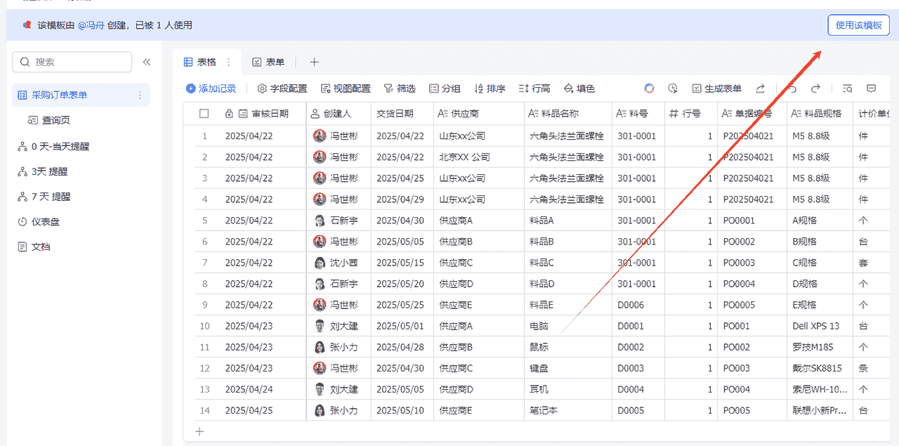
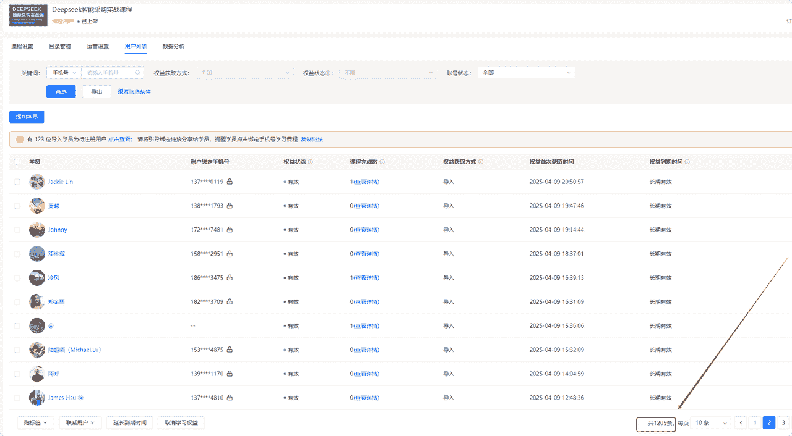

# CAIWY 采购知识库

# 采购知识库（AI实操+采购知识）

> 来源：[https://rxq0zfnkm77.feishu.cn/docx/COA2drYyioV33MxcOc1cbOZCnHb](https://rxq0zfnkm77.feishu.cn/docx/COA2drYyioV33MxcOc1cbOZCnHb)

# ⛳️  知识空间简介

> 本知识库是面对采购与供应链行业人员的知识库，本知识库文件为原创，请忽商用。如转发请标注原创。

📕：[采购冯志伟](https://www.xiaohongshu.com/user/profile/677e40a6000000000803e060)（点击跳转关注）

视频号：众智商学课程中心

[点击查看](https://channels-aladin.wxqcloud.qq.com/aladin/html/0378ddfc-4497-419c-992d-edf56b73ebef.html)（打开后复制链接到🛰️打开）

26年CPPPM试听课已经安排好了~~

扫码可以试听一半，想试听所有可以加右边老师咨询~

加入粉丝群，讨论更多采购技巧！

**交货提醒多维表格在这里！！**

[采购订单交货提醒](https://rxq0zfnkm77.feishu.cn/wiki/UTDrwkDRWiPFjjk42C7cAoK6npc) 点击使用该模板就可以复制使用

# ⭐️采购知识文章文案分享

点击[采购知识干货系类](https://rxq0zfnkm77.feishu.cn/wiki/QUWZwDVD8i27RKkys9kcsNpLn7b)查看全部

[采购面试高频问题](https://rxq0zfnkm77.feishu.cn/wiki/HfsOwjpYwiwAnBkuyZ1caKe2nEh)

[采购轻松搭建自己的工作SOP](https://rxq0zfnkm77.feishu.cn/wiki/OoPBwBei2iKh9xkQGb8crLybnae)

[采购领域常用的详细术语及其解释](https://rxq0zfnkm77.feishu.cn/wiki/Az6cwocnLiimhTk7JtscPRaFnOe)

[为什么采购在职场中需要空杯心态？](https://rxq0zfnkm77.feishu.cn/wiki/QwtxwL6tnic4zOkZ19Ac0PCHned)

[采购、物流、供应链三大专业推荐岗位](https://rxq0zfnkm77.feishu.cn/wiki/KiBfw6vbjiL2dtkN9EDcETyTn6e)

[采购谈判的隐藏王牌：不懂心理学，怎么玩转供应商？ ](https://rxq0zfnkm77.feishu.cn/wiki/GfSqwXMdmiumoRkIrojcFEKVnad)

[政府采购方式全解析,一篇搞懂6大采购模式](https://rxq0zfnkm77.feishu.cn/wiki/KGCPwwZSaiq11LkHauFciudhnFf)

[采购员日常核心工作内容（附能力拆解）](https://rxq0zfnkm77.feishu.cn/wiki/JKekwUlGYivOWGkdo5AcuGpJntg)

[2025年美国关税政策对采购领域的影响](https://rxq0zfnkm77.feishu.cn/wiki/ZyUIwHx2Oi1IhRkWnlVcVW35n8c)

[大学生校招必看：零经验拿下采购岗面试的实战指南](https://rxq0zfnkm77.feishu.cn/wiki/UK4DwKeAbiSSIIkwESpc9U7vnhf)

[采购常用表格函数公式](https://rxq0zfnkm77.feishu.cn/wiki/HMxiwxUOdiLoafk9BeKcelKgn0g)

[采购员的职业前景深度分析](https://rxq0zfnkm77.feishu.cn/wiki/YfbkwTqZCiBmYPk0Zwncv3PInsc)

[采购小白必看！采购跟单全流程拆解](https://rxq0zfnkm77.feishu.cn/wiki/IITawHEfQi2JzNkb01BcoGItnUc?from=from_copylink)

# ⭐️  AI实操文档（教程）

1.  [Deepseek+kimi 快速生成PPT 教程](https://rxq0zfnkm77.feishu.cn/wiki/LceFwzyVdiGmyBkoHSHcqdmznkh)

1.  [Deepseek制作的采购流程图](https://rxq0zfnkm77.feishu.cn/wiki/ZjZ9wHxGpihKifk7bUCcqe0nnRf)

1.  [采购如何使用Deepseek辅助实现降本目标？](https://rxq0zfnkm77.feishu.cn/wiki/SNuvwT1h8iMqlKk2D4Hc7vIEnTh)

1.  [Deepseek麦肯锡行业分析](https://rxq0zfnkm77.feishu.cn/wiki/R65Bw47QVizbSYkmYhUcCWKZnme)

1.  [AI生成的markdown代码转思维导图教程](https://rxq0zfnkm77.feishu.cn/wiki/RQqxwyYwEiXGATk71xmcbcKKn7d)

1.  [Deepseek生一个针对中国市场的新能源汽车行业综合数据看板 提示词文档](https://rxq0zfnkm77.feishu.cn/wiki/XKKuwRBFWiC1GHkfXz7coSLcn9c)

###  推荐网站与小程序

1.  [采购寻源导航网站](http://dh.zmxh.top)【300+采购常用网站集合】

1.  [采购办公文档免费下载站](http://caizhiku.net)【2000+采购文件资料】

> 推荐采购人考取的认证证书

> [注册职业采购经理认证详解](https://rxq0zfnkm77.feishu.cn/wiki/ELHmwebA3iOQkxkF80ZcBGFcngh)

> [SCMP供应链管理专家认证详解](https://rxq0zfnkm77.feishu.cn/wiki/Uc0Swwc2iiNFGVkAx7cc8rSXntb)

# ⭐️  DeepSeek智能采购实战课程来啦 耗时三个月持续打磨的课程

第一节直播课程圆满结束，感谢1000位采购从业者的支持~，没有报名课程的采购从业者现在加助理🛰️可以领取第一节的试听，限时限名额~

