# OpenAI官方APP教你一步到位！国内怎么用支付宝购买ChatGPT Plus4.0会员

> 来源：[https://bwiny5w2svt.feishu.cn/docx/DKc0dgy8Wo9cCPxiP23cHVnnnwd](https://bwiny5w2svt.feishu.cn/docx/DKc0dgy8Wo9cCPxiP23cHVnnnwd)

ChatGPT的iOS版出来大家都知道了吧？这意味着我们可以直接利用App Store购买plus啦！ 那美区账号怎么充值呢？给大家分享一下今天刚刚实操过的支付宝购买礼品卡的方法。

# 基础工具

+   一个美区的AppleID，只有美区的才能下载chatGPT IOS 版本

+   手机上有FQ工具才能使用ChatGPT，而这种工具在ios上是要付费的

# 开始支付

## 1. 改位置

把支付宝左上角的位置改成美国的城市，比如旧金山；

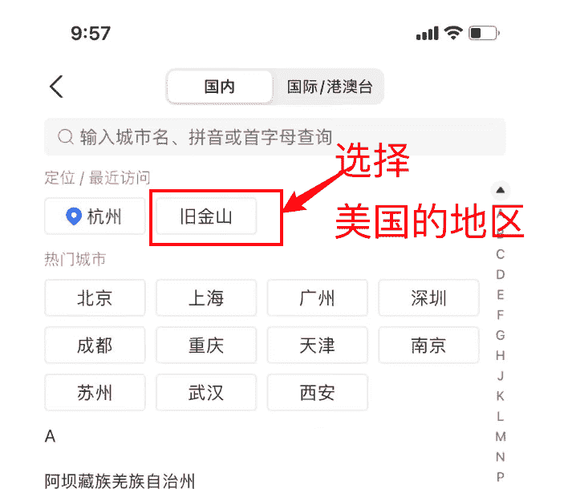

## 2. 进入优惠界面

下方中间有个“惠”字，点击即可；

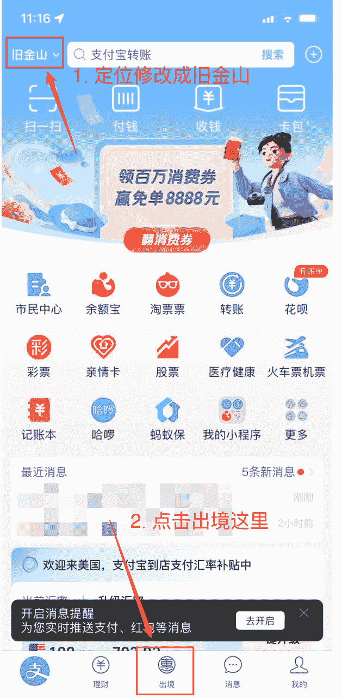

## 3. 点击“折扣礼卡”

进入礼品卡界面；

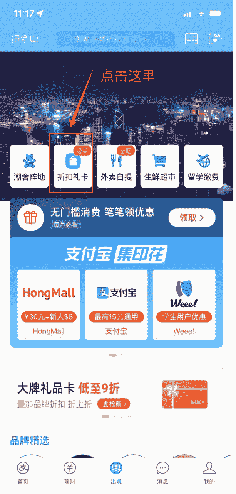

## 4. 拉到最下面，点击更多大牌礼品折扣卡

进入Pockyt Shop

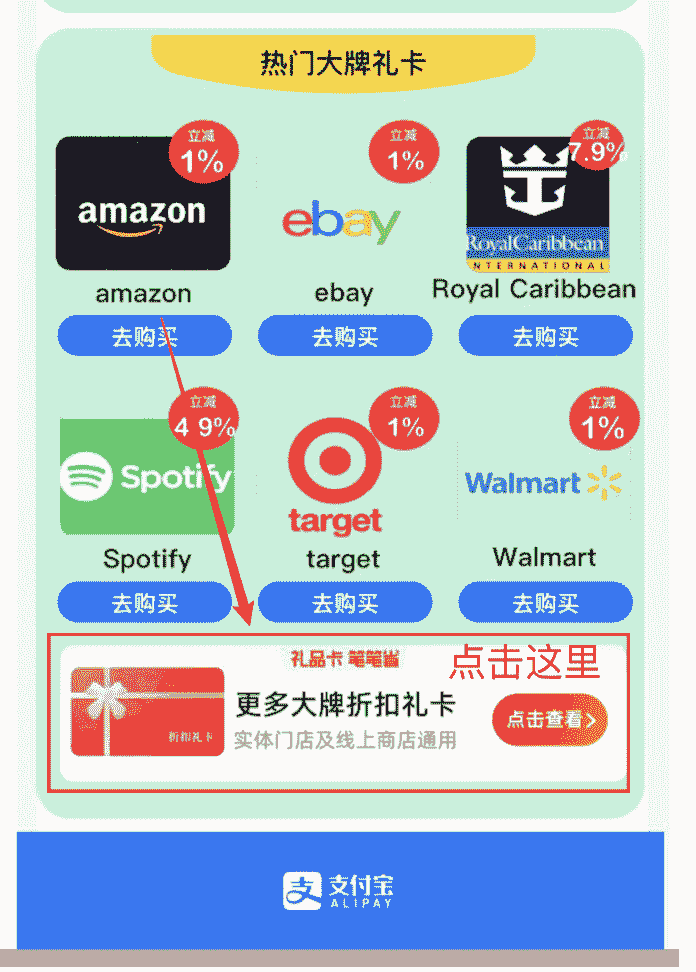

## 5. 搜索 "App" 这个关键字

就能看到iTunes礼品卡了，然后根据自己需要购买即可（需要先注册），购买成功去复制出礼品卡号码。

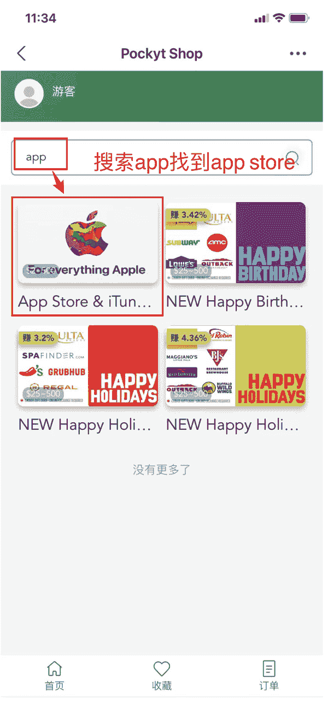

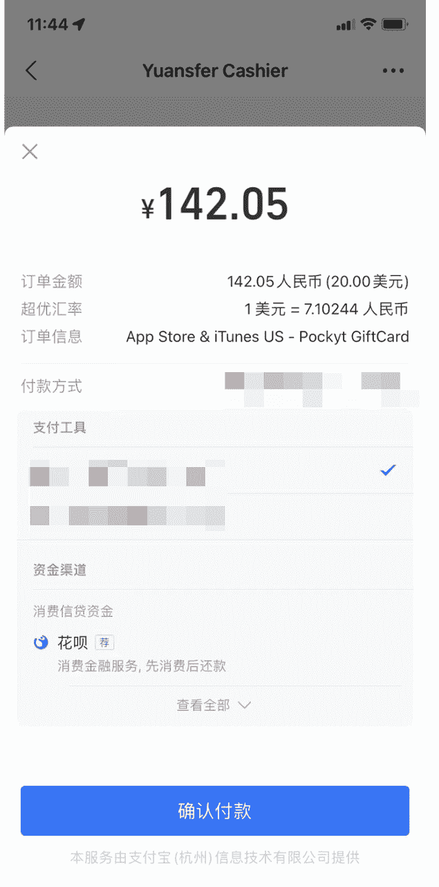

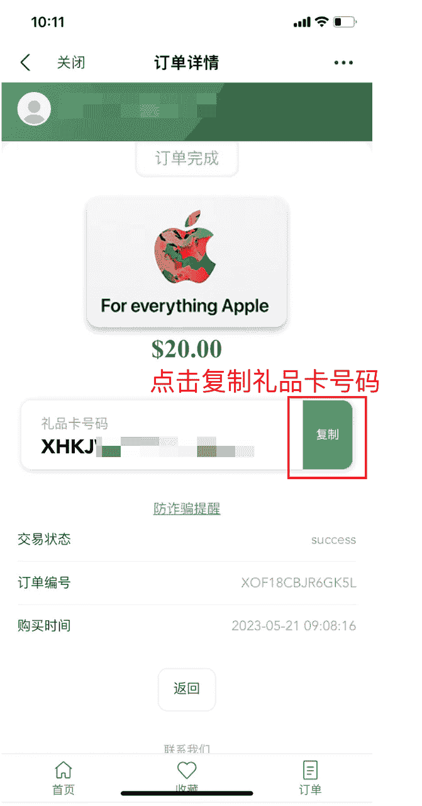

## 进入到账户兑换充值卡

进入 app store > 账户 > 账户页面 按下面流程操作，兑换充值卡

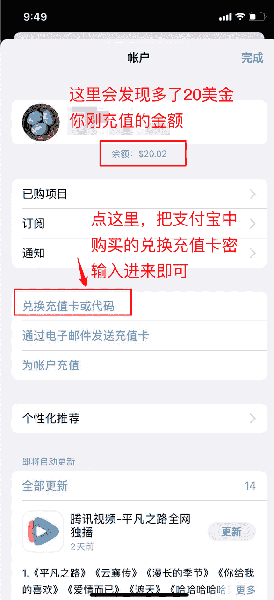

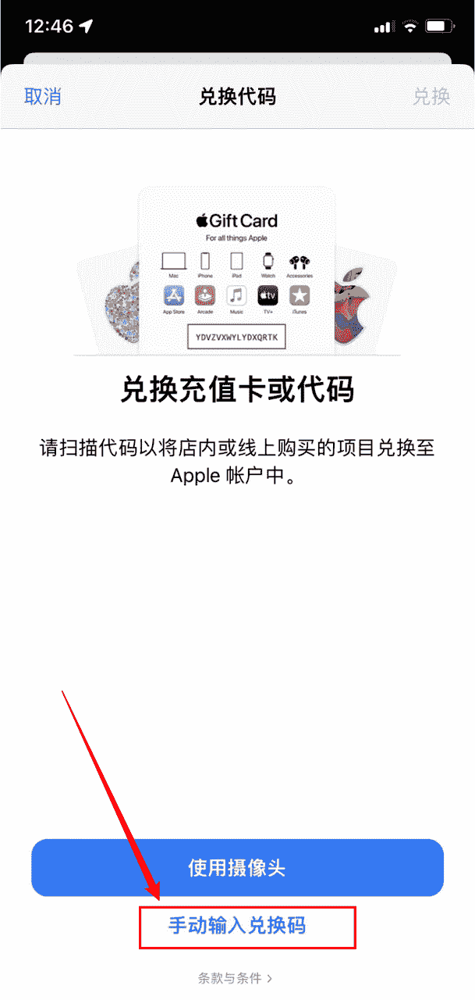

回到chatGPT ios app 中直接购买就可以了，成功后页面就会改变。

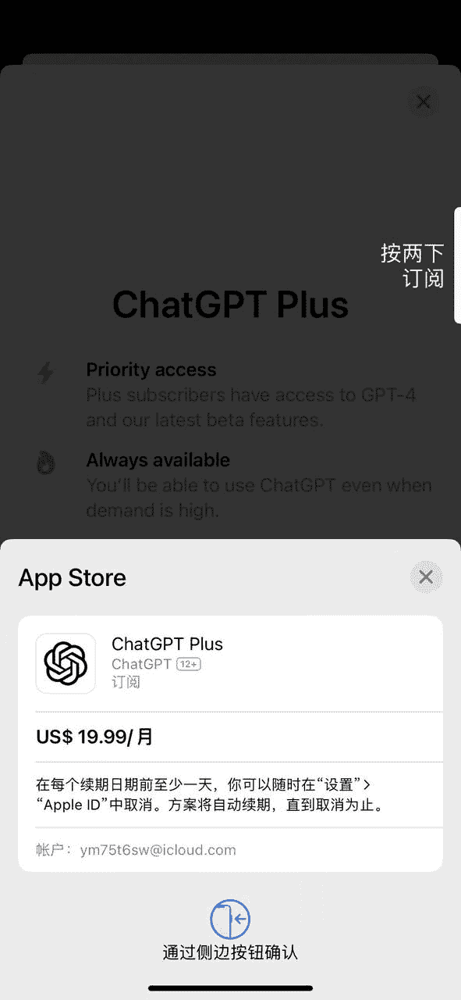

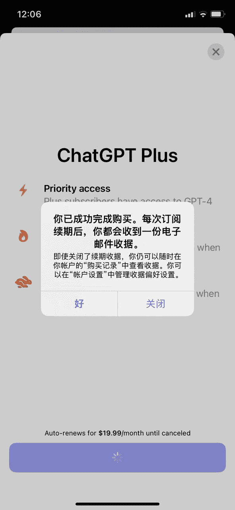

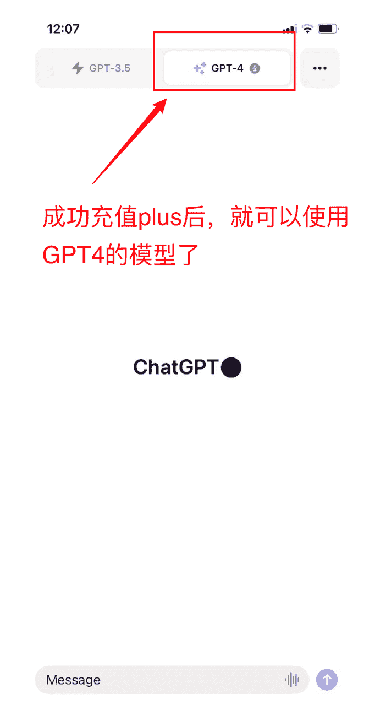

## 特殊情况处理：

当你在chatGPT app中进行购买时，有时会报下面这个错误

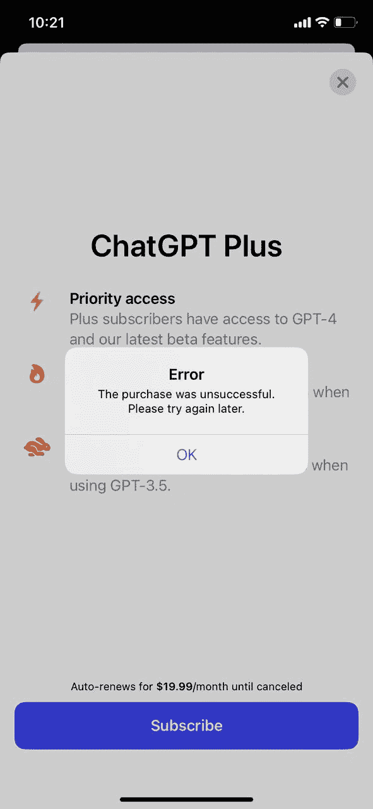

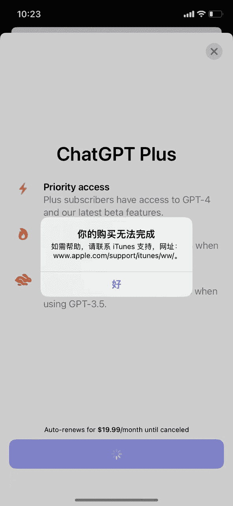

通过提供的网址，我和Apple官方客服取得了联系。由于我在同一部手机上，为多个chatGPT账号充值触发了风控，需要apple官方进行审核，所以需要第二天再试。

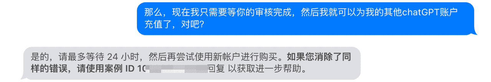

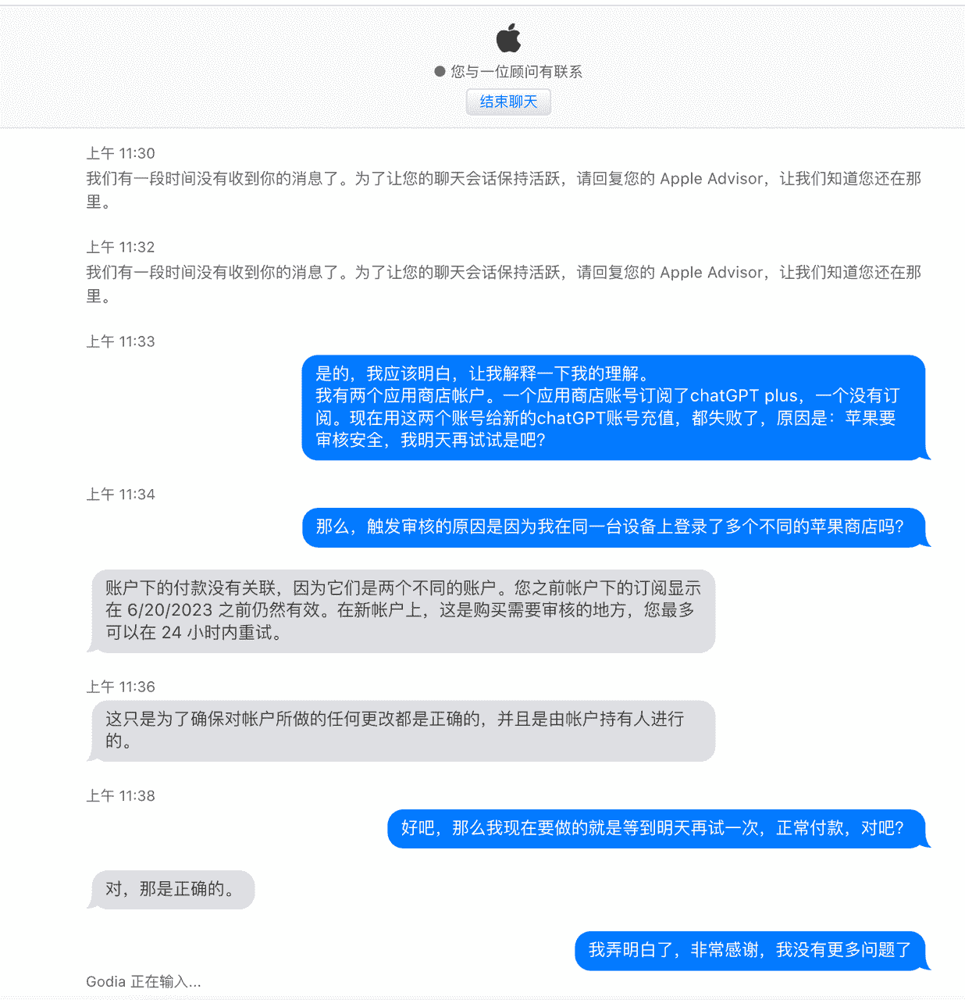

** - ****ChatGPT****让每个普通人，不再平庸 -**

链接博主+免费AI社群+商务合作                                                      公众号：AI超体进化室

