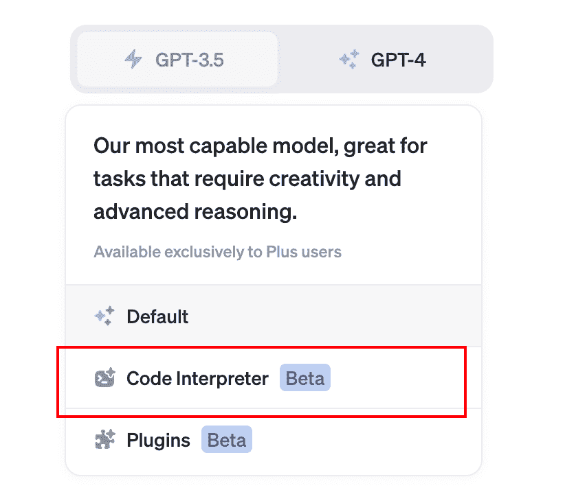
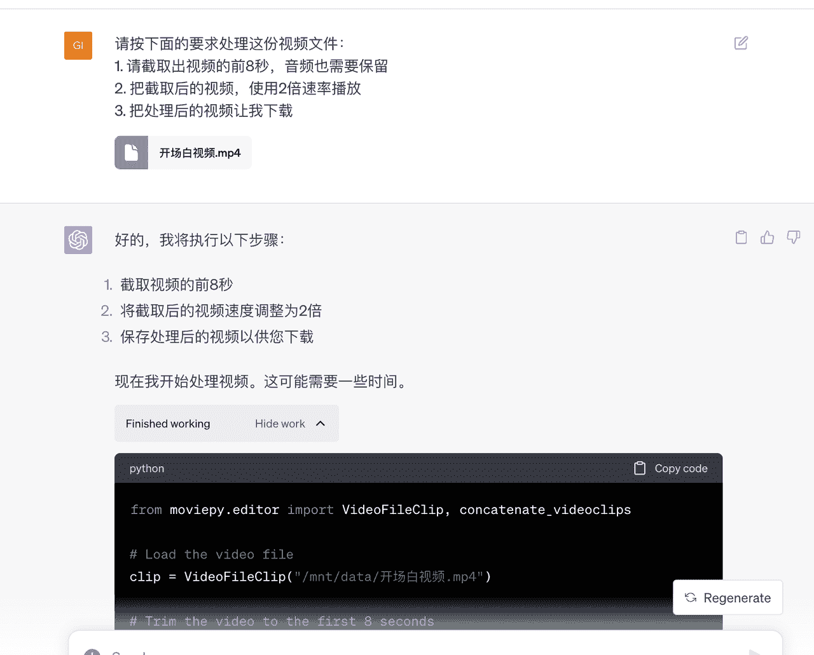
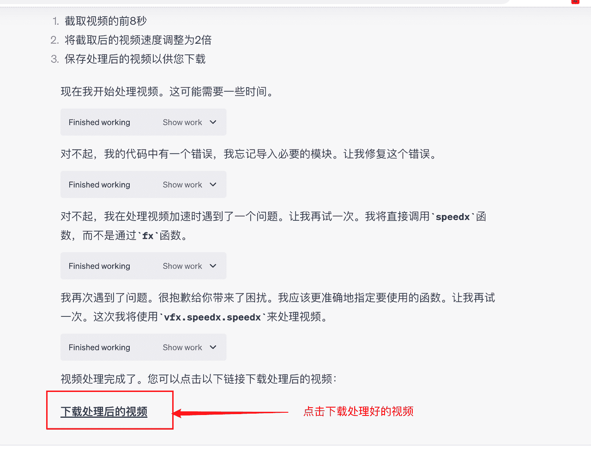
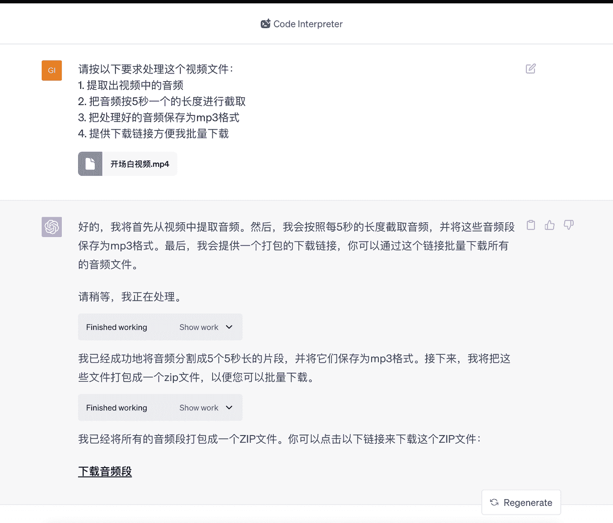
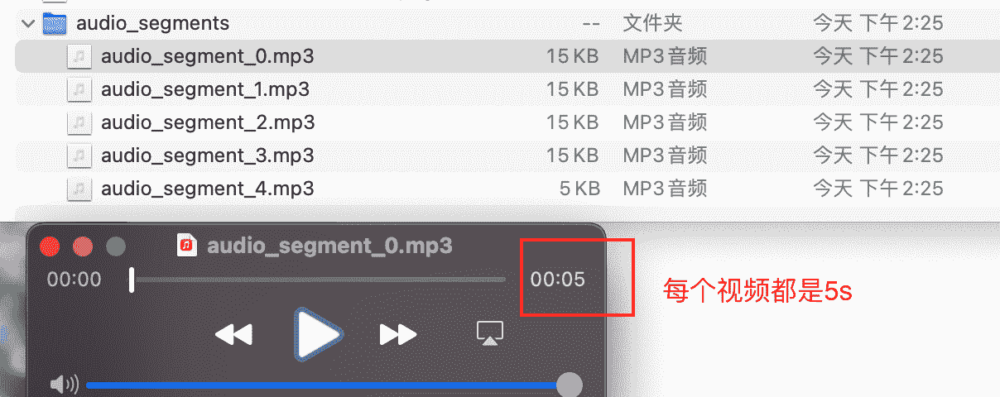
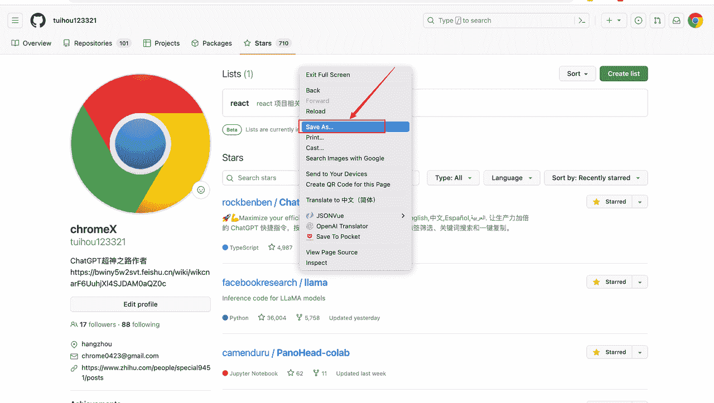

# 代码解释器Code Interpreter

> 来源：[https://bwiny5w2svt.feishu.cn/docx/T3Zbd9Mb3ofphkxInXacI0P9nhd](https://bwiny5w2svt.feishu.cn/docx/T3Zbd9Mb3ofphkxInXacI0P9nhd)

# 常见问题

## 什么是代码解释器？

ChatGPT可以写代码，却不能执行。而Code Interpreter 不但能写，还能直接在云端执行。

Code Interpreter内置了一个Python的虚拟环境，只要Python代码能做的事，Code Interpreter基本都能做。相当于让用户通过自然语言去写代码。为什么是“基本都”，而不是“全部”呢？是因为它还有以下几个特点。

**优势：**

+   可以直接执行Python代码，不用在本地调试了

+   执行过程中，出错，会自动修复

+   执行的代码可以点击show完整展示，全流程非常清晰

**缺点：**

+   不联网，安全考虑

+   文档的生命周期只有20分钟，临时空间有限

+   只能使用官方内置的库，不能使用其他库

+   官方给出的沙盒环境中，缺少中文字体的支持。中文在可视化图片展示时会出现失真的情况

+   沙盒的内存有限，如果文件太大，不会执行（<100M）

参考资料：

+   https://zhuanlan.zhihu.com/p/628095564

## 代码解释器有哪些运用场景？

Code Interpreter 可以解析、处理、生成文件。

+   图片处理：图片合并与拆分、图片滤镜（灰度、马赛克）、尺寸修改

+   视频处理：视频合并与拆分、视频音频提取、尺寸修改

+   文档处理：文档总结

+   表格处理：数据分析和统计、可视化表格

+   代码生成zip完整版：生成整个完整的项目

+   教学演示：输入代码，立即看到结果

+   文件生成：图片（jpg静态图、GIF动态图）、视频、文件（excel）、Pdf等。

+   文件格式的转换：MP4转GIF、MP3转MAV

局限性：由于安全和隐私考虑，代码解释器不能联网，也不能执行一些可能会影响系统稳定性的操作。因此，虽然代码解释器非常强大，但它并不能替代一个完整的Python开发环境。

参考资料：

+   https://zhuanlan.zhihu.com/p/642515408

# 案例：视频剪辑

## 视频截取及变速

**痛点说明：**

视频剪辑我们一般会利用一些专业的软件帮我们处理，比如：剪映。

但是有些专业的视频公司有批量处理的需求，要怎么快速处理？普通用户电脑上没有安装剪辑软件怎么办。

能不能通过文本描述就把视频给剪辑了？答案是可以的。下面我们借助让ChatGPT编写代码的方式来帮我们写一段程序处理视频。

利用code Interpreter 代码解释器，能帮我们做什么

+   剪辑掉没有声音的视频部分

+   合并多个视频

+   把视频让指定要求进行拆分

+   指定视频位置进行剪切

+   提取视频的声音

+   给视频设置转场效果

+   视频加速、减速播放

大家都知道chatGPT是可以写代码的，但是写完之后还得拷贝到本地，安装各种依赖才能运行。

而且经常中运行中报错，我们又但把错误信息给到它，让它再生成新的代码。

能不能再简单点，一步到位呢？比如：我们让它，写一段把代码把视频拆分成5s一个有段视频。生成完整后，直接让我们下载就可以了。如果代码执行过程中报错了，它自己去修复就好了。是不是非常完美。

下面我将教大家这种非常好用的方法：ChatGPT Code Interpreter 代码解释器。

它可以在网页中执行ptyhon代码，拥有对文件读取、编辑和生成的能力。非常适合来做自动化、批量化的工作。



**操作步骤：**

原始视频


[开场白视频.mp4](https://internal-api-drive-stream.feishu.cn/space/api/box/stream/download/all/UC1bbTiDpoUT1Yx0NBKcRxeMnwh)

任务提示词

> 请按下面的要求处理这份视频文件：

1.  请截取出视频的前8秒，音频也需要保留

1.  把截取后的视频，使用2倍速率播放

1.  把处理后的视频让我下载

1.  最后生成的视频中，音轨请使用 AAC

说明：如果不声明最后一点，会发现在macbook中使用quicktime播放没声音，

是因为mp4格式的文件是为MKV封装的DTS音轨。如果是标准的MP4文件，音轨应该是AAC的。





下面是最后剪辑的效果


[processed_video_aac.mp4](https://internal-api-drive-stream.feishu.cn/space/api/box/stream/download/all/IJpubEAaTodjUqxNygGcXGwOnBb)

## 音频提取及处理

多种拆分模式可选

+   每个视频按指定时间长度拆分

+   按指定时间位置拆分

我的视频付费课，在讲克隆声音这一节时，有一节是讲如何克隆声音的。其中有一个环节需要训练声音。

需要把一段音频按一定的长度进行截取，用来训练。一般我们需要使用特定的工具，但是这里我们可以直接让代码解释器生成一段代码帮我们处理这个任务，并把执行的结果直播返回给我们。

提示词

> 请按以下要求处理这个视频文件：

> 1. 提取出视频中的音频

> 2. 把音频按5秒一个的长度进行截取

> 3. 把处理好的音频保存为mp3格式

> 4. 提供下载链接方便我批量下载



下载音频段是一个压缩包，解压里面有5个音频，每个长度都在5秒。



## 过滤没有声音的视频，快速粗剪

> 请按下面要求处理视频：

1.  过滤掉视频没有声音的部分

1.  并提一个新地址给我下载

## 多图层视频合并处理

左边是演示的画面，右边是视频。我需要让右侧的讲解视频放在左侧的图片上，最后生成一个新的视频。


[开始.mp4](https://internal-api-drive-stream.feishu.cn/space/api/box/stream/download/all/J8w1bm8UwodAwpxFkhzcYx6Vn8d)

提示词：

> 请按下面的要求生成视频：

1.  把图片和视频合成在一个视频中，视频的图层在图片的上方

1.  视频的位置，在页面右下角，高度为画面的 1/4.

1.  合成的视频，音轨请使用 AAC

1.  把最后生成的视频提供给我下载

技巧：由于代码解释器只能上传一个文件，当我们有两个文件需要处理时，需要把它们打成一个压缩包。

## 大文件的处理

拷贝出Code Interpreter生成的代码，然后把代码拷贝到 Google Colab Research 来运行。

# 其他使用场景

## 数据提取

把一个大的文档，通过Code Interpreter上传后，让它提取出指定的内容。

使用步骤：

1.  保存网页的html为本地文件

1.  把保存后的文件通过code interpreter上传

1.  写入提取的提示词

> 请提取出html中指定的内容，生成一个csv供我下载。csv包括三个字段：项目名、链接、描述。

> 项目名和链接的元素位置

> ```

> <a href="/rockbenben/ChatGPT-Shortcut">

> <span class="text-normal">rockbenben / </span>ChatGPT-Shortcut

> </a>

> ```

>

> 描述为的位置：

> ```

> <p class="d-inline-block col-9 color-fg-muted pr-4" itemprop="description">

> <g-emoji class="g-emoji" alias="rocket" fallback-src="https://github.githubassets.com/images/icons/emoji/unicode/1f680.png">🚀</g-emoji><g-emoji class="g-emoji" alias="muscle" fallback-src="https://github.githubassets.com/images/icons/emoji/unicode/1f4aa.png">💪</g-emoji>Maximize your efficiency and productivity, support for English,中文,Español,العربية. 让生产力加倍的 ChatGPT 快捷指令，按照领域和功能分区，可对提示词进行标签筛选、关键词搜索和一键复制。

> </p>

> ```



>

资料参考：https://twitter.com/ThePyCoach/status/1682455083034857473

** - ****ChatGPT****让每个普通人，不再平庸 -**

链接博主+免费AI社群+商务合作                                                      公众号：AI超体进化室


