# ChatGPT+程序员10倍提效

> 来源：[https://bwiny5w2svt.feishu.cn/docx/KV1SdmI8ToSAPQxmU67cGnV0nZe](https://bwiny5w2svt.feishu.cn/docx/KV1SdmI8ToSAPQxmU67cGnV0nZe)

**身份设置：**

英文：英文的语料库更丰富，经过测试，发现使用英文写代码效果更好。

> I want you to act as a web front-end development expert.

> Your job is to help me develop the front-end code, find hidden bugs and fix it, and give me code optimization suggestions.

> I will provide some specific information about web applications, the main technologies include: javascript, typescript, react, antd-design, umi, ahooks, etc.

> If you understand, please reply to confirm. Waiting for my next command.

中文：

> 我希望你扮演一位web前端开发专家。

> 你的工作是帮助我开发前端代码，找出隐藏的bug并修复它, 给我提供代码优化建议。

> 我将提供一些关于web应用的具体信息，主要技术包括：javascript, typescript,react, antd-design,umi, ahooks等。

> 如果明白，请回复确认。等待我下一个指令。

## 修复代码BUG步骤

> 设定身份> 指明BUG > 测试验证（自己手动验证） > 再指明BUG > 验收完成

**问题说明**

下面是一段有问题的代码，我们尝试让chatGPT帮我们修复。

有BUG的代码在线演示：

https://codesandbox.io/s/you-bugde-cha-xun-biao-ge-deng-dai-chatgptxiu-fu-mje3if

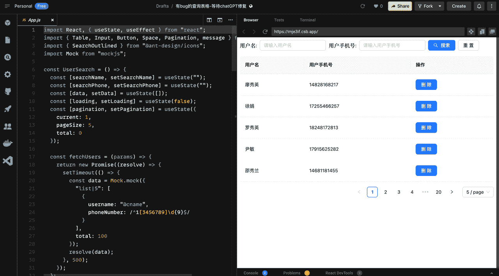

主要的BUG有：

> 点击[搜索]后没有重置页码再请求数据

> 点击[重置]没有重置页码，然后请求参数

> 点击删除需要调用接口（使用mock.js+new Promise 在本地模拟），删除后需要刷新列表

> 用户手机号input, 不能输入非数字，长度不能超过11位，否则无法输入

###

**调教步骤**

**第一步**：设定身份：指名GPT的身份是前端专家，让它帮我找到并修复BUG。

> 指令见上面

**第二步**：不告诉它具体的BUG，让GPT自己找，发现业务上的BUG它无法发现。

> 下面是一个【用户信息查询】的react代码，你能找到bug吗？

> 不单单是技术上的bug，还包括业务上的bug，

> 比如说，用户手机号input, 不能输入非数字，长度不能超过11位，否则无法输入，这个是业务上的bug，你能找到吗？

**第三步**：机器很难理解业务上的BUG， 给GPT指明具体的BUG，继续让它修复

> 上面我提供的代码存在以下bug，请修复它

> 1. 点击[搜索]后没有重置页码再请求数据

> 2. 点击[重置]没有重置页码，然后请求参数

> 3. 点击删除需要调用接口（使用mock.js+new Promise 在本地模拟），删除后需要刷新列表

> 4. 用户手机号input, 不能输入非数字，长度不能超过11位，否则无法输入

**第四步**：发现BUG都修复完了，但是引出了新BUG。所以下面接着让它修复

> 上面的代码存在以下bug，请修复它

> 1. 当触发 handleChange方法时，handleSearch中获取的current 是旧值，而不是新值。应该使用最新的值。

###

**全程对话+修复后的在线演示地址**

最终实现的效果：还是不错的。

由于对话过长，放在下面的链接中，可点击查看。

> 点击查看修复后的DEMO在线演示

>

> [**请点击查看完整对话链接 **](https://raw.githubusercontent.com/tuihou123321/chatGPT-tutorial/main/images/gpt-%E4%BF%AE%E5%A4%8Dbug%E5%AE%8C%E6%95%B4%E5%AF%B9%E8%AF%9D.png)

## 查找技术解决方案

> 副标题：效率大师！用ChatGPT查找技术解决方案，比Google更快捷省心！

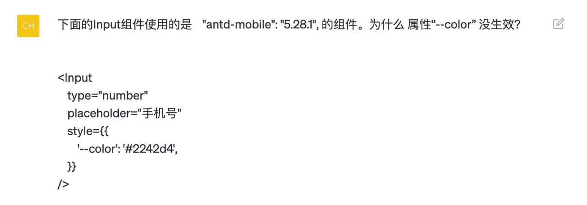

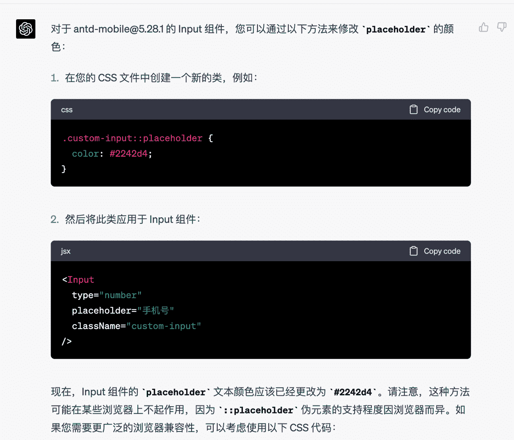

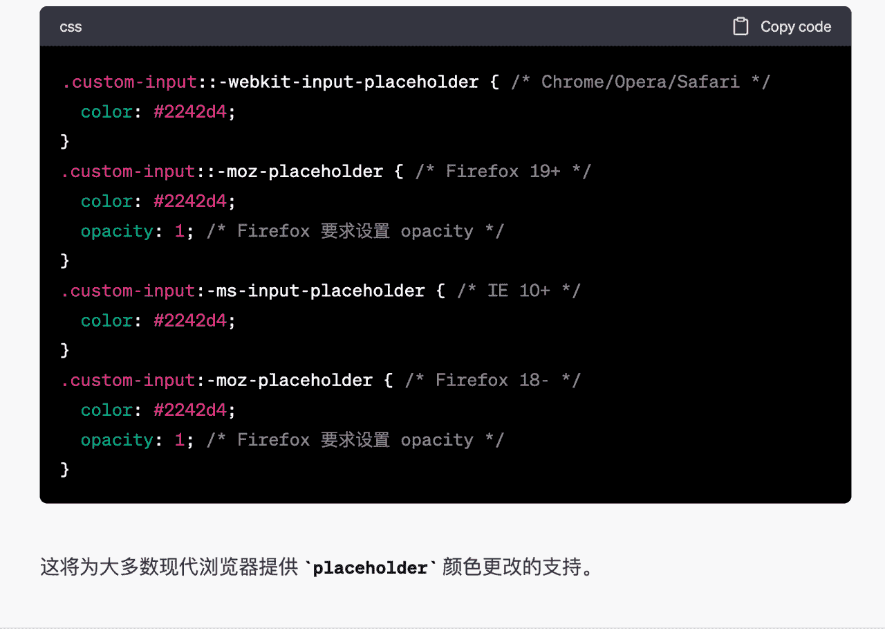

## 优化代码：编程小白也能成大神？ChatGPT助你优化代码，轻松升级技能！

使用技巧：直接让chatGPT自己分析、优化。

它会找到代码重复的部分，然后合并重复项，让代码更容易维护。

**代码优化案例展示**

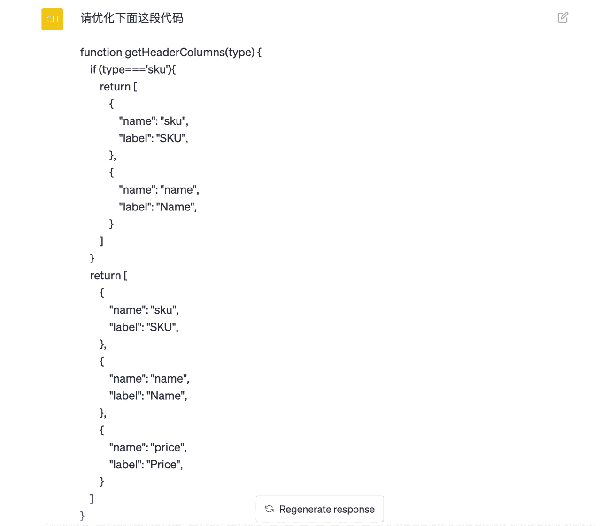

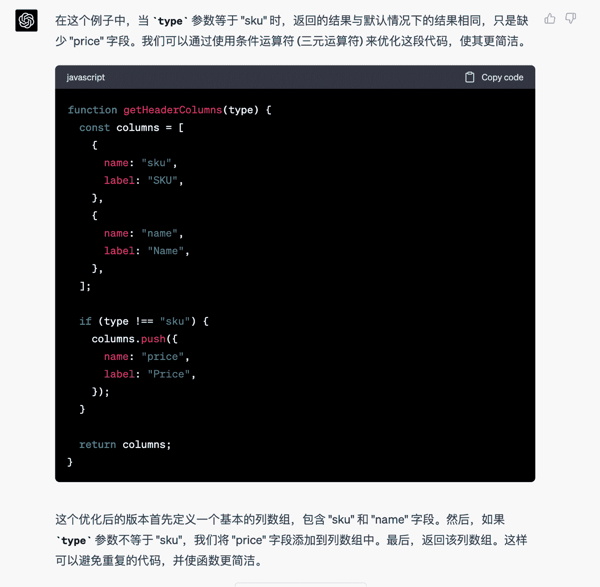

**具体优化哪些代码**

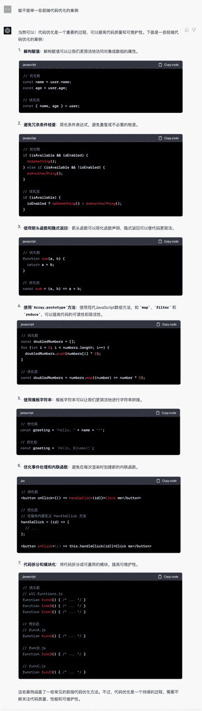

## 根据描述生成代码

### 生成函数

+   创建一个函数验证是不是手机号

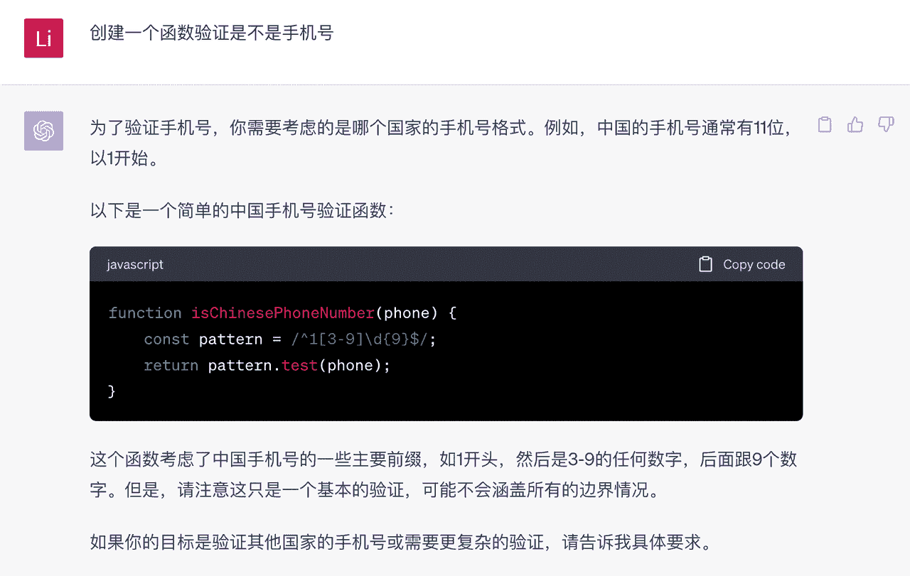

### 数据格式转换

副标题：无需手动转换！ChatGPT让数据格式转换成为小菜一碟！

**场景说明：**

中后台项目经常需要核对大量的字段，一个列表有几十个字段，每个字段又有很多的属性。人工核对非常费时，而且容易出错。产品会给到我们一份表格，每个字段对应的设置项。我们只需要把这个表格直接转换成js对象就非常方便。

> 小技巧

> 如果你们产品写的原型文档，不能把表格直接生成csv，比如在语雀文档中插入的excel。可以先把表格拷贝到腾讯文档的表格中，然后把标题修改成你需要的对应key。如下图，最后导出csv文件。

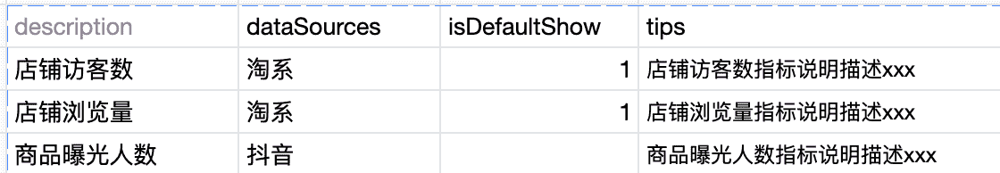

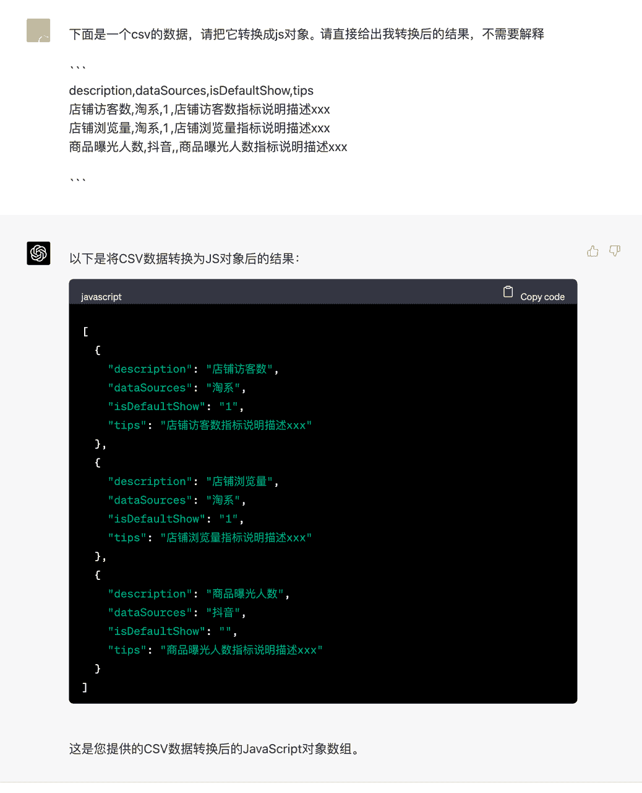

### 生成React完整页面

副标题：程序员们疯狂了！用ChatGPT生成React完整页面，竟然不用写一行代码！

不写一行代码（包括：js、css、请求方法等）直接通过中文描述能不能让chatGPT把react的组件写了？

答案是可以的。下面介绍一个实战案例。

**完整对话url : **[**点击查看**](https://raw.githubusercontent.com/tuihou123321/chatGPT-tutorial/main/images/h5.png)

**功能说明：**

账号在进行敏感操作时，为了验证是本人，而不是盗号。需要用户在收到的手机url 上点击确认授权。

下面就是开发的h5页面。

主要逻辑在提示的状态：未授权，已授权，链接过期三种状态。需要调用接口判断。

已授权是可点击的（需要调用接口）。下面我们用chatGPT来实现一下。

（下图是chatGPT实现的效果）


指令：（这条指令不单单完成了功能，还写了UI）

```
要求：使用react + antd mobile+ less+ alita，创建一个页面组件。

页面逻辑如下
1. import {confirmAuthorization, getPageStatus } from &quot;@/services/loginVerification&quot;;  // 引入接口路径
2. 进入页面后调用 getPageStatus 接口，判断页面状态，显示对应的文本信息
3. 点击[授权通过(如非本人请勿点击)]按钮后，调用 confirmAuthorization 接口，判断返回值，如果成功就显示您已授权通过，否则显示无效的访问！！
4. 进入当前页面的路由及参数：https://www.xxx.com?authKey=[32位字符串]

页面UI布局要求如下（整个页面padding为20px,下面每行间距为10px）：
第一行文本（文本样式：红色，加粗）：XXX安全验证
第二行文本（文本样式：缩进）：您的XXX账号当前正在执行高危或敏感操作，需要您亲自授权通过！，
第三行文本（右对齐）：通过 getPageStatus 接口返回的data状态显示不同的文本信息。未授权时为蓝色（(页面信息：[授权通过(如非本人请勿点击)]按钮)），已过期为红色（页面信息：无效的访问！！），已授权为绿色（（页面信息：您已授权通过））

接口一：getPageStatus 获取页面状态
入参：
{
    authKey:string, // 从url中获取
}
出参：
{
    code:0, // 0 成功
    data:number // 页面状态：0 未授权，  1 已过期， 2 已授权
}


接口二：confirmAuthorization 确认授权
入参：
{
  authKey:string   // 从url中获取
}
出参：
{
  code:0, // 0 成功
  data:boolean // true 成功， false 失败
}
```

### 生成html+css文件


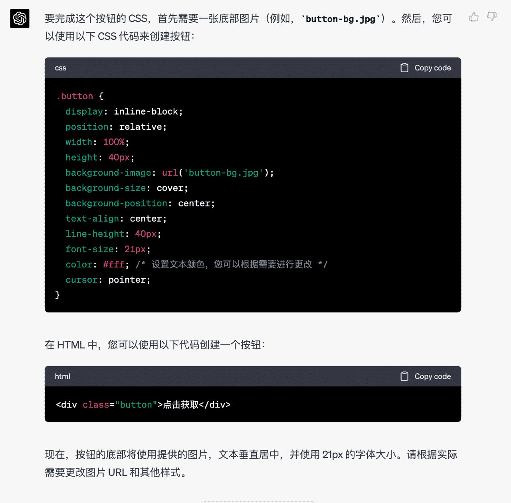

最后生成的效果


###

### 使用mockjs模拟数据

痛点：

怎么快速的把后端定义的接口文档变成前端项目中的Mock数据，前端可以直接请求这个接口并返回模拟数据呢？

我的项目使用的 [umi框架](https://v3.umijs.org/zh-CN/docs/mock#%E7%BA%A6%E5%AE%9A%E5%BC%8F-mock-%E6%96%87%E4%BB%B6)， 内置了mock数据服务，所以我们只要把相关的接口 umi的要求生成代码即可。

下面我们开始吧。

解决方案：

**第一步：身份设置**

> 你是一个数据格式生成器，我会给你一些接口定义文档。你会转换成 umi中 mock的数据格式。

> 注意事项：

> 1. 需要把标题放在url的上方，并注释起来。

> 2. 生成的数据，放在一个代码块中方便复制。

> 3. 引入： import mockjs from 'mockjs';  来模拟数据

**第二步：数据格式处理**

这里为什么要进行数据格式处理呢？

因为chatGPT的token长度有限制，一次不能输入太多，并且上下文理解能力长度也有限制。

所以我把原始文档拷贝到 typora中，把不必要的内容删除。

拷贝到typora中的好处是，可以把文档内容转成markdown格式，如果内容中包含表格文本拷贝到GPT进行识别。

这是删除整理后的数据，只包含了生成mock的必要数据。接口名称、接口url, 请求方式，返回示例。实例后面

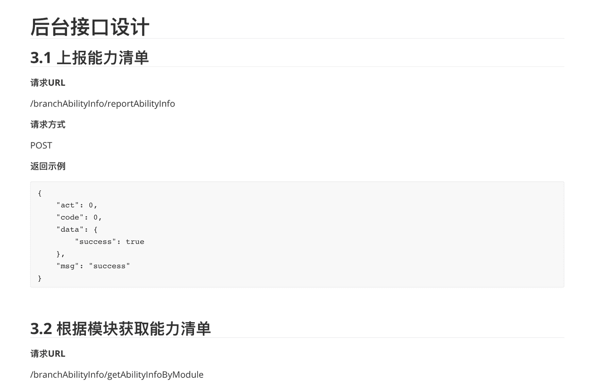

**第三步：让****GPT****转换数据**

把过滤后的markdown数据发送给ChatGPT，并让它生成数据。

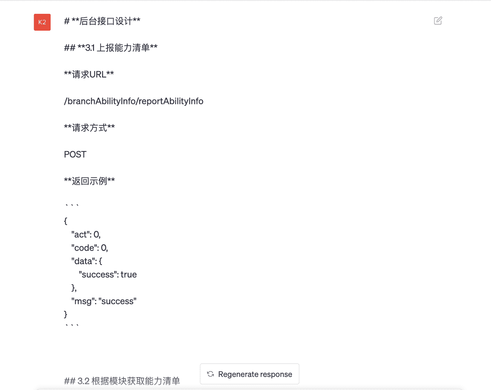

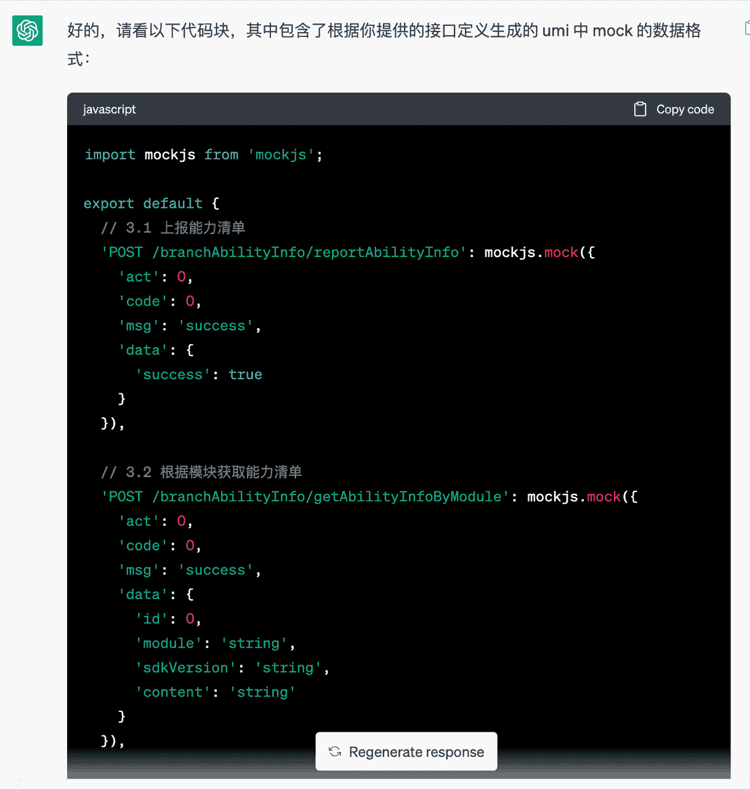

由于生成的内容，ChatGPT无法一次输出。所以下面我们需要让它继续，并且提醒它把代码放在一个代码块中。

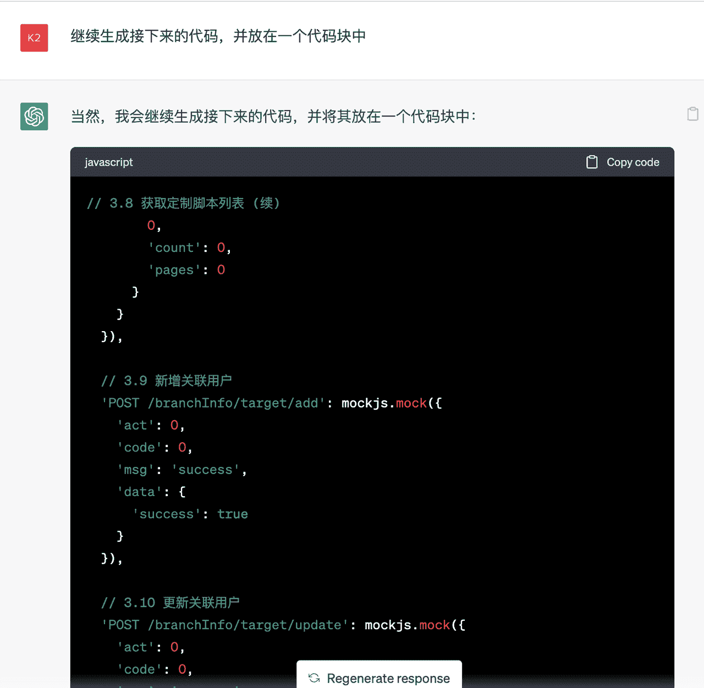

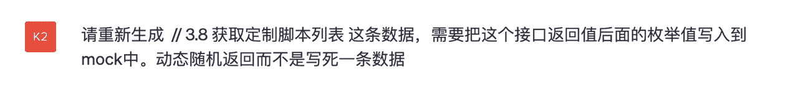

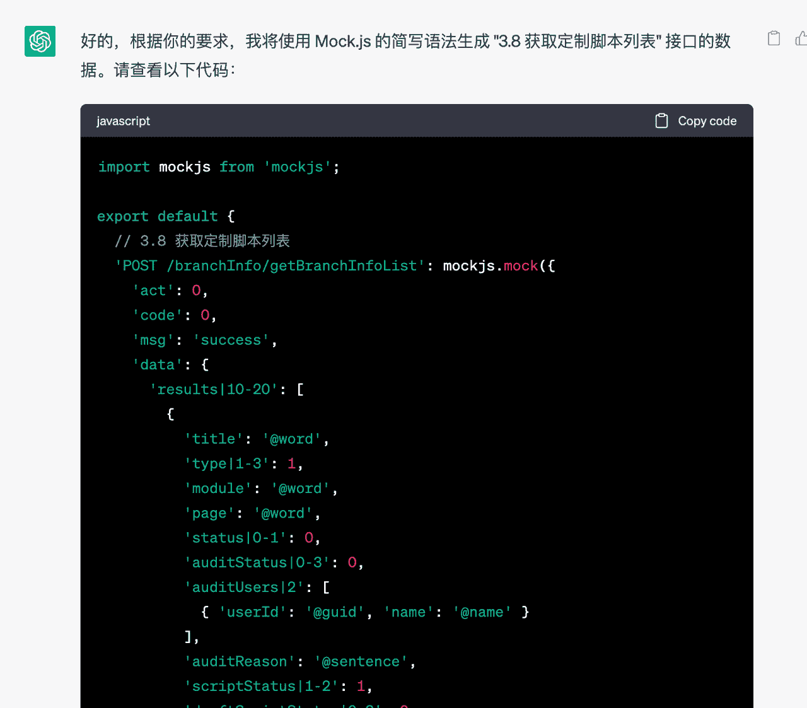

**第四步：本地测试**

ok

## 把JSON转换成TypeScript类型定义

**痛点说明：**

使用TS写前端代码需要定义很多数据类型，而这些数据大多依赖接口返回的数据类型。

如何快速的把接口json转换成 TS定义，可以帮我们节省很多干苦力活的时间。

也许你会想到一些在线服务：在线Json转TypeScript工具。但是这真的好用吗？

下面我们来看一个例子：

完整的JSON数据见url： https://gist.github.com/tuihou123321/4339f2cd1928bb7c4b5c8855d7fbb129。

下面是一个复杂的json对象，其中pages中的key都是变量，比如：foo,bar

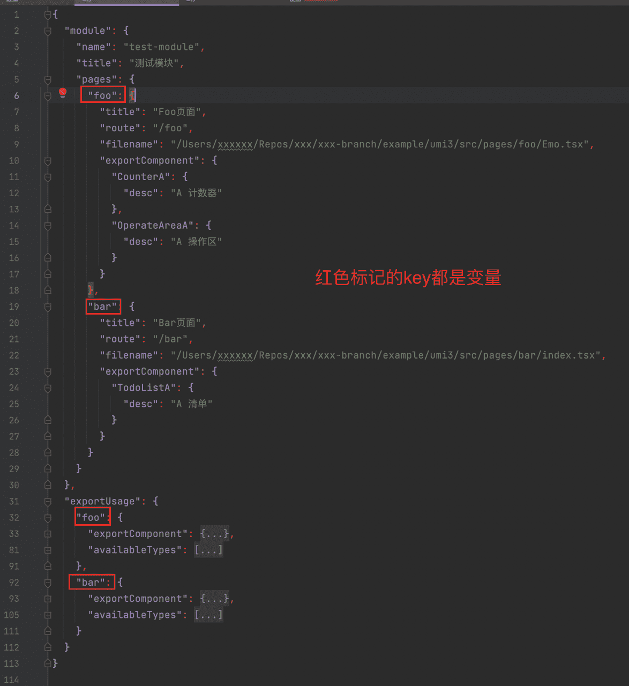

我们使用上面提到的在线转换工具来进行测试，发现效果非常不理想。 foo, bar是变量，不应该定义在TS类型中。那有没有其他更好的工具来解决这个问题呢？

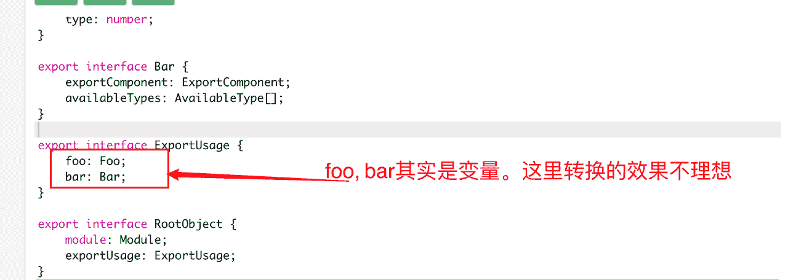

**解决方案：**

我们直接把json对象直接丢给chatGPT。

提示词：

```
请把下面的JSON对象转换成 typescript类型定义：
// 这里是注入的json代码
```

下面就是最后生成的TS类型定义，转换的非常不错。chatGPT在智能理解方面比普通的小工具更智能。

```
type ComponentMethodParams = Record&lt;string, unknown&gt;;
type ComponentMethod = {
    params?: ComponentMethodParams;
    context?: string[];
    getter?: boolean;
    wrap?: boolean;
    desc?: string;
};
type ComponentMethods = Record&lt;string, ComponentMethod&gt;;
type ComponentAppendButton = {
    desc?: string;
    context?: string[];
};
type ComponentAppendButtons = Record&lt;string, ComponentAppendButton&gt;;
type Component = {
    methods: ComponentMethods;
    appendButtons: ComponentAppendButtons;
};
type ExportComponent = {
    [key: string]: {
        desc?: string;
        component: Component;
        type: Record&lt;string, unknown&gt;;
    };
};
type Page = {
    title: string;
    route: string;
    filename: string;
    exportComponent: ExportComponent;
};
type Pages = Record&lt;string, Page&gt;;
type Module = {
    name: string;
    title: string;
    pages: Pages;
};
type AvailableType = {
    title: string;
    type: number;
};
type ExportUsage = {
    [key: string]: {
        exportComponent: ExportComponent;
        availableTypes: AvailableType[];
    };
};

// 能力清单通过配置文件生成，配置文件的格式如下：
export type Config = {
    module: Module;
    exportUsage: ExportUsage;
};
```

## 找出编译错误并修复

这两天遇到一个代码打包编译报错的问题，本地打包没问题，但在服务器打包就各种报错。

看着密密麻麻的错误日志让人头痛，排查起来很费时间。

我们可以把错误日志直接丢给chatGPT让它帮我们找出原因，并提供解决方案。

第一步：身份设定：

> 你是一位前端技术开发专家，我将给你一些计算机方面的问题，你将帮我分析，并提供解决方案。

下面开始提交你的错误日志：

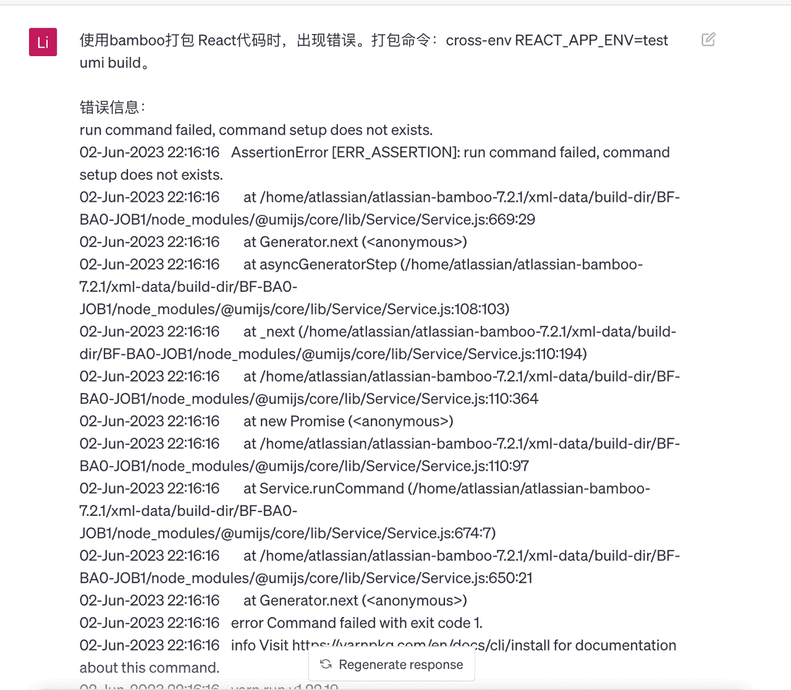

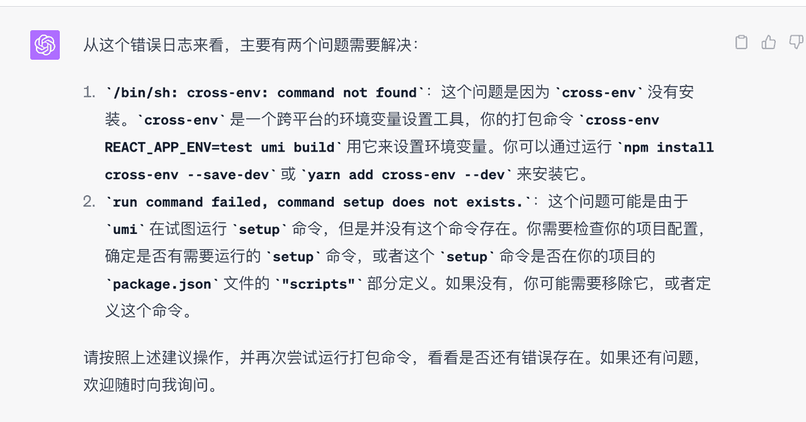

**经**过上面的修改，再次在服务器上打包，发现错误信息变了，出现了新的问题。我们再次把错误日志丢给ChatGPT。

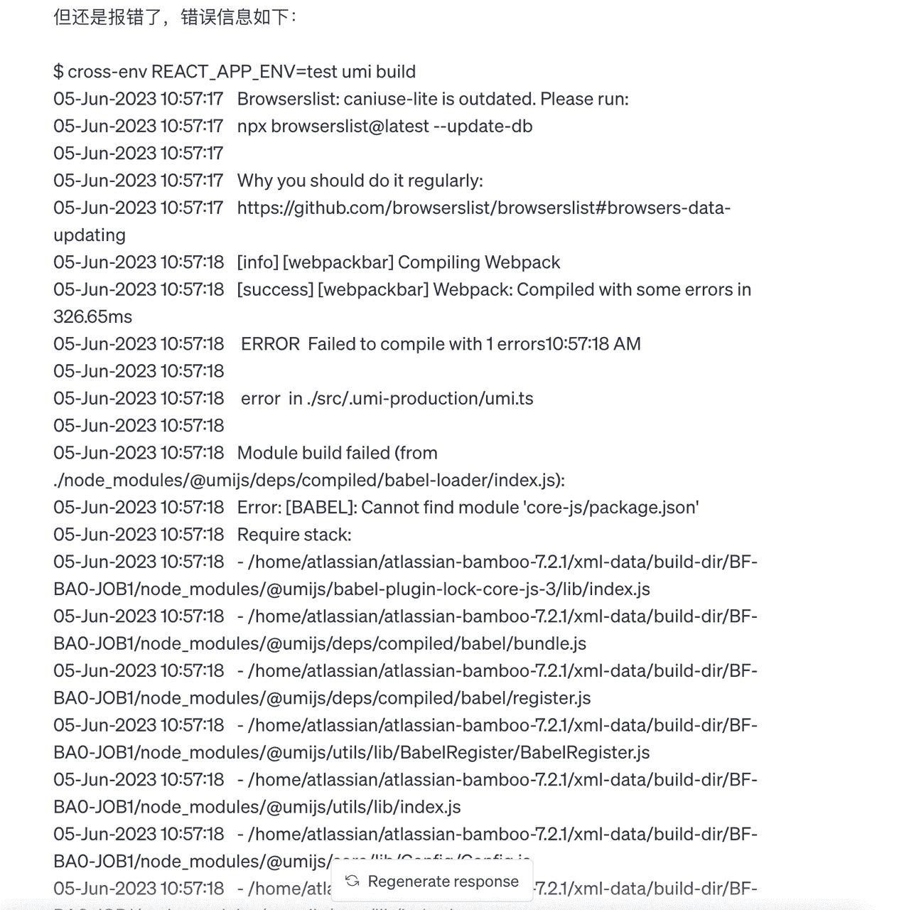

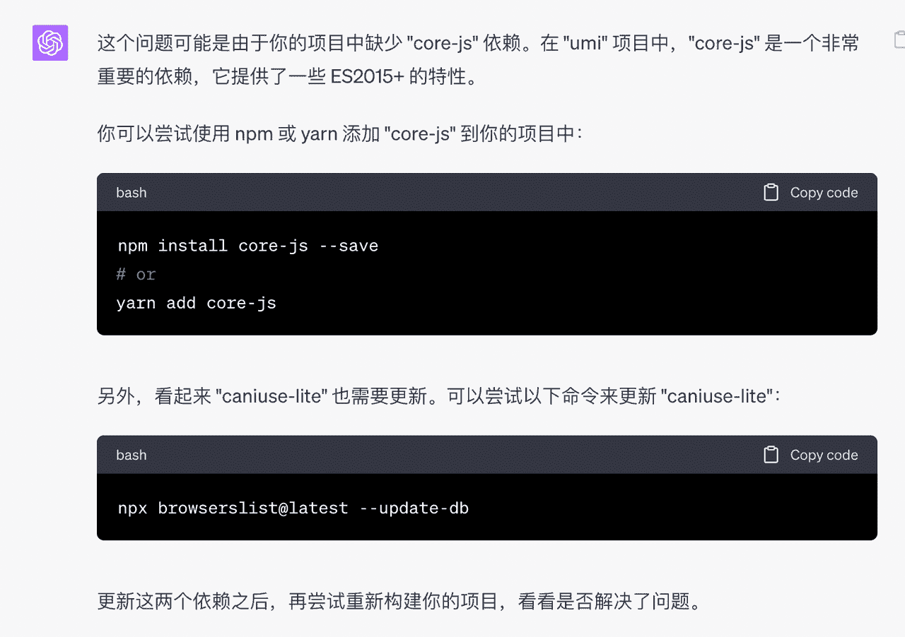

经过上面两个来回，很快就把打包编译错误给解决了，这种方法比自己查询效率高多了。

## 模拟面试

几年前我写过[【前端面试宝典】](https://github.com/tuihou123321/FE-interview)，需要去网上搜索各种回答。效率比较低，其实使用chatGPT可以更高效的复习。

你可以把问题给到chatGPT让它帮你生成答案，并且可以给你展示demo,给你解释，让你对知识掌握的更好。

文档在线地址：https://xz-fe-interview.gitbook.io/fe-interview/readme

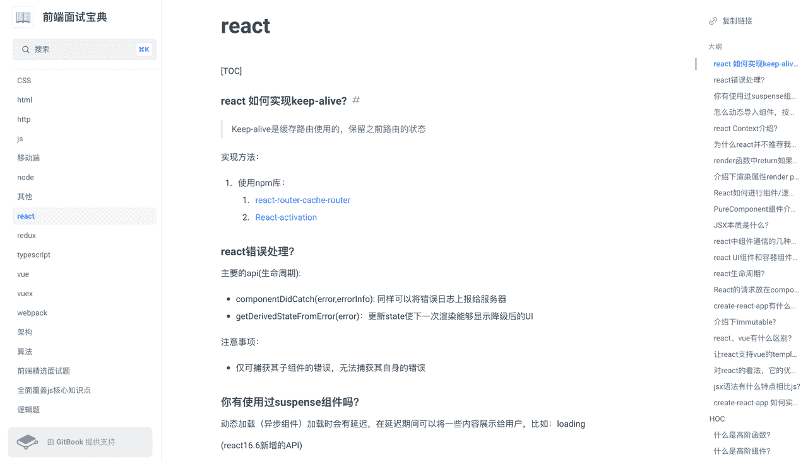

## ChatGPT插件+Webstorm效率再翻翻，快的飞起来

**痛点**

ChatGPT虽然强大，如果每次要在IDE和ChatGPT两个软件中不断切换，拷贝代码有点麻烦。有什么方法可以提效呢？

那就直接把ChatGPT 装[进 webst](https://plugins.jetbrains.com/plugin/20603-chatgpt)orm吧，右键选中代码。让chatGPT优化、自己找BUG，并且可以在窗口中随时提问，那岂不是很爽。现在好了，强大的插件已经出现了。它就是 webstorm插件： ChatGPT。

**Follow Me 一步步来：**

**第一步：获取APIKeys**

请参考文章：

+   什么是ChatGPT ApiKeys，如何获取，有哪些注意事项？

**第二步：在we****bst**orm中下载chatGPT 插件

+   [插件名：ChatGPT](https://plugins.jetbrains.com/plugin/20603-chatgpt)

+   把从openAI开发平台获取到的 apikyes 设置进插件的配置中。

安装后的效果：选中代码，找bug、优化代码、自定义指令。

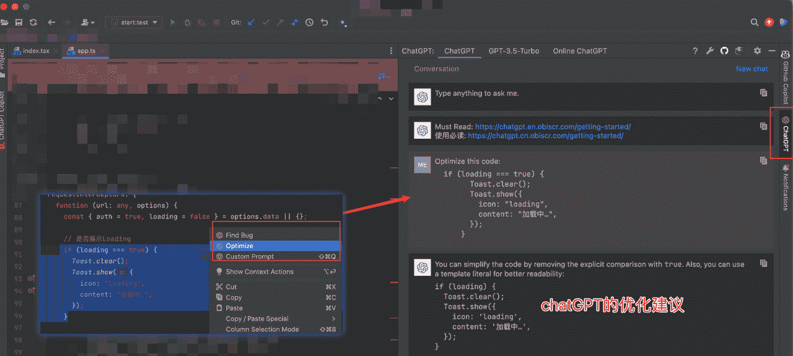

插件底部还有一个对话框可以实时提问。让它再解释、重新生成代码等功能


## 3分钟极速、免费搭建自己的ChatGPT网站，再也不用魔法上网了

**为什么要搭建这么一个网站？**

+   【给亲戚/朋友用】能教我怎么注册、登陆ChatGPT吗？最近我听到很多这样的声音，一个个指导，确实有点费劲，毕竟搞完PC，还有手机端（android, ios）。能不能直接给一个网站，不用注册、不用魔法上网，免费使用。

+   【引流】我想通过这个网站给的【ChatGPT超神之路】引流，让更多看到这份不错的使用文档。

+   【写这份文档】帮助更多人快速搭建属于自己的ChatGPT网站

+   【自定义网站可扩展功能更丰富】一键导出对话、把对话生成图片、内置提示词等

那搭建这么一个网站是不是很复杂？

答案是：很简单，3分钟搞定。

**如何搭建自己的****ChatGPT****网站？**

好吧，让我们开始吧。

**第一步：找到一个****ChatGPT****源码**

下面推荐几个开源不错的开源项目

+   https://github.com/Chanzhaoyu/chatgpt-web  （Vue版本），支持下载聊天数据为图片这个功能不错

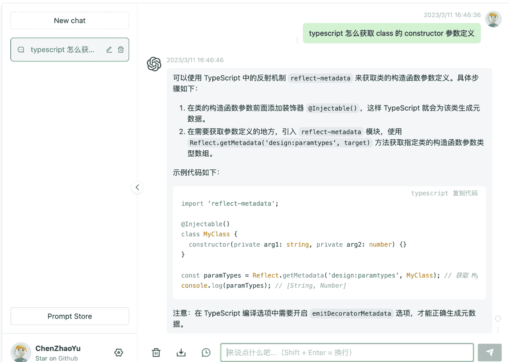

+   https://github.com/Yidadaa/ChatGPT-Next-Web/  (React版本)，一键导出所有聊天记录，支持markdown格式

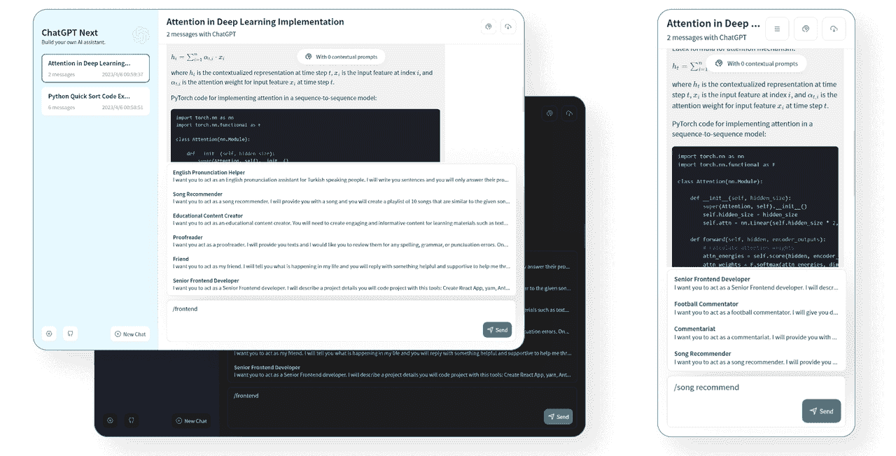

+   [https://github.com/](https://github.com/zuoFeng59556/chatGPT)zuoFeng59556/chatGPT （Vue版本），简化版本不支持创建多个聊天框

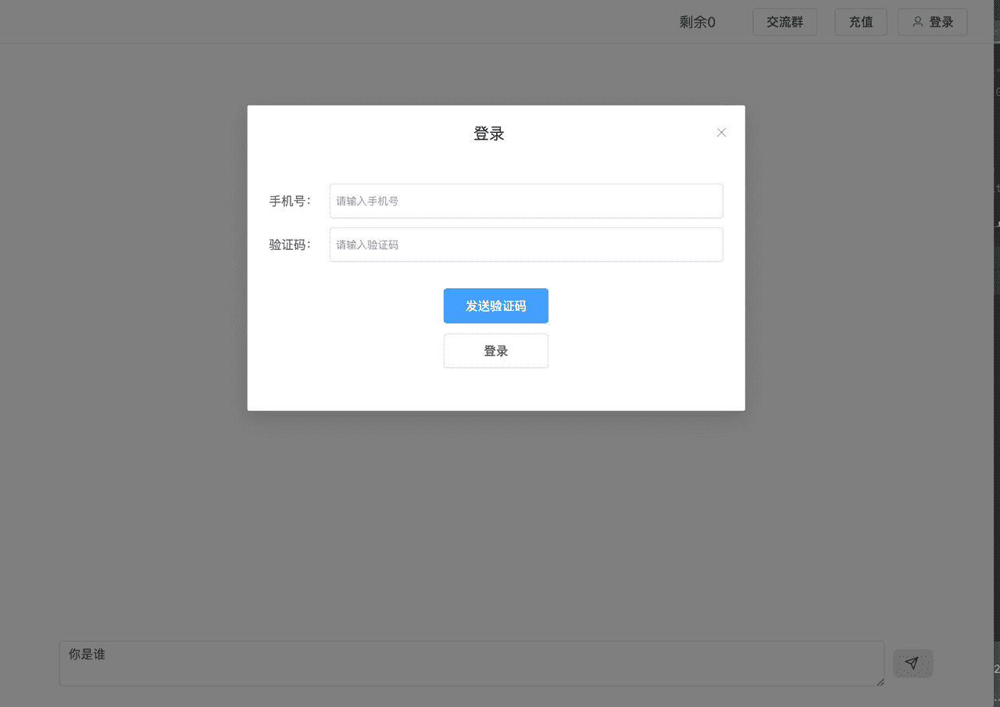

**第二步：找到免费的****云服务器****+写后端代码**

项目上线需要涉及到：

+   购买服务器

+   云存储空间

+   域名

+   数据库（这个项目简单做，所以没用到）。

一年至少也要300块+/年。网站还要备案啥的，太麻烦的。

有没有可以白嫖、简单的方案的方案呢？

推荐使用云原生服务；[laf](https://laf.dev/)。

> 注意：这里使用的域名是：https://laf.dev/。只有这个dev域名才能调用ChatGPT的服务。猜测可能是风控方面的考虑。

Laf 是一个 Serverless 框架，提供开箱即用的云函数，云数据库，对象存储等能力，是一个干净清爽的开发平台，像写博客一样写代码！

**步骤：**

**后端接口部分：**

1.  添加环境变量。输入你的apikeys。

apikeys的获取地址：https://platform.openai.com/

> 注意事项：注意是否有免费流量，注意流量是否过期, 否则无法调用。

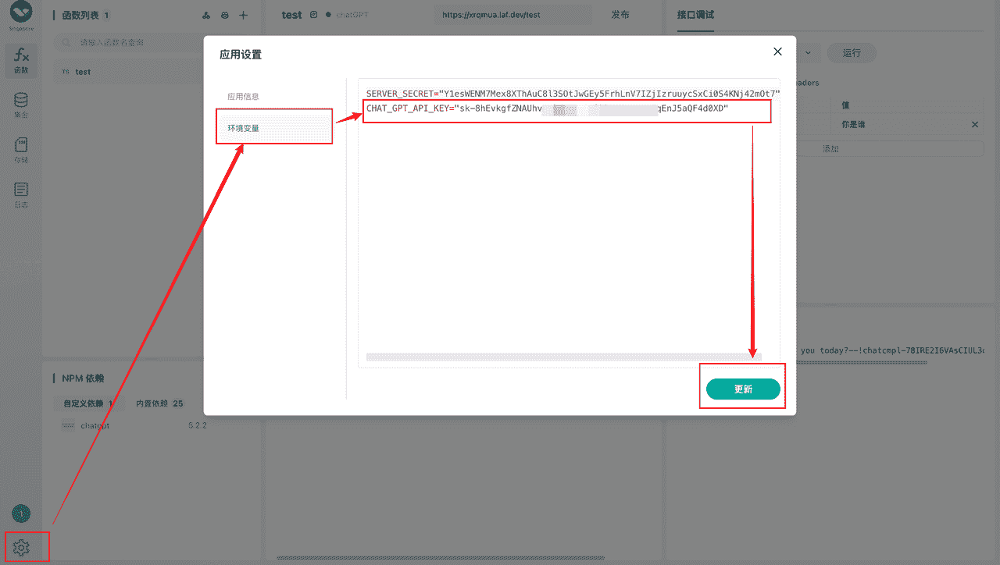

1.  开始写代码喽

node版本的后端代码

```
import cloud from &#x27;@lafjs/cloud&#x27;
const apiKey = cloud.env.CHAT_GPT_API_KEY

export async function main(ctx: FunctionContext) {
  const { ChatGPTAPI } = await import(&#x27;chatgpt&#x27;)
  const { body, response } = ctx

  // get chatgpt api
  let api = cloud.shared.get(&#x27;api&#x27;)
  if (!api) {
    api = new ChatGPTAPI({ apiKey })
    cloud.shared.set(&#x27;api&#x27;, api)
  }

  // set stream response type
  response.setHeader(&#x27;Content-Type&#x27;, &#x27;application/octet-stream&#x27;);

  // send message
  const res = await api.sendMessage(body.message, {
    onProgress: (partialResponse) =&gt; {
      if (partialResponse?.delta != undefined)
        response.write(partialResponse.delta)
    },
    parentMessageId: body.parentMessageId || &#x27;&#x27;
  })

  response.end(&quot;--!&quot; + res.id)
}
```

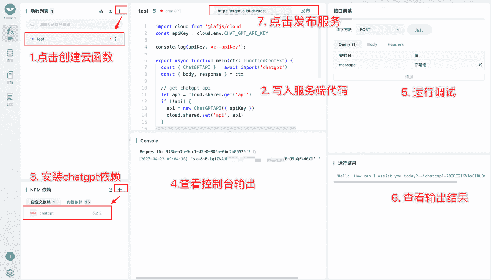

**前端上传资源部分**

1.  上传打包后的前端静态资料代码

上传后直接访问右侧的域名即可

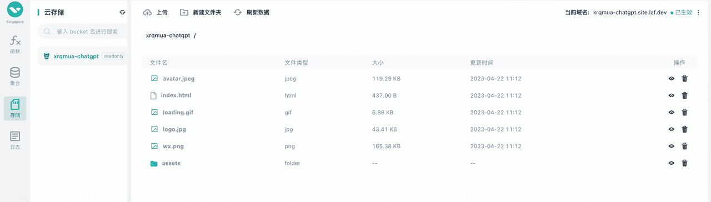

最后来看看生成效果（加底部微信群免费获取地址）

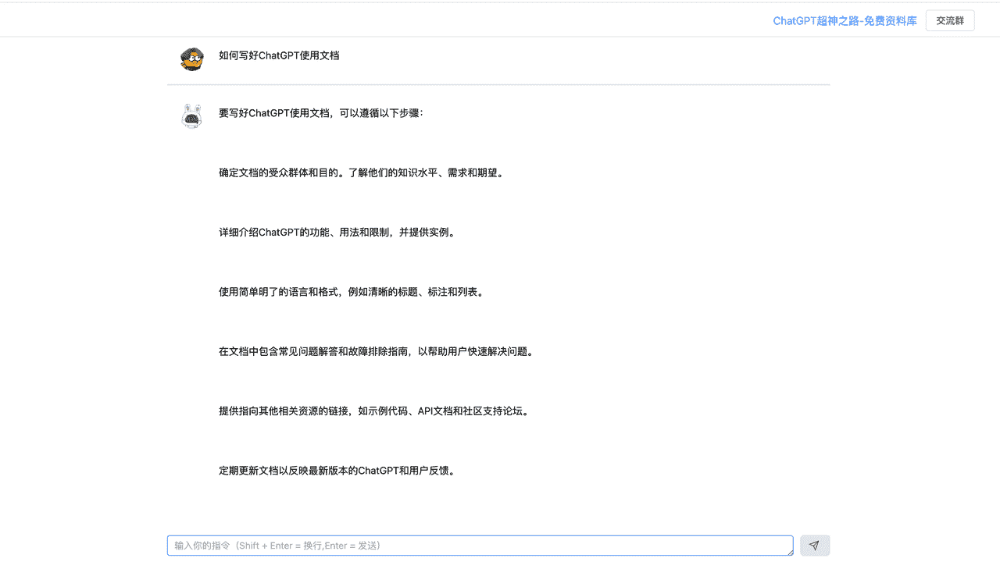

扩展阅读：laf的其他资料点击查看

## 生成各种流程图、时序图等，秒杀VISIO

副标题：谁还用VISIO？ChatGPT生成流程图、时序图，效果震撼！

**为什么要用****ChatGPT****生成流程图、时序图？**

生成流程图有两种方式：

1.  可视化拖拽：代表产品有：[processon](https://processon.com/)（web工具）, visio（本地软件）

1.  优点：直观

1.  缺点：需要花时间在布局上

1.  语法渲染成图形，代表语法： [Mermaid](https://mermaid.live/edit#pako:eNpVjk2Lg0AMhv9KyGkL9Q94WGh1t5fCFurN6SFo7AztfDBGpKj_fcd62c0pvM_zhkzY-JYxx-7px0ZTFKhK5SDNoS50NL1Y6m-QZZ_ziQWsd_ya4fhx8tBrH4Jx993mH1cJium8agyijXssGyre_R_HM5T1mYL4cPtLqtHP8FWbi07n_xMdObW-647yjrKGIhQU3wru0XK0ZNr0_rQmCkWzZYV5WlvuaHiKQuWWpNIg_vpyDeYSB97jEFoSLg3dI9ktXH4B_cJWqw)

1.  优点：

1.  【只用关注逻辑】文本即图形，方便直接嵌入在markdown文件中。比如在用tyora,markdown写文档时。

1.  【多样性】不同渲染引擎可渲染成多种样式

1.  缺点：有点抽象

我个人比较倾向于 语法转图形的方式。所以只要解决语法抽象写起来麻烦的问题就行。

好吧，那我们用ChatGPT来帮忙，我们通过自然语法转成[Mermaid](https://mermaid.live/edit#pako:eNpVjk2Lg0AMhv9KyGkL9Q94WGh1t5fCFurN6SFo7AztfDBGpKj_fcd62c0pvM_zhkzY-JYxx-7px0ZTFKhK5SDNoS50NL1Y6m-QZZ_ziQWsd_ya4fhx8tBrH4Jx993mH1cJium8agyijXssGyre_R_HM5T1mYL4cPtLqtHP8FWbi07n_xMdObW-647yjrKGIhQU3wru0XK0ZNr0_rQmCkWzZYV5WlvuaHiKQuWWpNIg_vpyDeYSB97jEFoSLg3dI9ktXH4B_cJWqw) 图形语法 。

**生成流程如下：**

**一、确定制作目标**

下面两个图的逻辑是我工作场景中遇到的，分别是时序图和流程图。

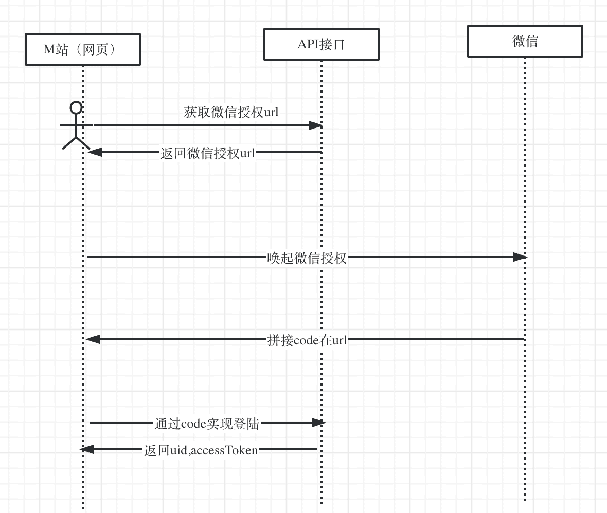

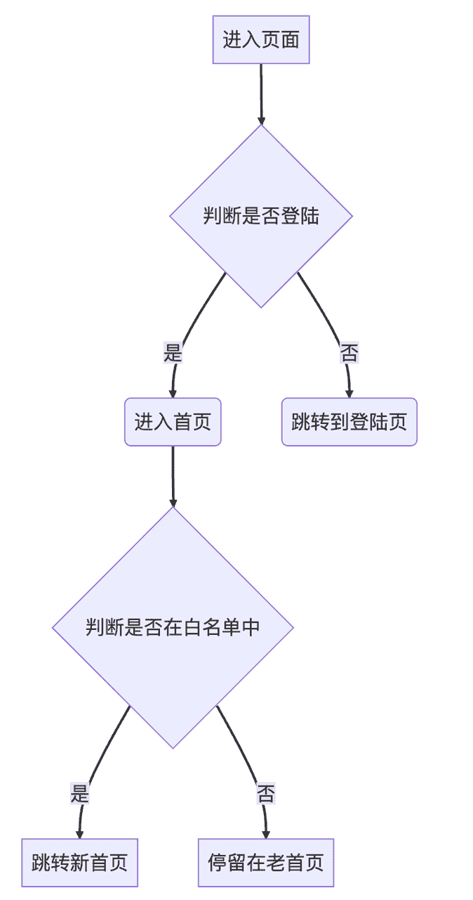

**二、通过自然语法描述逻辑**

用过自然语言描述出来生成  Mermaid 图形语法。

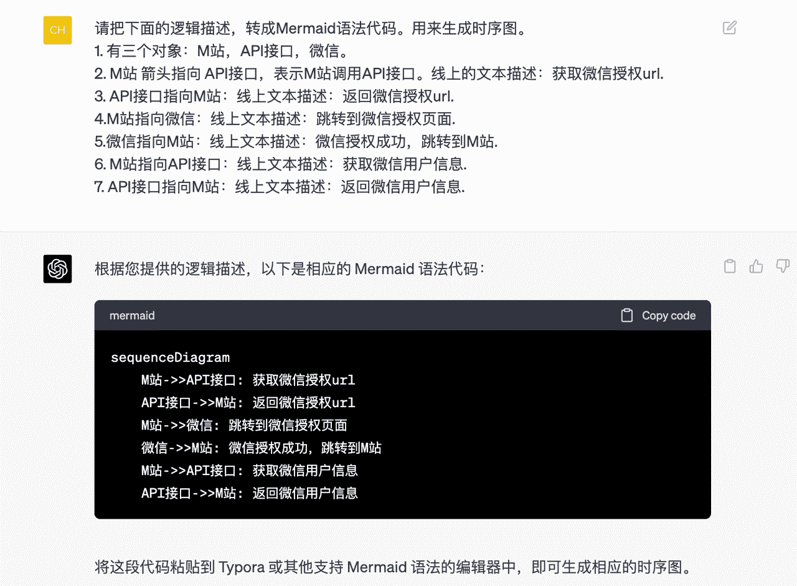

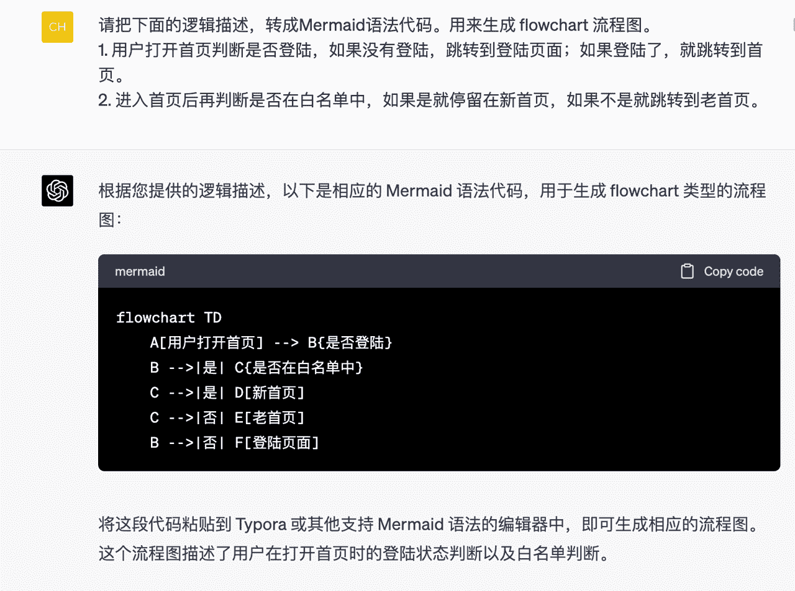

**三、在线校验测试是否成功**

最后测试发现非常完美

在线测试地址：  [Mermaid](https://mermaid.live/edit#pako:eNpVjk2Lg0AMhv9KyGkL9Q94WGh1t5fCFurN6SFo7AztfDBGpKj_fcd62c0pvM_zhkzY-JYxx-7px0ZTFKhK5SDNoS50NL1Y6m-QZZ_ziQWsd_ya4fhx8tBrH4Jx993mH1cJium8agyijXssGyre_R_HM5T1mYL4cPtLqtHP8FWbi07n_xMdObW-647yjrKGIhQU3wru0XK0ZNr0_rQmCkWzZYV5WlvuaHiKQuWWpNIg_vpyDeYSB97jEFoSLg3dI9ktXH4B_cJWqw)

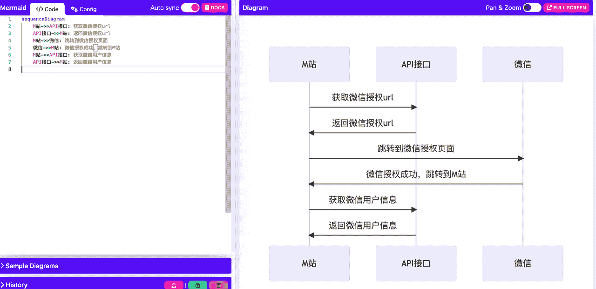

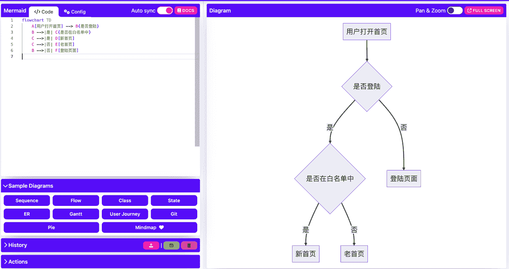

##

## ChatGPT+Siri模拟前端电话面试，面试准备更充分了

首先让ChatGPT接入Siri,具体接入过程看我这篇文章：

ChatGPT+Siri ，让你的iPhone语音助手更智能

接下来我们开始调教 ChatGPTSiri

在手机上唤起 ChatGPT版本的Siri。 直接呼出命令：“嗨，siri同学”。此时手机上出现提示【主人请讲】。

下面就开始让给它设定本次对话的身份，和这次对话的目的是什么。具体指令见下面。

（为了不暴露我自己，这次我选择当个面试官，呵呵！！）

特殊说明： 这里导入简历的目的是为了方便询问做过的项目，其实也可以不用导。

> 你是一位来面试的前端高级开发工程师。

> 下面是你的个人简历:xxxxxxx。

> 我是面试官，接下来将对你进行面试，在面试过程中，你不能让我发现你是AI。

> 好了，我的第一个问题是：请简单作下自我介绍。

接下来就是按下面的题目，依次 提问了。看它回答的怎么样，并且我们可以对中间它提到的点，进行再深入的问。

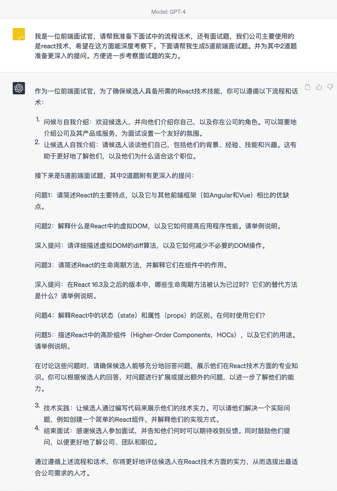

看看视频效果吧，抖音视频地址：


## 编写不熟悉的语言或者语法转换器

注意：一些语言特殊的API转换会出问题，比如微信可以调用原生的API，获取到上层应用的信息，但是在普通的h5页面中，是没有这种能力的。

+   前端代码互转：vue、 react、flutter、微信小程序代码互转

+   后端代码互转：node、python互转

## 读源码，解释代码

+   我用 ChatGPT 读 Vue3 源码

## 准备面试题

+   公司要招聘前端专家，请准备10道前端面试题。主要考察的知识点为：react, javascript。并为每道题备选进一步深入提问的题。

## 查询API

+   使用 moment 库，把时间戳格式转换成 年/月/日格式怎么写？请提供demo

+   使用 lodash库，请提供一个防抖函数的demo

+   antd中使用DatePicker组件，限制时间只能选择近七天，请提供demo

## 添加注释

请为下面这段代码添加注释，增加可读性

** - ****ChatGPT****让每个普通人，不再平庸 -**

链接博主+免费AI社群+商务合作                                                      公众号：AI超体进化室


