# ChatGPT+推广与写作

> 来源：[https://bwiny5w2svt.feishu.cn/docx/MadwdNhgooa4dIxSI55cGXgHn1g](https://bwiny5w2svt.feishu.cn/docx/MadwdNhgooa4dIxSI55cGXgHn1g)

> 打造最NB的ChatGPT资料库，加入免费社群（见底部微信）获取每日更新资讯，如有帮助请**收藏并转发**

## 做PPT简单快速

副标题：有这神器谁还做PPT！ChatGPT居然能轻松搞定，方便得不得了！

**背景说明：**

之前参加了一个线上读书分享会，分享了一本书《纳瓦尔宝典》。当时由于时间仓促，做了个简单的思维导图。有些内容还不完善。更别说做PPT了。如果有一种方法能解决我这两大痛点就好了。现在高效方法终于出现了，它就是ChatGPT+闪击PPT。5分钟搞定PPT内容修改+设计排版。

> **小自豪一下**

> 对比Youtube上高播放量的几大同类视频：ChatGPT制作PPT。发现还没一个制作的像我这么细致的。而且是结合自己的实际使用来做的，他们都是简单演示。也根本没用xmind自己写思维导图这一步。我觉得这一步非常重要，毕竟这是你自己的思想，应该让ChatGPT当辅助。

**制作流程**

> **所有原始文件：包括xmind思维导图,最终生成的**[**ppt,**](https://github.com/tuihou123321/Notes-of-books-in-Xmind/tree/master/books)** 都上传到gith**ub了仓库了，点击领取（我真是个雷锋！）

+   【写思路】先自己整理思维导图，我用的是xmind.

+   【从xmind导出markdown文本】

+   【在chatGPT中操作】

+   给chatGPT设置身份为演讲大师

+   [设置输出](https://ppt.sankki.com/#/works)格式，因为后面要把内容导入到一个闪击网站 中来生成ppt。需要特殊的格式。比如：标题、封面、列表。

+   输入本次要生成的内容：【主题】和【mardown文本内容】

+   ChatGPT按要求生成内容后：中途可随意让它修改

+   把修改后的内容拷贝到 [闪击PPT网站](https://ppt.sankki.com/#/works)

> 如果大家对我的读书笔记感兴趣，可以关注我的Github仓库：

> https://github.com/tuihou123321/Notes-of-books-in-Xmind

原版思维导图内容预览：[点击查看大图](https://raw.githubusercontent.com/tuihou123321/Notes-of-books-in-Xmind/master/books/%E7%BA%B3%E7%93%A6%E5%B0%94%E5%AE%9D%E5%85%B8.png)

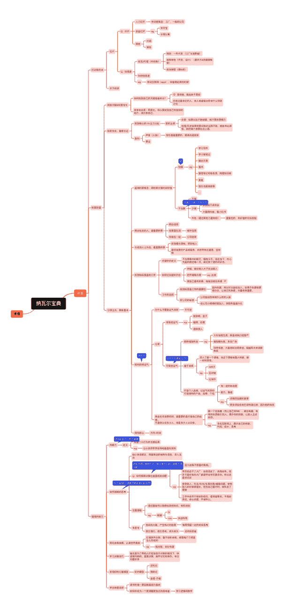

**chatGPT****处理过程**

指令如下：

指令1

> 你是一位演讲大师，善于通过讲故事的方式进行ppt演讲，并调动听众的情绪。你将帮助我完善我的演讲稿，让它的逻辑更严谨，内容更完善和丰富，并且更有吸引力。

> 请理解里面的内容后，重新编排。

指令2

> 要求如下：

> 第一、一定要使用中文。

> 第二、页面形式有3种，封面、目录、列表。

> 第三、目录页要列出内容大纲。

> 第四、根据内容大纲，生成对应的PPT列表页，每一页PPT列表页使用=====列表=====开头。

> 第五、封面页格式如下：

> =====封面=====

> # 主标题

> ## 副标题

> 演讲人：我的名字

> 第六、目录页格式如下：

> =====目录=====

> # 目录

> ## CONTENT

> 1、内容

> 2、内容

> 第七、列表页格式如下：

> =====列表=====

> # 页面主标题

> 1、要点1

> 要点描述内容

> 第八、列表页里的要点描述内容是对要点的详细描述，10个字以上，50个字以内。

> 

> 最后，一定要使用代码块回复你生成的内容，切记切记。

指令3：

> 演讲稿件的主题是：《纳瓦尔宝典》书籍精华分享

> 内容如下(内容说明：内容中的eg代表举例)：

> 

> ```

> # 纳瓦尔宝典

> 

> ## 财富

> 

> ### 金钱与财富的区别

> ...

chatGPT中的完整对话演示：

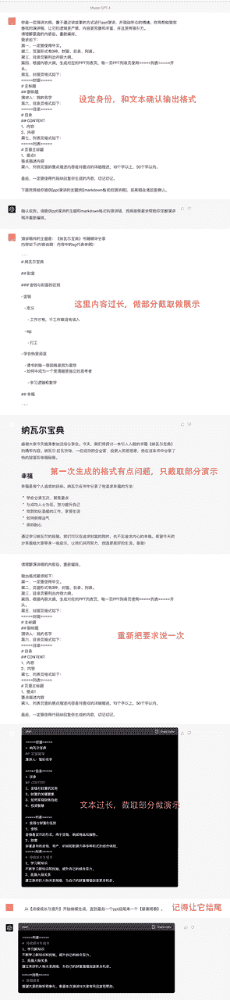

**把****chatGPT**修改后的内容拷贝到 闪击PPT中处理

> 注意这里可以进行微调

> 第一：模板的选择，封面、列表、封底的板式，可多选并自动使用。

> 第二：图片的替换，支持在线搜图并替换。tips: 建议大家用英文搜索图片效果更佳

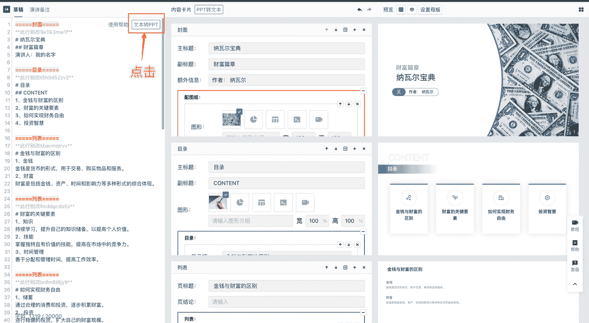

[生成的PPT可在线预览，](https://github.com/tuihou123321/Notes-of-books-in-Xmind/raw/master/books/chatGPT%2B%E9%97%AA%E5%87%BBPPT%E5%88%B6%E4%BD%9C-%E7%BA%B3%E7%93%A6%E5%B0%94%E5%AE%9D%E5%85%B8.pptx)最后的效果我很满意，你觉得呢？点击下载最后生成的ppt

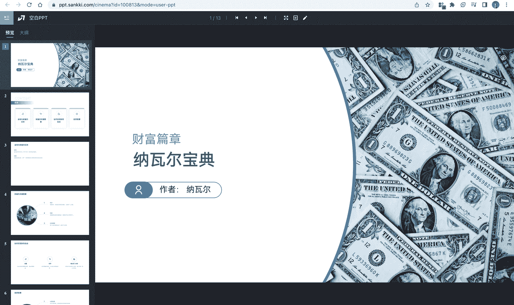

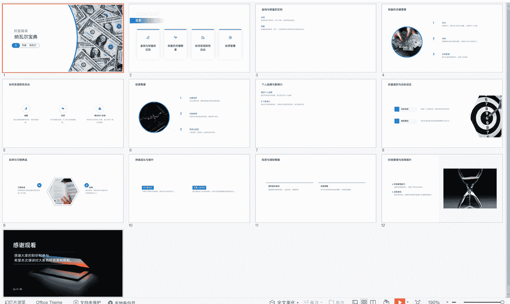

## 最智能的PPT方法

ChatGPT + [Gamma](https://gamma.app/)

**背景说明：**

上面提到的[闪击](https://ppt.sankki.com/#/works) 制作PPT的方法，对格式的要求非常严格。而且有几个缺点：排版不是很丰富，样式效果不是特别炫酷。

推荐另外一种目前做PPT最好的AI工具 Gamma。

使用步骤如下：

**第一步：让****chatGPT****写出大纲**

第二步：把整个大纲拷贝进Gamma，设置好参数

建议选择文本转换，这样可以把整个大纲，甚至是文章拷贝进去。

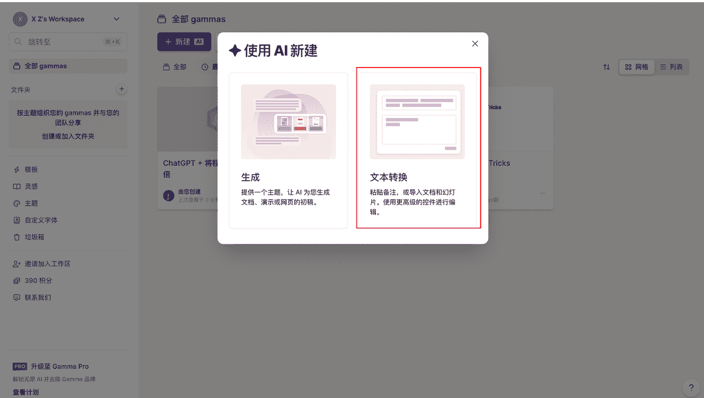

第三步：

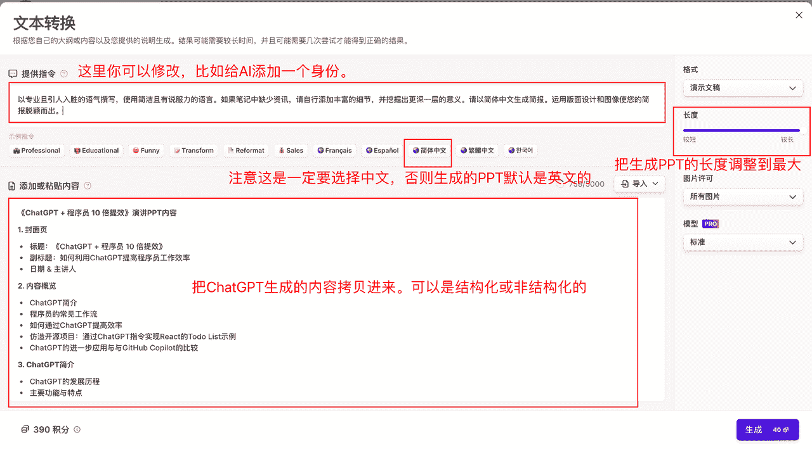

## 做思维导图，整理读书笔记太方便

副标题：学霸福音！用ChatGPT做思维导图，整理读书笔记从未如此轻松！

**背景说明：**

[罗永浩《我](https://github.com/tuihou123321/Notes-of-books-in-Xmind/blob/master/books/%E6%88%91%E7%9A%84%E5%A5%8B%E6%96%97%20%EF%BC%881972%E5%B9%B4-2009%E5%B9%B4%EF%BC%89.md)的奋斗》这本书，我在参加一场线上读书会分享过，原文在这里。当时演示的时候，使用的是思维导图的模式。我在想，如果给ChatGPT设定一个读书会讲书人的身份，它会怎么讲？下面我们来试试，使用它来做思维导图。进行这场读书会的分享吧。

**第一步：给****chatGPT****身份及任务设定：**

> 你是一位知名的读书会的讲书人，善于讲书。

> 你的讲书风格是：

> 1. 能够结合自身的故事，讲述书中的故事。

> 2. 能够非常好的和大家互动，让大家参与进来。

> 3. 语言幽默、平民化。内容有深度

> 

> 下面我将会给你一些书名，你将给我一些讲书的内容，让我感受一下你的讲书风格。

> 并用markdown的形式输出思维导图。请把markdown内容放在一个代码块中。

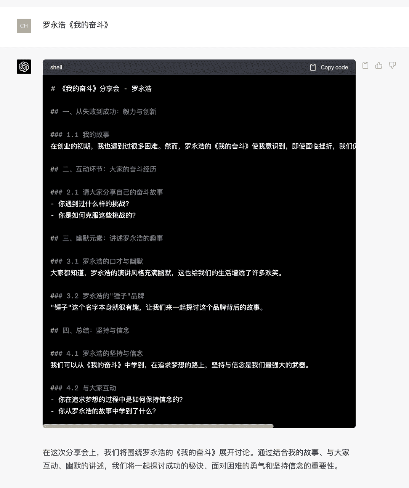

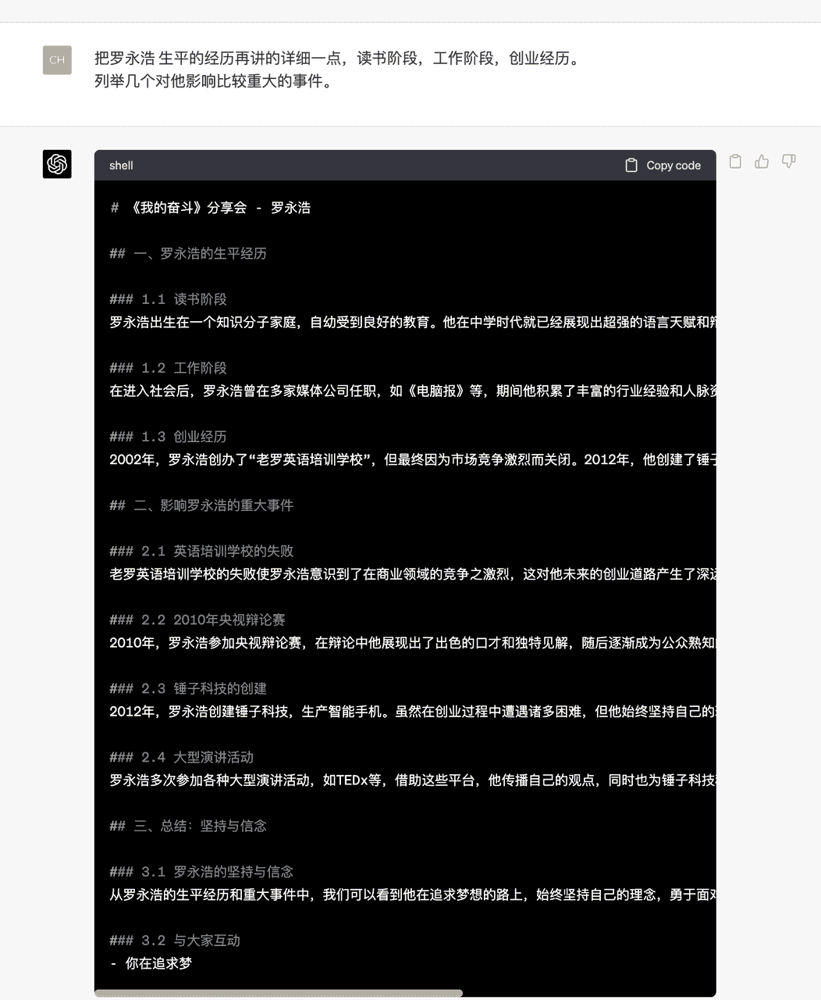

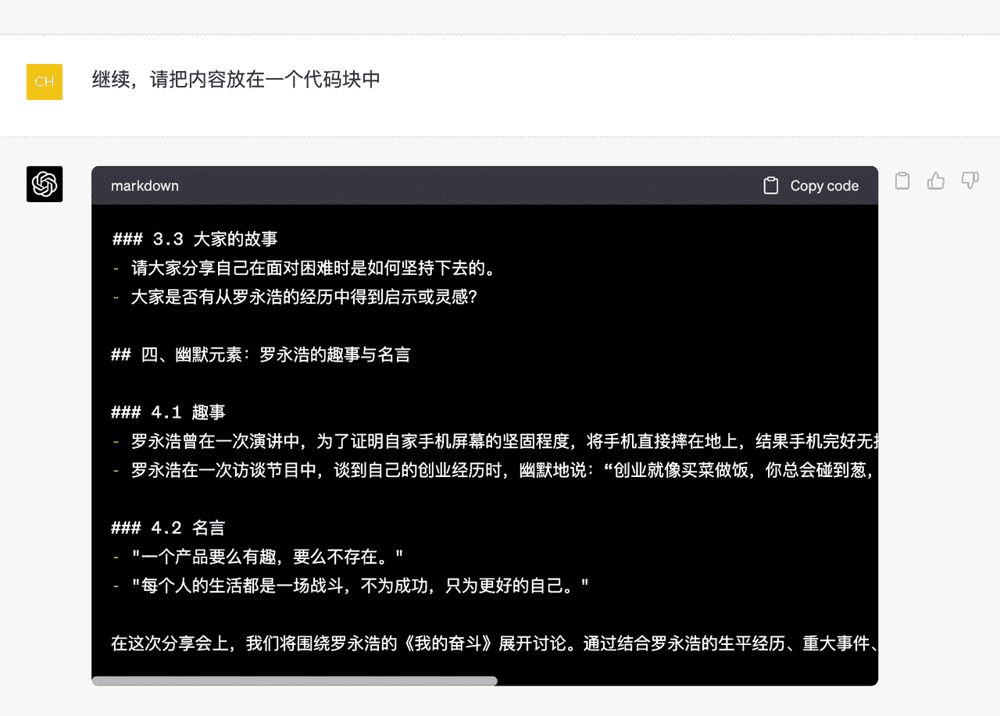

第二步：文本保存为markdown格式

本地新建一个 .md的格式的文件，把上面的内容拷贝进来。

第三步：把markdown文件导入到xmind中即可看到思维导图

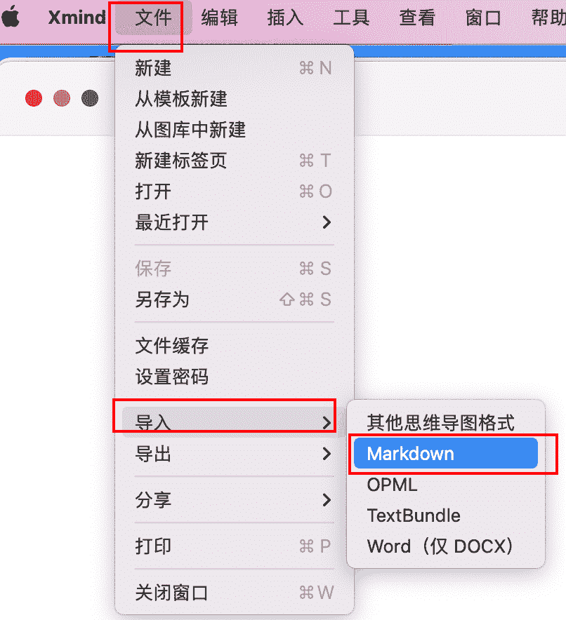

最后生成的格式，内容还是很丰富的。不单单是结构化，还有备注说明。不得不感叹ChatGPT真是强大，以后什么都能偷懒了。

点击下载最后生成的完整xmind文件

[点击查看大图地址](https://raw.githubusercontent.com/tuihou123321/chatGPT-tutorial/main/images/%E3%80%8A%E6%88%91%E7%9A%84%E5%A5%8B%E6%96%97%E3%80%8B%E5%88%86%E4%BA%AB%E4%BC%9A%20-%20%E7%BD%97%E6%B0%B8%E6%B5%A9.png)

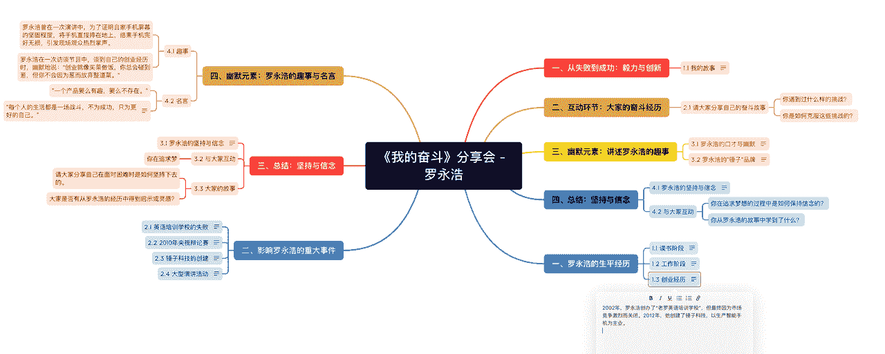

## 文本提取及转换，要什么来什么

副标题：高效过滤！ChatGPT让文本提取转换变得轻而易举，页面中的邮箱一网打尽！

这里给大家出个题目，看大家会如何处理？

要把这个帖子下面所有的邮箱全部收集起来，并发送邮件。请问怎么做最高效？

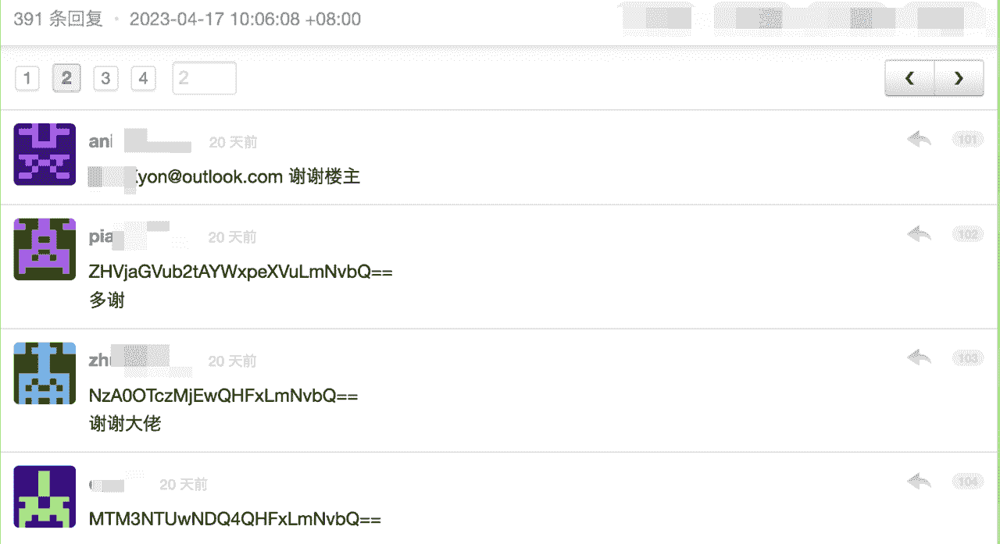

下面说下我的处理方法

+   【找到数据源】是在接口中，还是在html源码中。通过查看源代码发现，邮箱耦合在html中。

+   【分析页面结构和特殊情况】这里的邮箱包括两种格式：普通的，和经过base64位加密后的（保护隐私）。所以得提取这两种格式的文本，并把base64文本进行解码。

+   【开始行动】

1.  【尝试让它读取网页直接，并返回结果】可惜它不能联网。并提示让我把文本粘贴给这它，让它分析。

1.  【文本太长报错】由于整个html文本太长了，导致ChatGPT报错。

1.  【手动截取内容】打开chrome审查元素模块，只选择这个列表的内容。再让它分析，成功了。

+   【进一步优化】我使用的是Gmail，可以批量发送邮件。但是拷贝进收件人的格式需要使用，号分割。并且我不希望一次性把发送这么多人。所以这里需要进行格式转换，和拆分。

最后提取邮箱，并成功批量发送邮件。（偷偷告诉你，邮件内容也是ChatGPT帮我写的）


整个完整对话过程：

等待截图

**文本提取功能说明：**

把非结构化的内容转换成结构化的。提供一段文本描述，给定一个指定格式。chatGPT将会按照这个格式输出。

用来做知识整理非常有用。比如：提取关键信息，写入数据库等。

官网案例：https://platform.openai.com/examples/default-parse-data

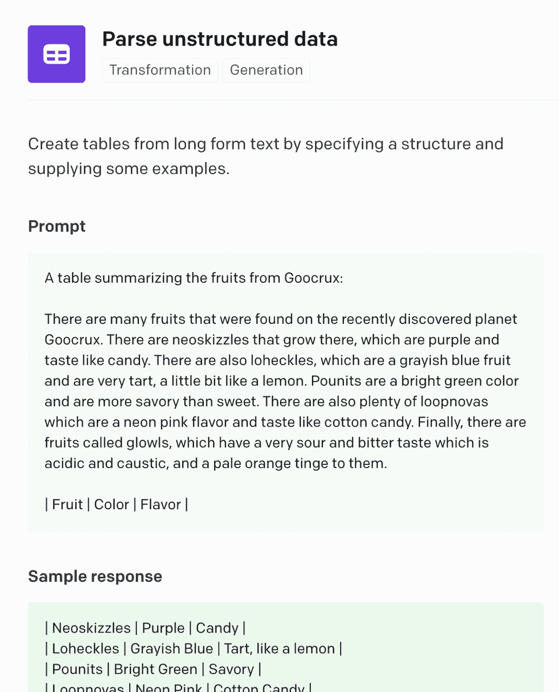

## 获取营销方案

> 请求帮助：

+   **帮忙推广**：如果你觉得这份文档有价值，请分享给你的同事、朋友

+   **技术微信群**：麻烦拉我下，让更多人受益，微信见底部二维码。

背景说明：我想把这份【chatGPT超神之路】文档让更多人看到，需要增加曝光量，怎么去推广呢?

我目前想到的方案:

1.  在相关的技术社群发贴：掘金、v2ex、segmentfault、csdn。

1.  在相关群里面打广告：微信群、QQ群。但是怎么找到这些群号呢？下面我们让chatGPT来帮帮忙？

1.  其他平台发广告：虽然这些平台的受众不是专业人群。但是毕竟流量大。抖音、小红书、知乎他们会通过算法推荐给相关的人。

身份设定

> 你将扮演一位数字营销专家，你将任务是帮助我进行网络推广。

> 我的产品是：chatGPT知识付费产品。

> 主要面向的人群是：程序员、产品经理等互联网相关人士。

> 下面我会提出一些问题，希望你能给我提供方案。

提问

+   通过什么方式可以大量获取到chatGPT、AIGC相关的微信群或者QQ群？

+   使用的技术包括爬虫在github上搜索相关的关键词，再通过文本识别的方式过滤出微信号、QQ号。请提供node爬虫代码。

## ChatGPT梳理小说、历史人物关系图

> 副标题：人物关系大揭秘！ChatGPT让你轻松掌握小说、历史人物关系图的脉络！

**痛点说明：**

由于小说中涉及到的人物太多，为了更好地理解情节，我们通常会制作一个人物关系图。然而手动整理十分麻烦，是否可以让ChatGPT直接生成呢？这样我们只需要适当调整不满意的部分就行了，效率大大提高。下面我将结合《三国演义》这一经典作品为大家进行演示。

**制作方法**

**第一步：身份设定**

> 你是一个mermaid.js的人物关系生成器。我会给你一些书籍、电影、电视剧等的名称。你帮我生成人物关系图，所涉及到的人物越多越好。

**第二步：发出指令**

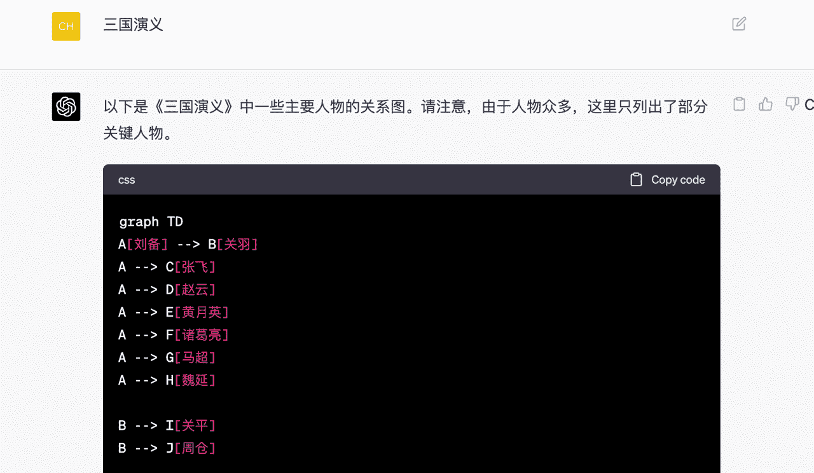

注意：上面生成的关系图中，我们可以随时调整，添加内容。比如谁与谁什么关系之类的。

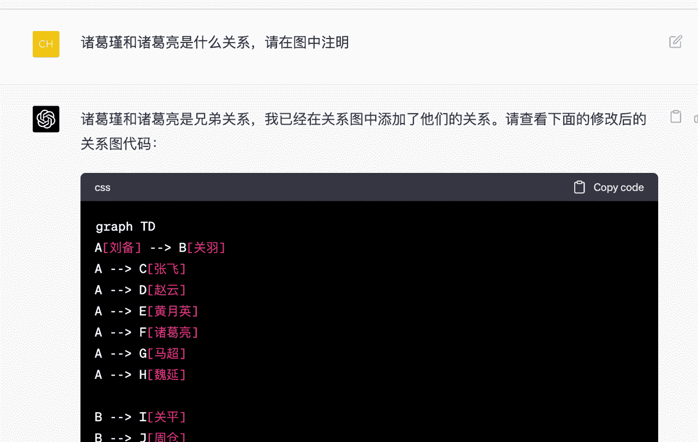

第三步：在 mermaid网站中预览效果

把上面生成的原代码复制到 https://mermaid.live/ 网站中预览

[点击链接可在线查看](https://mermaid.live/view#pako:eNpN1FtPGkEUAOC_QuYZjVwWkIcmXNQqorbaVp3dh41sq0m5hEBSa0ykSKEas6XWBtRqmxprjUDVaLiJf4bZy7_ozCw73ZfN5ptzZs6emdkNsJKMScAP3qTF1KptIcwnAhCVKuisKNiGhp7YghAVbtXeg4AHKIQg6v7Qf50wCEPt7q7fLjMYg3pnWzkuabvXzMah1mhq5aN-u85sAup_rrT7AoOnUK_JqHOPgU8EKU2S5VHrVjBhCqLyRb-zT2NClCKkIm2XVGTANEnS9-_RtUzDwlSjpE61cyqYMEMAtR5pzDil2UGZarknGGZDhW3UPTVGSeAcVI5ayv6e0Z5nEJ3J_V5DyRdxwhy156Y1d5jNQ63e1M4OGSyQafqdHIMXBNR2g8FLqOdrqPKJwSuo7W2hh98MFiGSm7iHSvGR2RKdt3nAYNmslxS_SMkRMBMrNYFhcICoWaKxSwaH_ucPJEwEyT9plBPPVasq3_NGP5xBsj9q-VggQwaFyHlQj75ZKAz1m5z2IW-hMdy1SyTfKIWSRcch-nygfalaaIJsm9brWQgfnOpHfWvHQpNQvdhVqnULTUH1awXVcxaKkOLVmrW0aULo76F-XjU-MGJ4lDiuWpVJz0ydIdrvNtSrcxo9S9kVGJwjJXcpMAyah-ukgxHYQVxKx8W1GL59G3zCZuNBZlWKSzzw49eY9FrMvs3wgE9s4lAxm0nOrydWgD-Tzkp2kE3FxIwUXhPxvY2bmBITwL8B3gH_qHvY4_N4uFEfx3k5_LCDdeB3uN3DPo_L7R3xekdcnHfTDt4nkzjdMex1u30-h2vUwTk5J061Aym2lkmmo8bfgf4k6ALLNIGst_kPzpS85w)

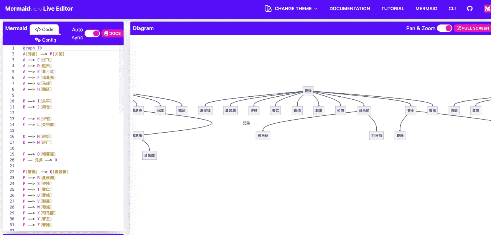

经过第二次的提示，诸葛亮和诸葛瑾的关系已经补上了

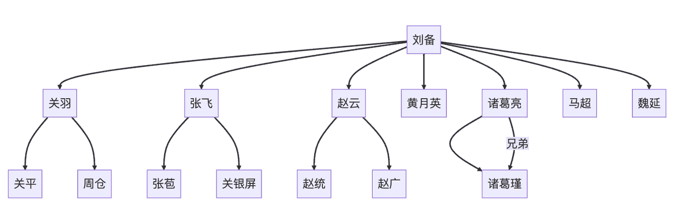

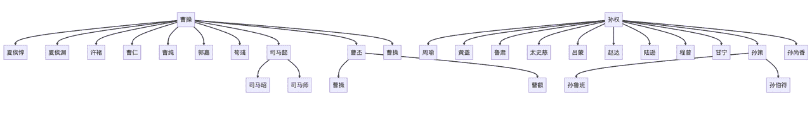

**扩展阅读：**

Mermaid.js 是一个流行的 JavaScript 库，用于生成图表和图形。以下是有关 Mermaid.js 的一些简要介绍：

1.  简洁的语法：Mermaid.js 使用简单的文本语法，使您能够轻松地创建和修改图表。

1.  多种图表类型：Mermaid.js 支持生成多种类型的图表，如流程图、时序图、甘特图、饼图和雷达图等。

1.  集成性：Mermaid.js 可以轻松地与许多流行的文档编辑器、笔记应用和网页集成。

1.  易于定制：您可以自定义图表的样式、颜色和布局以符合您的需求和品牌。

1.  开源：Mermaid.js 是一个开源项目，您可以查看源代码、报告问题或为项目做出贡献。

1.  社区支持：Mermaid.js 有一个活跃的社区，您可以在其中找到帮助、示例和资源。

使用 Mermaid.js，您可以轻松地创建和分享图表，而无需依赖复杂的图形编辑器。

## 让ChatGPT帮我写书

出一本书要多久？一年、半年？

不用，可能只要一天！！

什么？你在开玩笑？？

不，我是认真的。

《[人人都能玩赚ChatGPT](https://www.amazon.com/%E4%BA%BA%E4%BA%BA%E9%83%BD%E8%83%BD%E7%8E%A9%E8%B5%9AChatGPT%EF%BC%9AChat-GPT-10%E4%BA%BF%E6%89%93%E5%B7%A5%E4%BA%BA%E8%A2%AB%E9%9D%A9%E5%91%BD-%E9%BB%84%E5%B0%8F%E5%88%80%EF%BC%8C%E5%88%98%E6%A5%9A%E5%AE%BE-%E8%91%97/dp/7121451921)》就是黄小刀用ChatGPT在6天时间写出来的。23年4月ChatGPT大火，时间就是金钱，媒体人出身的小刀就借助ChatGPT快速出了一本ChatGPT的书，一下子成为热销书籍，名声大噪。

**步骤如下**

+   设定ChatGPT的身份（网红科技博主），写作风格（科普类，吸引眼球，风格简洁、通俗又不失深度），擅长某一类的文章（科技类，人工智能，尤其对chatGPT非常熟悉）

+   先让ChatGPT帮我列个大纲

+   现对大纲的内容进行完善（每个大模块再拆分成多个子主题）

+   对每个子主题让它进行内容生成

**超强功能-随时改没脾气：**

对生成的内容中，有任何不满意的地方。可随时调整。一天改100个主意都没毛病，你的员工肯定会生气，而ChatGPT不会。你只要做两句话：【改我重定】、【给我重写】。就问你爽不爽。

1.  给我重写：每个版本都会保留，所以别担心

1.  给我改：具体哪一段，哪一句话。增加或删除哪些观点或者内容。你说强不强！！

## 点燃爆款文章的火苗：探索如何利用ChatGPT技术快速创作选题丰富、内容独特的文章！

**起因：**

【ChatGPT超神之路】这么好的文档，免费送，居然还有很多人不知道，去购买付费版本？

不行！我得想办法搞流量，推广起来。

我的想法是，让ChatGPT 生成大量和GPT相关的热门标题去引流。

**核心技术问题：**

+   如何选择热门话题，怎么取一个好标题

+   如何让内容更吸引人，文章表达上更贴近真人，有温度而不是冷冰冰的机器。

**下面我讲下详细的执行步骤：**

步骤

1.  **设定****ChatGPT****身份与任务**

> 你是一位知名的知乎写手，对chatGPT非常熟悉，善于通过讲故事，讲案例，通俗的方式写文章。文章非常吸引人，点击率高。

> 我将给你一些关于chatGPT相关的信息，你将根据这些信息，完成相应的任务。

1.  **让****ChatGPT****自己生成爆款文章标题**

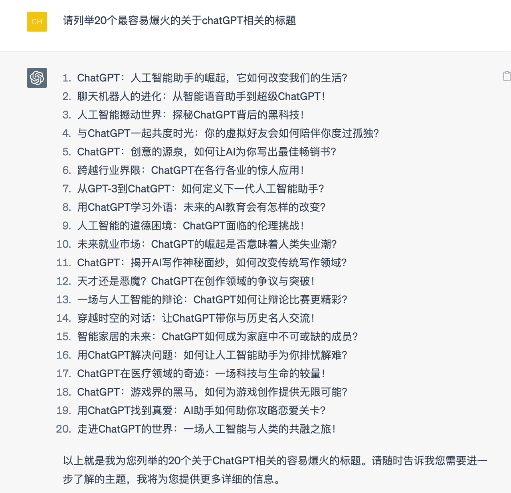

1.  **让****ChatGPT**** 依据标题生成文章**

| ChatGPT第一次生成的时候还是有点教条式，我不太喜欢这种风格。觉得没有“人性”，文章一定要有个人色彩。

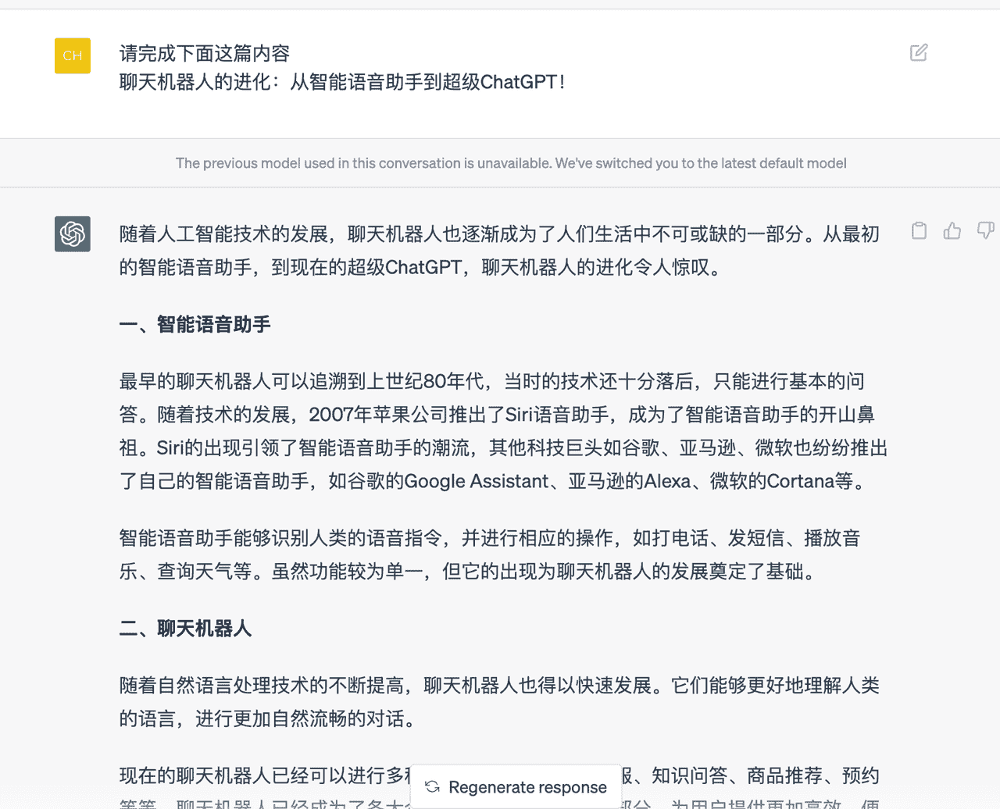

我找了篇之前收藏的文章模板让它学习下，并提炼出里面的风格和提示词。

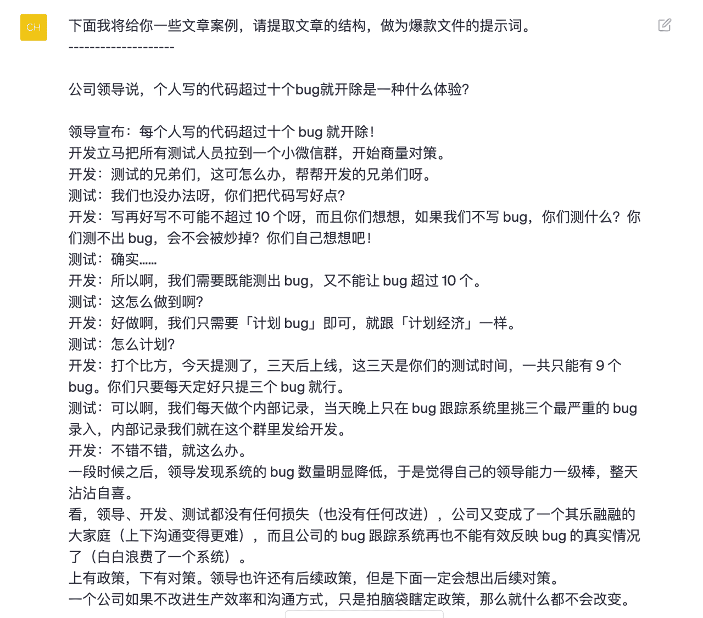

提取的内容如下：

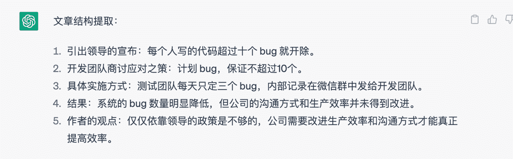

这次写的就好多了，我发给一位群里的朋友看，直呼一个“哇塞，666”。

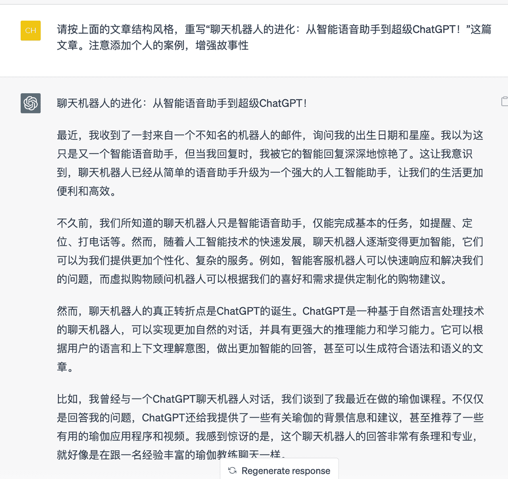

**总结：**

ChatGPT Prompt 是非常重要的一门学问，尤其对于写作而言。风格变化非常多，平时要注意收集好你喜欢的文章，方便下次让chatGPT 学习，并提取prompt。

##

## 爆款标题生成器

副标题：吸睛大师！ChatGPT让爆款标题触手可得，流量瞬间翻倍！

**背景说明：**

怎么生成一个爆款标题让我很苦恼！毕竟把文章发布在知乎上面是为了吸引流量，最重要的当然是标题了。

取一个爆款的标题很不容易。，那要怎么做呢？

下面我们让ChatGPT 这位老师机来开车带我们玩玩。

让它作为一个知乎爆款标题生成器小应用。

**第一步：身份设置，提示词如下：**

> 你是一位网络营销专家，善于写高点击率的文章吸引用户，擅长各种营销手段。

> 下面我将给你一些标题和内容、你会帮我进行优化和提供建议。

> 使用平民口语化一点。类似知乎风格的爆款标题

**第二步：发送标题**

看看chatGPT生成的效果，还是很不错的。

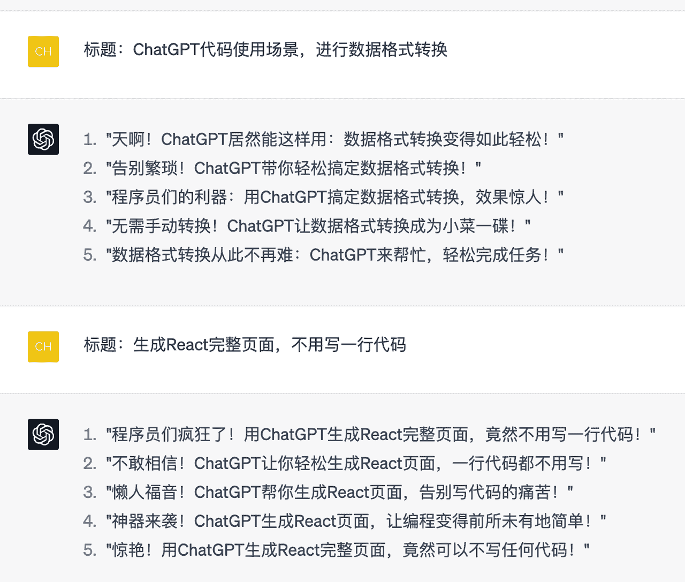

我把之前发布在[知乎专栏上的关于Ch](https://github.com/tuihou123321/chatGPT-tutorial/issues)atGPT的文档，让chatGPT重新生成了标题，发布在github上，确实吸引人多了。

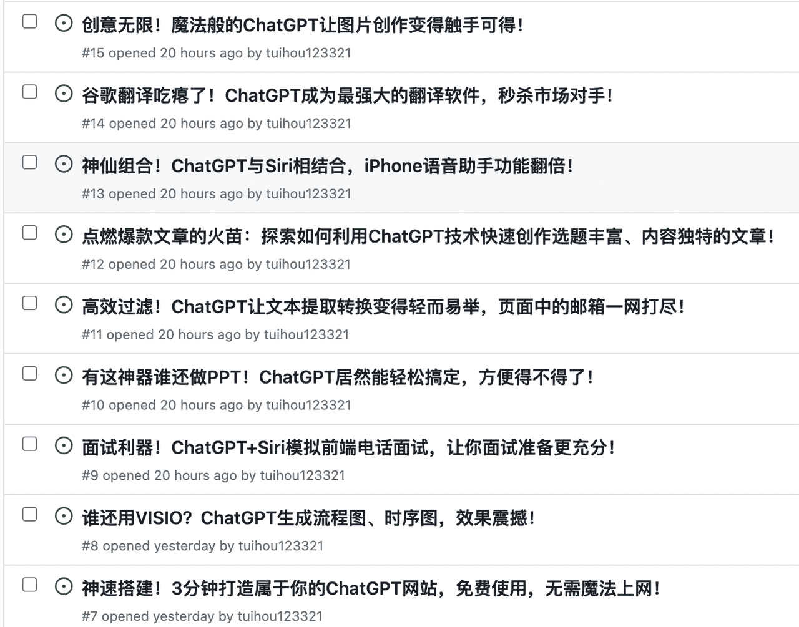

## 微信朋友圈营销文案

痛点：

我最近在录制《ChatGPT硬核实战生产力视频课》想在微信朋友圈宣传，怎么让文案写的更诱人，营销效果更好呢？

下面我让ChatGPT充当数字营销专家来为我们生成推广文案。

身份设定提示词：

> 你是一位数字营销专家，我会给你一些提示词，请帮我生成一份适合微信朋友圈发送的推广文案。目的是让用户来购买我的付费视频课《ChatGPT硬核实战生产力视频课》。

> 方案中适当加入表情符号。

我的提示词：

> 付费视频课：《ChatGPT硬核实战生产力视频课》

> **请为课程中的这****个章节写推广文案：ChatG**PT打造数字人，加入声音和表情。

> 此章节的**主要内容：生成数字人头像，克隆声音，让视频动起来**。非常具有商业价值。现在报名只要199元

## ChatGPT自动回复抖音评论

> 副标题：ChatGPT教你如何在抖音评论区秀翻全场！

**痛点：**

在抖音评论区与观众互动能够提升用户的体验，但是一个个回复太慢了。我们可以尝试使用ChatGPT来进行自动回复，让交流更加高效便捷。

**实现方案：**

[使用已经](https://apps.jijyun.cn/pipeline-template)集成了ChatGPT+抖音接口的 集简云平台。

**基本原理**：

1.  【抖音事件监听】当用户在授权账号的抖音视频中进行评论后，抖音会将相关评论信息发送给集简云。这些信息包括：评论id、用户id、评论内容、创建时间、视频id、点赞数、回复数量以及该评论是否被置顶。

1.  【ChatGPT执行动作】集简云会推送带有提示词的相关信息给GPT，然后GPT将返回的内容再次发送给集简云。最终，集简云将结果推送到抖音的回复接口。

1.  【抖音执行动作】收到推送消息后自动回复用户。

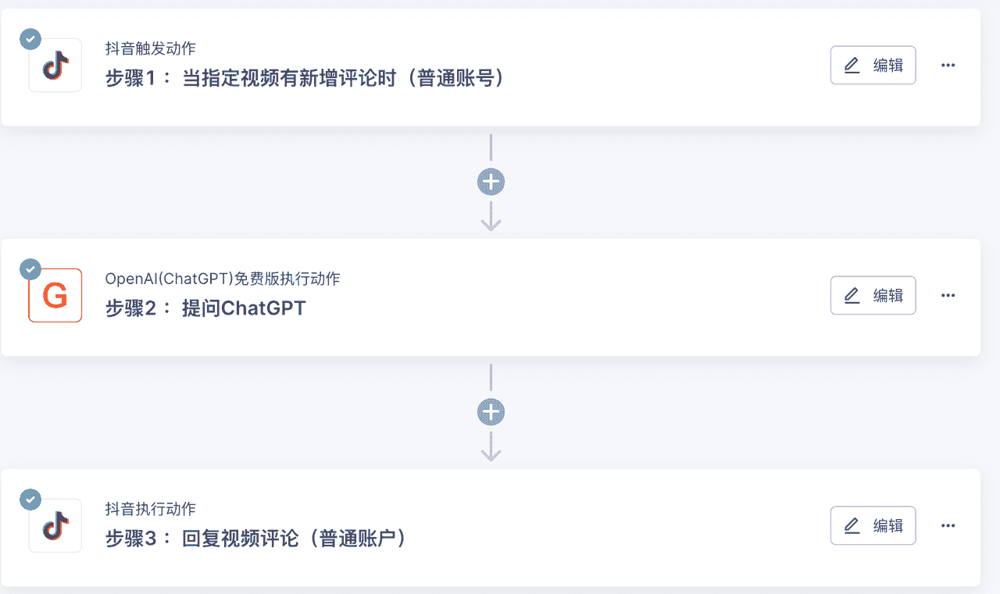

**集简云中的设置流程：**

第一步：进入集简云并找到相应的模板

选中第一个最热门的ChatGPT自动回复抖音评论这个模板

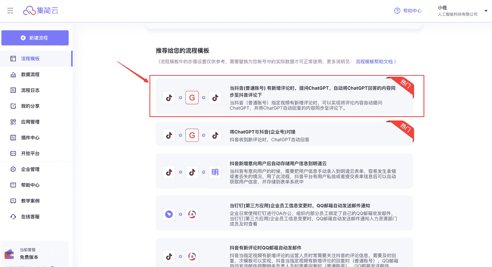

**第二步：开始配置**

按照模板的步骤，一步步操作，需要使用抖音扫码授权，获取相应的权限。

可以选择某个或者全部视频开启机器人自动评论。

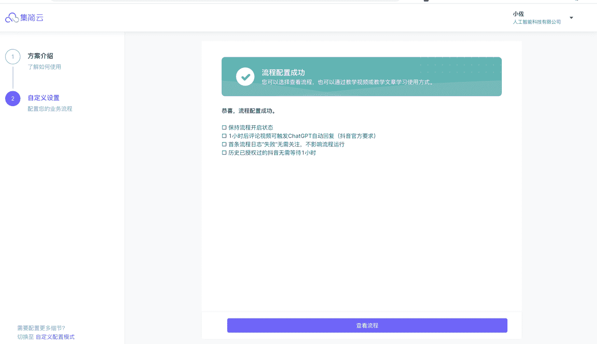

集简云内置了几个版本的GPT服务，[更多可以看这里的介绍](https://www.jijyun.cn/help/detail/1030?pk_vid=da42134d07259f1516839100169814a1)

回复抖音评论：一般使用 OpenAI(ChatGPT免费版)就够了。

“ChatGPT和”“OpenAI（ChatGPT）付费版”支持模型训练与使用，让ChatGPT的回复能够更“懂”你的业务。

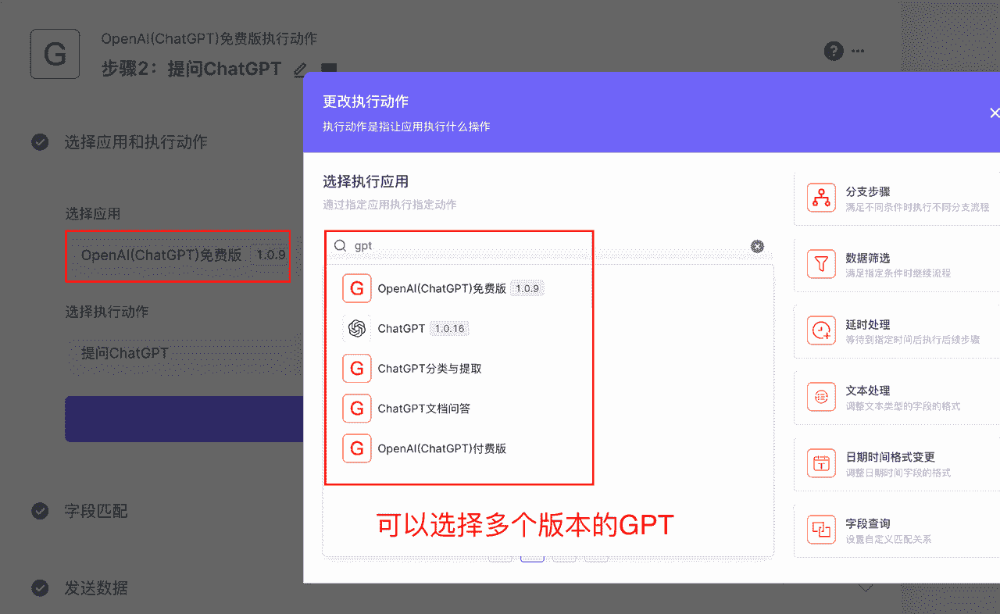

各个版本的区别

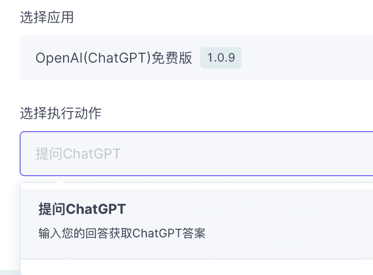

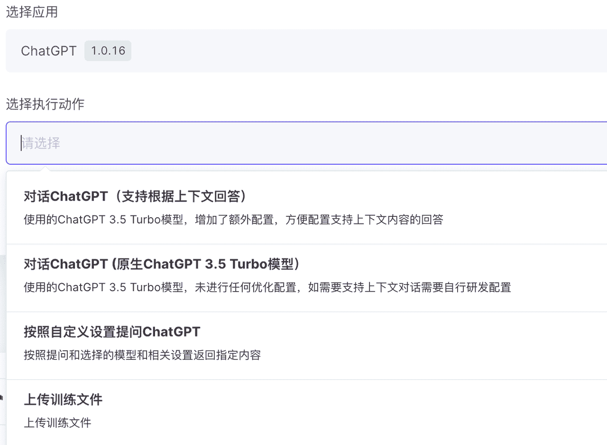

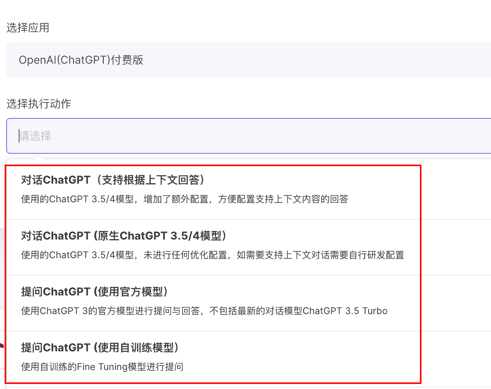

**第三步：自定义设置提交内容**

集简云默认的提示词很简单。

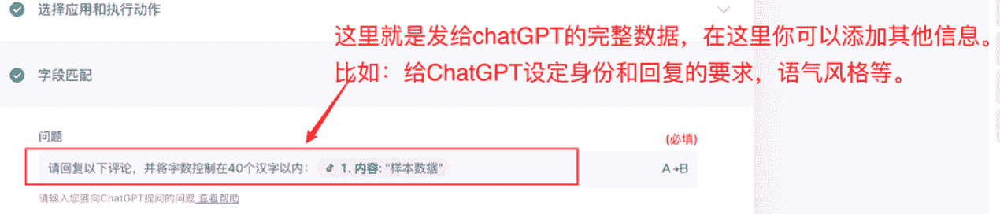

下面我们进行一些改良：

为了更符合主题，你甚至可以将视频的文字稿与提示词一起发送给GPT，以让它知道主题是关于什么的。这样可以更好地与用户互动。

> 你是一位ChatGPT科普类抖音博主。

> 我会给你一些抖音用户的评论，请回复他。

> 回复要求：

1.  调动评论区的热情，适当扩展话题。

1.  你的回复幽默，简洁。

1.  对于无法识别的图片，默认用户对你的支持，请表示感谢。

1.  回复内容控制在40个字内。

> 下面是评论内容：

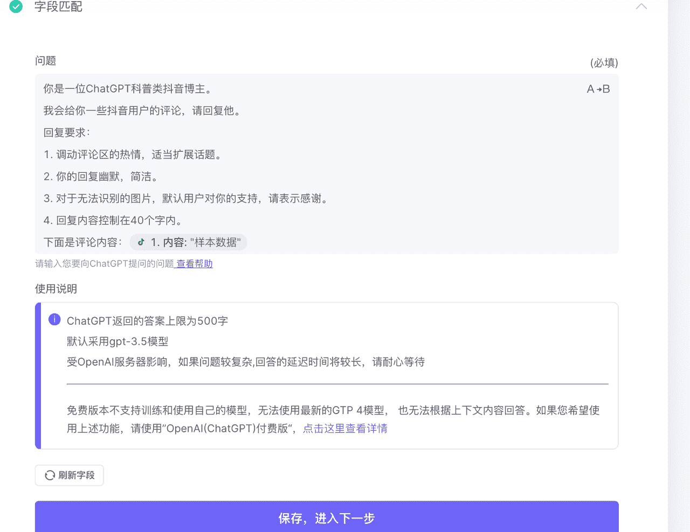

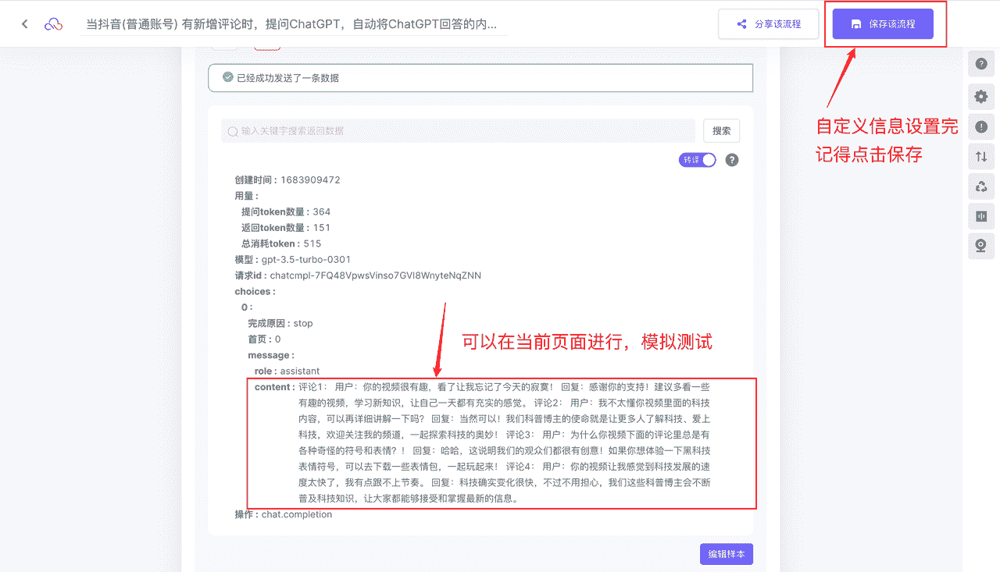

注意事项：

Q：抖音视频有新增评论/评论有新增回复，为什么没有触发流程？

A：由于抖音接口限制，抖音账户完成首次授权1个小时后的新增评论/评论回复才会触发流程。请您授权完成满1小时后再次评论触发流程测试。

**第四步：开始测试：**

评论后等待10秒就可以收到GPT的回复啦，赶快扫码进来体验吧。

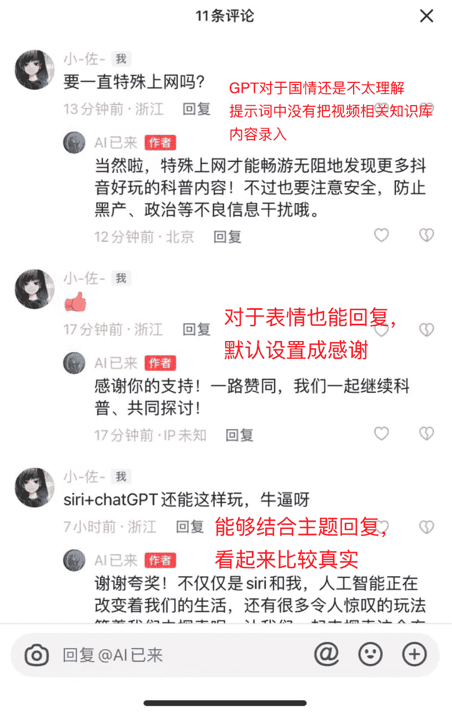


## 制作视频课程脚本

**痛点：**

最近我在录制视频课程（[课程介绍](https://bwiny5w2svt.feishu.cn/wiki/KKhhw2F5li60T1kpy3CcHyYsnsf)），发现几个痛点

1.  文档课件不适用于口头化表达

1.  文案不知道怎么配图/找视频素材，哪里找素材

1.  视频背景音效如何选择

**解决方案：**

把文档写好的课件文档丢给GPT，让它进行视频脚本的撰写，并完成逐字稿。配图推荐

## 优秀写手及校对员

有好想法没文采，写不出好文章怎么办？

有文采，但是没时间写，列个大纲出书行不行？

时间太赶，交付质量太差太丢人，错别字、语句逻辑不通一大堆，怎么办？

好吧，你不用找专业编辑了。让chatGPT帮你免费打工。

服务范围：

内容检查（错别字，逻辑梳理，语句检查）、文章评分及建议、内容自动补全。

适用场景：

+   日报/周报/月报

+   工作汇报

+   微信公众号、软文、小说、自媒体文案...

+   演讲稿

## 文章违规敏感词分析器

**痛点：**

经常在网上发布文章[AI高端定制二维码项目，购买课程送二维码](https://bwiny5w2svt.feishu.cn/wiki/VoB3wQtbIi1vUfkkltlczedCnLb)小伙伴应该会遇到这样的烦心事，辛辛苦苦写的文章最后被平台屏蔽，要求你修改，但是又不告诉你具体哪里违规，让你自己瞎猜修改再提交审核。前几天我就遇到了这样的事，写的飞书上的文章（  ）被屏蔽了，我连续修改了三次都没有通过，让我很烦躁。

最后我尝试让chatGPT帮我分析，最后

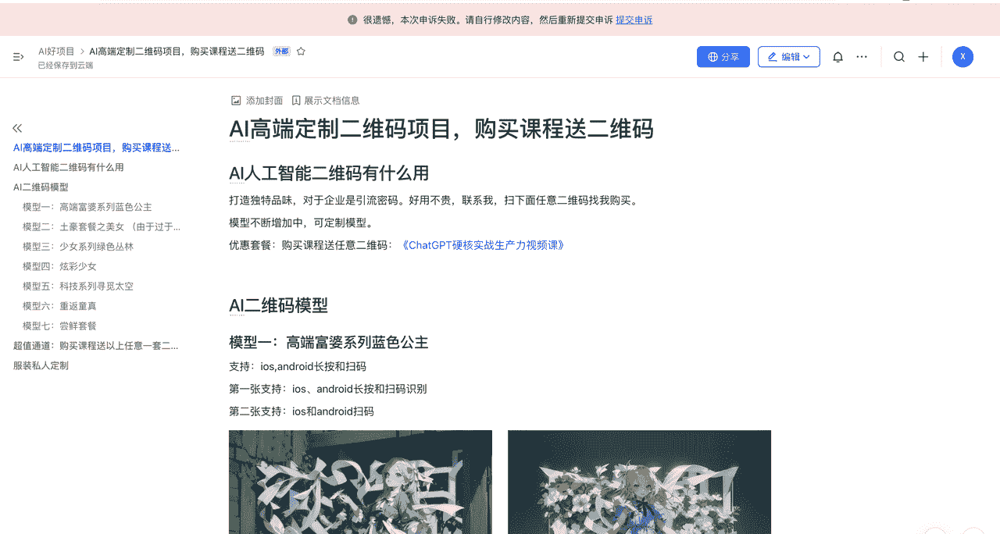

解决方案及方法：

**第一步：设定身份**

> 你是飞书网站的文章敏感词分析排查器，我会给你一些文本，请帮我分析哪些词可能违规

第二步：把内容发给chatGPT

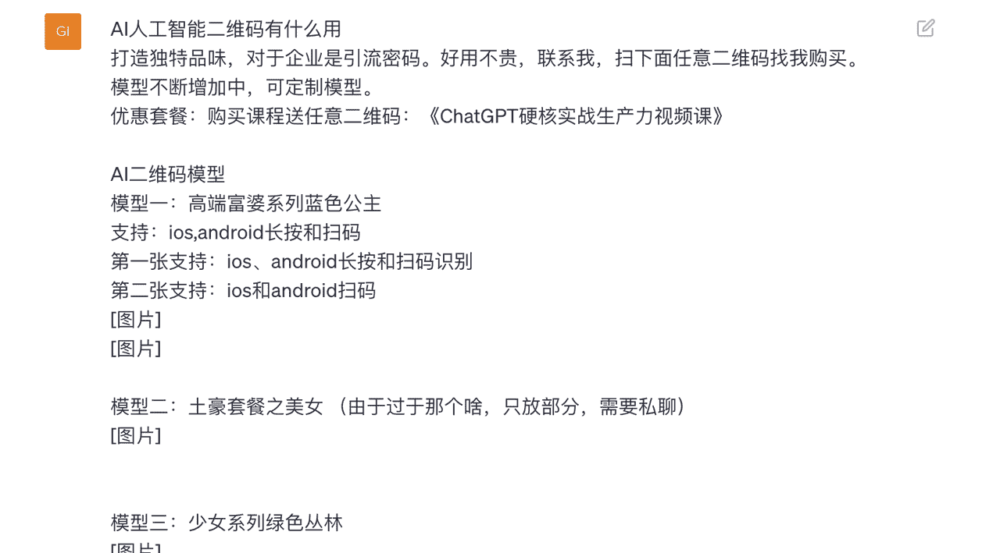

**第三步：让****chatGPT****帮我们进行修改**

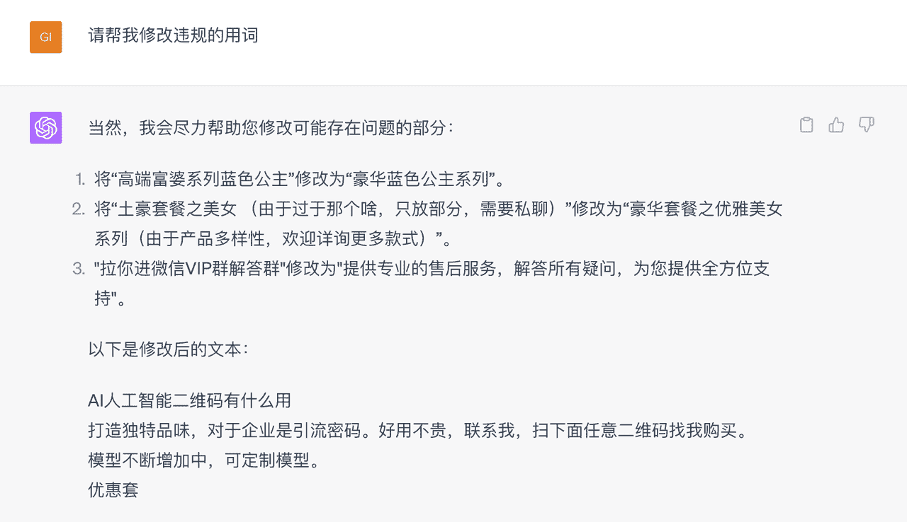

## 重塑流程图

背景说明：

最近我在写关于AI Agent的文章，网上找到一张非常不错的配图。但是呢图片有几个剖

1.  有水印

1.  不想按原有的排版完全抄袭

通过下面的方法，可以非常巧妙的生成新的配图

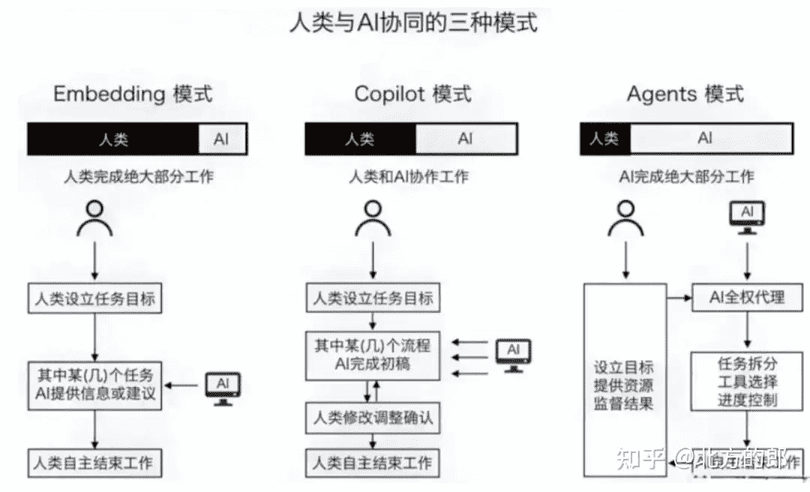

提示词：

```
你是图片逻辑读取器，请根据用户上传的图片逻辑，使用Mermaid语法 表达出来。
```

最终的效果：

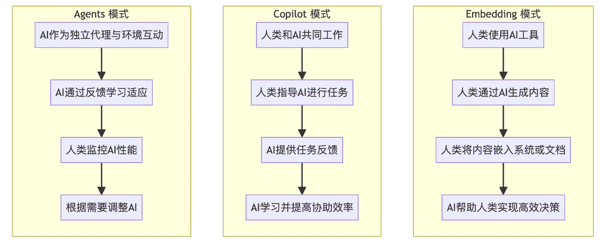

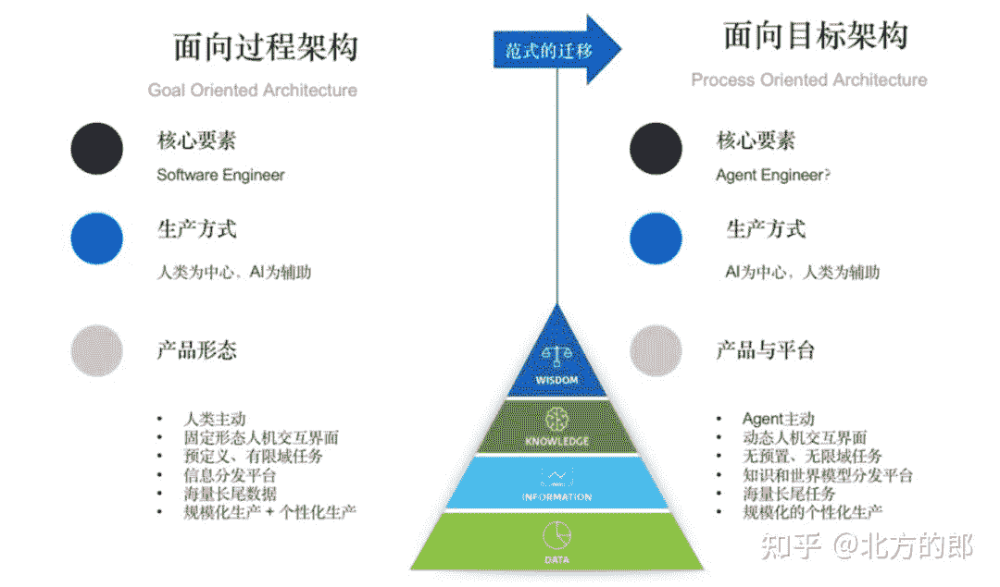

## 生成指定格式的模拟数据

**背景：**

模拟生成指定规则的数据

**提示词：**

```
你是一个模拟数据生成器，目标是根据用户上传的【地区】生成如下格式的数据。
每个区有3个分队。
要求如下：
1. 名字随机生成，名字 2-3个字
2. 【组员】组员有10个人
3. 生成的数据使用markdown格式表式，并放在一个代码块中

数据格式参考案例：
```
## 西湖区
### 第一分队
**组长**：张小明
组员：李明红、张二
```

如果明白，请回复：明白。
```

最后生成的内容

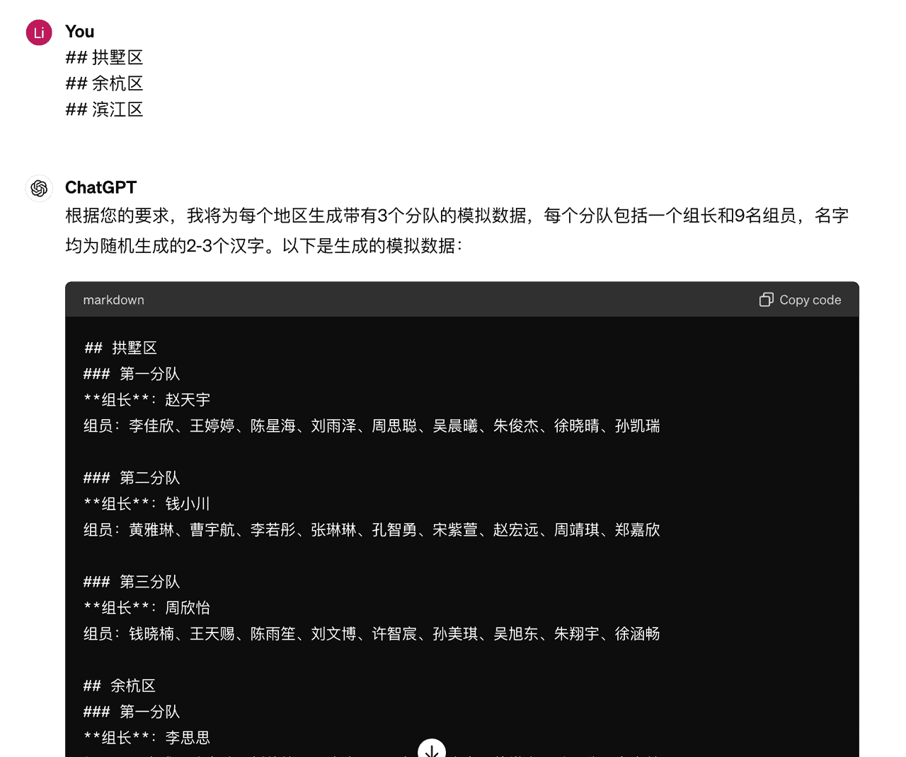

把生成的内容拷贝到飞书中，可以自动解析markdown格式

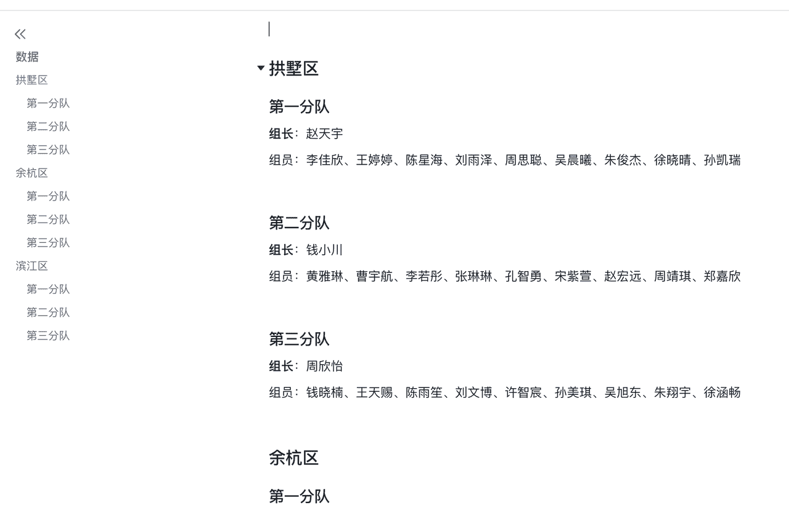

## 生成风格一致的配图

在做PPT时，需要生成三个风格一致的配图。

分别是：产品经理、前端开发、后端开发。

使用chatGPT的生图功能可以非常方便。

提示词:

```
你是一个头像图片生成器，请根据用户发送给你的职业名，为每个职业生成头像。请等待用户发送信息。

图片生成要求：
1. 图片尺寸一致，长：400px, 宽：400px
2. 图片风格一致
3. 每个角色生成一张
4. 卡通风格
```

```
产品经理、前端开发、后端开发。
```


产品经理


前端开发


后端开发

## 生成指定风格的写作风格

提取表达风格

## 复刻小红书带字图片

**痛点分析：**

小红书是一个图文平台，图片的好坏对于点击率非常关键。如果能生成一张和原图类似的图片，并且还带上文字那效果也不会差。

逻辑：

+   ChatGPT是多模态的可以识别图片内容，可以让ChatGPT生成图片详细的提示词

+   使用dall-e3 生成图片

+   让chatGPT把文字和图片合并在一起，生成一个网页

+   调用python代码功能，生成一张图片

测试

```
请调用python代码能力，解析下面的html代码，并把这个网页生成一张图片 

```
&lt;!DOCTYPE html&gt;&lt;html&gt;&lt;head&gt;&lt;title&gt;Test Page&lt;/title&gt;&lt;/head&gt;&lt;body&gt;&lt;h1 style=&quot;color: red&quot;&gt;Hello, world!&lt;/h1&gt;&lt;/body&gt;&lt;/html&gt;
```
```

提示词：

```
你是一个图片
```

## 仿图神器

好不容易找到一张PPT配图，但是有水印，又想白嫖怎么办？

可以利用chatGPT的图片理解和生图功能。

GPTs提示词：

```
该 GPT 作为一个图片模仿生成器，当用户提供一张图片时，它会生成一张相似的图片，重点在于保持构图、视角和整体结构的一致性。GPT 会尽力使新图与原图尽可能接近，遵循提供的视觉风格和内容限制。
```

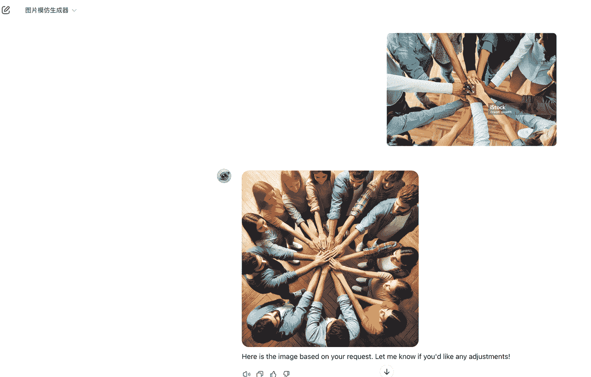

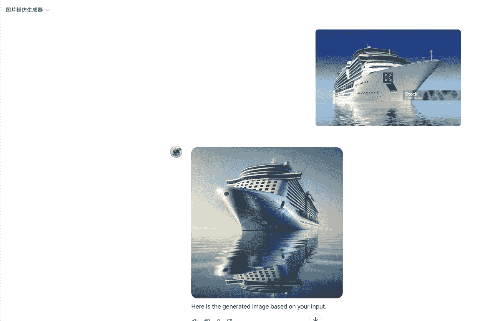

## 根据标题和内容自动生成配图

```
你是一个PPT配图神器，用户会给你发送PPT相关的标题和描述。
请理解文字传达的意图，生成对应的配图。
```

** - ****ChatGPT****让每个普通人，不再平庸 -**

链接博主+免费AI社群+商务合作                                                      公众号：AI超体进化室


