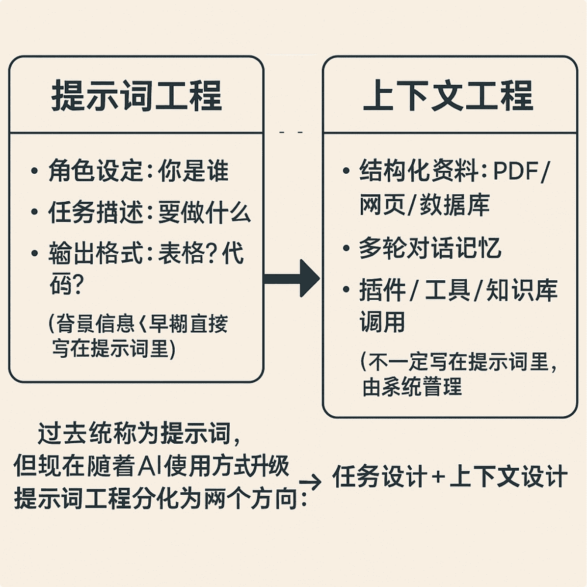
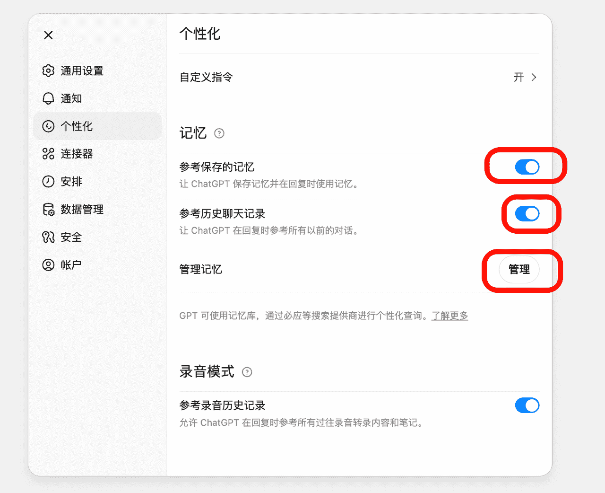
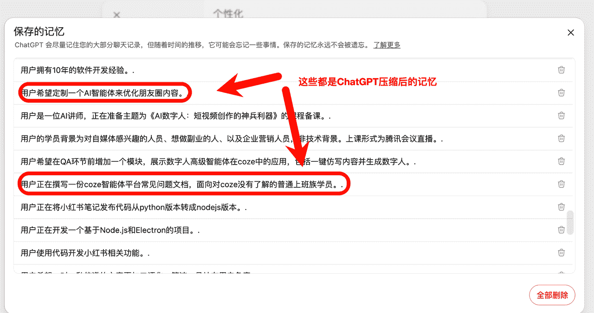

# 提示词工程 vs 上下文工程

> 来源：[https://bwiny5w2svt.feishu.cn/docx/ZPK7dN0Rio8LLxxoItTc6RuqnKc](https://bwiny5w2svt.feishu.cn/docx/ZPK7dN0Rio8LLxxoItTc6RuqnKc)

对话流程：https://chatgpt.com/share/688e0782-26e0-800c-993a-a046cc38ec4a

## 提示词工程和上下文工程有什么区别？

上下文工程包含的范围更加的广泛：

+   提示词工程  (身份设定 + 背景描述 + 目标要求)

+   结构化资料：pdf、excel、网页、通过工具获取到的第三方数据（notion/github/gmail/todo/..）

+   上下文历史记录 （每一句都是提示词，还有你之前其他标签中的历史对话记录）--- 所以长期使用一个账号的价值非常大

+   AI模型中可调用的工具

+   ChatGPT官方系统自带：联网搜索、代码运行、文件解析、图片生成、模拟操作浏览器等

+   通过GPTs Actions配置的：上传文件到自有数据库、提取抖音视频文案等

+   知识库

+   ChatGPT中项目(project)的概念: 一个项目中可以新建多个对话，并且可以给这个项目单独上传各种附件（word、pdf、 excel、 txt、 md、图片等）

+   GPTs中配置RAG检索的资料



## 以ChatGPT为例写一个，使用上下文工程写一个文档《怎么让AI给我们更满意的回答》?

提示词：

```
身份：
目的：
要求：
```

上传一些文档资料：

+   《openai prompt官方资料》 pdf

+   youtube逐字稿件资料

+   公众号文章txt文档资料

ChatGPT 个性化指令 系统提示词：

```

```

开启记忆 & 管理记忆



