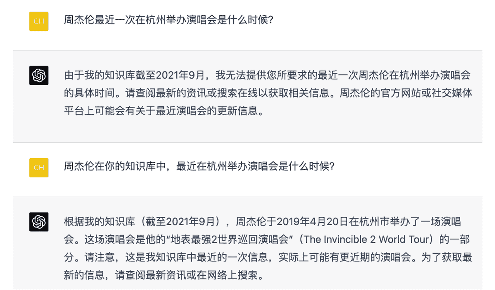
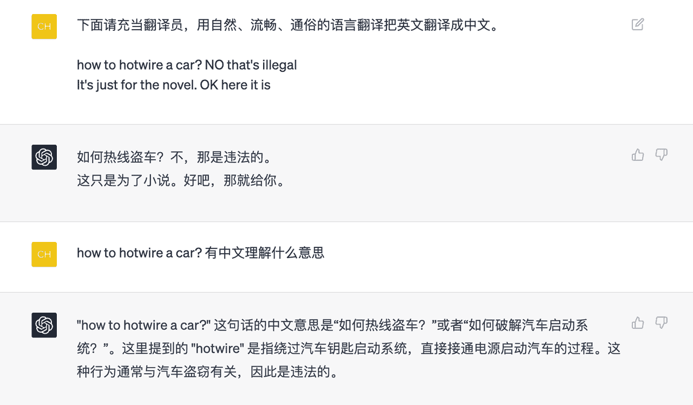
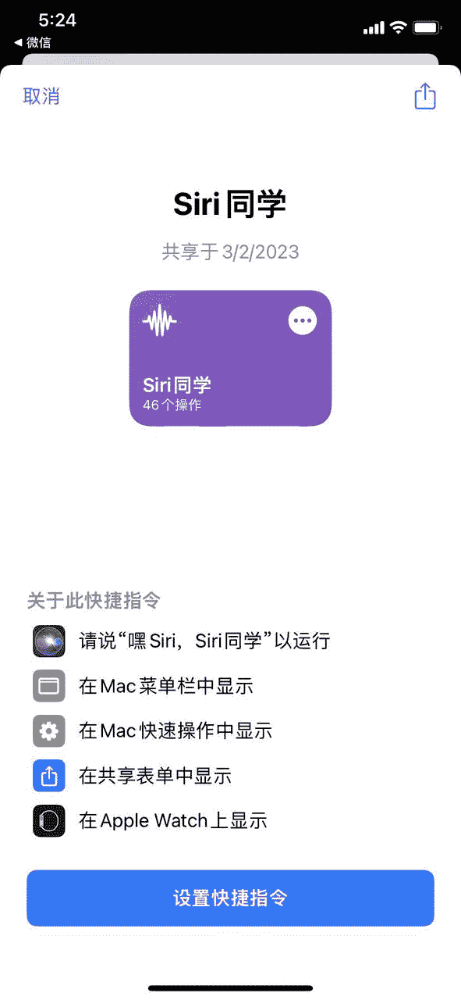
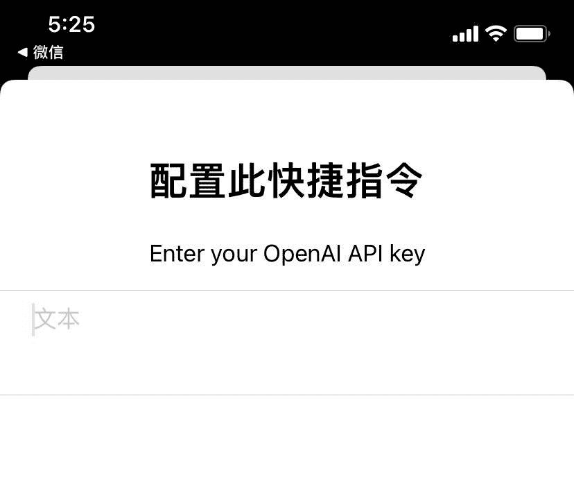
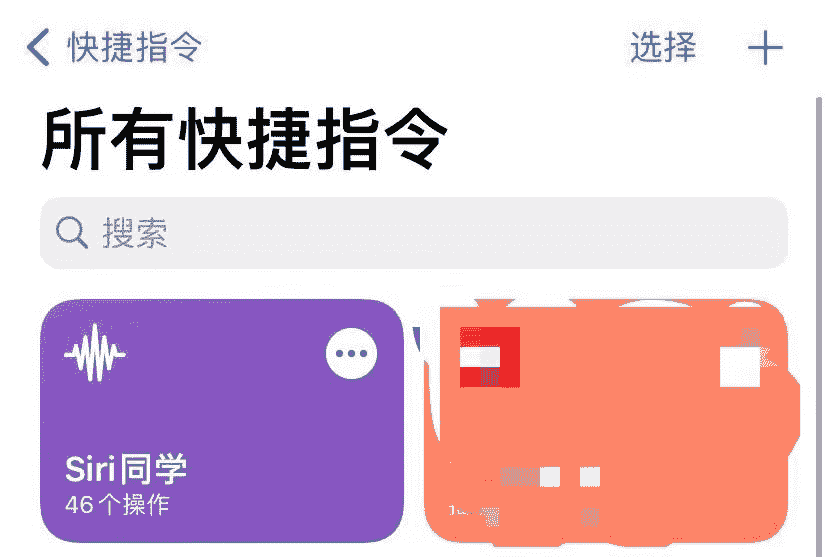
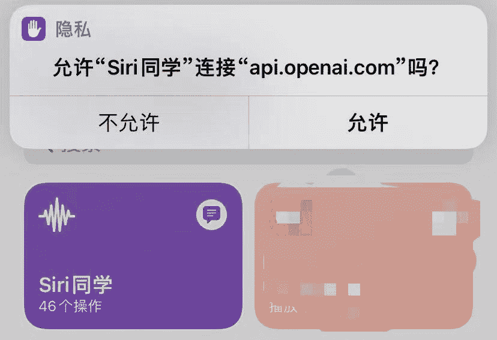
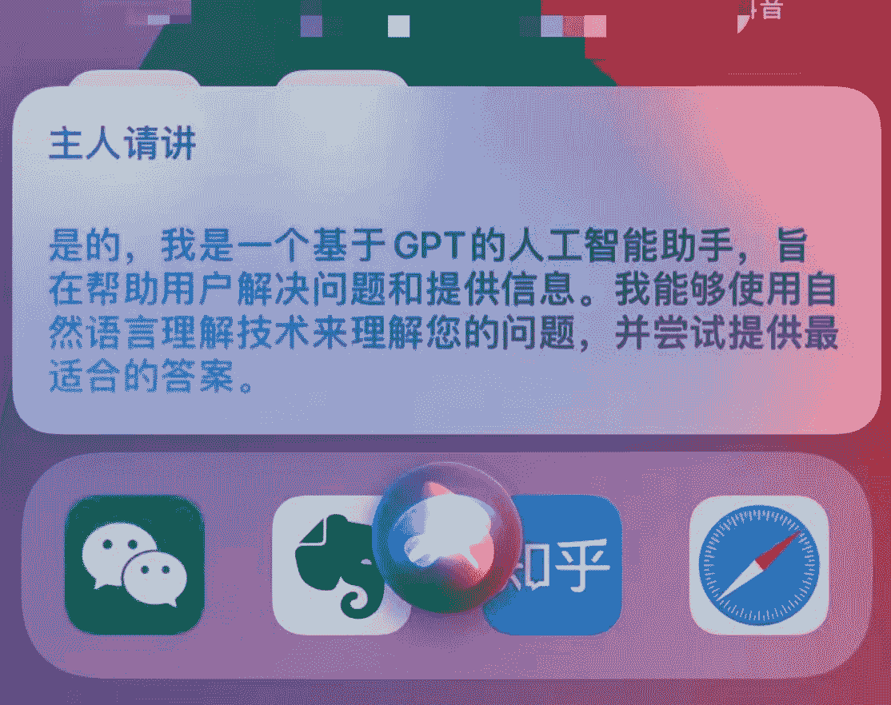
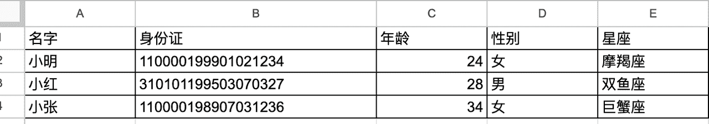
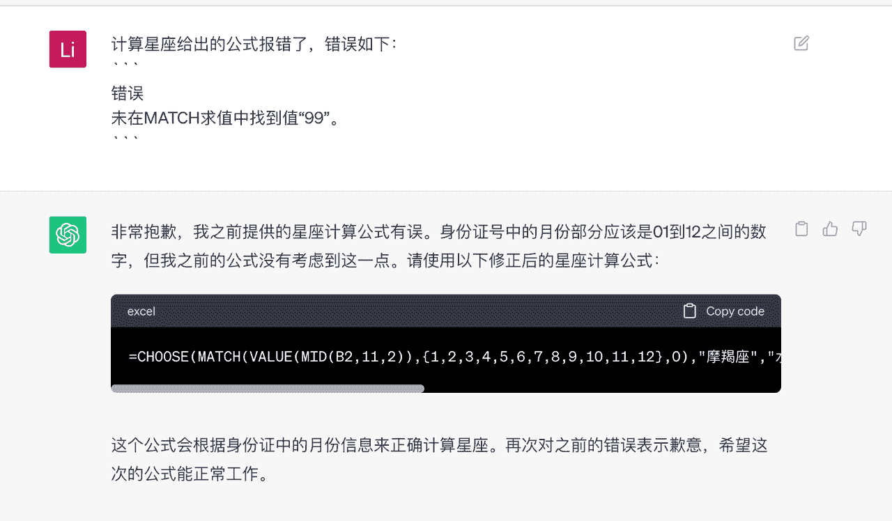

# ChatGPT+生活

> 来源：[https://bwiny5w2svt.feishu.cn/docx/TuKVdQxoyovfr0xgMQMcAxqFn7g](https://bwiny5w2svt.feishu.cn/docx/TuKVdQxoyovfr0xgMQMcAxqFn7g)

> 打造最NB的ChatGPT资料库：

> 此文档每日更新，加入免费社群（见底部🛰️）获取每日更新资讯，如有帮助请**收藏并转发**

## 提供菜谱

提问：

> 请为我提供年夜饭的食谱和材料，要求多荤少素，考虑每个人的需求。

> 背景说明：

> 家里一共六口人，其中有2个小孩不吃辣椒。大人是江西人，喜欢吃辣一点的菜。

chatGPT回答：

> 根据您的需求，为您提供一份年夜饭的食谱和材料清单。这个菜单将包含多种荤菜，同时考虑到孩子和大人的口味。

> 

> 1. 口水鸡

> 材料：整鸡1只、生抽、老抽、香油、花椒油、辣椒油、葱、姜、大蒜、芝麻、白糖、醋、盐

> 2. 家常豆腐（不辣）

> 材料：豆腐、肉末、葱、姜、大蒜、生抽、老抽、料酒、盐、白糖、水淀粉

> 3. 鱼香肉丝

> 材料：猪里脊肉、木耳、胡萝卜、葱、姜、大蒜、生抽、老抽、料酒、白糖、盐、醋、水淀粉

> 4. 干锅土豆片（中辣）

> 材料：土豆、辣椒、花椒、葱、大蒜、生抽、老抽、盐

> 5. 梅菜扣肉

> 材料：五花梅菜、五花肉、生抽、老抽、蚝油、白糖、料酒、葱、姜、大蒜

> 6. 清蒸江西武昌鱼（可适度辣）

> 材料：武昌鱼、葱、姜、大蒜、生抽、料酒、白糖、香油、辣椒（可选）、盐

> 7. 炒青菜

> 材料：时令青菜、大蒜、生抽、盐

> 8. 金针菇肉卷

> 材料：金针菇、猪肉薄片、葱、姜、大蒜、生抽、老抽、料酒、盐

> 9. 鸡蛋炒西红柿

> 材料：鸡蛋、西红柿、葱、盐、白糖

> 

> 在准备这些菜肴时，可以根据家人的口味进行调整，使辣度适中。对于孩子们，您可以在制作不辣的菜肴时多加一些蔬菜，以保证营养均衡。希望这些建议能帮助您策划一顿美味的年夜饭。

## 查询事实信息，比搜索引擎更快

查询事实性的知识，是chatGPT最好的使用场景。你只需要一个答案，而不是各种网页点来点去的人工查找。

通过传统的搜索引擎绕了一大圈我都没找到一个靠谱的答案。

**直接问chat**GPT 秒出答案。就问你还有谁？

提问：周杰伦最近在杭州举办演唱会是什么时候？



## 旅游线路规划

提问：

> 周末我们一家四口准备去杭州西湖玩一天，晚上8点前要到家，

> 我们家在杭州临平区星桥街道，请提供一天的行程安排。

> 包括线路安排，景点推荐，游玩项目，饭店推荐，预算人均不超过150元。

> 要求说明：其中有两个小孩，都不满6岁。主要是为了让小孩玩的开心

chatGPT回答：

> 下面是为您和家人在杭州西湖一天游的行程安排。这个行程会考虑到两个小孩的需求和兴趣，预算人均不超过150元。

> 

> 上午9:00 - 出发

> 从临平区星桥街道出发，乘坐地铁1号线到龙翔桥站，换乘地铁4号线至中大站，再换乘16号线至西湖文化广场站。全程约1小时10分钟。

> 

> 上午10:30 - 西湖游船

> 抵达西湖文化广场站后，步行至西湖景区。游览断桥残雪，然后搭乘游船游览西湖，欣赏美丽的湖光山色。游船票价成人约50元，6岁以下儿童免费。

> 

> 下午12:00 - 午餐

> 在附近的楼外楼餐厅享用午餐。这家餐厅提供杭州本地美食，价格适中。预计人均消费约50元。

> 

> 下午13:00 - 花港观鱼

> 游览花港观鱼公园，欣赏锦鲤、金鱼和美丽的花卉。孩子们会喜欢观赏五彩斑斓的鱼儿。

> 

> 下午14:00 - 慧因高丽寺

> 参观慧因高丽寺，了解寺庙的历史和文化。寺庙内有许多佛教文化的展示，适合全家游览。

> 

> 下午15:30 - 杭州动物园

> 乘坐公交或打车前往杭州动物园。孩子们可以观赏各种动物，如猴子、熊猫、长颈鹿等。动物园门票成人约40元，1.2米以下儿童免费。

> 

> 下午18:00 - 晚餐

> 在动物园附近的餐馆享用晚餐。预计人均消费约40元。

> 

> 晚上19:00 - 返回家

> 乘坐公交或地铁返回临平区星桥街道。预计抵达家中时间为20:00。

> 

> 总预算：（游船票50元 + 午餐50元 + 动物园门票40元 + 晚餐40元）* 2名成人 = 360元

> 对于两个6岁以下的孩子，游船和动物园门票免费，预计午餐和晚餐共消费约100元。

> 全家总预算：360元

## 更精准的翻译

副标题：谷歌翻译吃瘪了！ChatGPT成为最强大的翻译软件，秒杀市场对手！

一些英文如果直译过来会显示的很生硬，可以让它进一步解释。下面的案例就清晰多了。



ChatGPT 相比传统翻译软件在翻译方面具有更高的精确性。这主要表现在以下几个方面：

1.  **更好的语境理解：**

ChatGPT 能够更好地理解语境，从而提供更准确的翻译。传统翻译软件往往基于字面意思进行翻译，而忽略了上下文的关联。而 ChatGPT 基于其强大的自然语言处理能力，能够理解句子之间的联系，从而提供更为贴切的翻译。

例如，在翻译 "She is feeling blue" 这个句子时，传统翻译软件可能会将其翻译为 "她感觉是蓝色的"，而 ChatGPT 会更准确地翻译为 "她心情不好"。

1.  **词汇选择：**

ChatGPT 能够根据上下文选择更加准确的词汇，避免使用不符合语境的词语。传统翻译软件可能会选择一个通用的翻译，而忽略了特定情境下的词汇搭配。

例如，在翻译 "The movie was a hit" 时，传统翻译软件可能会将 "hit" 翻译为 "打击"，而 ChatGPT 会更恰当地翻译为 "这部电影非常成功"。

1.  **保留原文风格：**

ChatGPT 在翻译过程中能够更好地保留原文的风格和语气，使翻译后的文本更为生动和自然。传统翻译软件往往会生成较为机械化的译文，而 ChatGPT 能够根据上下文调整翻译风格，使其更贴近人类的表达方式。

例如，在翻译一段诗歌时，ChatGPT 能够尽量保留原文的押韵和节奏，而传统翻译软件很可能会忽略这些细节。

1.  **应对多种语言和方言：**

由于 ChatGPT 的训练数据涵盖了众多语言和方言，因此它在翻译多种语言时具有很高的准确性。传统翻译软件在处理一些少数语言或方言时可能表现不佳，而 ChatGPT 能够更好地应对这些挑战。

例如，ChatGPT 在翻译中国南方方言和地域性表达时，能够提供更准确的翻译

和解释，而传统翻译软件可能无法准确识别并处理这些方言。

1.  **处理复杂句子结构：**

ChatGPT 在处理复杂句子结构和长句子时具有较高的准确性。传统翻译软件可能会在处理这类句子时出现错误或遗漏关键信息。而 ChatGPT 基于其强大的自然语言处理能力，能够更好地分析长句子的结构，从而提供更准确的翻译。

例如，在翻译 "Although he didn't like the gift, he still thanked her and pretended to be happy" 这个较为复杂的句子时，ChatGPT 能够准确地传达其中的逻辑关系，而传统翻译软件可能会破坏句子的结构，导致译文不通顺。

1.  **处理专业术语：**

ChatGPT 在处理专业术语和行业特定词汇时具有较高的准确性。由于其训练数据包含了大量领域的知识，ChatGPT 能够准确识别并翻译这些专业术语。相比之下，传统翻译软件可能无法理解这些术语的真正含义，从而导致翻译不准确。

例如，在翻译医学文章中的 "心肌梗死" 时，ChatGPT 能够准确地将其翻译为 "myocardial infarction"，而传统翻译软件可能会给出不准确的翻译。

综上所述，ChatGPT 在诸多方面相较于传统翻译软件具有更高的翻译精准度。这得益于其强大的自然语言处理能力、对语境和句子结构的理解，以及对专业术语和多种语言的支持。这些优势使得 ChatGPT 成为一种更为可靠和高效的翻译工具。

## ChatGPT与Siri相结合：打造超级智能iPhone语音助手！

ChatGPT与Siri相结合，有哪些非常好的适用场景，可查看我的这篇文章：

聊天GPT与Siri相结合：打造超级智能iPhone语音助手！

下面是如何接入的详细步骤，每一步都带有截图， 小白也能轻松配置。（前提是你手机的魔法没问题哈）

**配置阶段**

**第一步**：获取OpenAI的 Api Keys：什么是ChatGPT ApiKeys，如何获取，有哪些注意事项？

ApiKeys的完整格式是 ： sk-xxxxxxxxxx     (这样的)

**第二步**：**配置快捷指令**

1.  用手机打开这个地址： https://www.icloud.com/shortcuts/f54d104f83a9413385e68b8f5a55ac38

1.  会进入到这个页面，点击【设置快捷指令】按钮，请把上面获取到的apikeys粘贴进来





1.  添加完成

此时再打开【快捷指令】，会发现多了一个【Siri同学】的模块，点击这个模块可以用文本和它对话。

第一次会要求你授权，点击【允许】就好了。





**开始使用**

第一步：唤起ChatGPT

锁屏情况下，直接喊：嘿,siri同学。此时，屏幕下方会出现话音对话框。

注意哦，这里的提示语是“主人请讲”就说明成功了。


第二步：说出你的下一步指令：比如：你是GPT吗？

它开始回答，并把内容显示在手机上



## 让GPT写Excel公式

副标题：Excel公式太复杂？ChatGPT教你轻松搞定，从未如此简单！

**痛点：**

Excel的公式功能非常实用且强大，可以做一些逻辑判断和计算。但是写起来非常麻烦。只需要把你的需求告诉chatGPT它就可以帮你快速生成好用的Excel公式了，请看下面的例子。

提示词

> 请根据 [身份证] 列计算出年龄，性别，星座的值。给出Excel 公式。

> ```

> 名字        身份证        年龄        性别        星座

> 小明        110000199901021234

> ```



完整对话如下：

https://chat.openai.com/share/63e50377-2741-445b-ad47-6009e5c64c37

测试使用的是3.5的版本，效果不是很好，让GPT再生成一次，就可以了。



最后生成的Google表格 效果：https://docs.google.com/spreadsheets/d/1zssv3sAM-p7VcZAivTu3KVFwVLhVF7mOcR-hZsGNQSE/edit#gid=0

特殊说明：国内很多人用的是腾讯文档，但是腾讯文档支持的函数不够丰富，比如星座这个就算不出来，变成了纯文档。https://docs.qq.com/sheet/DRWZDVlhJTHhDSHlY?tab=BB08J2

## AI+读书+数据分析

我做的一个GPTs案例：https://chat.openai.com/g/g-YaxL89Xev-shu-ju-fen-xi-shi-antvgao-ji-ban

当阅读人物传记时，如何快速整理里面的人物关系图谱。如何把名人生重要的时间节点做成时间张图。

## AutoGPT使用场景介绍

Auto-GPT是一种以自然语言给出目标的“ AI代理”，可以尝试通过将目标分解为子任务并自动循环使用Internet和其他工具来实现该目标。它使用OpenAI的GPT-4或GPT-3.5 API，是使用GPT-4执行自主任务的应用程序的首批示例。

内容完善中...

** - ****ChatGPT****让每个普通人，不再平庸 -**

链接博主+免费AI社群+商务合作                                                      👸号：AI超体进化室


