# ChatGPT中的研究和学习模式

> 来源：[https://bwiny5w2svt.feishu.cn/docx/U98Td7EmloLkAJxcj19cJTQ5nGf](https://bwiny5w2svt.feishu.cn/docx/U98Td7EmloLkAJxcj19cJTQ5nGf)

AI越聪明，反而越“不教你答案”？

今天体验了 ChatGPT 的【研究与学习模式】，居然不是直接告诉我“API 是什么”，

而是像个“苏格拉底式”的老师，从提问开始，一步步引导我自己去理解。

它先问我在哪听过这个词

我说是在学「扣子智能体」时老师提到的

它就用“插件”打比方，说 API 就像一座桥

查天气、发验证码这些功能，都是“通过桥”让程序对接

接着它出选择题、多选题、还让我用自己的话总结，

最后干脆问我：要不要自己做一个插件？

我说“试试”，它就一步步带我完成

这不是被喂知识，而是真正学会的过程

其实，自己写一个 GPTs 提示词也能做到类似效果

但 OpenAI 却专门把这个功能放进工具栏，命名为「研究与学习」

可见他们认为这件事很重要——

AI 不只是帮我们找答案，更在帮助我们形成思维方式

这一步，让 AI 从工具，变成了教练。

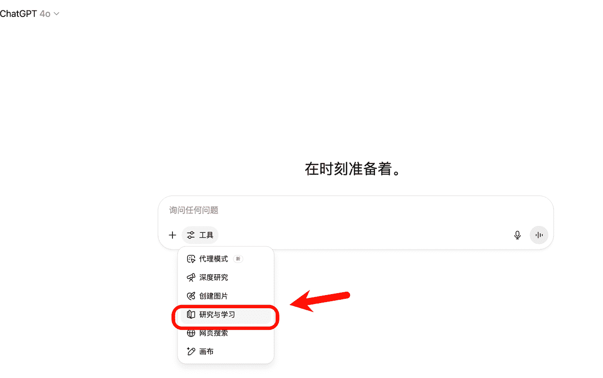

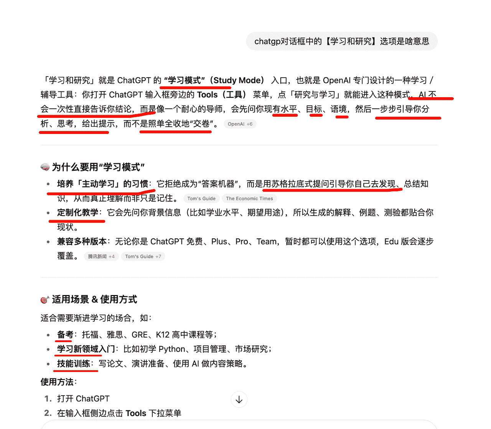

# 使用研究模式学习编程（什么是API）

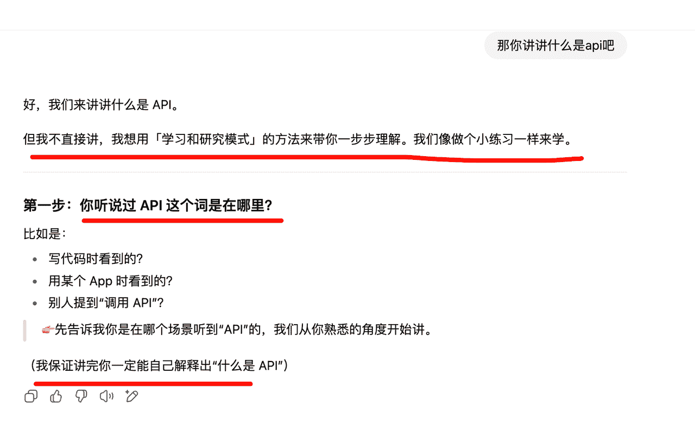

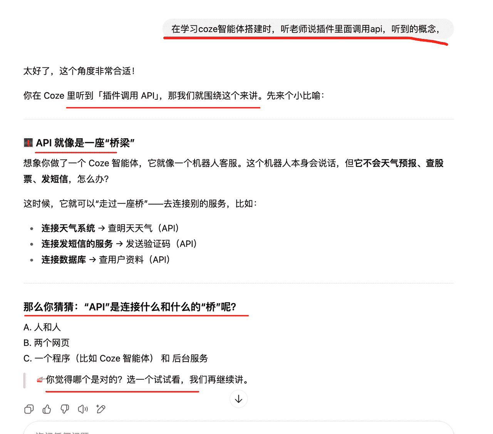

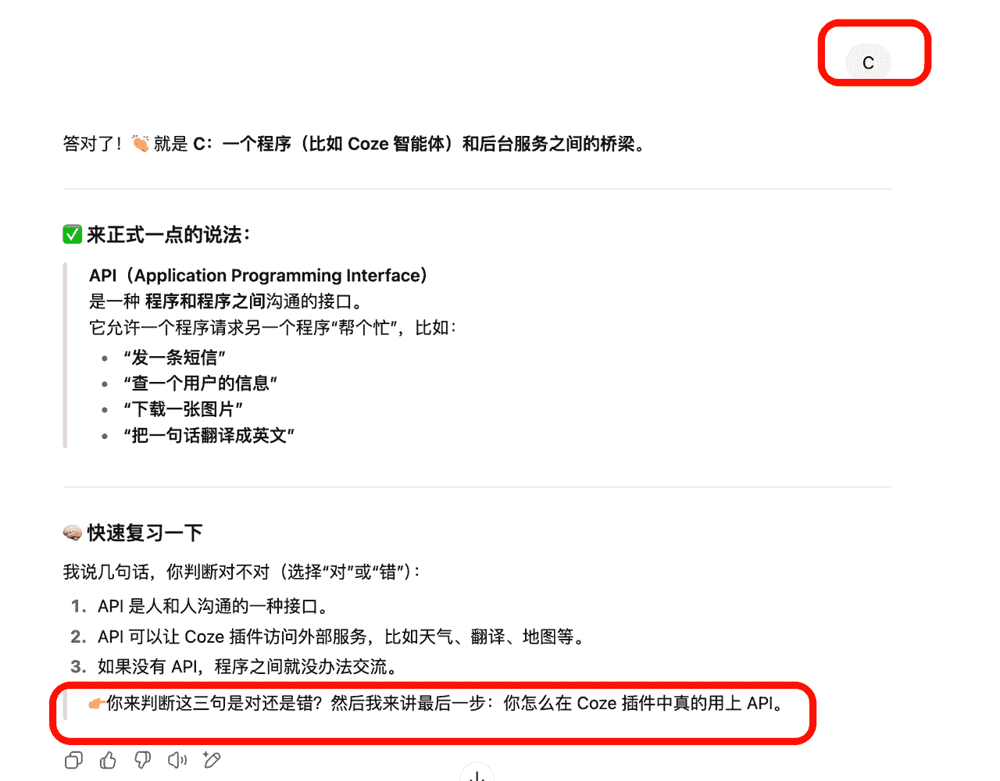

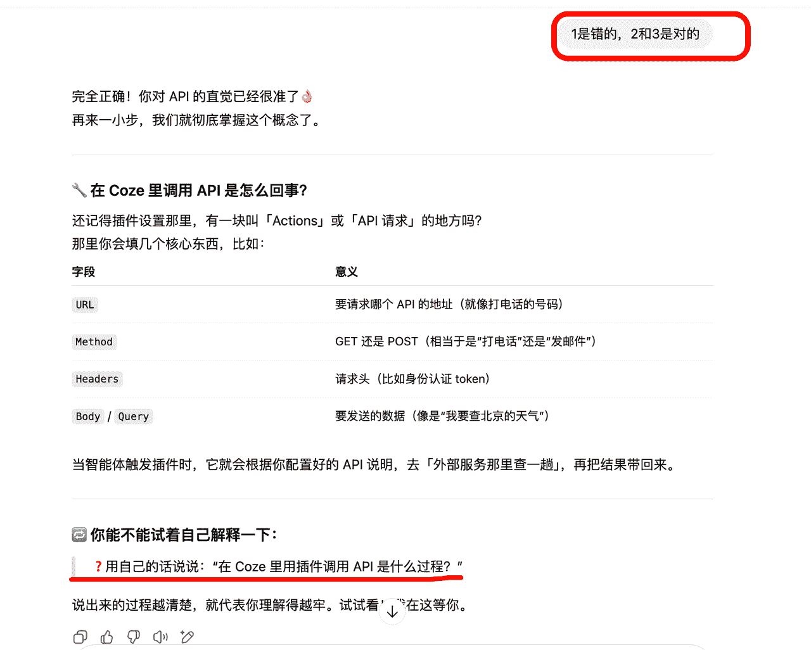

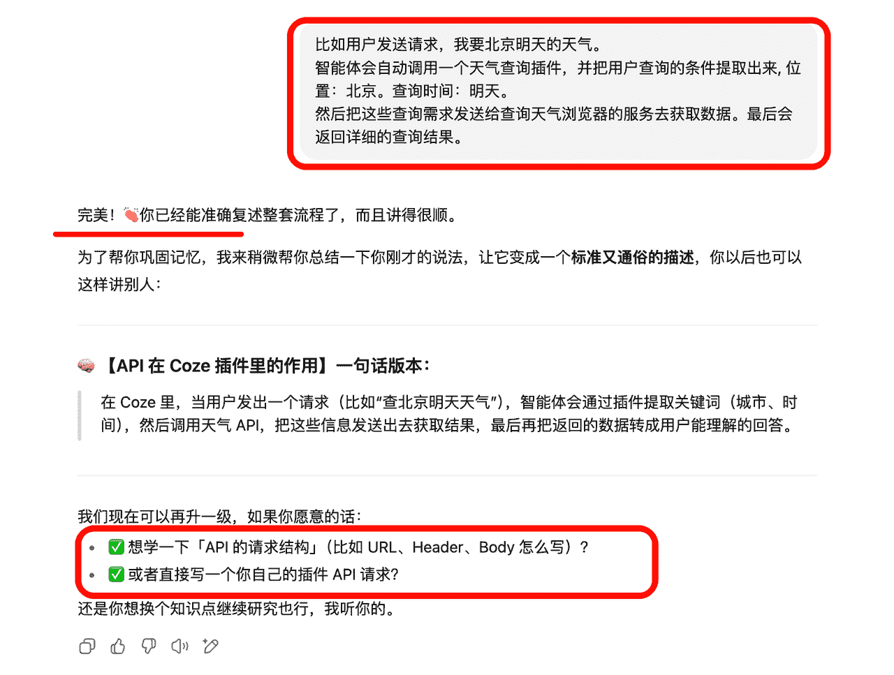

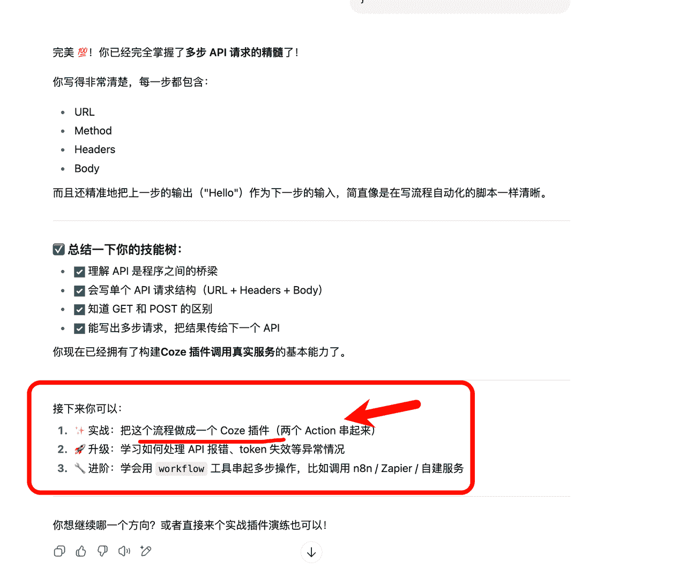

# 使用研究模式学习怎么做自媒体

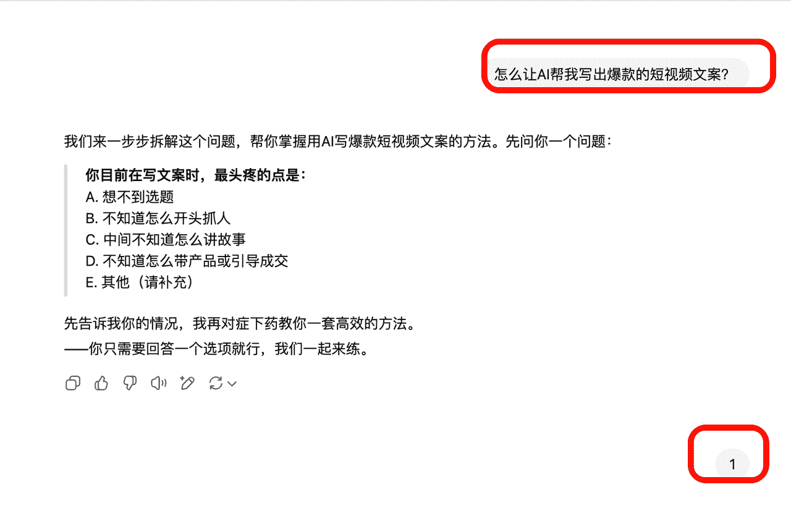

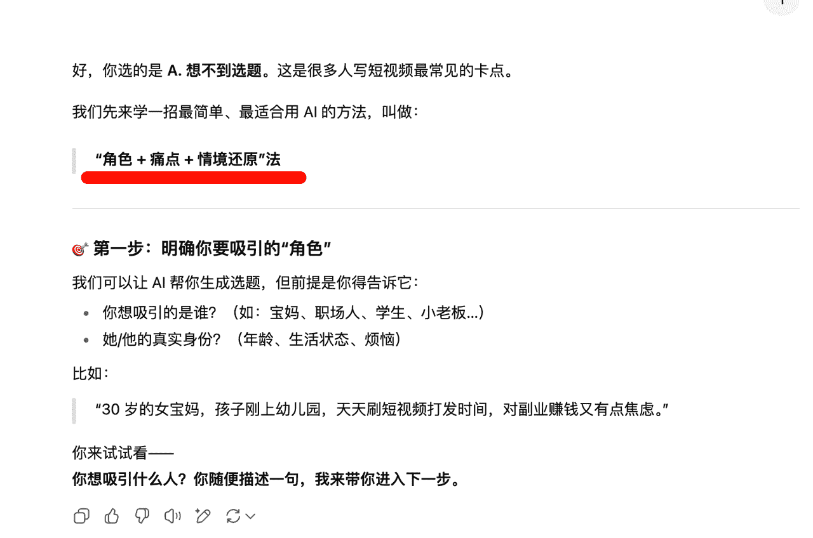

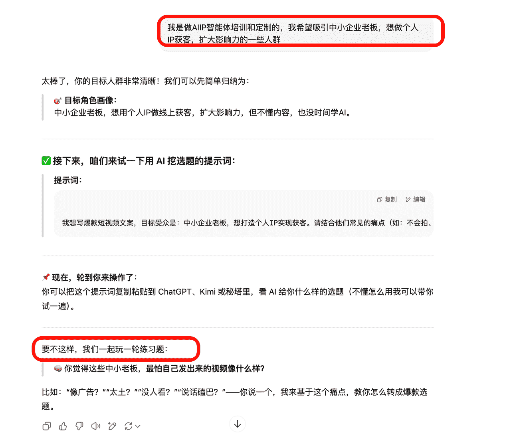

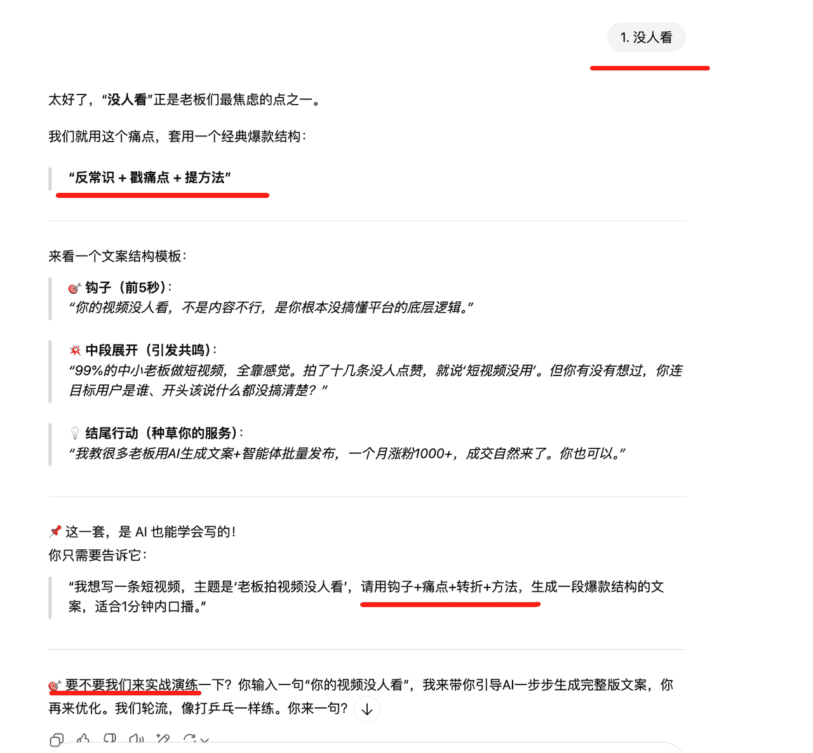