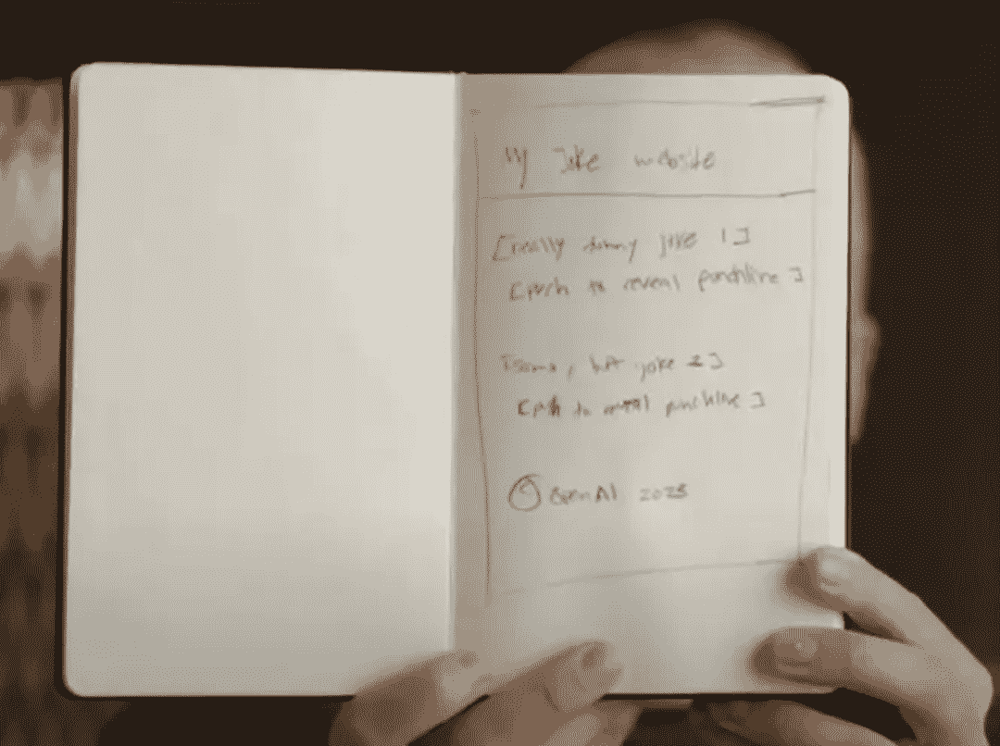
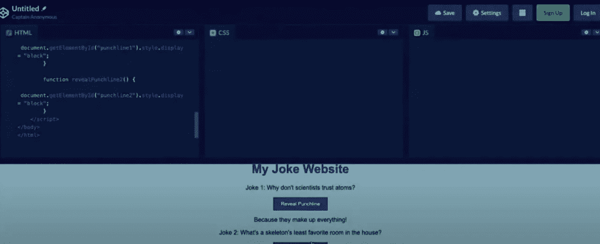
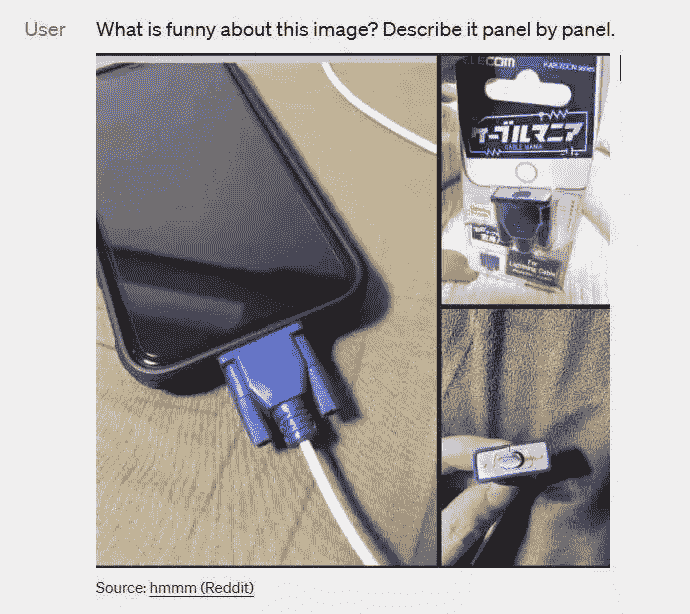
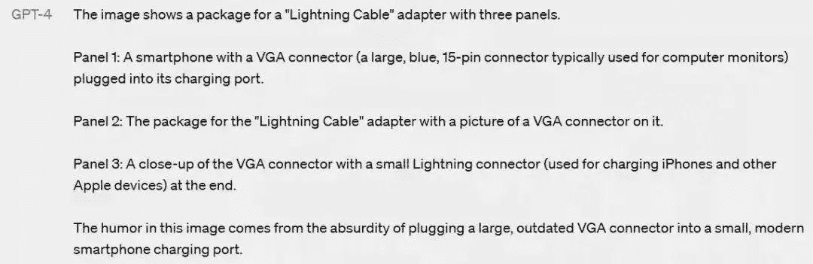
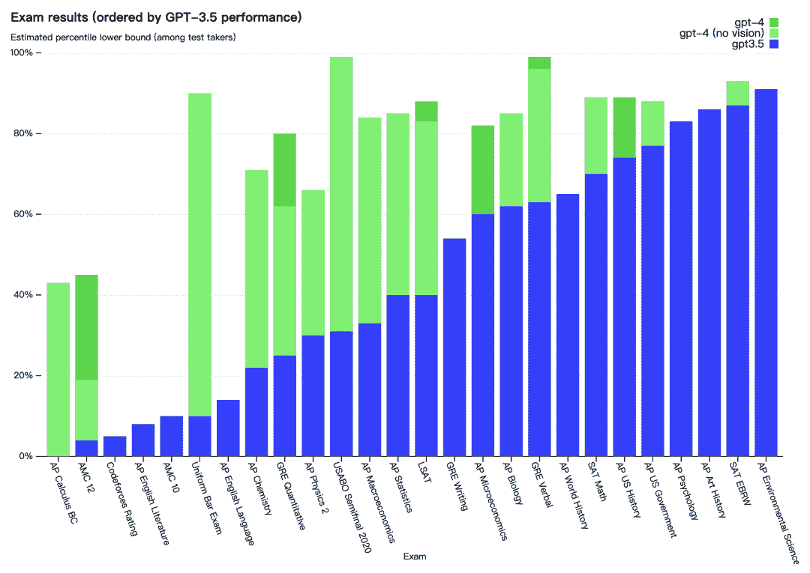

# 五、开通ChatGPT Plus4.0有什么好处

> 来源：[https://bwiny5w2svt.feishu.cn/docx/TWgxdvtnCom0XDxRXiYcA7j9n1e](https://bwiny5w2svt.feishu.cn/docx/TWgxdvtnCom0XDxRXiYcA7j9n1e)

> 开通plus有几大优点：

> 1、服务更稳定：如果服务器负载不夠的话，首先受影响的肯定是免费用户。

> 2、更强大的新功能：图片识别，深度分析等

今天，我刷抖音看到一条视频，内容是一家公司的老板因为引用AI辞退了原画师。

在大家的认知中，原画师应该是一个需要创意、很难被替代的职业。**但ChatGP**T4.0的出现，使得AI能更快速、更符合老板对插画的需求和想法，并且在版权上可以直接付费商用，比雇用一个原画师的成本低很多。

不论我们如何否认，ChatGPT对各行各业的影响正在逐步蔓延，AI时代真的到来了。

**ChatGPT4.0时代到来**

**新功能颠覆你的认知**

**图片识别功能**

GPT-4不再仅仅处理文本数据，对图片也有了理解能力。

在官方的文章中，OpenAI给出了几个使用范例，如说明图片的内容、分析图表、解答图片内的考题、找出图片不寻常的原因等等，让人大开眼界。

在OpenAI官方发布的视频中，GPT-4通过识别上图中随便画出的草图，就识别出了这是一个关于网站的草图。

然后GPT-4“顺手”生成了建成这个网页的全部代码，再然后...一个网站就这样建成了。

**强大的推理能力**

官方还展示了一个示例。向GPT-4上传一张梗图，并且提问：为何这张图是搞笑的？

GPT-4不仅看懂了图片，听懂了问题，甚至指出了图片上有意思的、让人发笑的点，分条列点，颇有条理。

从这一回答中可以看出，GPT-4的**推理能力**已经有了大幅度提高。

**支持更长的输入和输出**

相比旧版，GPT-4的文字输入长度增加到3.2万个Token，约2.4万单词，同时支持更长的输出，大约能处理长达25000字的文本。

这使得更多的应用场景变为可能，例如长文本的创建、超长对话和文档的搜寻和分析等，仅需一次对话，就足够写一部剧本或者短篇小说了。

**考试能力超过90%人类**

最让人感到头皮发麻的是ChatGPT-4拥有推理能力。在GRE、SAT和美国法学院考试等美国考试中，GPT-4的得分几乎和人类考生没有区别。

其中，GPT-4在模拟律师考试的成绩在考生中排名前10%左右，在SAT阅读考试中排名前7%左右，在SAT数学考试中排名前11%左右。

GRE考试的数学部分满分是170分，GPT-4获得163分，而上一代GPT-3.5得分为147分；在GRE语言部分，GPT-4得分为169分，GPT-3.5得分为154分。

也就是说**，GPT-**4已经可以靠自己考上斯坦福大学了！

** - ****ChatGPT****让每个普通人，不再平庸 -**

微信号：请备注代充GPT Plus 还是 加免费社群                                          公众号：AI超体进化室

