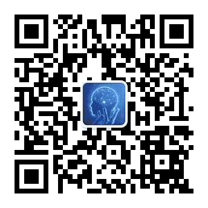

# 学习交流社群

> 来源：[https://bwiny5w2svt.feishu.cn/docx/Yt5idNrx8oJ9X8xI340ciV2bnWg](https://bwiny5w2svt.feishu.cn/docx/Yt5idNrx8oJ9X8xI340ciV2bnWg)

> 打造最NB的ChatGPT资料库：

> 此文档每日更新，加入免费社群（见底部微信）获取每日更新资讯，如有帮助请**收藏并转发**

已建立社群【ChatGPT超神之路】，社群是一个为 ChatGPT 爱好者和研究者们提供学习交流平台的社区。在这里，你可以了解最新的 ChatGPT 技术动态、分享应用案例、参与学习讨论和交流互动。无论你是想了解 ChatGPT 的技术细节、研究应用场景，还是想与其他 ChatGPT 爱好者交流心得，【ChatGPT超神之路】社群都会是你最好的选择。快来加入，让我们共同学习、探索和成长！

扫码加微信，让你的ChatGPT快人一步。

** - ****ChatGPT****让每个普通人，不再平庸 -**

微信号：请备注代充GPT Plus 还是 加免费社群                                          公众号：AI超体进化室

