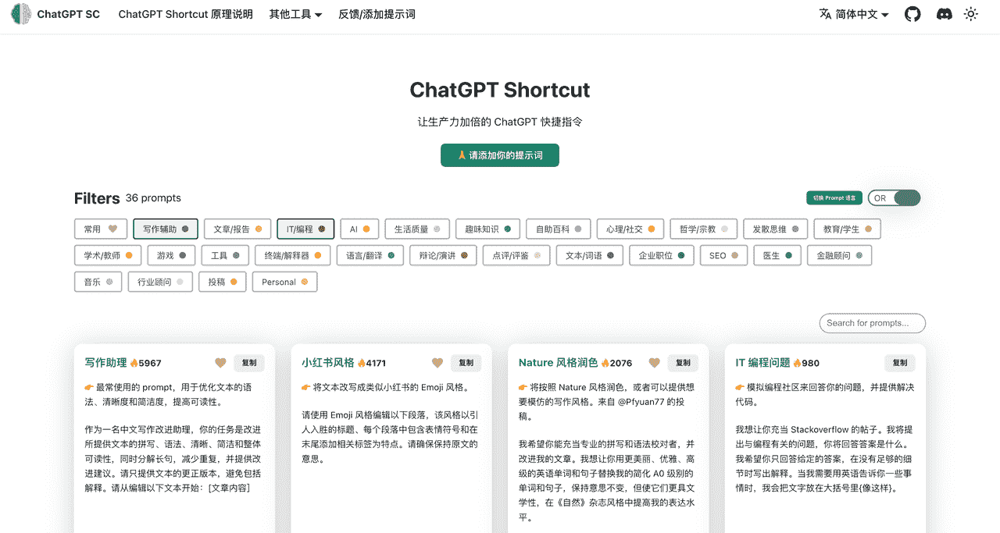
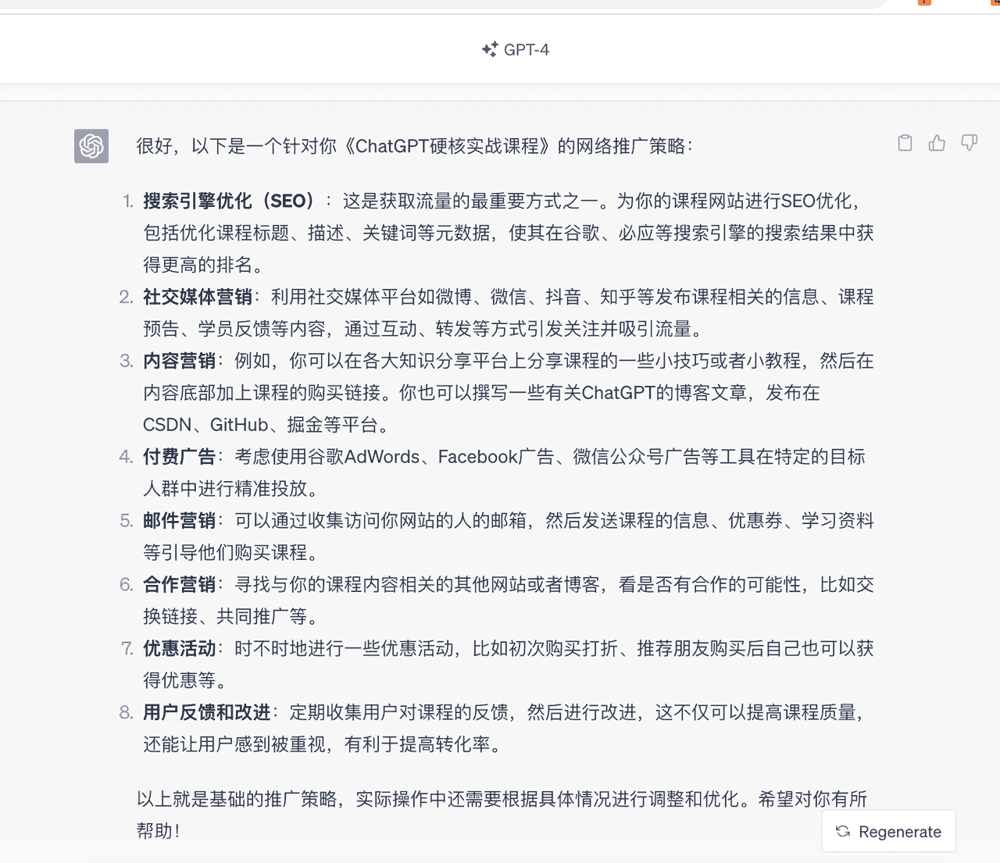
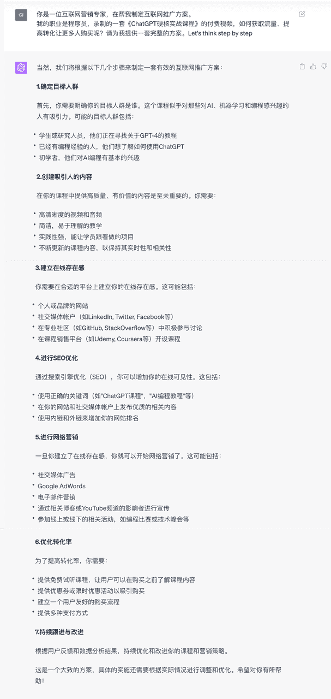

# 八、ChatGPT Prompts提示词

> 来源：[https://bwiny5w2svt.feishu.cn/docx/QpfVdHXEOoB93UxwmvfceBFynbc](https://bwiny5w2svt.feishu.cn/docx/QpfVdHXEOoB93UxwmvfceBFynbc)

> 打造最NB的ChatGPT资料库：

> 此文档每日更新，加入免费社群（见底部🛰️）获取每日更新资讯，如有帮助请**收藏并转发**

## 推荐一些开源的提示词网站

ChatGPT Shortcut

支持以中文显示，并且有些提示词符合中国用户，比如📕。点击可以一键复制。不好地方：没有存储自己提示词的地方。

国外火爆的提示词列表：

英文原版：https://github.com/f/awesome-chatgpt-prompts

## 如何管理自己的提示词并且方便快速调用

最好的方法不是在ChatGPT中直接存储和调用，这样最方便。

推荐几个不错的Chrome插件：chatgpt-prompt-genius

## 如何让ChatGPT回答的逻辑性更强？

在问题的结尾加上这句 “ Let's think step by step ”，中文的意思是，让我们一步步思考。

通过这个魔法关键词，我们可以学习ChatGPT深度思考的过程。

案例提示词

> 你是一位互联网营销专家，在帮我制定互联网推广方案。

> 我的职业是程序员，录制的一套《ChatGPT硬核实战课程》的付费视频，如何获取流量、提高转化让更多人购买呢？请为我提供一套完整的方案。Let's think step by step

不加“Let's think step by step”的效果：

直接给出方案，没有思考过程，就是一个直男。

加“Let's think step by step”提示词的效果：

加上之后，思考严谨很多。

1.  确定目标人群

1.  修炼内功：打造好的内容

1.  打造人设：提高网络知名度

1.  SEO优化：让更多通过关键字找到你

1.  网络营销

1.  提高转化：各种转化套路

1.  持续跟进数据并改进。

除了“Let's think step by step”，再给大家分享几个，可以帮助提升与ChatGPT的互动质量的英文指令。

"Please provide a detailed explanation"（请提供详细说明）

当你需要一个详细的解释时，可以使用这个指令。

"Can you break it down into simpler terms?"（你能把它分解成更简单的术语吗？）

当你觉得ChatGPT的回答过于复杂或难以理解时，这个指令可以帮助你获得更简单易懂的解释。

"Please list the pros and cons"（请列出优缺点）

当你需要对某个主题进行权衡分析时，这个指令可以帮助你获取一个全面的观点。

"Can you provide a step-by-step guide?"（你能提供一步一步的指导吗？）

当你需要完成某个任务或学习某个技能时，这个指令可以让ChatGPT提供一个分步指南。

参考资料：

+   https://zhuanlan.zhihu.com/p/624632355

** - ****ChatGPT****让每个普通人，不再平庸 -**

链接博主+免费AI社群+商务合作                                                      👸号：AI超体进化室

