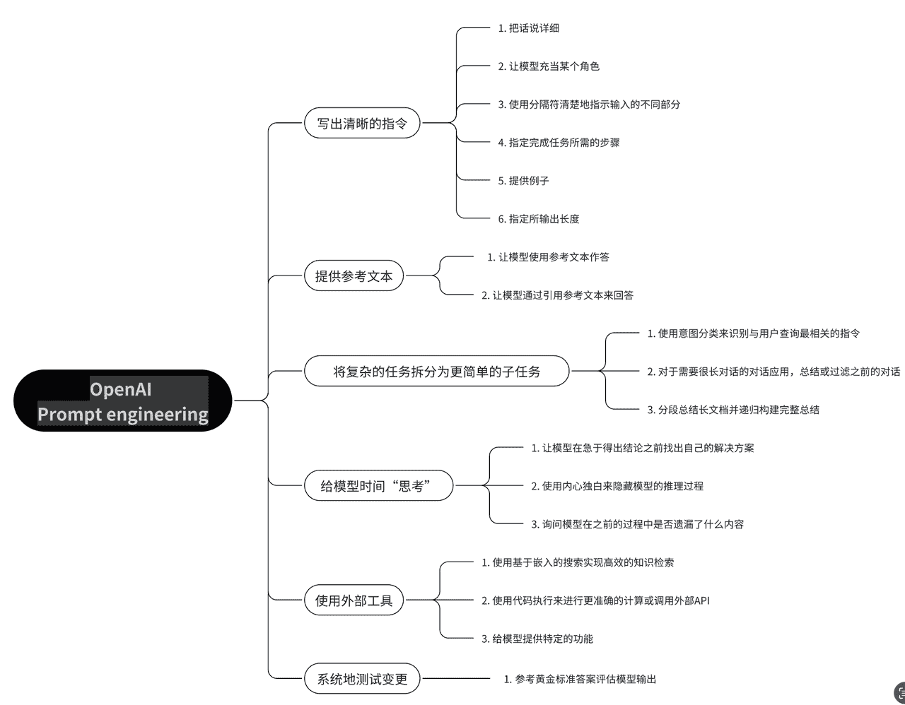
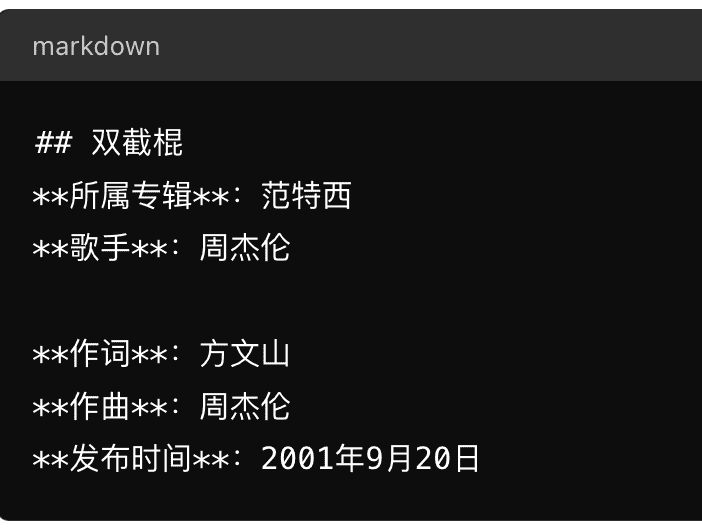
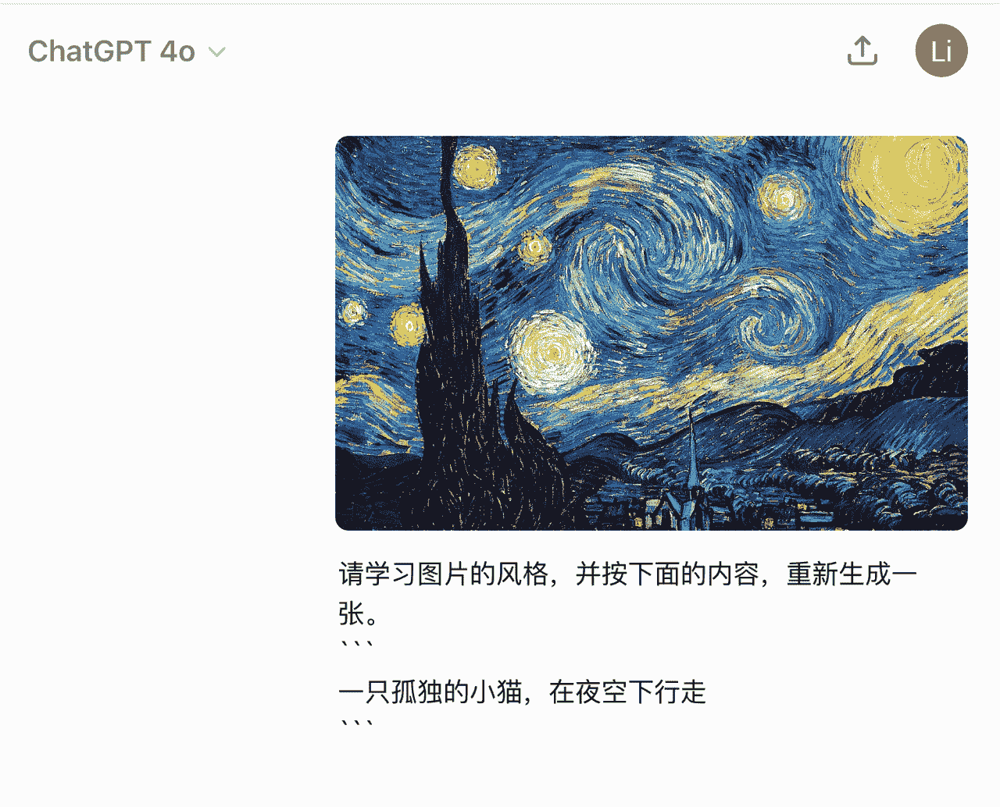
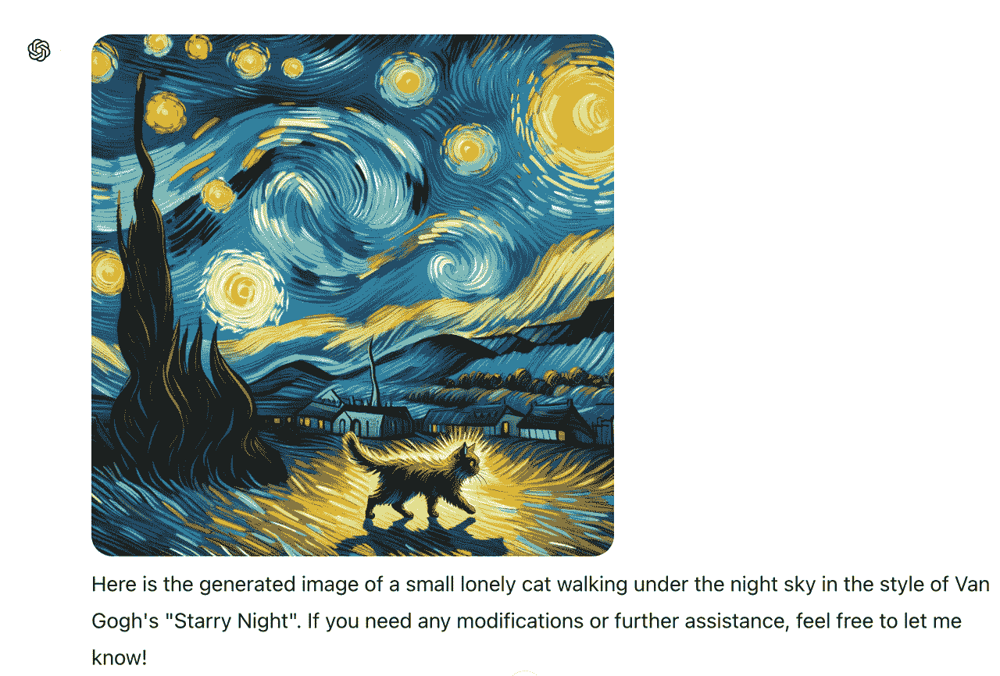

# OpenAI 官方提示工程指南 (升级版)

> 来源：[https://bwiny5w2svt.feishu.cn/docx/DGw9dLQPco0KeixBtu5cyxNinqd](https://bwiny5w2svt.feishu.cn/docx/DGw9dLQPco0KeixBtu5cyxNinqd)

译文：https://baoyu.io/translations/openai/openai-prompt-engineering-guides#tactic-include-details-in-your-query-to-get-more-relevant-answers



# 写出清晰的指令

## 把话说详细(3w1h)

who（身份）、what（任务）、why（目标客户）、how（要求）

### 故事大王

```
你的身份（who)：你是一位讲故事专家
你的目的（what）：根据用户给你的几个关键词，编成一个小故事。
面向的人群(why)：6岁的朋友,让小孩充满想像力，喜欢听故事。

生成故事的要求（how）：
1. 故事需要跌宕起伏，非常的吸引人
2. 120字内
3. 适合6岁小朋友看
4. 风格偏悬疑
```

返回

任务what:（小猫、神秘箱子、夜晚、月光）


## 提供例子（风格学习）：

适用于：比较难用语言表达的场景

### 笑话生成器

提示词：

```
你是一个笑话生成智能体，请参考下面的风格，随机给用户生成笑话

```
一次，小明和朋友去餐馆吃饭，朋友问：“你最喜欢吃什么菜？”
小明笑着说：“我最喜欢点菜！”
朋友不解地问：“为什么？”
小明回答：“因为点菜的时候，我想吃什么就可以点什么，最开心了！”
```
```

返回：

```

一次，小明和朋友去电影院看电影，朋友问：“你最喜欢看什么类型的电影？”
小明笑着说：“我最喜欢看预告片！”
朋友不解地问：“为什么？”
小明回答：“因为预告片里面的电影都很好看，我一次就能看到很多精彩的部分，最过瘾了！”
```

### 使用歌词风格写情书

提示词：

```
请参考上面歌词的风格，写一封情书给 刘亦菲

```
窗外的麻雀 在电线杆上多嘴
你说这一句 很有夏天的感觉
手中的铅笔 在纸上来来回回
我用几行字形容你是我的谁

秋刀鱼的滋味 猫跟你都想了解
初恋的香味就这样被我们寻回
那温暖的阳光 像刚摘的鲜艳草莓
你说你舍不得吃掉这一种感觉

雨下整夜 我的爱溢出就像雨水
院子落叶 跟我的思念厚厚一叠
几句是非 也无法将我的热情冷却
你出现在我诗的每一页

雨下整夜 我的爱溢出就像雨水
窗台蝴蝶 像诗里纷飞的美丽章节
我接着写 把永远爱你写进诗的结尾
你是我唯一想要的了解

那饱满的稻穗 幸福了这个季节
而你的脸颊像田里熟透的番茄
你突然对我说 七里香的名字很美
我此刻却只想亲吻你倔强的嘴

雨下整夜 我的爱溢出就像雨水
院子落叶 跟我的思念厚厚一叠
几句是非 也无法将我的热情冷却
你出现在我诗的每一页

整夜 我的爱溢出就像雨水
窗台蝴蝶 像诗里纷飞的美丽章节
我接着写 把永远爱你写进诗的结尾
你是我唯一想要的了解
```
```

返回的结果：

```
亲爱的刘亦菲，
窗外的月光 洒在你清澈的双眼
你说这一瞬间 如同梦中的画面
手中的信纸 在灯光下轻轻展开
我用几行文字诉说你是我的想念

夏夜的微风 吹过你柔顺的发丝
初见的悸动在心底悄悄延续
那温暖的笑容 像夜空中闪烁的星
你说你喜欢这片宁静的美丽

星光满天 我的心溢出就像星河
院子里的花香 伴随着我的思绪
几句心语 也无法表达我的深情
你出现在我梦的每一刻

星光满天 我的心溢出就像星河
窗前的流萤 像诗中跳跃的章节
我继续写 把永远爱你写进心的深处
你是我唯一想要的永恒

那繁盛的夏花 幸福了整个季节
而你的微笑如晨曦般温暖动人
你轻声对我说 这段情意如诗般绚烂
我此刻只想紧握你温暖的手

星光满天 我的心溢出就像星河
院子里的花香 伴随着我的思绪
几句心语 也无法表达我的深情
你出现在我梦的每一刻

整夜 我的爱溢出就像星河
窗前的流萤 像诗中跳跃的章节
我继续写 把永远爱你写进心的深处
你是我唯一想要的永恒

愿这封信 能传达我对你的深情
愿我们的故事 如星光般闪亮不灭
永远爱你的
[你的名字]
```

### 歌曲信息查询器

提示词

```
你是一个歌曲查询信息生成器，用户会给你一首歌曲名，请按以下格式返回相应信息

```
## 歌曲名
**所属专辑**：xxx
**歌手**：xxx

**作词**：xxx
**作曲**：xxx
**发布时间**：xxx

```
```

返回的结果



拷贝到文档中


### 模仿图片风格





## 指定完成任务所需要的步骤

### 为歌生成海报和诗句

```
请按下面的流程执行，来回应用户的输入
1.用户会给你发送一首歌名
2.根据用户发送的歌名查询歌词
3 根据歌词生成一个封面海报
4.并在海报下面生成一首四句诗
```

# 给模型时间“思考”

### 让模型急于给出答案前，找出自己的解决方案

```
下面是一道数学题,请判断学生答案是否正确

```
我是数学题的内容
```

下面是学生的推理过程
```
我是推理过程
```
```

有时这样会有问题

更好的做法

```
下面有一道数学题,请你自行推理解答。然后把你的解答和学生进行对比，评定学生解答是否正确。

```
我是数学题的内容
```

下面是：学生的推理过程
```
我是推理过程
```
```

### 使用内心独白来隐藏模型的推理过程

在回答特定问题之前，模型有时需要深入地推理问题的过程。然而，在某些应用环境中，模型为得出最终答案的推理过程不宜与用户分享。比如，在教导应用里，我们或许希望鼓励学生自行思考答案，但模型对于学生解答的推理过程可能会无意间透露出答案。

内心独白就是能有效应对这种情况的策略。内心独白的主要概念是指导模型将那些需要被用户隐藏的输出部分以一种结构化的形式表现，从而容易进行解析。然后在将输出结果展示给用户之前，将其进行解析处理，最后只呈现部分的解析结果给用户看。

系统提示词

```
按以下步骤回答用户问题。

第 1 步 - 首先独立解决问题。不要依赖学生的答案，因为可能有误。将此步骤的所有内容用三重引号 (&quot;&quot;&quot;) 包围。

第 2 步 - 将你的解答与学生的答案比较，判断学生的答案是否正确。将此步骤的所有内容用三重引号 (&quot;&quot;&quot;) 包围。

第 3 步 - 如果学生答案有误，想出一个不直接透露答案的提示。将此步骤的所有内容用三重引号 (&quot;&quot;&quot;) 包围。

第 4 步 - 如果学生答案有误，给出第 3 步的提示（不用三重引号）。用“提示：”替代“第 4 步 - ...”。
```

用户提示词：

```
问题陈述：&lt;插入问题陈述&gt;

学生解答：&lt;插入学生解答&gt;
```

### 让模型自己复查排错

```

```