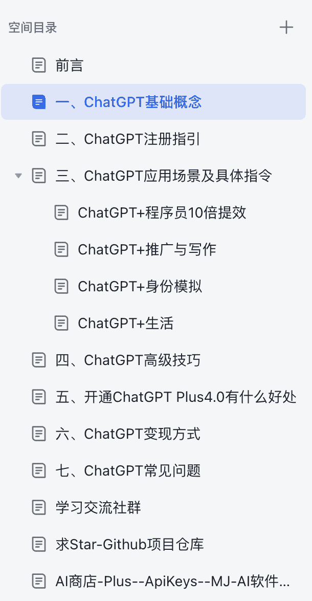
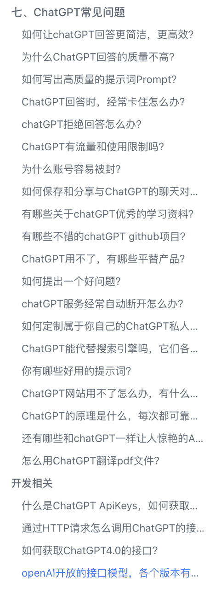
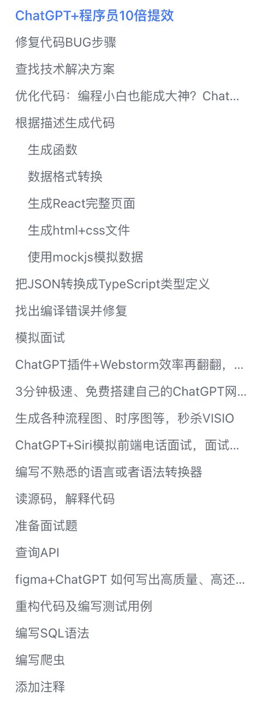
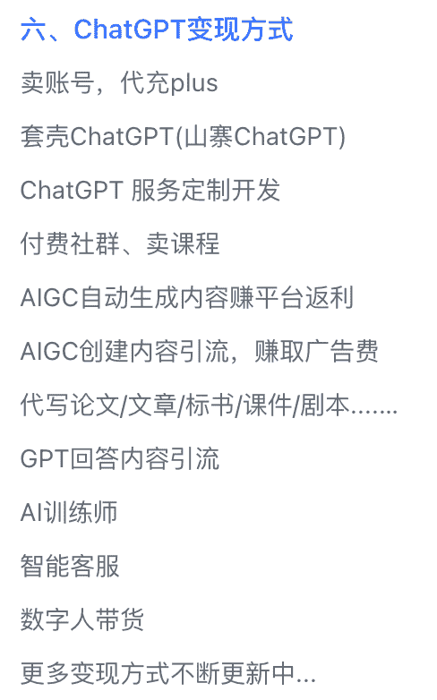
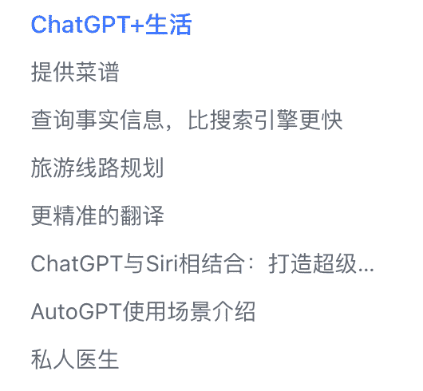

# ChatGPT 超神之路

# 前言

> 来源：[https://bwiny5w2svt.feishu.cn/docx/FtJqdunY3oc8kTxvoShccOTtnXk](https://bwiny5w2svt.feishu.cn/docx/FtJqdunY3oc8kTxvoShccOTtnXk)

## **为什么要做这个****ChatGPT****知识库，它有什么优势？**

+   【更系统】市面上关于ChatGPT的知识都太零散，不系统。此文档从gpt的基础原理、如何注册、使用技巧、如何开通plus、plus的优势及使用技巧、如何通过chatGPT变现等展开了详细的说明。

+   【更贴合职业视角】笔者结合自己在工作中对chatGPT的真实经验，总结了一套对程序员提效的方法。当然对其他职业也有帮助，比如：如何在生活上提效，如何在搜索上提效等。更接地气，可执行性强

+   【与GPT对话全展示】截取了完整的对话流程，让你深入理解里面的细节，仿佛你自己在亲身体验，更有体感。

+   【免费】市面上出现了很多培训的社群，年费大部分在 399-899元/位。有些甚至要好几千，有些人甚至都不是程序员出生，也不懂技术。就是为了蹭热度、宣传焦虑。

## 最强大ChatGPT知识库目录概览

## **为什么人人都应该学习****ChatGPT****?**

**雷军曾在**自传中说，自己人生中最大的感悟就是要：顺势而为。

而未来最大的势就是:AI人工智能。 chatGPT 就是普通人利用AI坐上时代顺风车的法宝，它赋予我们每个人强大的能力。 AI时代已经呼啸而来，没有坐上时代大潮车的人即将被时代淘汰。 假舟楫者非能水也，善假于物也。人与人之间差距，可能就在于细微的敏感度，小小的技巧而已。

##

## **为什么要加入社群？**

+   【获取ChatGPT最新技巧】此文档每日更新，在群里你可以获取到最新的内容。

+   【获得帮助】关于ChatGPT相关问题，可以在群里获得答案。

+   【获得资源】群内有很多交换资源的人，比如：工作介绍、资源互换、项目合作、寻找人才。

+   【ChatGPT plus 升级遇到问题】可以找群主代充，也节省自己的时间。

+   【免费福利】享受免费、不限量、不用注册、不用🪜的ChatGPT镜像站。ChatGPT超神之路，为群友独立部署的。地址见群公告

+   【免费线下沙龙】[**见往期沙龙记录**](https://bwiny5w2svt.feishu.cn/wiki/NKTwwAQfPi7FFwkG5g0cqy9kn4f?chunked=false)

## Github项目地址

是兄弟，就来**STAR**我！！！

## **猛戳** ==>  https://github.com/tuihou123321/chatGPT-tutorial

## 如何看待ChatGPT?

ChatGPT通过语义的交互方式来快速解决问题。

可以替代很多小工具

+   亲戚称呼计算器

+   json转TypeScript类型定义

+   文本检查及优化

+   ...

结合ChatGPT插件功能，颠覆app的使用方式

+   比如计划旅游方案后自动购买机票、订酒店、购买门票等。

+   年夜饭出计划方案，并自动采购食材，推送制作视频教程。

+   ...

** - ****ChatGPT****让每个普通人，不再平庸 -**

链接博主+免费AI社群+商务合作                                                      👸号：AI超体进化室

