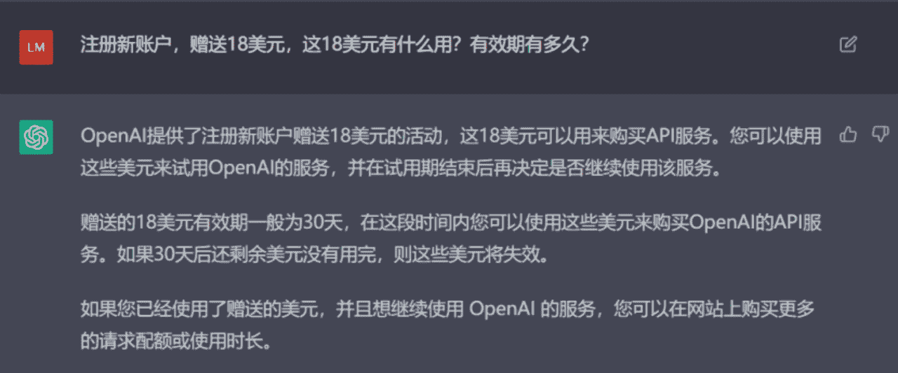
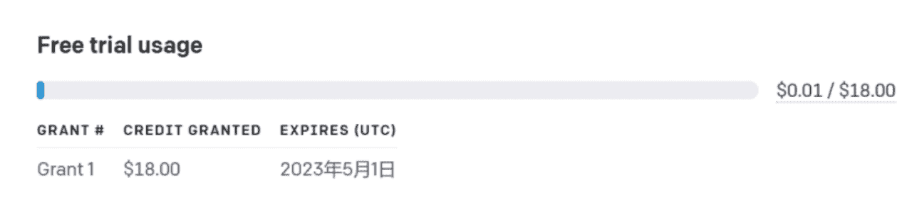

# GPT账号价目表

> 来源：[https://my.feishu.cn/docx/WNrcdTpXioT4saxjkO1cB6I9nID](https://my.feishu.cn/docx/WNrcdTpXioT4saxjkO1cB6I9nID)

**普通号**

18美金版本 46.8

5美金版本 26.8

**特殊号**

开发者账号 188

plus账号GPT4 售价255

# 不同类型账号的异同

**统一特征**

账号和QQ号类似 只要OpenAI不倒闭你就能一直使用，账号余额消费完也可以长期在ChatGPT机器人地址：https://chat.openai.com 使用，该网站免费且不消耗额度。

### **独享账号的好处**

1.  隐私安全有保障。 使用官网chat的时候，不会泄露隐私，因为只有你自己用，花小钱得安心！

1.  共享账号容易被封，太多人使用，乱七八糟。 OPENAI防滥用也很严格。

1.  独享账号和QQ号类似，只要OpenAI不倒闭你就能一直使用。

### 5美金版

要选择微软邮箱进行注册和登录，购买的账号含5美金 余额有效期4个月左右（适合小白用户和没API调用需求的用户）

### 18美金版

可以直接登录，购买的账号含18美金 余额有效期4个月左右 （适合有API调用需求的开发者）

### 开发者账号

开发者账号就是普通号里面有120美金，1个月到期（适合调用API频次高的开发者）

### plus账号

可以使用最新的GPT-4模型，调用的api也可以选择GPT-4（适合想体验最新版模型、追求访问稳定性的用户）

## API调用计费说明

使用计费说明 按回答内容计费 $0.02/1000 tokens 1个token是一个英文单词，一个汉字2个token

# **18美元账号和5美元有什么区别**

你要编程，才用得到API,你只使用如上图所示的ChatGPT聊天，用不到API，在现阶段是不收费的，后续如何要看OpenAI的产品经理说了算。

如果，你觉得18美元不够用，可以用完了又来买，或者本店有内含120美元的单个账号