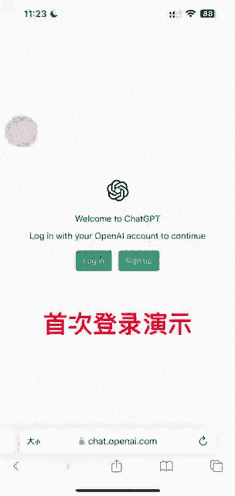
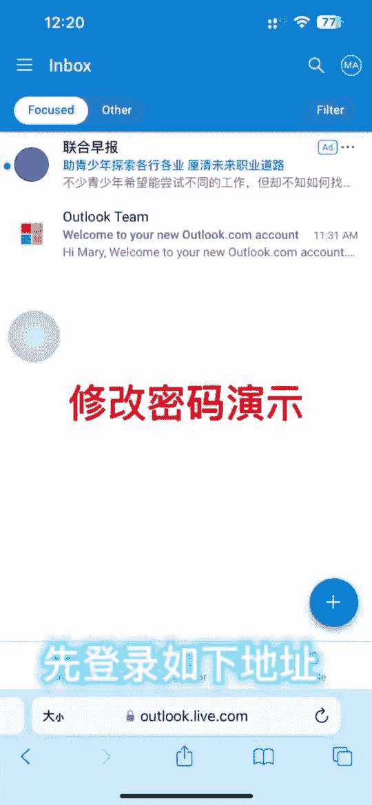
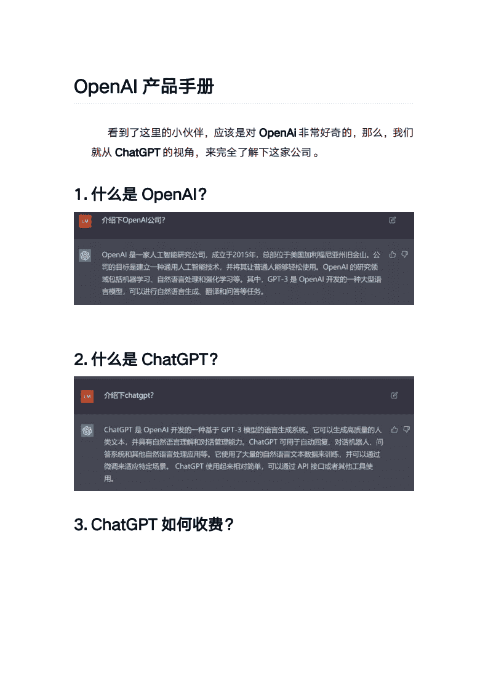

# 5美金版使用说明

> 来源：[https://my.feishu.cn/docx/UlU0dYjimoFeSox0SDdcwLK2nrd](https://my.feishu.cn/docx/UlU0dYjimoFeSox0SDdcwLK2nrd)

> **特别提醒：**

> 只能一人一号登陆（最多两个设备），多人共享，异地登录会被秒封号

> 因为这个原因导致的封号，售后概不负责。

# 登录操作

[5美金版登录演示.mp4](https://internal-api-drive-stream.feishu.cn/space/api/box/stream/download/all/boxcnkY2kaypPgM1vrgxZn1wfxb)

请严格按照上述视频进行登录操作，否则可能登录异常

# 如何修改密码

[修改密码操作.mp4](https://internal-api-drive-stream.feishu.cn/space/api/box/stream/download/all/boxcnV0rCcsQWnuagHvrbijZjvf)

打开https://outlook.live.com/owa/ 使用邮箱账号与邮箱密码登录。 然后去https://openai.com/login 找回密码 收到邮件后 重新设置密码 。也可以按照视频上的操作进行密码修改。

# 账号锁定怎么处理

如果账号显示锁定，客户用自己的手机号进行解锁就好了。因为邮箱是提前注册的，gpt是当天注册的，邮箱长时间不登录会锁定，其他客户也有碰到类似的问题，这属于是正常现象。

# 附件：

[OpenAI产品手册.pdf](https://internal-api-drive-stream.feishu.cn/space/api/box/stream/download/all/boxcn8GuoNa1Ed938yfNteCviug)