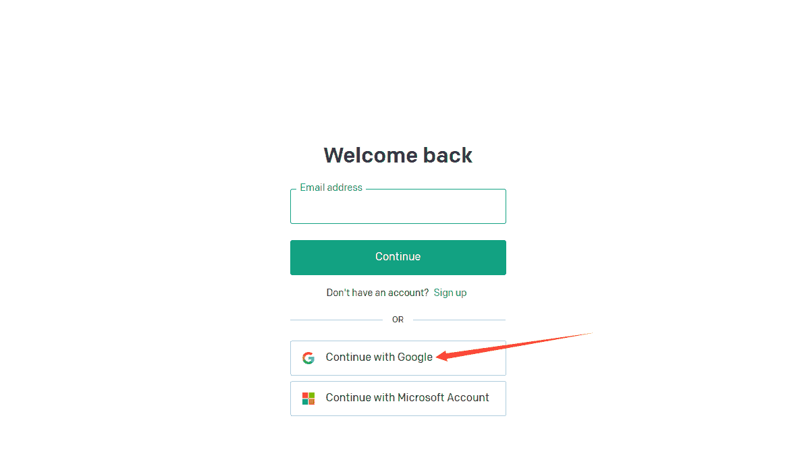
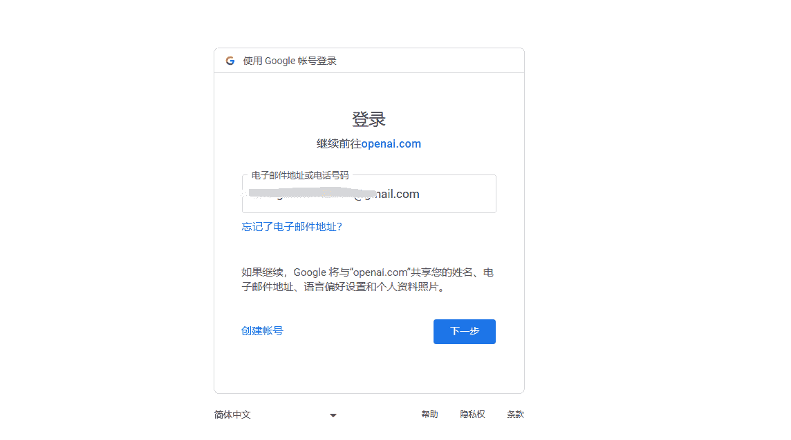
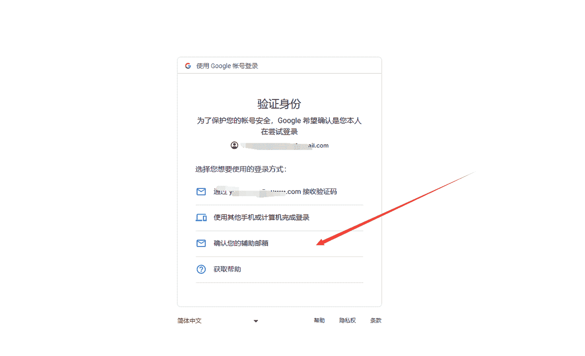
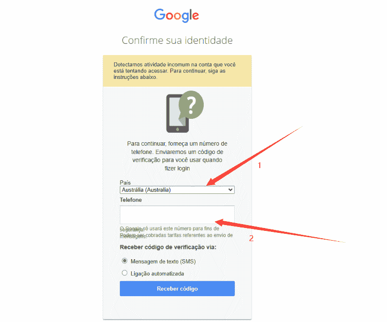
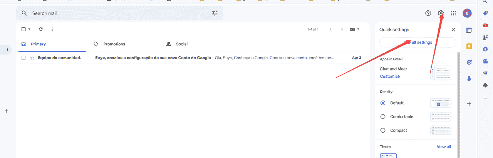
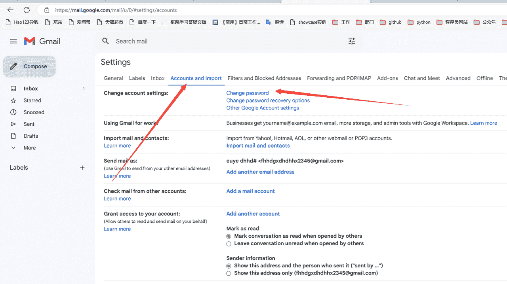
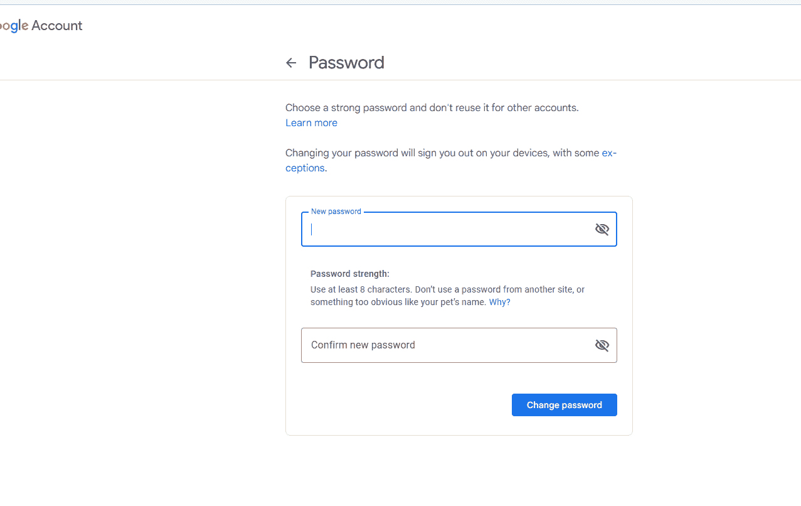

# ChatGPT 登录教程-谷歌邮箱

> 来源：[https://my.feishu.cn/docx/UHLbd00TOoYyZIxj6NocF9xVnVd](https://my.feishu.cn/docx/UHLbd00TOoYyZIxj6NocF9xVnVd)

# 打开登录地址：https://chat.openai.com/auth/login

1.  **点击谷歌授权登录**

1.  **输入谷歌邮箱和密码**

**第一次登录会需要你进行验证身份，你可以使用辅助邮箱进行**验证，用卡密最末尾的辅助邮箱验证就可以了

> **记住：这里是点****确认你的辅助邮箱**，然后把辅助邮箱的信息复制进去即可

1.  如果登录过程中出现需要手机号码验证的情况，你只需要

①处选择中国（china）

②处填写自己的手机号码验证即可。

# 邮箱改密码，邮箱登录地址：https://mail.google.com/mail

