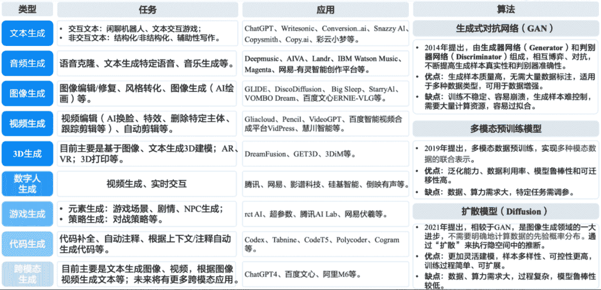
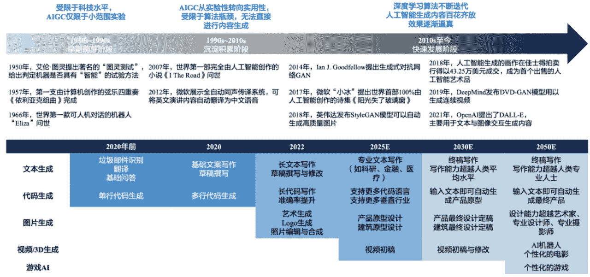
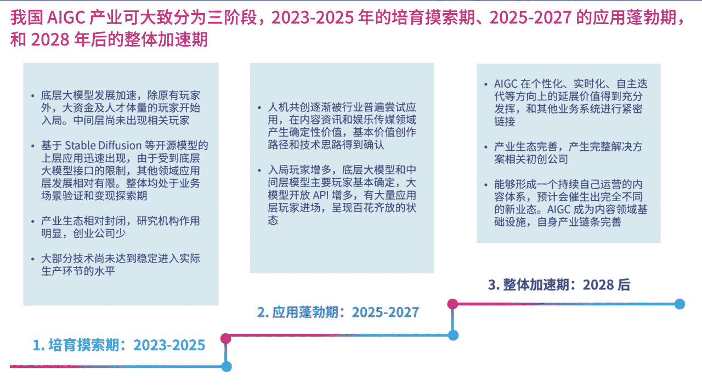
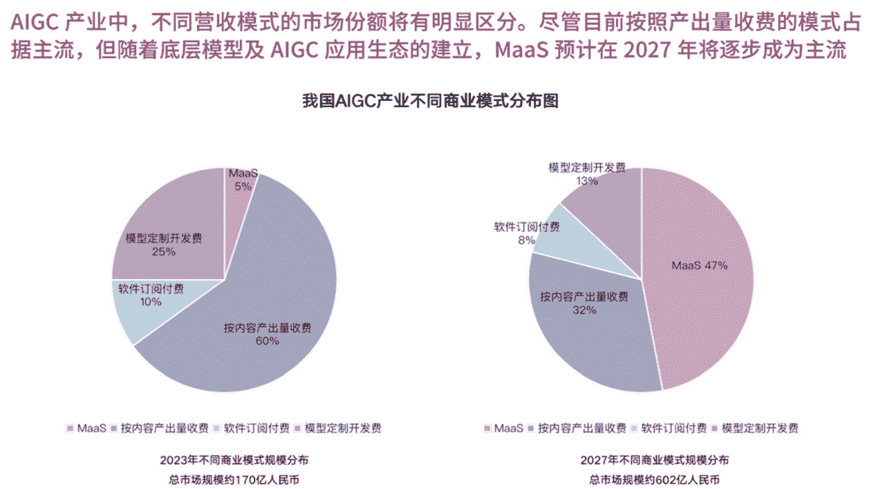
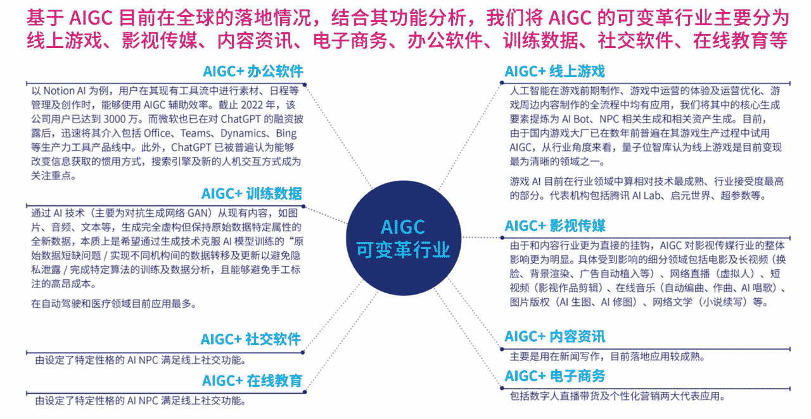

# AIGC入门介绍

> 来源：[https://my.feishu.cn/docx/P8EFddI4GonrwTxcIaWcdJcRnNf](https://my.feishu.cn/docx/P8EFddI4GonrwTxcIaWcdJcRnNf)

# 基本概念

AIGC即AI Generated Content，是指利用人工智能技术来生成内容，AIGC也被认为是继UGC、PGC之后的新型内容生产方式，AI绘画、AI写作等都属于AIGC的分支。

进一步理解时，AIGC有狭义和广义概念之分。

狭义的AIGC与普通用户更为贴近，更关注图像、文本、音频、视频等内容生成，和Generative AI（生成式AI） 、Synthetic media（合成式媒体）等概念类似。

论广义概念，还包含策略生成（如Game AI中游戏策略生成）、代码生成（GitHub Copilot）、蛋白质结构生成等。

# AIGC发展历程

# AIGC产业发展阶段

目前，我国还处于AIGC发展的初期阶段，竞争趋势不明显，需要调整开发、资金等投入，寻求整体生态的快速搭建。至2030年，AIGC产业发展共分三个阶段：

1、**培育摸索期**（2023—2025）：整体均处于业务场景验证和变现探索期。

底层大模型发展加速，中间层尚未出现相关玩家，基于Stable Diffusion等开源模型的上层应用迅速出现，但受底层大模型接口限制，大部分技术尚未达到稳定进入实际生产环节的水平。

2、**应用蓬勃期**（2025—2027）：基本价值创作路径和技术思路得到确认。

行业普遍尝试应用人机共创，且内容资讯、娱乐传媒等领域利用AIGC产生确定性价值。这一时期，底层大模型和中间层模型主要玩家基本确定，开放API增加，整体入局玩家增多，尤其是大量应用层玩家。

3、**整体加速期**（2028—2030）：产业生态完善。

报告指出，2028年往后，AIGC在个性化、实时化、自主迭代等方向上的延展价值得到充分发挥，和其他业务系统进行紧密连接，会有相关初创公司产生完整解决方案。这一阶段AIGC成为内容领域基础设施，预计会催生出完全不同的新业态。

# AIGC商业化的5种营收模式

全球AIGC赛道持续走热，如何跑通商业模式产生实际营收，成为市场另一个关注焦点，目前来看一共有5种不同的营收模式：

1、MaaS (Model as Service)

适用于底层大模型和中间层进行变现，按照数据请求量和实际计算量计算。到2027年，MaaS模式占市场规模比例将从5％增长至47％。

**2、按产出内容量收费**

适用于应用层变现，如按图片张数、请求计算量、模型训练次数等收费。到2027年，该模式市场规模占比将从60％下降至32％。

该模式的关键在于如何从单次好奇驱动的行为切入，保证产品长期的复购率。

整个过程会受到具体属性影响，如版权授予（支持短期使用权、长期使用权、排他性使用权和所有权多种合作模式，拥有设计图案的版权）、是否支持商业用途（个人用途、企业使用、品牌使用等）、透明框架和分辨率等。

**3、软件订阅付费**

第三种模式即ChatGPT Plus现有的盈利方式之一：每月向用户收取20美元费用。该模式在现有市场占有10％左右的比例。按照这种模式，Jasper等初创企业已经产生了营收。展开来说，Jasper以类SaaS服务的形式进行收费，分为初级、高级和订制三个模式，成立当年营收额就达到4500万美元，并收获了7万名用户。

这意味着AI正以越来越显性的方式产生商业模式。国内部分领先的AIGC公司，在用户规模、内容生成量上在2022年亦快速起步，2023年开始产生营收及盈利并非难事，但能否形成SaaS订阅模式尚待观察。

**4、模型训练费用**

即最为传统的项目开发制度，如今占据市场营收份额的25％，到2027年，预计将有12％左右的下滑。

**5、其他模式**

包括广告／流量模式，依靠产品获取用户点击，从中获得广告流量，这种营收模式的关键在于产品如何获得复购。由于属于小型项目，在市场规模测算中暂不单独考虑。

# AIGC对不同行业的变革影响

首先是**线上游戏行业**，它目前在AIGC领域中算相对最成熟、接受度最高的部分。

其应用从前期制作到后期运营以及游戏周边内容制作的全流程中均有涉及。其中的核心生产要素为：AI Bot（游戏操作策略生成）、NPC相关生成（包括逻辑和剧情）和相关资产生成（包括地图等）。

报告认为，这一行业是**目前AIGC变现最为清晰**的行业。

接下来是**影视传媒**，由于它和内容挂钩更为直接，AIGC对这一行业的整体影响更为明显。

具体受影响的细分领域包括电影及长视频（换脸、背景渲染、广告自动植入等）、网络直播（虚拟人）、短视频（影视作品剪辑）、在线音乐（自动编曲、作曲、AI唱歌）、图片版权（AI生图、AI修图）、网络文学（小说续写）等。

**内容资讯行业**则不必多言，主要是在新闻写作，目前落地应用也已较成熟。

**电子商务行业**也会受到影响，主要来自数字人直播带货及个性化营销这两方面。

**办公软件行业**同样受到冲击。最具代表性的当属微软Office全家桶的Copilot功能了，它被誉为一项“重新发明生产力”的重磅更新。

除此之外，相关独角兽企业如Notion AI也表现出色，截止2022年，该公司用户已达到3000万。

最后会引起变革的行业还包括训练数据（主要集中在自动驾驶和医疗行业）、社交软件（比如用特定性格的AINPC设定满足线上社交功能）和在线教育等。

