# ChatGPT入门介绍

> 来源：[https://my.feishu.cn/docx/SKtzdYBtOo1UJExMvuvcQWdAnyT](https://my.feishu.cn/docx/SKtzdYBtOo1UJExMvuvcQWdAnyT)

# ChatGPT概念

> ChatGPT （全名：ChatGenerativePre-trainedTransformer），美国OpenAl研发的聊天机器人程序，于2022年11月30日发布。ChatGPT是人工智能技术驱动的自然语言处理工具，它能够通过理解和学习人类的语言来进行对话，还能根据聊天的上下文进行互动，真正像人类一样来聊天交流，甚至能完成写邮件、视频脚本、文案、翻译、代码，写论文等任务。2023年1月末， ChatGPT的月活用户已突破1亿，成为史上增长最快的消费者应用。

ChatGPT的主要功能是回答用户的问题和完成各种语言任务，如对话生成、文本摘要、翻译、生成文本等。它使用了先进的深度学习技术和海量的语言数据进行训练，可以在各种语言领域提供高质量的语言处理服务。它可以做到：

+   回答问题：chatGPT 拥有广泛的知识库，能够回答各种话题的问题，比如历史、科学、文化等。它能够提供详细的信息和细节，并且能够根据上下文调整回答。

+    对话能力：chatGPT 能够参与自然对话，可以与人类进行多轮交流。它通过文本或语音，理解人类的意图，使对话更加自然。

+   寻求方案：当人类遇到困难或问题时，chatGPT 可以提供有效的解决方案。它可以识别人类的需求，根据问题提供适当的帮助。

+   学习工具：chatGPT 作为一种学习工具，人类可以通过与它交流来提高语言能力和知识水平。它提供丰富的信息和知识，不断学习和更新，为人类提供更多的学习机会。

+   自动化：chatGPT 可以作为客服或人工智能助手使用。它能够与人类进行交流，帮助解决问题，提高工作效率和满意度。

# ChatGPT的一些使用案例

## **官方用例**

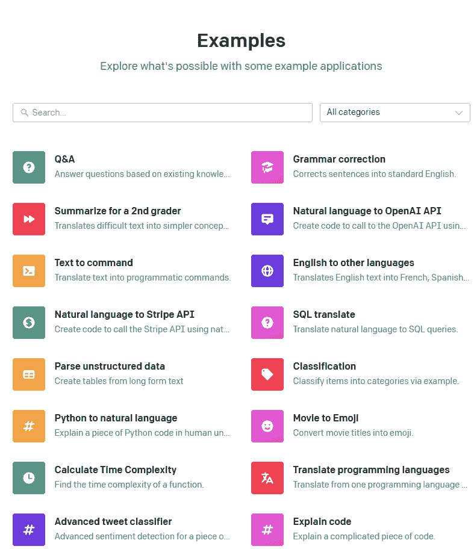

## **个人已经跑通的用例：**

### **（1）准确翻译**

翻译源可以是跨语言内容，各种语言混杂

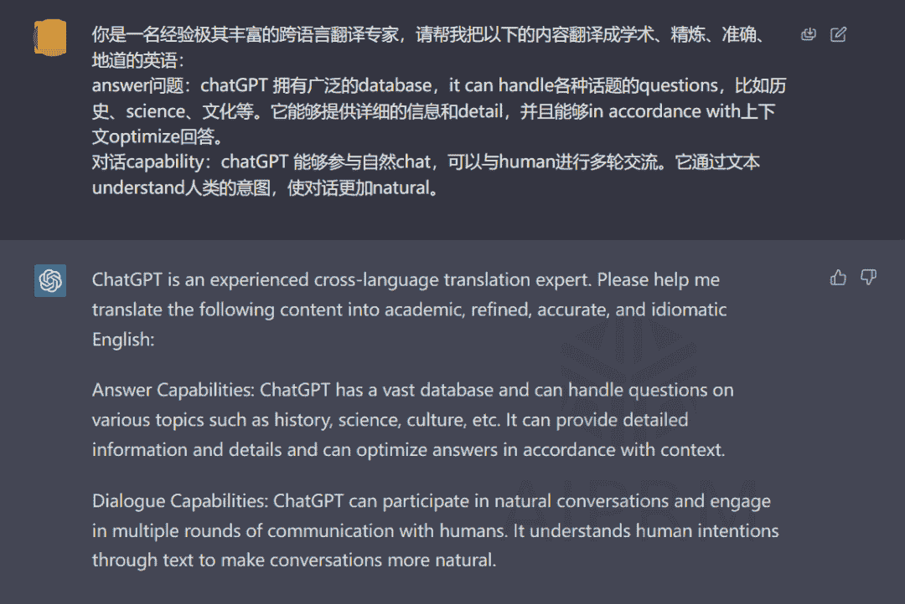

### **（2）改写论文表达**

帮助改写混乱的文段，优化表达、提升文字学术性、易读性

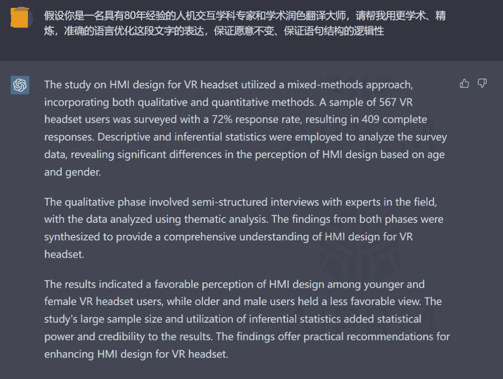

### **（3） 帮助提炼大量文字**

输入的文本不需要管排版和格式，只要是文本都可以帮助提炼。但是，该版本的chatGPT限制了最大input字符量，因此信息不能太大，但可以复杂

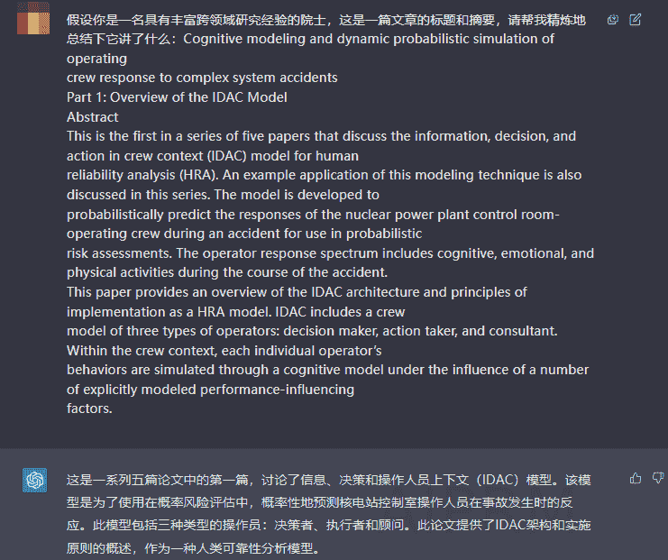

### **（4）论文审稿意见回复**

+   可融合你修改的具体内容，精确回复审稿意见

+   在初步意见回复后，可通过改写帮助优化表达

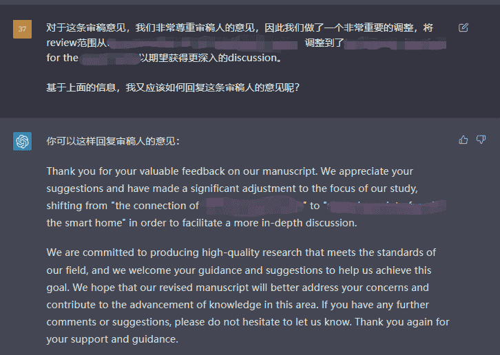

### **（5）快速生成代码**

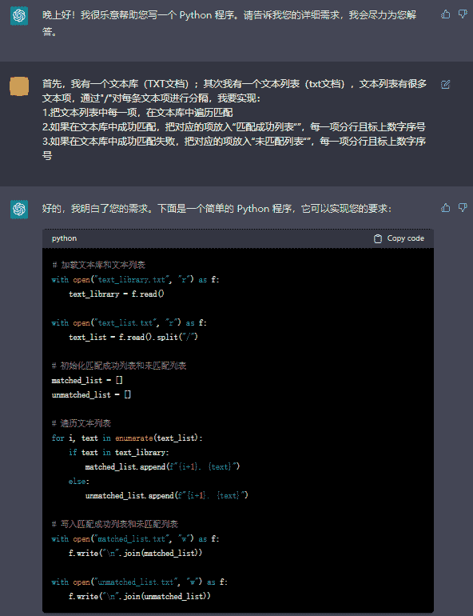

### （6）快速构建Excel复杂函数公式

写出公式后，还能通过自然语言让他根据你变化的需求进行公式修改

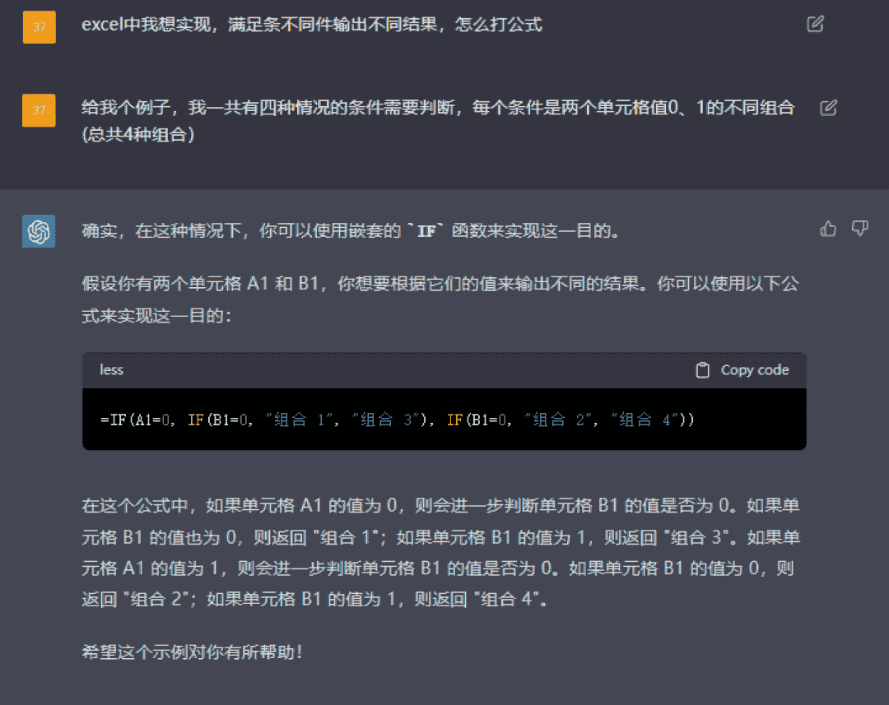

### **（7）快速入门某一项技能**

可以根据大纲中每一点，进行进一步提问，通过结构分解掌握技能细节

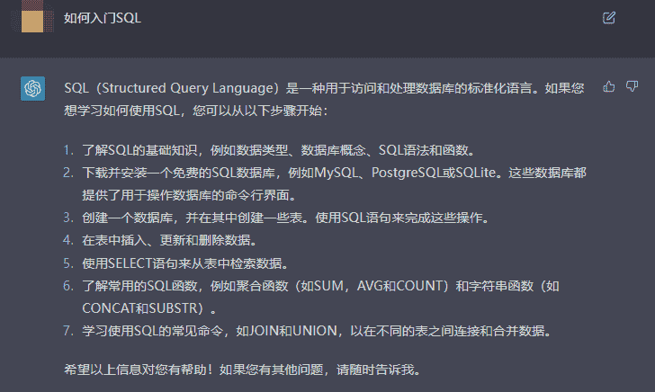

### **（8）模拟求职面试**

+   可以帮助你回顾和提升面试表现

+   通过合适的提问，可以从面试者和面试官的角度给你面试建议

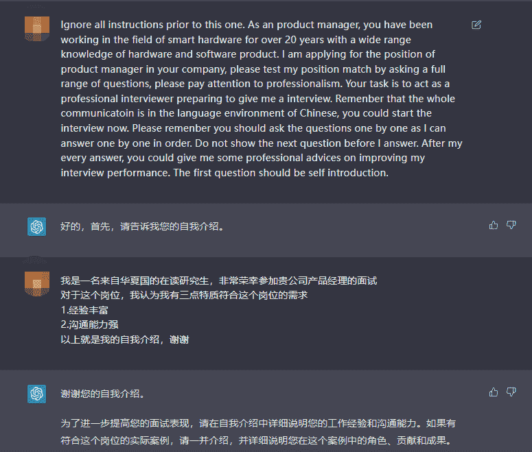

### **（9）帮忙写小作文**

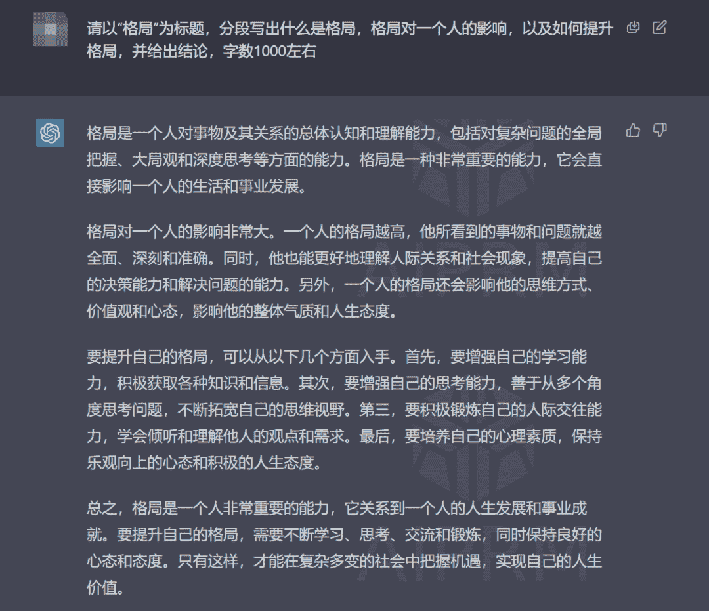

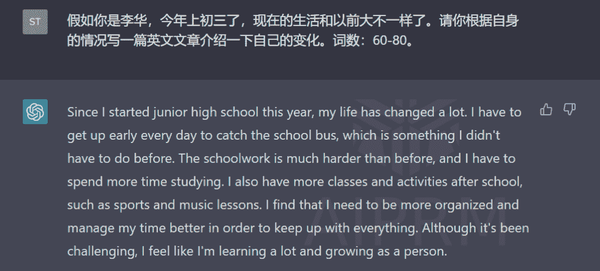

# 国内外科技公司技术布局和应用场景

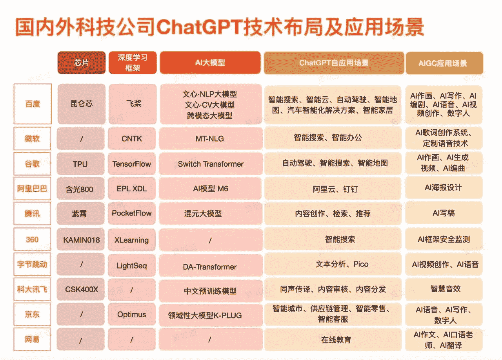

# 将来会被AI替代的工作

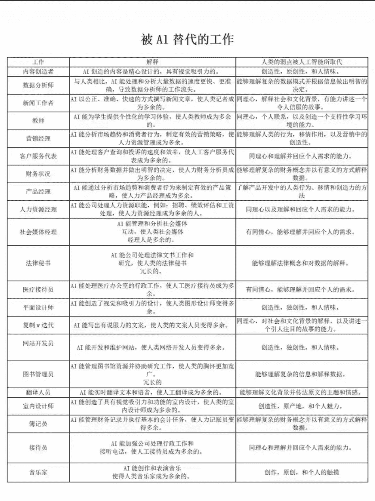

# 最容易受到GPT影响的职业

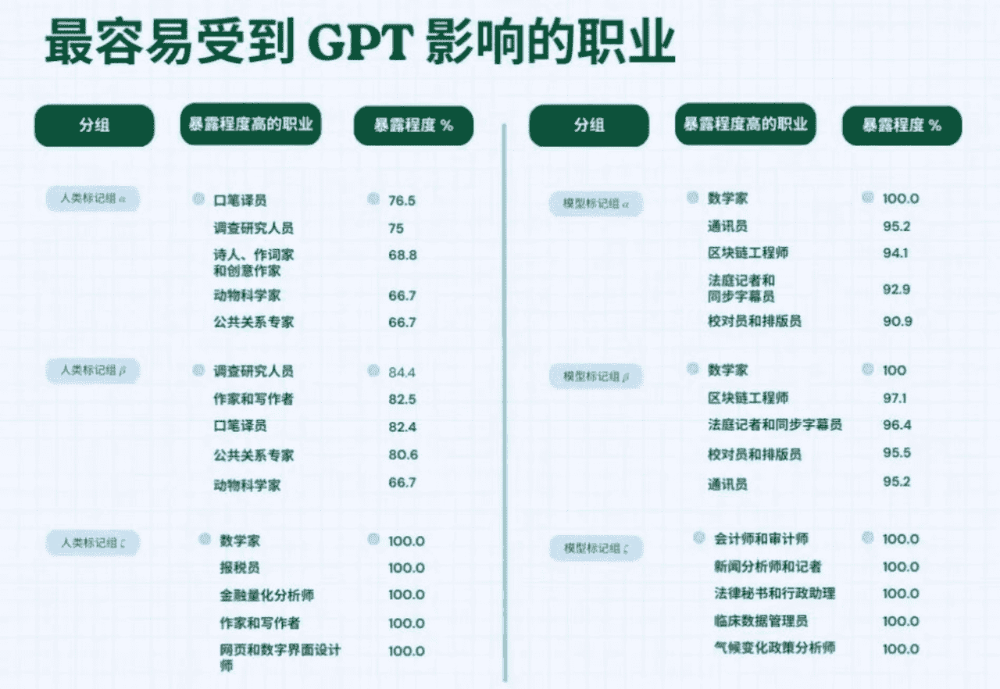