# ChatGPT 常见问题及解放方法（解决 98%以上的问题）

> 来源：[https://my.feishu.cn/docx/KTOFdKYW8o3iCHxZ7DCcNVhlnod](https://my.feishu.cn/docx/KTOFdKYW8o3iCHxZ7DCcNVhlnod)

# 账号使用说明

[账号使用说明](https://nqa5sj7i45.feishu.cn/wiki/wikcnO6KvtF8WY0aPT1AVystUhf)

# 故障处理大全

**最简单的修复方法：先重试，等待 **5 分钟，刷新，换浏览器，使用隐私模式。

**最简单的修复方法：先重试，等待 **5 分钟，刷新，换浏览器，使用隐私模式。

**最简单的修复方法：先重试，等待 **5 分钟，刷新，换浏览器，使用隐私模式。

一次完整的访问，无非就是五个元素参与其中

分别是梯子、IP、浏览器、设备、服务器

登陆不上，无非就是五个元素中的**至少一个不行**

有时候 OpenAI.com 不能登

但直接登录聊天页面 https://chat.openai.com 却可以使用

首先复制 https:/**/**chat.openai.com 到浏览器进行登陆

## 账号锁定怎么处理

如果账号显示锁定，客户用自己的手机号进行解锁就好了。因为邮箱是提前注册的，gpt 是当天注册的，邮箱长时间不登录会锁定，其他客户也有碰到类似的问题，这属于是正常现象。

## 无法向此号码发送短信

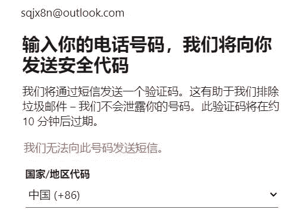

微软服务可以不用 T 子也能访问，关掉代理以后再次尝试就好了。如果不行关掉浏览器再打开。

## 登录时报错显示不在特定的国家地区

"显示不在特定的国家地区" 请使用国外 ip 全局模式+浏览器无痕模式 独享账号一旦售出 无法找回 所以概不退款 以下国家 IP 不支持使用 中国（包含港澳台） 俄罗斯 乌克兰 阿富汗 白俄罗斯 委内瑞拉 伊朗 埃及

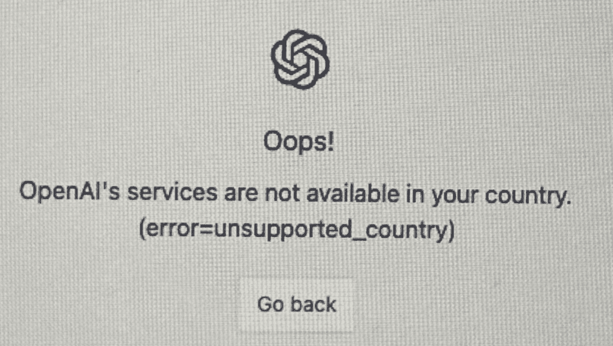

Country unsupported，意思是地区不支持，这是梯子不行

原因：OpenAi 限制了**某些地区**的访问，你需要告诉他，你不是来自那些地区

建议：

1.  确保梯子打开，以可以打开 YouTube.com 为证

1.  确保你的 IP，**不是香港、台弯、俄罗斯**

1.  还是不行，那确保把梯子的全局模式打开再试

1.  全局模式打开还是不行，就重开浏览器、换个浏览器再试

1.  还是不行，就咨询梯子供应商或者换梯子

## 服务器不行（等等）

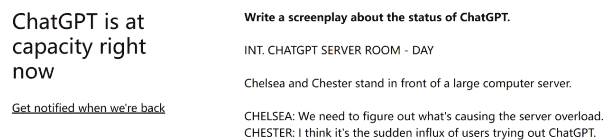

**Capac**ity 的意思，就是服务器满了，这是服务器不行

**原因：**太火爆了，官方已经扩容很多次了，也挡不住大家的热情

**温和建议**：半个小时过后再试

**激进建议**：换 IP 重试（这个不一定能行，有可能挤进去），记得换 IP 了同时重开或者换浏览器

目前已出 Plus 账号，Plus 号在这种情况下，可以直接进。

## Access denied（IP 不行，换个节点）

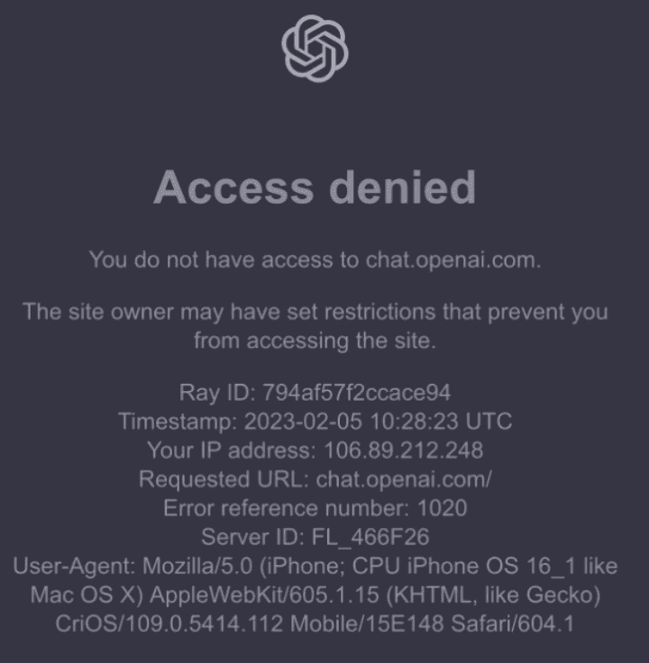

**Access** denied，意思是访问被拒绝，这是 IP 不行。

**IP 不行有三种可能：**

1.  如果**不能打开**其他外网，那就是梯子问题，首先需要能开 YouTube

1.  如果**能打开****外网但显示这个错误，首先检**查你的 IP，不能是香港、台弯、额罗斯。然后再打开全局模式（梯子设置里面选），以及浏览器无痕模式

1.  如果还不行就是因为服务器压力太大，必须要对某些 IP 访问量太大的 IP 进行限制，很不幸，就选中了你的 IP。

建议：你需要做的就是，告诉服务器，你其实来自一个请求量小的 IP，不会给他造成太大的麻烦。

**假设 ChatGPT 是一家**餐馆，当客人满了，它就只能对外挂牌 Access denied。有趣的是，它有很多个门，每一个 IP 就是一个门。你需要做的就是，尝试从没有挂牌的 IP 进行访问。

说白了，就是换 IP，然后往里面硬挤（每换一次，要关闭浏览器，重新登陆），所谓换 IP，在梯子中选择其他地区就算是完成了一次换 IP 操作。

## 没有输入密码的窗口

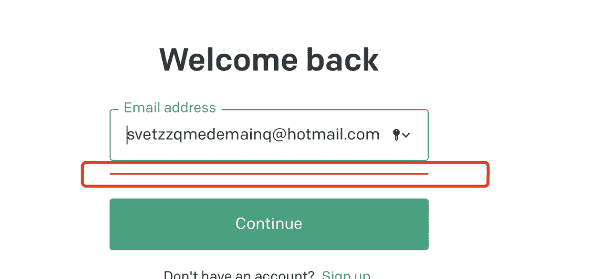

输入框下边是一条横线，这是网速太慢了，验证码没加载出来等、或者点 continue 重新发起请求

## we ran into while authrnticating

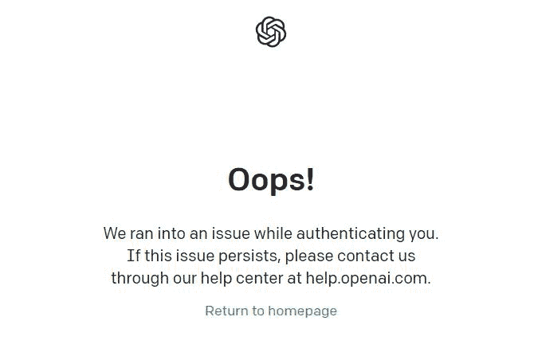

很不幸，封号了。

只能一人一号登陆（最多两个设备）

​多人共享，异地登录会被秒封号

要注意

## 发生错误、wrong、Hey there

都是服务器崩溃

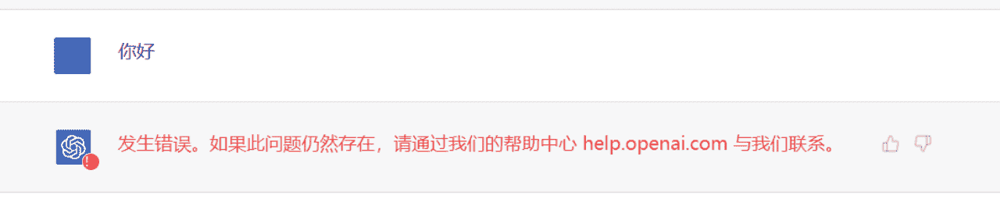

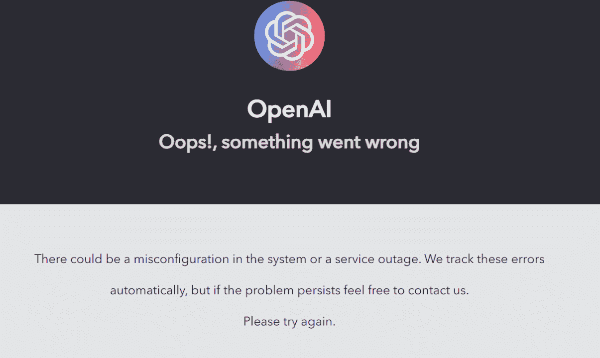

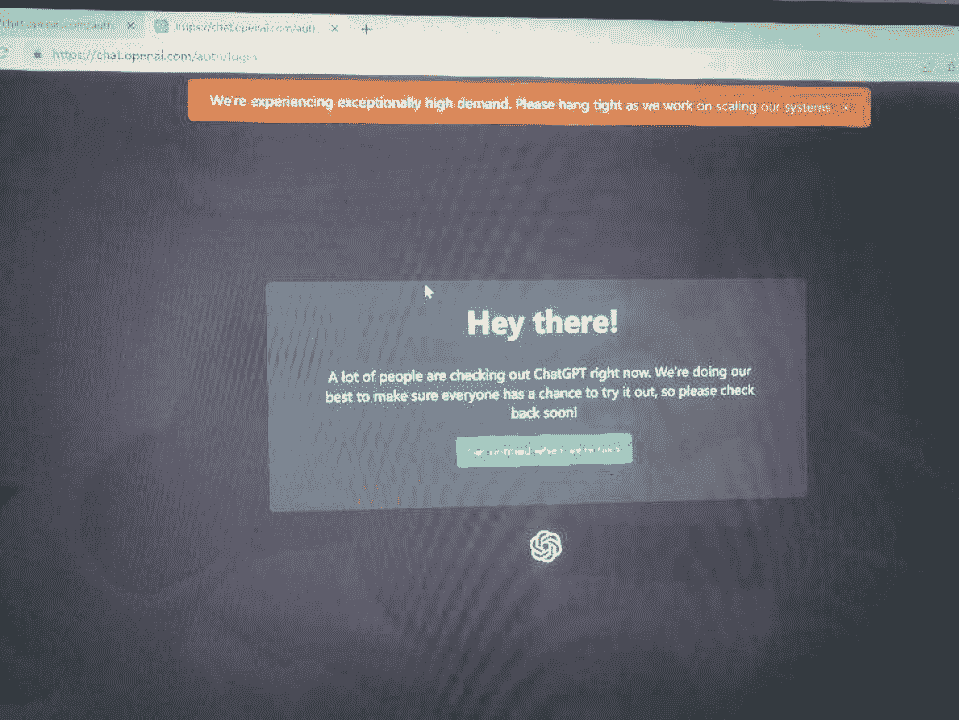

## Enter your password

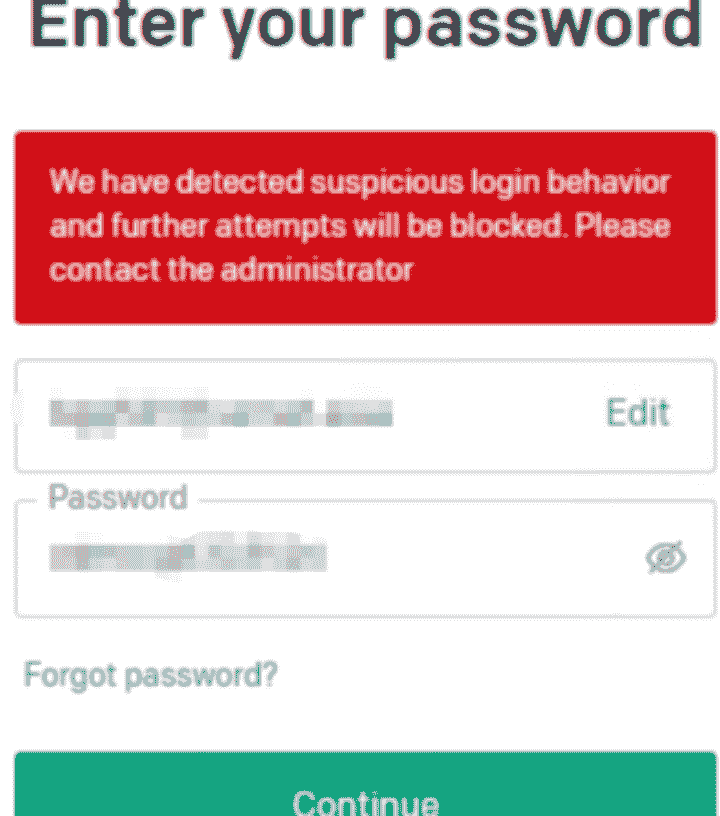

IP 被 openai 封，用这个 ip 的人太多，换个节点（你的梯子有很多人在用共一个节点访问 GPT）

这不是号的问题，一定注意。

翻译过来就是：我们检测到可疑的登录行为，将阻止进一步的尝试。请联系管理员

提示这个错误，很的朋友会以为是密码错误，其实并不是密码错误，而是因为某些风控原因，阻止了你登陆

ChatGPT 登陆出现 We have detected suspicious login 的解决方法

1.首先，这个不是密码错误，不用纠结密码的问题

2.出现这个错误后，不用继续尝试登陆了

3.清除浏览器缓存，然后更换其他节点 IP，再次尝试，直到不弹，如果不弹这个错误，那就说明这个节点可以登陆成功了

## **换了 IP 发现不行**

**那么，我们就像是生病了得治，可以先试**试偏方，偏方不行再去医院详细检查五脏六腑。

### 偏方 1：

1：先**关闭梯子，**然后刷新刚才的界面

2：打开 https://chat.openai.com/，输入账号，过验证码，输入密码，注意，输入密码之前又打开梯子

3：这时候，登录依然显示错误 1020，再次关闭梯子，刷新就可以进入

4：刚才说的是关闭梯子，如果不行，就换成关闭全局代理又打开全局代理

5：偏方不行，就看后面的科学诊断

### 偏方 2：

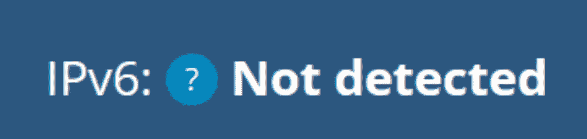

1：关闭电脑的 IPV6。（具体方法，在百度搜索你电脑的牌子和系统+关闭 IPV6）

2：关闭梯子的 IPV6

3：https://whatismyipaddress.com，在这个网址查询看 IPV6 是否关闭

如图显示，Not detected 表示已关闭

3：尝试重新登录

### **科学诊断：**

上面说的“换 IP”，三个字说得轻巧，其实所有问题都出在这里

我们**以为换好了**，但是服务器收到的是**没有换好**

你折腾了一大圈，实质上并未完成换 IP 的操作

什么原因呢？

原因就是，我们的信息传递，**要经过介质****，是介质造成****了****信息误判**。这个介质就是，浏览器、设备和网络通道。

浏览器和设备有一些复杂的网络协议。我们没办法，在协议层去检查我们 IP 换成功没有，只能通过表象来判断。（有时候，IP 查询没换成功，但是可以登录。有的时候，查询换成功了，但是无法登录）

我们唯一能做的就是，通过控制变量，来看是不是浏览器和设备的问题，我经常是同样的梯子，在 A 浏览器不行在 B 就可以，在 C 设备不行在 D 就可以，具体原因我们没有能力也没有精力去排查。

**那么，你每完**成一次**换 IP**，将浏览**器关闭重**新打开，甚至**清理缓存，甚至**开无痕模式，还是不行就换一个浏览器，目的是让服务器理解我们确实是发起了另外的一个请求。

**本质上，每一次更****换过后发起请求，我们就是往里面挤，就像去机场给明**星接机一样，勇敢地多尝试着往里面挤，总有可以获得和明星的近距离接触机会。

** **

到此，已经解决了 95%的无法登录问题了

如果还不行

就换网络，比如说新连接一个 WiFi 或者是手机开热点重试以上步骤

** **

到此，已经解决了 99%的无法登录问题了

如果还不行

就换设备，在新的设备**同样执行**换 IP 和换浏览器操作

**这**很关键，凭经验，梯子不行的情况占 20%，浏览器和设备不行的占据 80%，一定要非常认真得换浏览器和设备

当你梯子开了全局模式，换了 3 个浏览器，3 个设备还是不行，那就只可能是梯子的问题了

**这个**，只能靠自己，通过以上的原理，逐步排除问题。不要将您的尝试步骤和反馈告知客服，客服也无可奈何，这只会更耽搁您的时间。因为每个人的设备和网络环境不同，客服也无法深入网络层进行问题排查。

## 账号密码错误

**如果提示账号密码错误，检查自己是**否按照下面所示登录，也就是授权登录方式。

** **

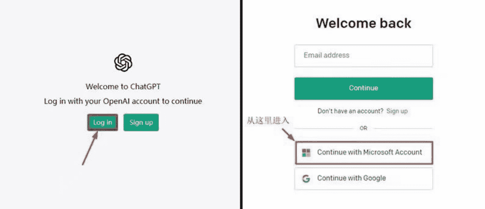

另外，邮箱和密码都没有前后空格，一定要注意。

**如果还是提示错误，那么在登录页面**点击忘记密码，然后进入邮箱查看邮件改密。

邮箱是微软邮箱，进入之后像你以往改密那样，点击链接改。

# 登录成功后遇到的问题

##  话说一半

在一次对话中，你感觉他还没说完，打“继续”，他会接着说

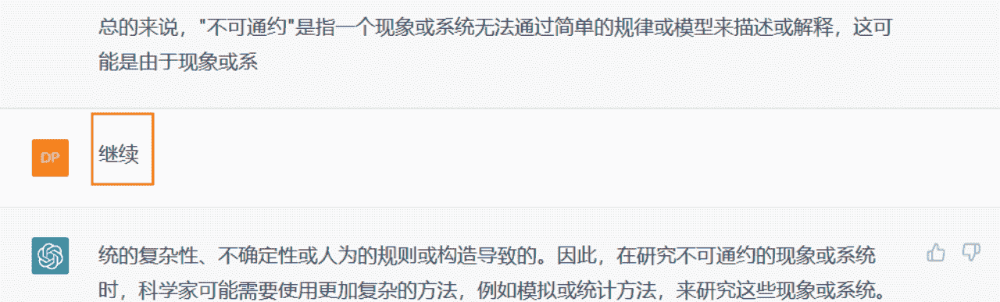

##  残缺不全（关闭浏览器的自动翻译功能）

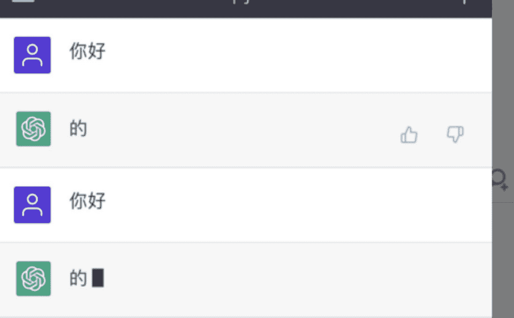

只回答一个“的”字，请关闭浏览器的自动翻译功能

## 没有退出或者升级按钮

关闭浏览器的自动翻译功能，你的自动翻译会挡住那些按钮。