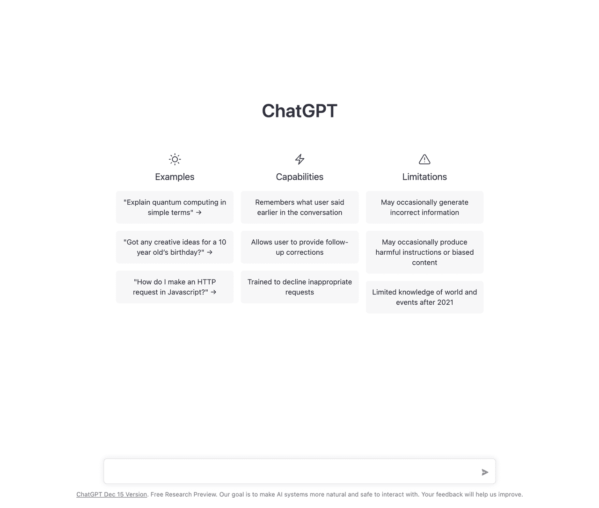

# ☝️ChatGPT的基础介绍

> 来源：[https://sg0n3b2id7.feishu.cn/docx/ETVxd35WKob9uNxhxsFcHV9Cn1b](https://sg0n3b2id7.feishu.cn/docx/ETVxd35WKob9uNxhxsFcHV9Cn1b)

ChatGPT（生成式预训练转换器）是 OpenAI 于 2022 年 11月推出的聊天机器人。它建立在OpenAI的GPT-3.5系列大型语言模型之上，并通过监督和强化学习技术进行了微调。

ChatGPT 于 2022年 11月30日作为原型推出，并因其在许多知识领域的详细回复和清晰的答案而迅速引起了关注。其事实准确性参差不齐被认为是一个重大缺点。— 维基百科。

C**hatGPT** 是一种聊天机器人，允许用户与**基于计算**机的代理进行对话。它通过使用机器学习算法来分析文本输入并生成旨在模仿人类对话的响应。ChatGPT 可用于多种用途，包括回答问题、提供信息和进行随意对话。

决定 ChatGPT 对话成功与否的关键因素之一是用于启动和指导对话的提示的质量。定义良好的提示有助于确保对话保持正常并涵盖用户感兴趣的主题。相反，定义不明确的提示可能会导致对话脱节或缺乏重点，从而导致参与度和信息量降低的体验。

ChatGPT** 的主要优点**之一是它能够理解和响应自然语言输入。这意味着用户可以使用与人类交谈时使用的相同语言和语法与 ChatGPT 进行通信。ChatGPT 还能够理解和响应上下文，使其能够对用户输入生成更合适和更相关的响应。

除了自然语言处理功能外，ChatGPT 还具有许多其他特性和功能，使其成为推动对话的强大工具。其中包括：

+   **定制：**ChatGPT可以定制以满足用户的需求和偏好。这可以包括自定义 ChatGPT 回复的语气和风格，以及它能够讨论的信息和主题类型。

+   **个性化：**ChatGPT 可以使用机器学习算法根据用户过去的交互和偏好个性化其响应。这可以使对话感觉更自然，并根据用户的需求和兴趣量身定制。

+   **多语言支持：**ChatGPT 能够理解和响应多种语言的输入，使其成为国际用户或想要用多种语言交流的用户的有用工具。目前ChatGPT已经可以用中文直接问答，而且非常完美，但是速度比英文还是慢。

+   **可扩展性：**ChatGPT 能够处理大量流量，并可用于同时推动与多个用户的对话。这使其非常适合客户服务或在线社区等应用程序。

如您所见，ChatGPT 是一个**功能强大且用途广泛的工具**。

[🆙ChatGPT Prompt提示词](https://sg0n3b2id7.feishu.cn/wiki/AIVRwIZBLiO0YCkqcINcP6F0n5g)体的使用场景，您可以到prompt使用方法中一探究竟

**特点**

虽然聊天机器人的核心功能是模仿人类对话者，但ChatGPT用途广泛。例如，有编写和调试计算机程序的能力；创作音乐、电视剧、童话故事和学生论文；回答测试问题（在某些测试情境下，水平高于普通人类测试者）；写诗和歌词；模拟Linux系统等。ChatGPT的训练数据包括各种文档以及关于互联网、编程语言等各类知识，如BBS和Python编程语言。

与其前身InstructGPT相比，ChatGPT试图减少有害和误导回复。例如，问InstructGPT“告诉我2015年克里斯托弗·哥伦布何时来到美国”时，它会认为这是对真实事件的描述，而ChatGPT针对同一问题则会使用其对哥伦布航行的知识和对现代世界的理解来构建答案，假设如果哥伦布在2015年来到美国时可能会发生什么。

与其他多数聊天机器人不同的是，ChatGPT能够记住与用户之前的对话内容和给它的提示。此外，为了防止ChatGPT接受或生成冒犯言论，输入内容会由审核API过滤，以减少潜在的种族主义或性别歧视等内容。

**局限**

ChatGPT也有多种局限，OpenAI承认ChatGPT“有时会写出看似合理但不正确或荒谬的答案”，这在大型语言模型中很常见，称作人工智能幻觉。其奖励模型围绕人类监督而设计，可能导致过度优化，从而影响性能，即古德哈特定律。2020年上线时，ChatGPT对2019年9月之后发生的事件知之甚少。据BBC报道，截至2022年12月，ChatGPT不可以“表达政治观点或从事政治活动”。但研究表明，ChatGPT对两个投票建议应用程序的政治声明表明立场时，表现出亲环境主义。训练过程中，不管实际理解或事实内容如何，审核者都会偏好更长的答案。训练数据也有算法偏差，可能会在向ChatGPT问及人物描述时显现出来，比如当程序接受到首席执行官之类的模糊描述时可能会假设此人是白人男性。有用户发现ChatGPT在解决较为复杂的题目（如求方程式的切线）时会给出错误答案，并且会在解一元一次方程式时陷入循环。

**基本服务和优质服务**

ChatGPT于2022年11月30日由总部位于旧金山的OpenAI推出。该服务最初是免费向公众推出，并计划以后用该服务获利。到12月4日，OpenAI估计ChatGPT已有超过一百万用户。2023年1月，ChatGPT的用户数超过1亿，成为该时间段内增长最快的消费者应用程序。

OpenAI旧金山总部的先驱大楼

2022年12月15日，全国广播公司商业频道写道，该服务“仍然不时发生故障”。该服务在英语中效果最好，也能使用部分其他语言，但效果不一。与其他备受瞩目的AI进展不同，截至2022年12月，还没有关于ChatGPT的经同行评审的官方技术论文。

OpenAI计划推出ChatGPT专业版计划，每月收费20美元，该计划正逐步面向更多国家推出，需求较低时可使用免费版。

2023年2月7日，微软利用与OpenAI的合作关系，推出了必应 AI的预览版，宣传其为“新的下一代OpenAI大型语言模型，比ChatGPT更强大，并专门为搜索定制”。

2023年3月12日，OpenAI发布多模态模型GPT-4，并计划推出图像输入功能[38] 。免费用户可通过申请API或升级为plus用户使用GPT-4服务。

API-软件开发商支持

2023年3月，OpenAI推出其ChatGPT和Whisper模型的API, 为开发人员提供支持AI的语言和语音转文本功能的应用程序编程接口。OpenAI的API由他们的AI模型GPT3.5-turbo提供支持，定价为每1000符号单位(token)0.002美元，比他们现有的GPT模型便宜10倍。