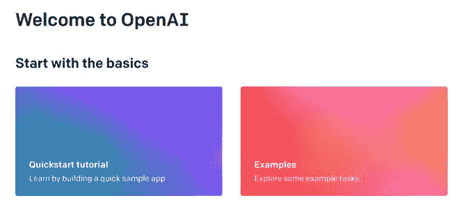
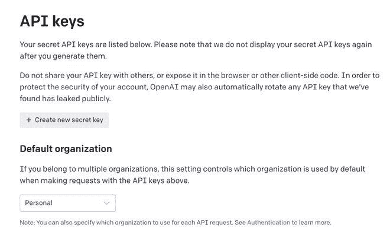

# 🗝️如何申请OpenAI的API Key

> 来源：[https://sg0n3b2id7.feishu.cn/docx/BCdKdsVkPo5F5RxYS7tcwDd9nVh](https://sg0n3b2id7.feishu.cn/docx/BCdKdsVkPo5F5RxYS7tcwDd9nVh)

作为ChatGPT的开发商，OpenAI为开发者提供了API，使得开发者能在自己的应用程序中调用OpenAI的相关服务。本文主要内容就是教大家申请OpenAI的API Key。

首先，在申请API Key前，你需要达成以下两个条件

1.  拥有一个可用的OpenAI账号(这也常常被说成是ChatGPT账号)

1.  可正常访问OpenAI相关服务的网络环境，主要原因是OpenAI目前不对中国地区提供服务。

使用浏览器访问：https://platform.openai.com/account/api-keys

点击Create new secret key按钮即可。API Key目前都是以sk-开头的。

要注意的是，创建后应该立即复制并妥善保存API Key。因为OpenAI为了保证API Key的安全，只在创建API Key时才会完整显示API Key，如果你遗忘或者丢失API Key，就只能重新创建新的API Key。

同时，OpenAI也提示，为了保护账户的安全，OpenAI 还可能会自动轮换他们发现已公开泄露的任何 API Key。所以，最好不要将自己的API Key分享给他人使用，或在互联网中公开，这样很可能导致你的API Key失效。

有了API Key，开发者就可以在自己的应用程序中调用OpenAI API，具体使用方法可以查看：https://platform.openai.com/docs/introduction