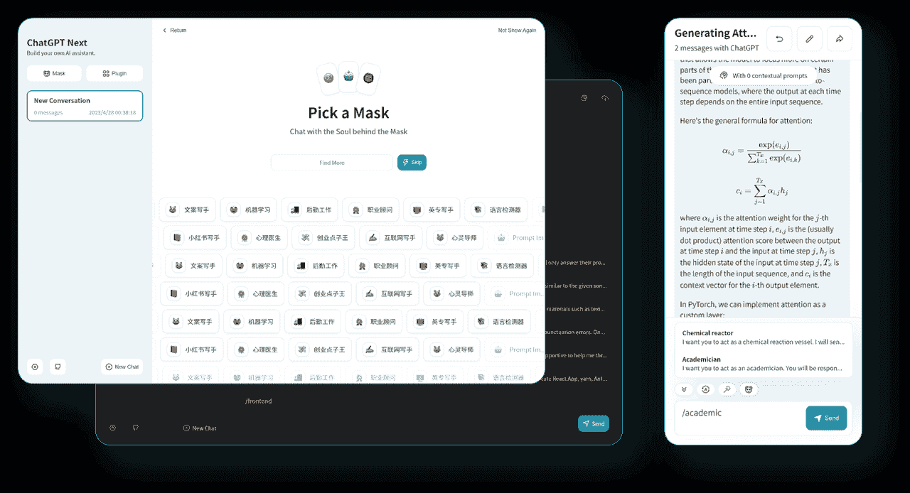
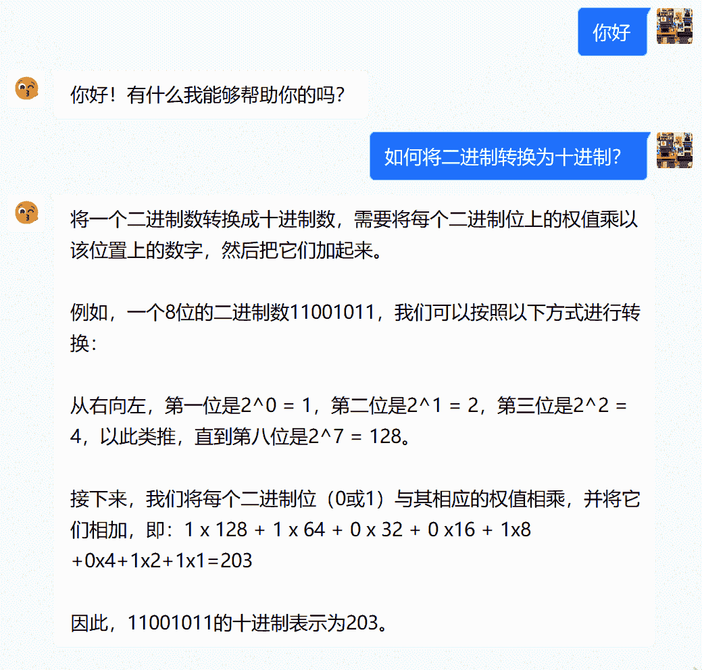
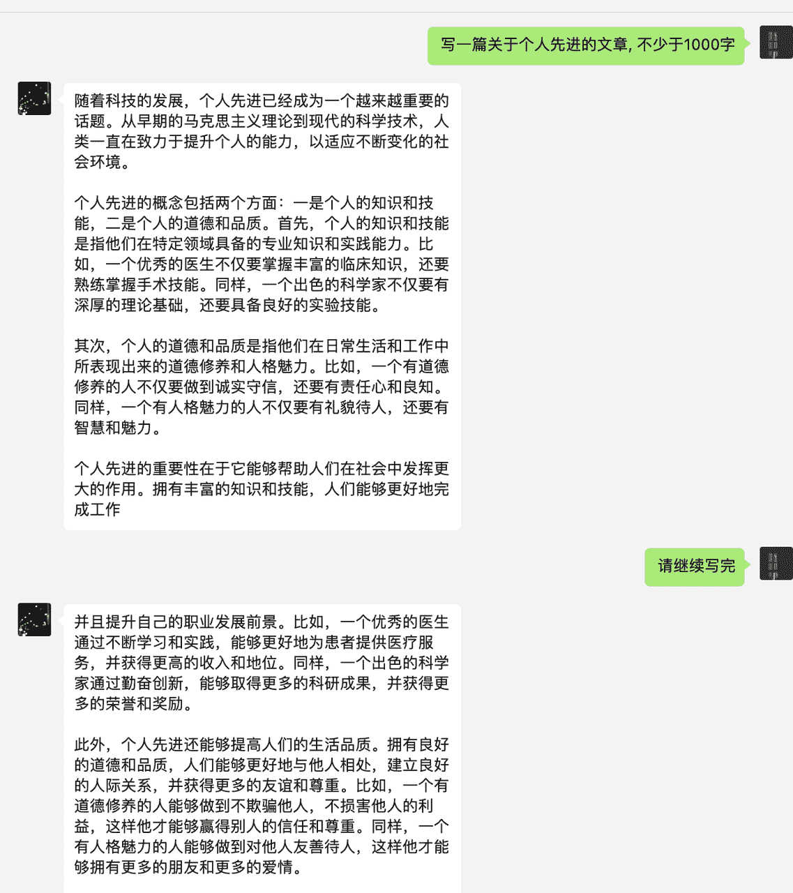
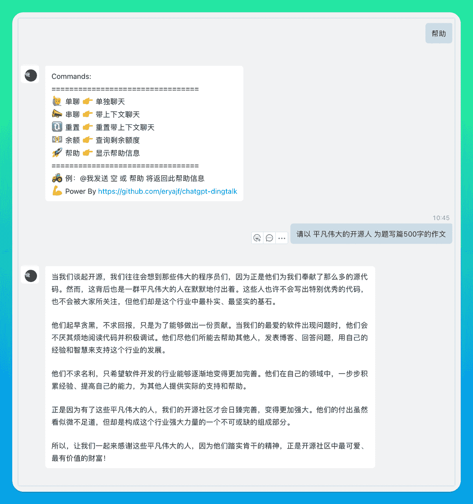
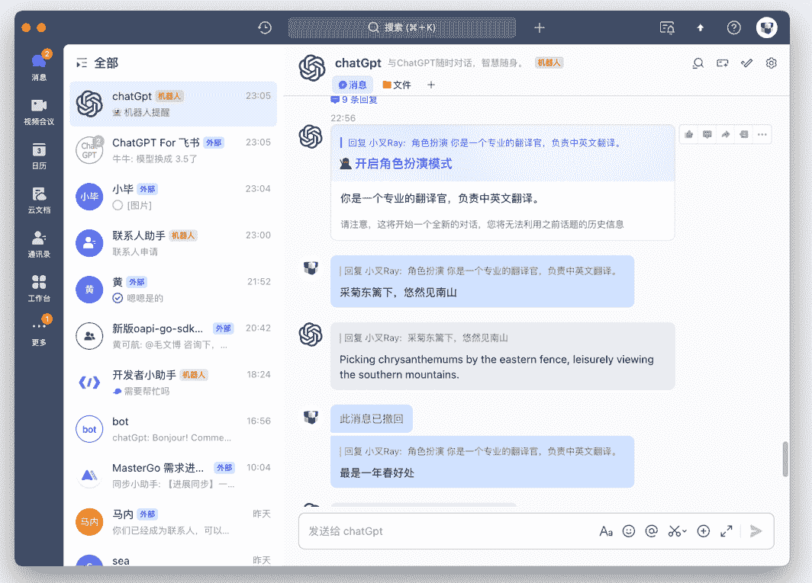
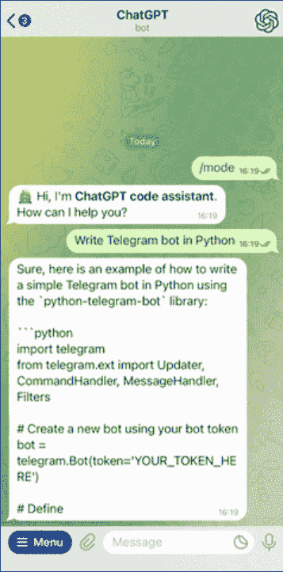
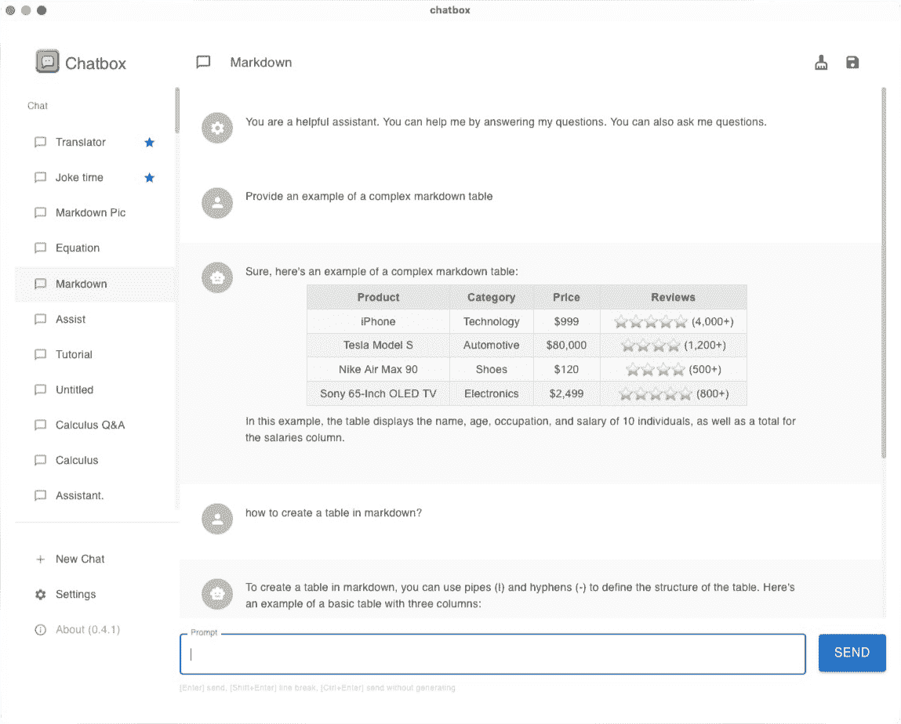

# 🚀自己的ChatGPT！ web镜像站&&机器人

> 来源：[https://sg0n3b2id7.feishu.cn/docx/GwfwdPdJ6oEifvxaix4ch2MwnDb](https://sg0n3b2id7.feishu.cn/docx/GwfwdPdJ6oEifvxaix4ch2MwnDb)

# 介绍

> 本章所提到或者未提到的镜像网站、各种机器人均可以帮忙远程搭建并且调试功能正常。

> 请提前准备好以下资源：

1.  程序部署的电脑或者服务器

1.  OpenAI的API Key [如何申请OpenAI的API Key](https://sg0n3b2id7.feishu.cn/wiki/FCScwTZiPisUf0k0fXEc6qYSn3f#FWmqd8QCGo4cy2xmYn6czjxunnb)

1.  IM账号，如QQ、微信等需要充当机器人的账号

1.  远程软件向日葵

> 搭建服务需要耗时耗力，需要很大的人工成本，所以此服务需要收取费用，请各位老板理解。

> 注：机器人长期频繁使用产生的有可能会造成一定概率的风控和封号等，如QQ、WeChat。

> 联系方式：[ChatGPT知识库首页💾](https://sg0n3b2id7.feishu.cn/wiki/D6ZpwFWJ8iYKB4ky2ABcmZqKnoJ)

# 网页Web GPT

可能是目前最完整的对话式UI，并且支持密码模式，方便分享给其他分使用，一键免费部署你的私人 ChatGPT 网页应用。

地址：https://github.com/Yidadaa/ChatGPT-Next-Web

# QQ-GPT机器人

可以在QQ上私聊以及群聊的ChatGPT机器人，几步即可获得一个基于 ChatGPT 的QQ机器人

✅回复符合上下文

✅支持敏感词过滤，避免账号风险

✅群内多种响应规则，不必at

✅使用官方api，不需要网络代理，稳定快捷

✅完善的多api-key管理，超额自动切换

✅组件少，部署方便，提供一键安装器及Docker安装

✅支持预设指令文字

✅完善的会话管理，重启不丢失

✅支持对话、绘图等模型，可玩性更高

✅支持指令控制热重载、热更新

✅支持插件加载🧩

✅私聊、群聊黑名单机制

✅回复速度限制

✅支持自定义提示内容

https://github.com/RockChinQ/QChatGPT

# 微信-GPT机器人

可以在微信上私聊以及群聊的ChatGPT机器人，几步即可获得一个基于 ChatGPT 的微信机器人

+    支持上下文语境的对话。

+    支持重置上下文语境，通过关键词(reset)重置对话上下文语境。

+    支持在群聊@你的机器人 🤖，@机器人即可收到回复。

+    支持通过关键词唤醒你的机器人，如当在群组中发送“@机器人 hello xxxx”时才会收到回复。

https://github.com/AutumnWhj/ChatGPT-wechat-bot

# 钉钉-GPT机器人

可以在钉钉上私聊以及群聊的ChatGPT机器人，几步即可获得一个基于 ChatGPT 的钉钉机器人

地址：https://github.com/ConnectAI-E/Dingtalk-OpenAI

# 飞书-GPT机器人 支持语音、支持新建话题

🗣 语音交流：私人直接与机器人畅所欲言

💬 多话题对话：支持私人和群聊多话题讨论，高效连贯

🖼 文本成图：支持文本成图和以图搜图

🛖 场景预设：内置丰富场景列表，一键切换AI角色

🎭 角色扮演：支持场景模式，增添讨论乐趣和创意

🤖 AI模式：内置4种AI模式，感受AI的智慧与创意

🔄 上下文保留：回复对话框即可继续同一话题讨论

⏰ 自动结束：超时自动结束对话，支持清除讨论历史

📝 富文本卡片：支持富文本卡片回复，信息更丰富多彩

👍 交互式反馈：即时获取机器人处理结果

🎰 余额查询：即时获取token消耗情况

🔙 历史回档：轻松回档历史对话，继续话题讨论 🚧

🔒 管理员模式：内置管理员模式，使用更安全可靠 🚧

🌐 多token负载均衡：优化生产级别的高频调用场景

↩️ 支持反向代理：为不同地区的用户提供更快、更稳定的访问体验

📚 与飞书文档互动：成为企业员工的超级助手 🚧

🎥 话题内容秒转PPT：让你的汇报从此变得更加简单 🚧

📊 表格分析：轻松导入飞书表格，提升数据分析效率 🚧

🍊 私有数据训练：利用公司产品信息对GPT二次训练，更好地满足客户个性化需求 🚧

地址：https://github.com/ConnectAI-E/Feishu-OpenAI

# telegram-GPT机器人

+   低延迟回复（通常需要大约 3-5 秒）

+   没有请求限制

+   消息流（观看演示）

+   GPT-4 支持

+   群聊支持（/help_group_chat 获取说明）

+   达尔 2（选择👩🎨艺术家模式生成图像）

+   语音信息识别

+   代码高亮

+   15种特殊聊天模式：👩🏼🎓助手，👩🏼💻代码助手，👩🎨艺术家，🧠心理学家，🚀埃隆·马斯克等。

+   允许的电报用户列表

+   跟踪在 OpenAI API 上花费的美元余额

地址：https://github.com/karfly/chatgpt_telegram_bot

# **Chatbox ****桌面客户端**

开源的 ChatGPT API (OpenAI API) 桌面客户端，Prompt 的调试与管理工具，支持 Windows、Mac 和 Linux，也可以用作ChatGPT Plus平替

地址：https://github.com/Bin-Huang/chatbox/blob/main/README-CN.md