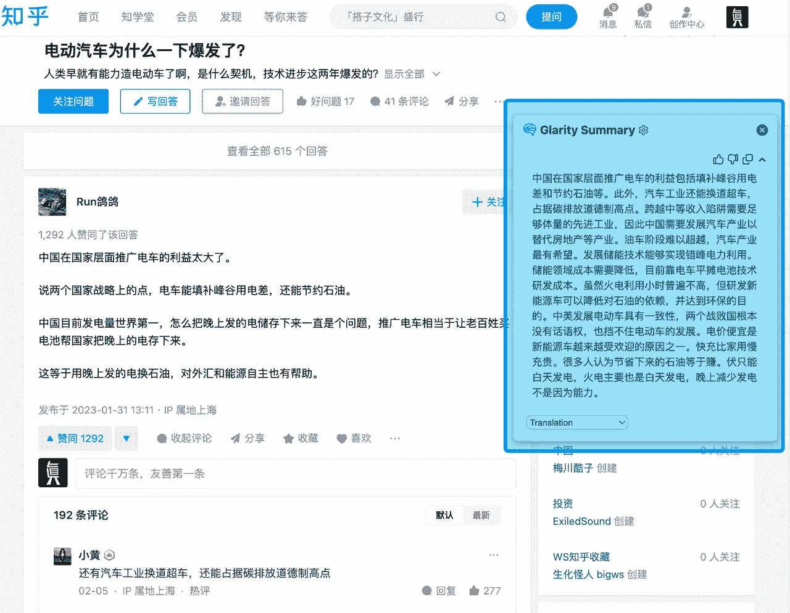
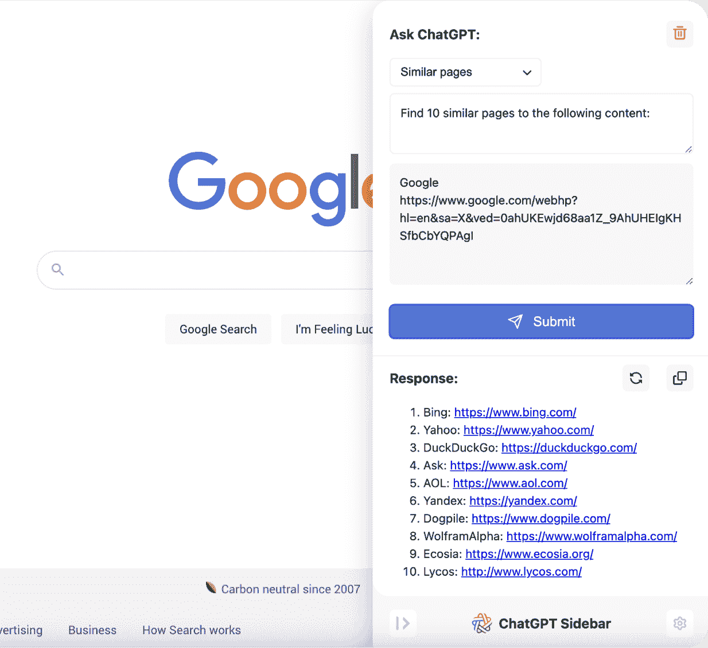
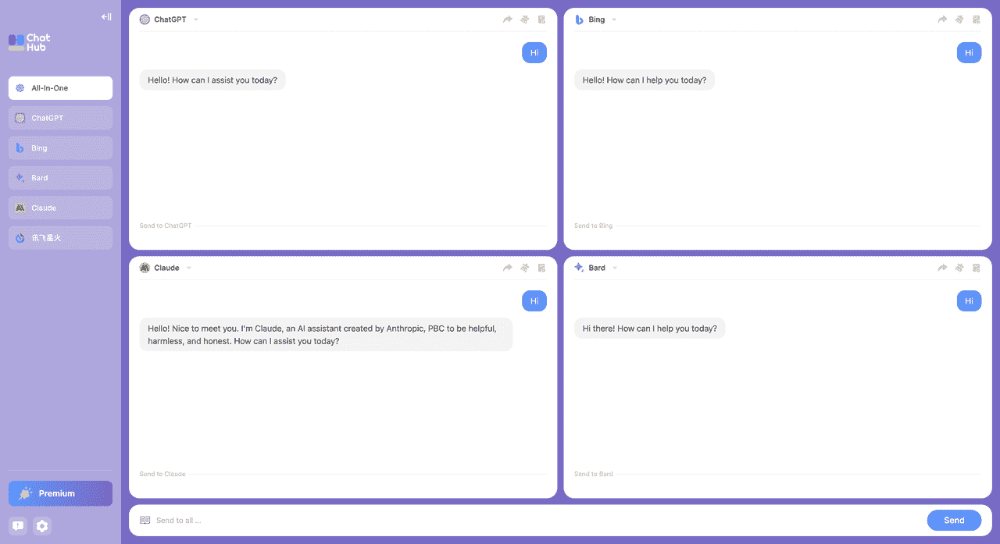
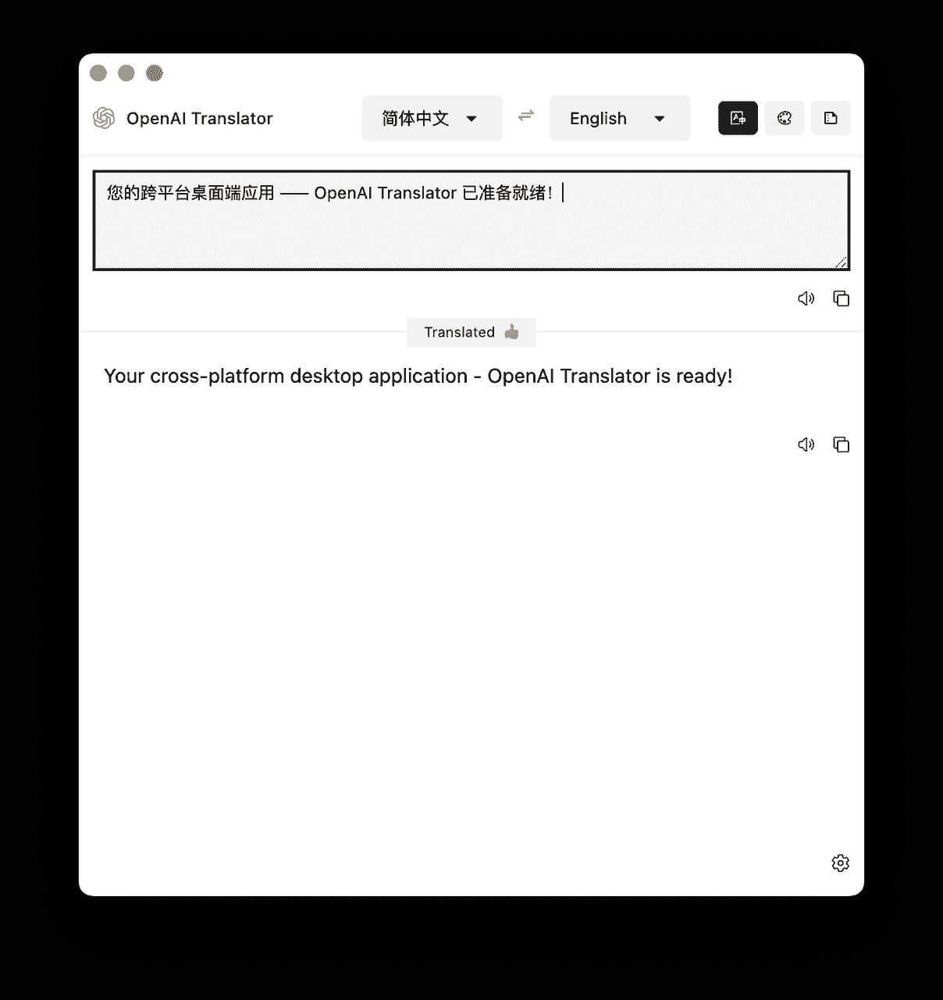
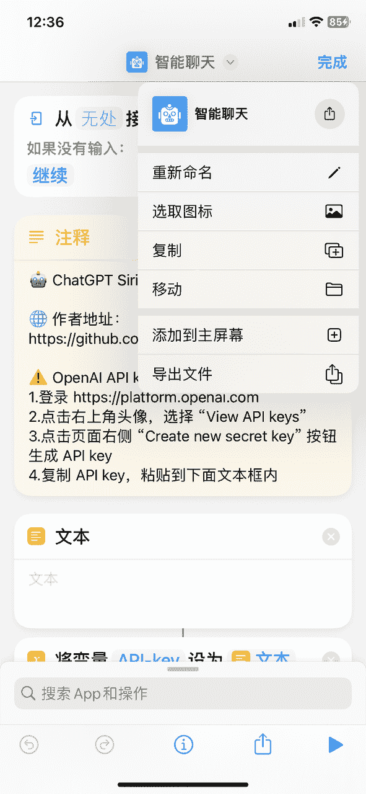
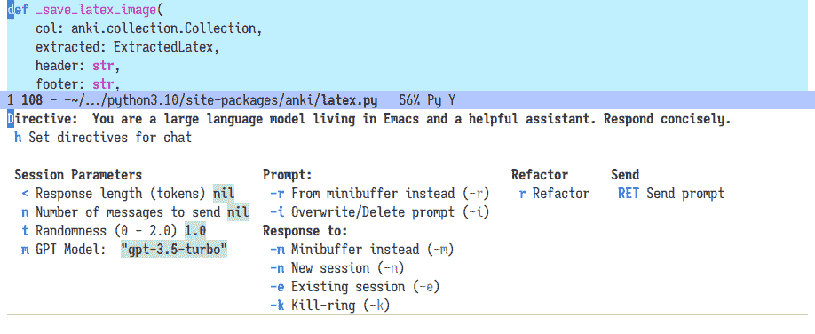
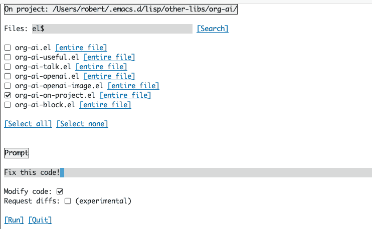

# 💕基于ChatGPT的扩展插件

> 来源：[https://sg0n3b2id7.feishu.cn/docx/LHA2dBfQ3oMfVZxH6ahcp1tCnhh](https://sg0n3b2id7.feishu.cn/docx/LHA2dBfQ3oMfVZxH6ahcp1tCnhh)

# Chrome浏览器插件

## HARPA AI

HARPA AI将ChatGPT、Web监控和自动化集成到您的Google Chrome中。利用AI的强大功能，自动化繁琐的搜索、数据提取、内容摘要、写作和网页监控任务：总结、改写、提取和监测网页、价格和数据。将网页转换为API的方式来调取，真的太牛了！强烈推荐！

地址：[HARPA AI | ChatGPT Web ](https://chrome.google.com/webstore/detail/harpa-ai-chatgpt-web-auto/eanggfilgoajaocelnaflolkadkeghjp/related)Automation Assistant

## Glarity

使用 ChatGPT API 生成 Google 搜索结果或 YouTube 视频的摘要，同时支持 Yahoo! JAPAN ニュース、PubMed、PMC、NewsPicks、Github、Nikkei、Bing、Google Patents。该扩展还支持 ChatGPT Webapp 的 API，无需配置即可使用。

地址：https://glarity.app/zh-CN

## ChatGPT Sidebar

在任何网页中打开侧边栏，询问 ChatGPT 关于页面内容的任何事情，如解释、翻译、概括或重写。你可以自定义 prompts 以便更轻松地使用。该扩展还支持 ChatGPT Webapp 的 API，无需配置即可使用。

地址：[ChatGPT Sidebar](https://chatgpt-sidebar.com/)

## ChatHub

ChatHub是一款多合一聊天机器人客户端，目前支持ChatGPT和新的Bing Chat。它允许同时与多个聊天机器人进行交流，方便比较它们的答案。 Source code: chathub-dev/chathub

地址：[ChatHub](https://chrome.google.com/webstore/detail/chathub-all-in-one-chatbo/iaakpnchhognanibcahlpcplchdfmgma)

## OpenAI Translator

使用 OpenAI API 翻译文本的 Chrome 扩展，并具有润色和摘要等其他功能。

地址：OpenAI Translator

# 苹果捷径

## ChatGPT Siri

通过 Siri 启动「快捷指令」连接 ChatGPT API，让 Siri 变身 AI 聊天助手。你可以直接和 Siri 说出你的问题，Siri 会回答你。

地址：[ChatGPT Siri](https://github.com/Yue-Yang/ChatGPT-Siri)

## Siri Pro

可随时唤起文字和语音两种输入方式，快速响应，支持多次问答，支持预设调教，跟人工智障说拜拜。

地址：[Siri Pro](https://www.icloud.com/shortcuts/6889d862918e479693be11fd9a0293b2)

# [Emacs](https://www.gnu.org/software/emacs/) 插件

## GPTel

为 Emacs 添加了一个新的 major mode, 可以像 ChatGPT 网页一样聊天，支持多个聊天会话，支持将选中的任意文本发送给 ChatGPT, 以得到回答、请求润色、代码建议，等等。

地址：[GPTel](https://github.com/karthink/gptel)

## org-ai

为 Emacs 下的笔记插件 org-mode 添加了一个新的自定义块，在该块中可以和 ChatGPT 聊天，可以使用 DALL-E 生成图片。可以使用语音输入，可以将 ChatGPT 的回答用语音播放。

地址：[org-ai](https://github.com/rksm/org-ai)

# [Obsidian](https://obsidian.md/) 插件

## Obsidian Text Generator Plugin

在 Obsidian 中根据你的笔记生成想法、头条、摘要、大纲和整段文字。

地址：Obsidian Text Generator Plugin

# [Logseq](https://logseq.com/) 插件

## Logseq Plugin GPT3 OpenAI

在 Logseq 中使用 ChatGPT 以及其他 AI 模型的插件。

地址：Logseq Plugin GPT3 OpenAI

# [Roam Research](https://roamresearch.com/) Plugins

## roam-ai

包含三个功能: 根据当前块生成文本；使用DALL-E 2生成图像；重新表述。

地址：[roam-ai](https://github.com/LayBacc/roam-ai)

# [Popclip](https://pilotmoon.com/popclip/) 扩展

## ChatGPT — PopClip Extensions

将所选文本发送到 ChatGPT 并将回复粘贴在后面。

地址：ChatGPT — PopClip Extensions

## ChatGPT Proofreader extension for Popclip

通过 ChatGPT API 对选中文本进行校对和润色，并将修改后的文本粘贴在后面。

地址：[ChatGPT Proofreader e](https://reorx.com/makers-daily/003-chatgpt-proofreader-extension-popclip/)xtension for Popclip

## ChatGPT Grammar Check PopClip Extension

和 ChatGPT Proofreader extension 类似的扩展，提供可下载的安装包。

地址：[ChatGPT Grammar Che](https://github.com/hirakujira/ChatGPT-Grammar-Check-PopClip-Extension)ck PopClip Extension

# [Drafts](https://getdrafts.com/) Actions

## ChatGPT Conversation | Drafts Directory

在 Drafts 笔记中与 ChatGPT 进行对话，新的回复将附加在末尾。支持定义和修改 system, assistant, user 角色的消息块。

地址：[ChatGPT Conversatio](https://directory.getdrafts.com/a/2HJ)n | Drafts Directory

# [Bob](https://bobtranslate.com/) 插件

## OpenAI Translator Bob Plugin

基于 ChatGPT API 的文本翻译、文本润色、语法纠错 Bob 插件。另有一个专注于润色的衍生版本:

地址：OpenAI Translator Bob Plugin

## OpenAI Polisher Bob Plugin。

地址：OpenAI Polisher Bob Plugin

# Keyboard Maestro 宏

## Copy to Ask ChatGPT

使用键盘快捷方式选择并复制文本以向 ChatGPT 提问。[下载链接](https://p15.p3.n0.cdn.getcloudapp.com/items/geuEZvwA/aeed10cb-a35d-404f-a17f-da1d46c9c9c7.kmmacros)。

地址：Copy to Ask ChatGPT

## 我的六個專屬 ChatGPT 助手

地址：我的六個專屬 ChatGPT 助手

# GitHub App

## CR.GPT

由 ChatGPT 驱动的代码审查机器人

地址：[CR.GPT](https://github.com/apps/cr-gpt)