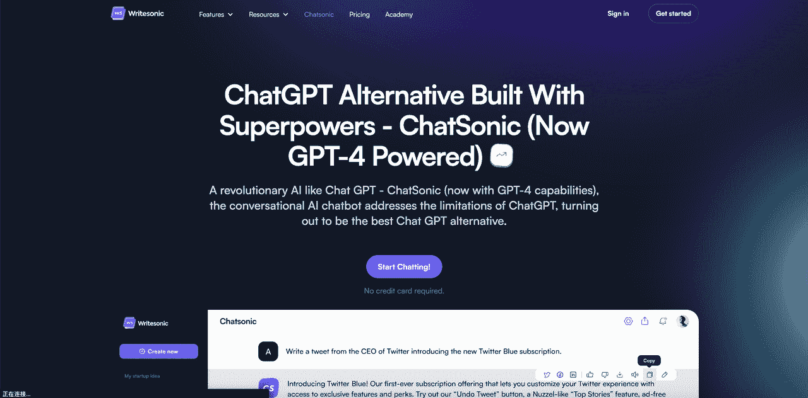
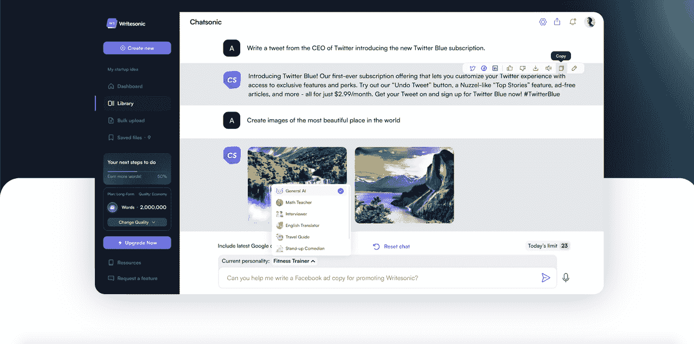
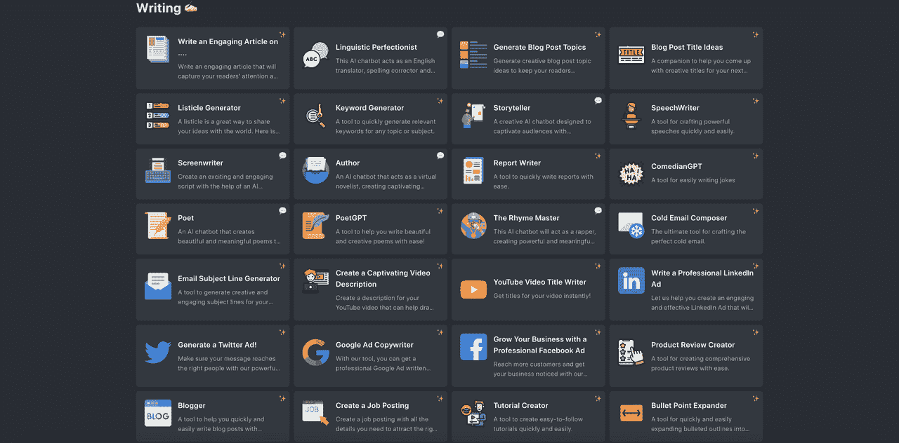
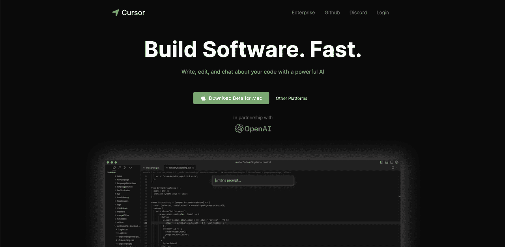
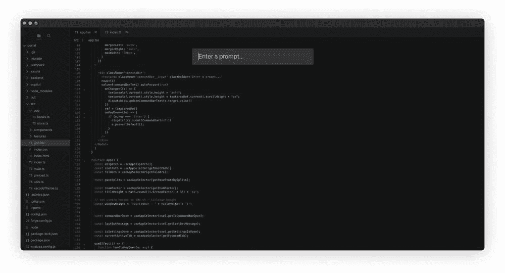
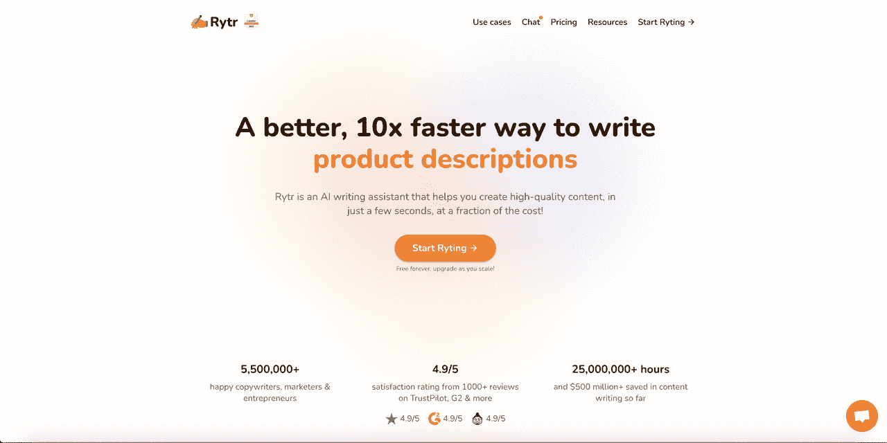
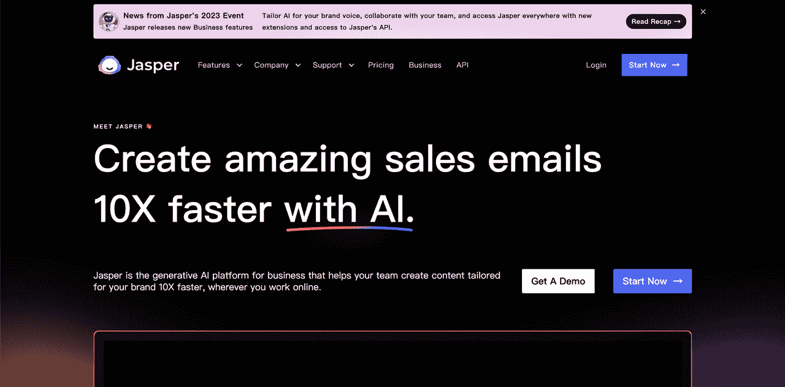
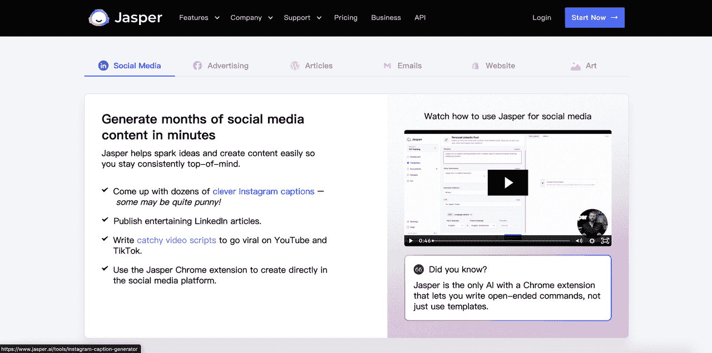

# 🦉ChatGPT替代产品

> 来源：[https://sg0n3b2id7.feishu.cn/docx/NTOidwkhao6PLcxdokqcEukQnVh](https://sg0n3b2id7.feishu.cn/docx/NTOidwkhao6PLcxdokqcEukQnVh)

# **Chatsonic**

对话式人工智能聊天机器人是一种革命性的人工智能，类似于Chat GPT-ChatSonic（现在具有GPT-4功能），它解决了ChatGPT的局限性，是最好的聊天GPT替代品。

地址：https://writesonic.com/chat

# **craft**

**craft可以**创建文档，产生影响，当你的工作需要惊叹时，工艺给你工具，让它变得华丽。

地址：https://www.craft.do/

# **Vondy**

**Vondy 可以**浏览并创建人工智能应用程序，可以做任何事情，从生成食谱到编写代码。无论什么对你有意义，我们都会为你提供保障。

地址：https://www.vondy.com/

# **cursor****（GPT4.0）**

Cursor是一款用于人工智能编程的编辑器。这还为时过早，但现在Cursor可以帮助你做一些事情。。。

+   编写：使用比Copilot更智能的人工智能生成10-100行代码

+   差异：要求AI编辑代码块，只查看建议的更改

+   聊天：了解您当前文件的ChatGPT风格界面

+   更多：要求修复lint错误，在悬停时生成测试/注释等。

地址：https://www.cursor.so/

Github：https://github.com/getcursor/cursor

# **rytr****（GPT4.0）**

Rytr是一款人工智能写作助手，可以帮助您在几秒钟内创建高质量的内容，只需花费很小的成本！

地址：https://rytr.me/

# **YouGPT**

You.com是一个基于人工智能的搜索引擎，为用户提供定制的搜索体验，同时保持他们的数据100%隐私。

地址： https://freegpt.one/

# **Jasper**

Jasper是一个生成性的商业人工智能平台，无论您在哪里在线工作，都可以帮助您的团队更快地为您的品牌定制10倍的内容。

地址：https://www.jasper.ai/