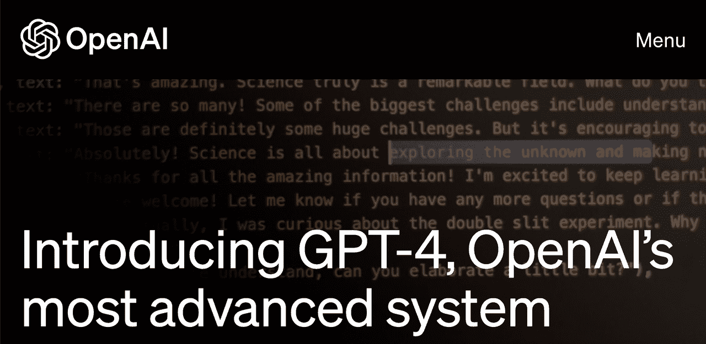
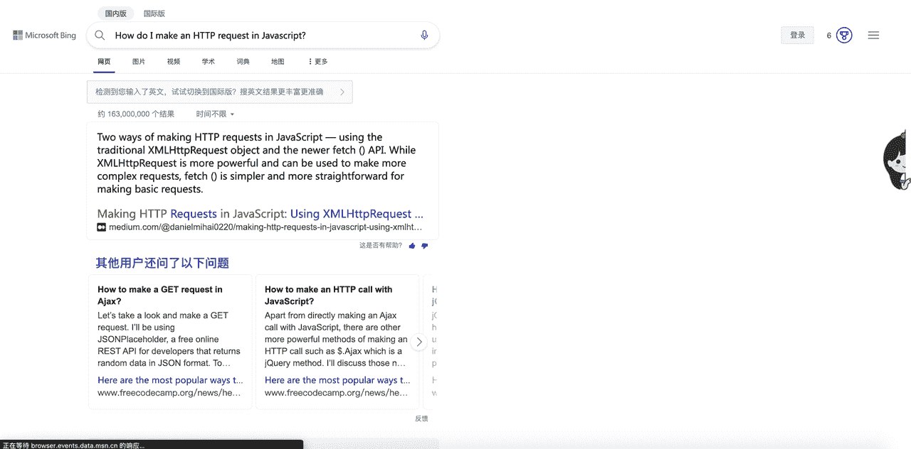
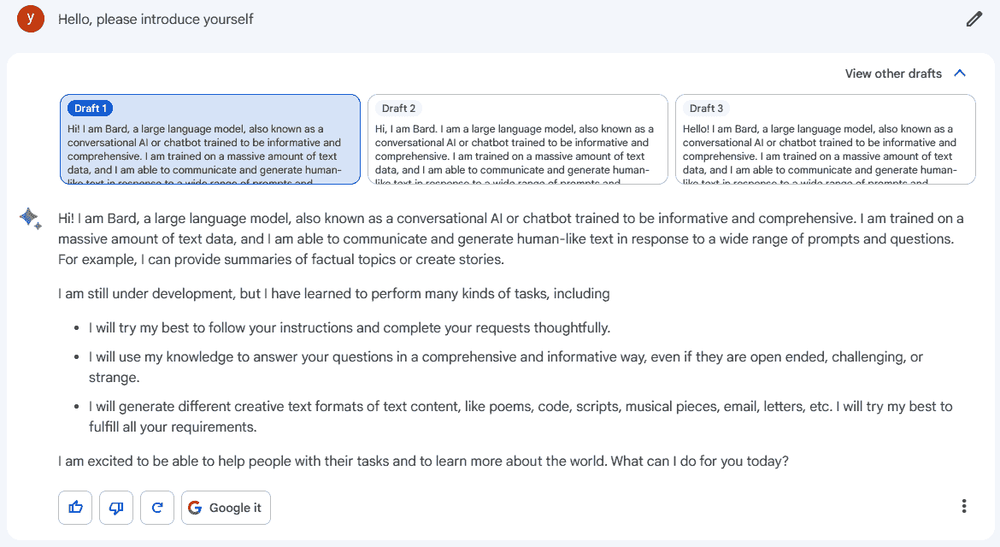
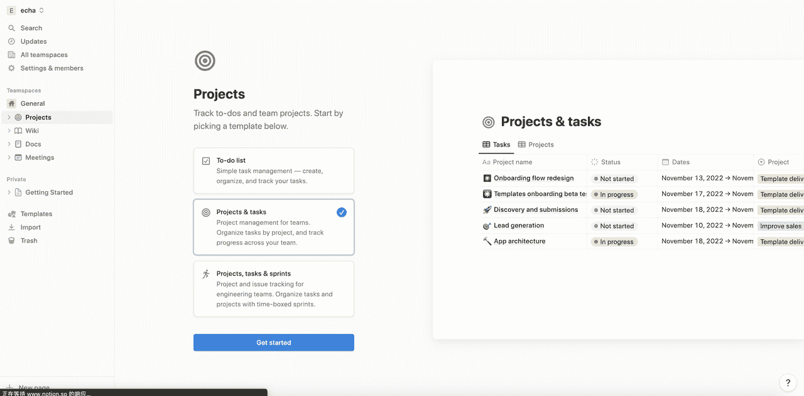
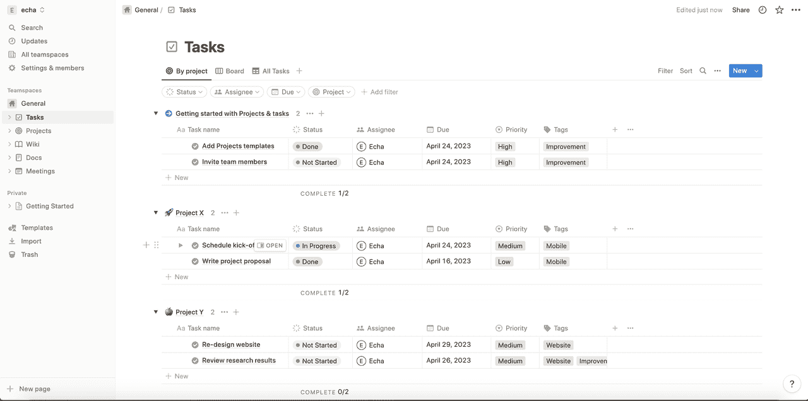
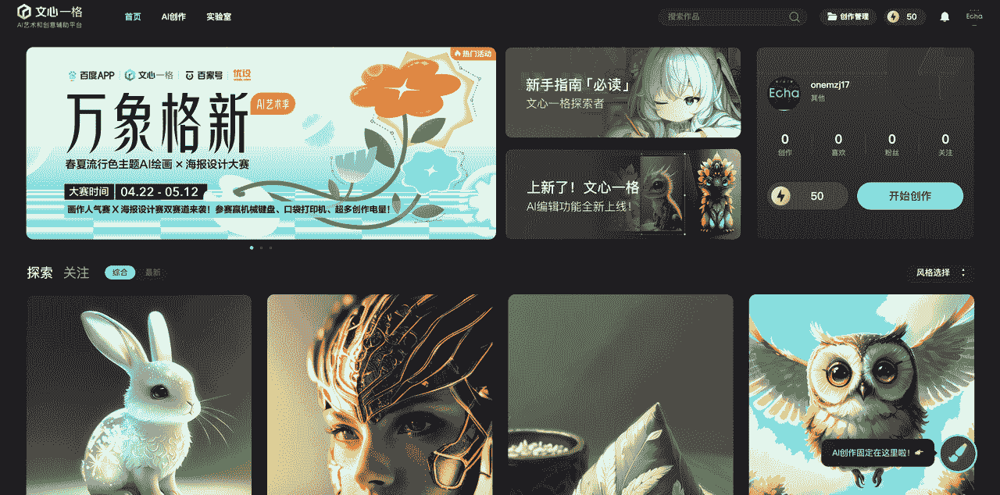
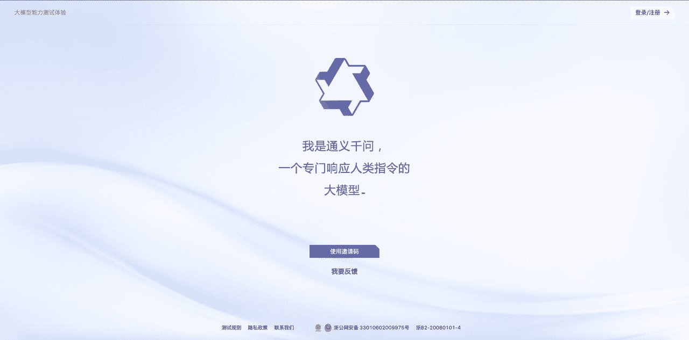
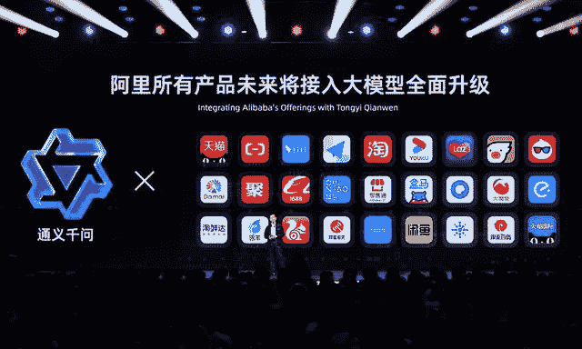
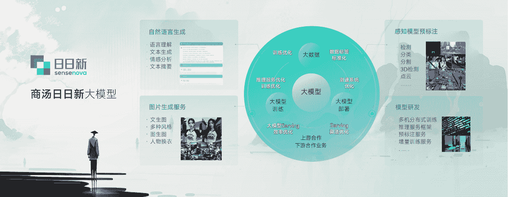

# 👾各大厂商GPT产品

> 来源：[https://sg0n3b2id7.feishu.cn/docx/O6RIdZhwWoONtHxThq6cp3HpnEe](https://sg0n3b2id7.feishu.cn/docx/O6RIdZhwWoONtHxThq6cp3HpnEe)

# **OpenAI**** ****ChatGPT**

地址：https://openai.com/

ChatGPT（全名：Chat Generative Pre-trained Transformer），美国OpenAI 研发的聊天机器人程序 ，于2022年11月30日发布 。ChatGPT是人工智能技术驱动的自然语言处理工具，它能够通过理解和学习人类的语言来进行对话，还能根据聊天的上下文进行互动，真正像人类一样来聊天交流，甚至能完成撰写邮件、视频脚本、文案、翻译、代码，写论文 等任务。

# **New Bing**

地址：https://cn.bing.com/

BAI Chat是一款基于GPT-3.5/CatGPT API的聊天机器人，免费、方便且响应迅速。试试看！

# Google Bard

地址：https://bard.google.com/

Bar**d是由谷歌LaMDA模**型提供支持的**实验型对话**AI服务，利用来自互联网的信息提供最新、高质量的回复。谷歌表示，Bard是对搜索引擎的补充，而不只是一种搜索。Bard能够实时联网，Bard目前仅支持英语，谷歌表示正努力支持尽可能多的语言。

# **Notion**

地址：https://www.notion.so/

一个新的工具，将您的日常工作应用程序整合到一个应用程序中。这是您和您的团队的一体化工作空间

# **百度文心一言**

地址：https://yige.baidu.com/

文心一言（英文名：ERNIE Bot）是百度全新一代知识增强大语言模型，文心大模型家族的新成员，能够与人对话互动，回答问题，协助创作，高效便捷地帮助人们获取信息、知识和灵感。文心一言是知识增强的大语言模型，基于飞桨深度学习平台和文心知识增强大模型，持续从海量数据和大规模知识中融合学习具备知识增强、检索增强和对话增强的技术特色。

文心一言可以做什么：与人对话互动，回答问题，协助创作，高效便捷地帮助人们获取信息、知识和灵感。

# **阿里通义千问**

地址：https://tongyi.aliyun.com/

通义千问，是阿里云推出的一个超大规模的语言模型，功能包括多轮对话、文案创作、逻辑推理、多模态理解、多语言支持。能够跟人类进行多轮的交互，也融入了多模态的知识理解，且有文案创作能力，能够续写小说，编写邮件等。

# **商汤科技日日新**

地址：https://www.sensetime.com/cn

日日新（SenseNova），是商汤科技宣布推出的大模型体系，包括自然语言处理模型“商量”（SenseChat）、文生图模型“秒画”和数字人视频生成平台“如影”（SenseAvatar）等。

