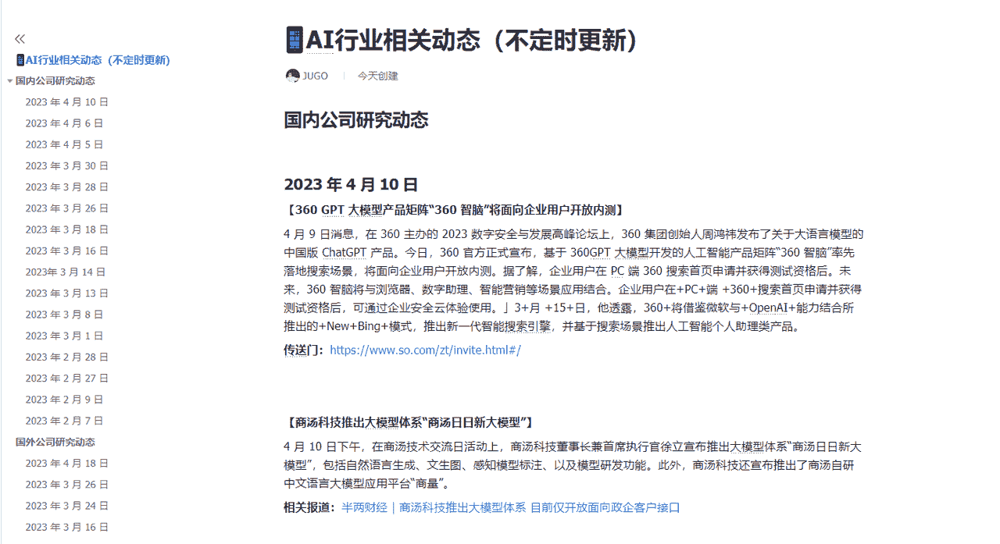
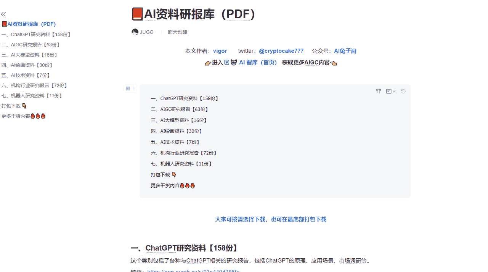
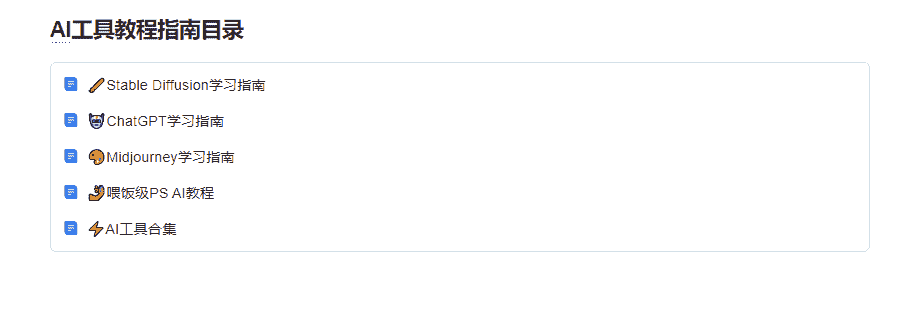
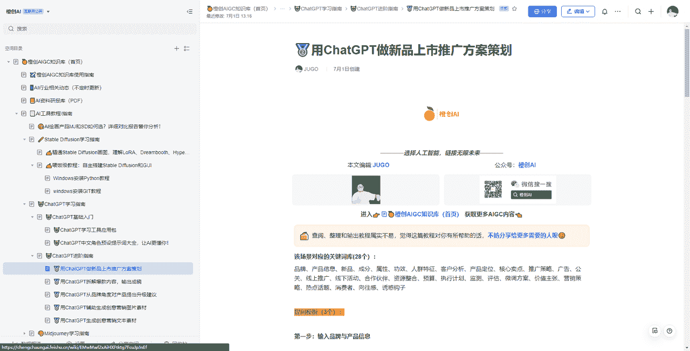

# ✈橙创AIGC知识库使用指南

> 来源：[https://chengchaungai.feishu.cn/docx/AT7SdHErnoBNVnx4hJVcRzpdnre](https://chengchaungai.feishu.cn/docx/AT7SdHErnoBNVnx4hJVcRzpdnre)

————**选择人工智能，链接无限未来**————

本文编辑:**JUGO** **  ****  **                                                         公众号：橙创AI

**进入👉 **[🍊橙创AI知识库（首页）](https://ix9q8jjj4ug.feishu.cn/wiki/DOsXwmRDaibJVUkDSHKcYbhmn0f)**获取更多A****IGC内****容👈**

> **查阅、整理和输出教程属实**[**不易**](https://ki6j1b0d92h.feishu.cn/wiki/wikcnOTLuqHXX6ZJ1oWEBGbd9zf?from=from_copylink)，觉得这篇教程对你有所帮助的话，不妨分享给更多需要的人呗😊

## 什么是AIGC

AI-Generated Content，中文解释为人工智能生成内容，AI绘画、AI写作等都属于AIGC的分支。于2022年由于openAI发布对话式语言模型chatGPT开始爆火，目前通常以生成式AI简写替代。

## 发展源起

AIGC 的发展可以大致分为以下三个阶段：

+   早期萌芽阶段：20 世纪 50 年代—90 年代中期，受限于科技水平，AIGC 仅限于小范围实验

+   沉积积累阶段：20 世纪 90 年代中期—21 世纪 10 年代中期，AIGC 从实验向实用转变，受限于算法，无法直接进行内容生成

+   快速发展阶段：21 世纪 10 年代中期—现在，深度学习算法不断迭代，AI 生成内容种类多样丰富且效果逼真

近年来，AIGC 的发展迅速，从原来作为边缘侧服务于企业、机构的角色变为了现在 C 端零基础用户都可以使用的创作工具。开发侧重点上，AIGC 也从原先用于翻译、语音合成以及重复性工作转变为了更注重应用层面，用户能够便捷操作的方向。

## 技术涉及

AIGC 技术主要涉及两个方面：自然语言处理 NLP 和 AIGC 生成算法。NLP是实现人与计算机之间如何通过自然语言进行交互的手段，AIGC 生成算法主流的有生成对抗网络 GAN 和扩散模型，扩散模型已经拥有了成为下一代图像生成模型的代表的潜力。它具有精度更高、可扩展性和并行性，无论是质量还是效率均有所提升，其快速发展成为 AIGC 增长的拐点性因素。

## 未来发展

**AIGC**** 未来发展核心：****大模型****、大数据与大****算力****。**结合自然语言的大模型与数据集已成为 AIGC 发展的软件基础，OpenAI 的 Clip 模型基于 4 亿组高质量的英文图文对应数据训练而成；算力即权力将在 AIGC 数字时代更加凸显， Stable Diffusion 目前依赖于 4000 个英伟达 A100 的 GPU 集群，运营成本超 5000 万美金。为了让功能更加精确，未来还将更多地基于语种去开发垂直类的应用，便于更有目的性地为特定功能进行训练。

## 投资领域

**AIGC**** 投资框架：软硬件与数据集。**生成算法、NLP 与算力决定 AIGC 能否运行，而高质量的数据集决定了 AIGC 质量与商业模式。

+   软件层面主要包括自然语言处理技术：谷歌、微软、科大讯飞、拓尔思；

+   AIGC 生成算法模型及数据集：英伟达、Meta、百度、蓝色光标、视觉中国、昆仑万维；

+   算力层包括：澜起科技、中兴通讯、新易盛、天孚通信、宝信软件、中际旭创等。

## 风险提示

+   技术创新不及预期：AIGC 的技术发展不及预期。以及底层硬件技术，如：超级计算机、算力的发展不及预期。

+   政策监管风险：目前 AIGC 还处于相对早期，后续是否会出台 AIGC 作品相关知识版权或其他法律监管条款尚不明确。

## 不足之处

+   目前所有的AI绘图程序更擅长做二维向的艺术创新，例如：绘画，照片，CG。但是在三维构图就缺少研究，例如：产品包装，汽车设计，室内设计等，但是不排除通过喂大量的图能训练出可用的模型；

## 应用领域

AIGC 在文字、图像、音频、游戏和代码生成中商业模型渐显。在一些具备高重复性的任务、对于精度要求并不那么高的领域应用已逐步成熟，并在探索商业模式中。目前图片生产、文字生成较为常见，这类 AIGC 服务大多数时候会以提供 SaaS 服务的形式变现。

# 知识库介绍

整合全网AIGC资源，资讯与技术教程，收藏记录AIGC行业知识，包含AI绘画，对话，AIGC行业报告与文档，学习音视频，Midjourney，Stable Diffusion的入门到生产的知识。

**每日更新** [AI绘画与提示词](https://chengchaungai.feishu.cn/wiki/VmxhwaA1niTeEqkdL5fcxBh0nxc?wiki_all_space_view_source=space_sidebar&table=tbleOqASJRcDDu2Q&view=vewu8DDIwm)，不定时更新 [AI平台导航](https://chengchaungai.feishu.cn/wiki/SBF5wcoVgim5cJkL9evcdSxKnEd?wiki_all_space_view_source=space_sidebar&table=tblMlOCJfcVr94ky&view=vewyesC0xl)

# 版块

### 一、[📱AI行业相关动态（不定时更新）](https://chengchaungai.feishu.cn/wiki/HJXNwvVXDiYCNxkbjrJcp2sNnIg)

在这个版块可以了解每日AI的资讯动态、热门工具和最新融资情况，轻松掌握 AI 世界的变化，发掘无限商机!

### 二、[📕AI资料研报库（PDF）](https://chengchaungai.feishu.cn/wiki/JKIfwsioli0OzCk6ZmEcQf78nac)

在这个版块可以获取行业报告和前沿论文，国内和国外的资料均有，有学习和工作需求的伙伴不妨来看看。

### 三、[📃AI工具教程/指南](https://chengchaungai.feishu.cn/wiki/EgD5w0bSfiqXKfkQubQcUXYsnrw?wiki_all_space_view_source=space_sidebar) （持续更新）

这个板块可以获取全AI工具的入门/进阶教程，上手方法，打通AI全学习路径。

### 四、[🔧AI工具百宝箱（不定时更新）](https://chengchaungai.feishu.cn/wiki/SBF5wcoVgim5cJkL9evcdSxKnEd?wiki_all_space_view_source=space_sidebar&table=tblMlOCJfcVr94ky&view=vewyesC0xl)

这个板块旨在介绍全网主流AI学习网站的链接，各类AI工具介绍以及直达链接

### 五、[💰AI变现思路/商业案例](https://chengchaungai.feishu.cn/wiki/Fpo6wy1MGiwPAzkdU4CcQt5Anaf?wiki_all_space_view_source=space_sidebar)

这个板块旨在分享所有用AI变现的项目，用AI完成商业化落地的复盘与拆解。

## 行业话

| LLMs | Large language models | 大语言模型 |
| --- | --- | --- |
| AIGC | AI generated content | 人工智能生成内容 |
| NLP | Natural Language Processing | 自然语言处理 |
| CLIP | Contrastive Language-Image Pretraining | 对比性语言图像预训练 |
| CNN | Convolutional Neural Networks | 卷积神经网络 |
| ANN | Artificial Neural Network | 人工神经网络 |
| DL | Deep Learning | 深度学习 |
| ML | Machine Learning | 机器学习 |
| AI | Artificial Intelligence | 人工智能 |
| AGI | Artificial General Intelligence | 通用人工智能 |
| GAN | Generative Adversarial Networks | 生成式网络对抗网络 |

#

# 教程文章

## 优质推荐

[ChatGPT中文角色预设提示词大全，让AI更懂你！](https://chengchaungai.feishu.cn/wiki/ZjVcwTI45iRlFpkByAocetOmnjL?wiki_all_space_view_source=space_sidebar)

[🎁【快速上手】怎么用 Midjourney 快速设计一个 logo？](https://chengchaungai.feishu.cn/wiki/XlzAwhrCwifBKrknejZcIN7LnXf?wiki_all_space_view_source=space_sidebar)

[🎨Midjourney学习指南](https://chengchaungai.feishu.cn/wiki/ZyuLwY24iiJLLIk4vhFcZy9inCb)

[📕AI资料研报库（PDF）](https://chengchaungai.feishu.cn/wiki/JKIfwsioli0OzCk6ZmEcQf78nac)

[🥈【技法拆解】怎么用 Midjourney 快速设计一个 logo？](https://chengchaungai.feishu.cn/wiki/XlzAwhrCwifBKrknejZcIN7LnXf)

[🎁【快速上手】必看！Midjouney指令大全](https://chengchaungai.feishu.cn/wiki/MYnUw5g4GidLvqkrIJVcbuh1nle)

[AI绘画产品MJ和SD如何选？详细对比报告替你分析！](https://chengchaungai.feishu.cn/wiki/EGhXwgS2qiVfPxkRUThcJCiun5e)

[💰AI变现思路/商业案例](https://chengchaungai.feishu.cn/wiki/Fpo6wy1MGiwPAzkdU4CcQt5Anaf)

# 社群会员增值服务

注意！接下来的每一句话都对你很重要！！！

Hi，我们是橙创AI，很开心能在数亿人海里，与你相遇。

这个「橙创AI学社」，我会告诉所有想踏入AI领域的伙伴们，

我们到底想做啥，以及如何你加入后，未来如何得到100 倍 ROI 回报，没后悔成为第一批成员！

致力打造成为未来一个不能更全、不能更新、不能更大的AI社交圈子✌

### 一、「橙创AI学社」到底是个啥？

一个专注Ai学术研讨、Ai工具实践、Ai变现搞钱的新人类社交圈以及学习圈.

**目前初步涉及的****Ai****领域：**

1.  ChatGPT系列：基础知识、注册流程、登录问题解决、相关应用和插件、角色扮演Prompt,基国内大模型相关进展及其相关内测申请流程，New Bing相关问题、AutoGPT安装教程，ChatGPT赚钱、ChatGPT写作、ChatGPT编程系列等探索

1.  Ai绘画系列：特别是Midjourney,Stable Diffusion的安装和使用教程，关键词Prompt，参数详解，高阶Prompts玩法，Midjourney提示词案例，Midjourney拓展资源，AI绘画变现案例等

1.  AI工具流系列：AIGC与实际工作学习有机结合探索，迭代你的工作学习方式，利用不同的AI工具结合产生1+1>2的效果，开启你的新世界。

1.  国内外AI研究：百度、阿里、商汤、360、昆仑万维，国外谷歌、微软大模型进展、国内外热门的AI工具测试讨论。

### 二、「橙创AI学社」适合谁加入？

1.  AI初学者：没接触过AI，但是想体验学习的人

1.  老板/企业家：寻求高效获客 + 降本增效的企业家。

1.  职场人士：追求效率高效"摸鱼"，增加未来核心竞争力在职人士。

1.  知识博主/自媒体人：批量产出文案和短视频的创作者，提升内容效率。

1.  公职人员：需要高级指导完成述职和职称论文的专业人士。

1.  副业人员：希望有效利用碎片时间增收的活跃人群。

1.  在读学生：期望论文、报告和课题更轻松的求知者。

1.  家长及学子：寻找全科目AI私人家教的家庭一族。

### 三、加入「橙创AI学社」有哪些权益？

学社不单单是一个「群」，会员群只是作为信息的触达、联系的工具。

学社权益着重在**高频次**、**高质量**、**高标准**的俱乐部会员活动，信息内容和交流服务。

#### **权益一：橙创****AI****学社1年会籍**

> 👉聚焦三大「链接」①A**I行****业人才链接，**②A**I服务商合作链接，**③A**I变现项目链接！**

> **👉一手信息案例共**享，即时讨论，每周定期案例复盘！历届大佬逐字稿案例分享，少走弯路！

> 👉俱乐部内部圆桌论坛：特邀行业大佬，一线AI操盘手，分享实战心得，大厂动向！

> 👉垂直AI行业人脉圈：和同圈层伙伴深**度链接和**交**流，**他们就是你的幕僚，好圈子胜过一大半。

> 👉会员专属服务官：他们不是客服，他们是资源地图，力求365天随时在线，努力秒回，用真心给会员创造持续价值。服务口号：有AI问题，上AI俱乐部，让你带着问题来，带你答案走。

#### 权益二：Ai知识库2.0~3.0~4.0……

> 上万字案例库，内部成员免费共享+搜索！

> **雷打不动持续更新，甄选特定主题一****起讨****论**、一起分享、一起碰撞链接，一起促进Ai知识库完善。未来Ai知识库，一定会成为每位Ai从业者不可或缺的资源地图，成为一个不能更全、不能更新、不能更大的AI案例库。

#### 权益三：6折~9折专享AI周边服务/分销变现

> 集合我们强大的社群力量，反向团购AI服务。

> GPT太贵？MJ太贵？xxxAi会员太贵？看我们怎么把价格打下来！！！👇

> 你有流量？有渠道？缺项目？那正好来看看有什么项目适合合作！🤝

> 你有项目？有产品？缺客户？那正好来谈谈有什么项目适合合作！🤞

> 橙创AI学社就是一个整合资源，寻找靠谱服务的好圈子！👌

#### 橙创AI学社补充说明

> 很感谢你看到了结尾这里，但作为创办者的我，希望补充多几句：

> 希望你能降低些预期，我也在学习，只是比你多走了几步而已，AI是一个新鲜的事物，很多东西还值得我们探索和学习，最后附上一句鸡汤：

> 拿着旧地图永远无法登陆新大陆；

> 拿着旧工具永远无法跨越式革新；

> 拿着旧认知永远无法解锁新世界。

> 今天的手机会是明天的马车（被淘汰），这个时间可能在三五年内，甚至更快。

> 今日面对一个新事物，比如ChatGPT，Midjourney .一定不要用现有的认知去思考，也不要去思考，只需抓住3件事：

> **●**1 拥抱变化！

> **●**2 积极拥抱变化！

> **●**3 不遗余力积极拥抱变化！

> 另外，我认为最好的学习方法，就是实践，把你学到认为有用的东西，立即执行，立马上手，上手后尝试运用到生活中，这样才能记得更牢靠，内化成自己的知识。

> **未来，所有行业，都可能通过****AI****重塑一遍！**

> 关注**公众号**，加入**AI****实战交流群**，掌握全面专业的**行业资讯**、**工具分享**、**变现指南**和**实战教程**，开启你的AI智慧之旅👇👇

联系微信**JUGO737Y****（备注来意）**

公众号：**橙创****AI**

**群聊二维码**：

