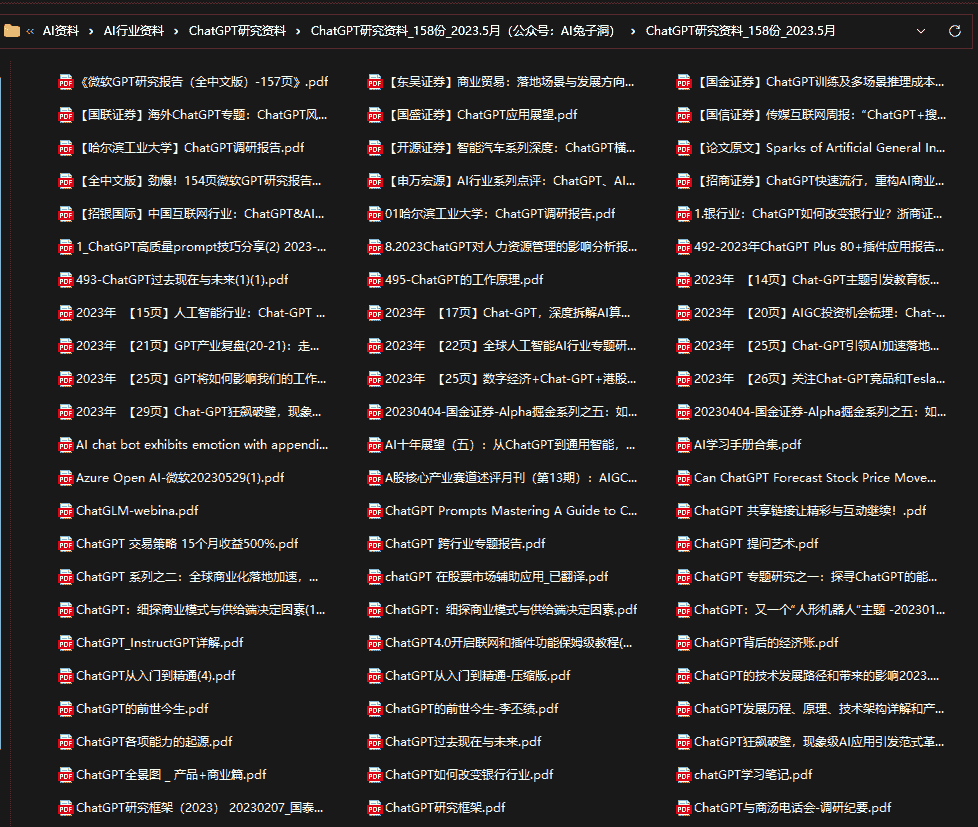
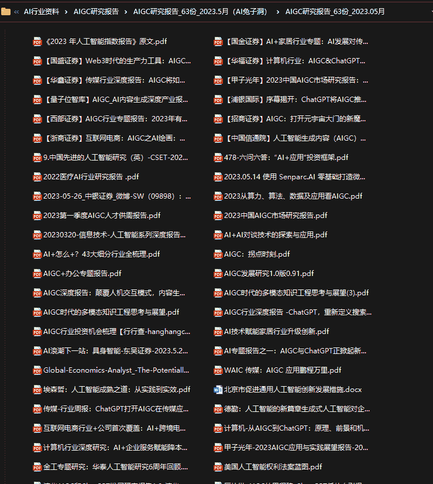
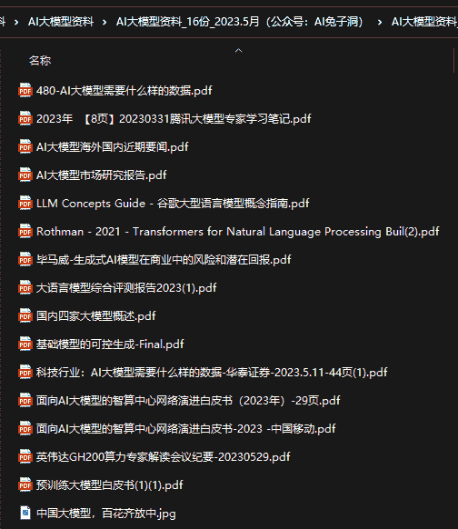
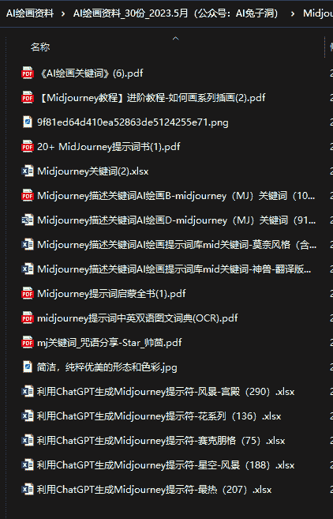
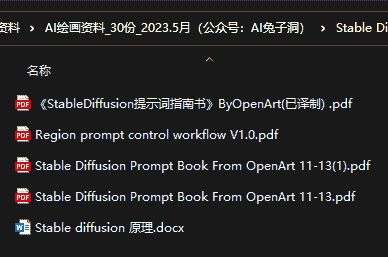
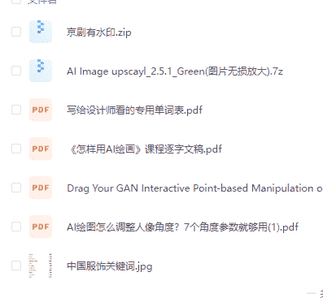
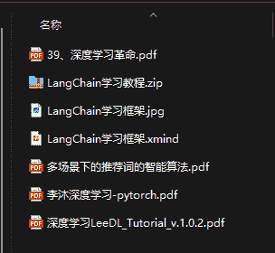
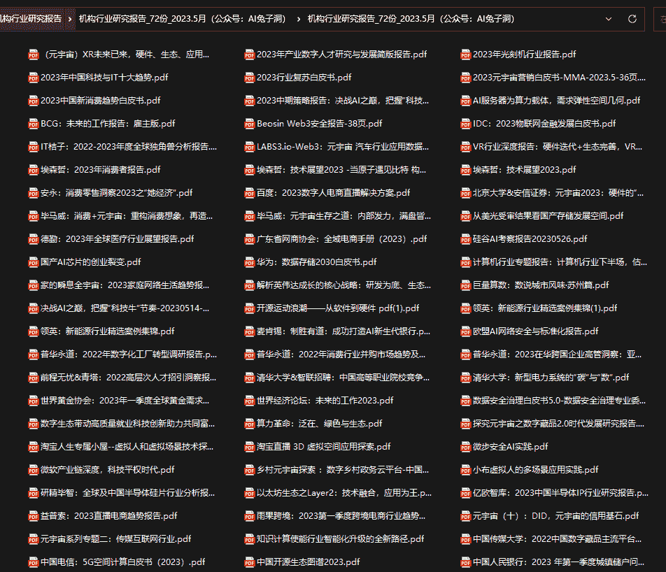
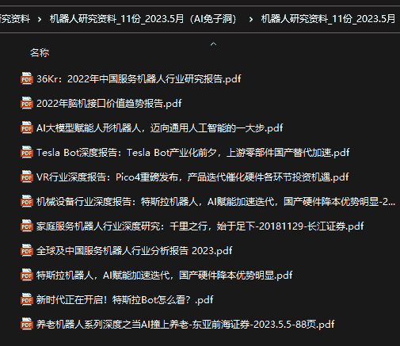

# 📕AI资料研报库（PDF）

> 来源：[https://chengchaungai.feishu.cn/docx/PfeSd6LqZoa6rPxlqL2cdhRznIY](https://chengchaungai.feishu.cn/docx/PfeSd6LqZoa6rPxlqL2cdhRznIY)

本文作者：**vigor**       twitter：**@cryptocake777**     公众号：**AI****兔子洞**

**👉进入 **[🤖 AI 智库（首页）](https://ki6j1b0d92h.feishu.cn/wiki/wikcnAFcEccJ5iXiU8MRntc2Vyb?from=from_copylink)**获取更多A****IGC内****容👈**

大家可按需选择下载，也可在最底部打包下载

## 一、ChatGPT研究资料【158份】

这个类别包括了各种与ChatGPT相关的研究报告，包括ChatGPT的原理、应用场景、市场调研等。

链接：https://pan.quark.cn/s/93e4404786fc

## 二、AIGC研究报告【63份】

这个类别包括了各种与AIGC相关的研究报告，包括AIGC技术的应用场景、发展趋势、市场前景等。

链接：https://pan.quark.cn/s/7a10933bc3bc

## 三、AI大模型资料【16份】

这个类别包括了各种与AI大模型相关的资料，包括各种大型语言模型、和自然语言处理模型等。

链接：https://pan.quark.cn/s/13aff7415d4a

## 四、AI绘画资料【30份】

这个类别包括了各种与AI绘画相关的资料，包括各种AI绘画指南和设计案例等。这些资料可以帮助普通用户或创作者更深入地了解AI绘画的使用技巧和行业设计思路。

链接：https://pan.quark.cn/s/34605f14eaf6

## 五、AI技术资料【7份】

这个类别包括了各种与AI技术相关的资料，包括各种AI算法、编程语言等参考资料。

链接：https://pan.quark.cn/s/6592e3e61cb4

## 六、机构行业研究报告【72份】

这个类别包括了各种与机构行业相关的研究报告，包括各种行业的发展趋势、产品类别、市场前景、竞争格局等。

链接：https://pan.quark.cn/s/941c3a7916dc

## 七、机器人研究资料【11份】

这个类别包括了各种与机器人相关的研究资料，包括各种机器人技术、应用案例、研究成果等。

链接：https://pan.quark.cn/s/8d733ab368e5

## **打包下载 👇**

**「****AI**行业资料-2023.5月（357份）」

链接：https://pan.quark.cn/s/c45ae01f10d2

> 关注**公众号**，加入**AI****实战交流群**，掌握全面专业的**行业资讯**、**工具分享**、**变现指南**和**实战教程**，开启你的AI智慧之旅👇👇

联系微信**JUGO737Y****（备注来意）**

公众号：**橙创****AI**

**群聊二维码**：

---

## **更多干货内容🔥🔥🔥**

> **看到最后都是最**棒的！！觉得这篇内容对你有所帮助的话，不妨分享给更多的人(球球了🙏）