# ✍喂饭级教程：自主搭建Stable Diffusion和GUI

> 来源：[https://chengchaungai.feishu.cn/docx/Bdn9dQSngonG4wxqa9Ucj1HUnjg](https://chengchaungai.feishu.cn/docx/Bdn9dQSngonG4wxqa9Ucj1HUnjg)


————**选择人工智能，链接无限未来**————

本文编辑:**JUGO** **  ****  **                                                         公众号：橙创AI


**进入👉 **[🍊橙创AI知识库（首页）](https://ix9q8jjj4ug.feishu.cn/wiki/DOsXwmRDaibJVUkDSHKcYbhmn0f)**获取更多A****IGC内****容👈**

> **查阅、整理和输出教程属实**[**不易**](https://ki6j1b0d92h.feishu.cn/wiki/wikcnOTLuqHXX6ZJ1oWEBGbd9zf?from=from_copylink)，觉得这篇教程对你有所帮助的话，不妨分享给更多需要的人呗😊

# 子页面目录

# 搭建运行环境

| **所需条件** | **版本或型号** | **备注** |
| --- | --- | --- |
| 外置独立显卡 |  | 型号越高，出图越快 |
| python | 建议 3.10以上 |  |
| git | 建议最新的 |  |
| stableDiffusion | 最新 |  |
| 中文汉化包 | 最新 |  |
| 模型 | 按需选择 | 我们可以去到这个全球最大的AI[绘画地，](https://civitai.com/)找到适合自己的或者自己喜欢的模型！Civitai：进入访问 |
| 系统 | 建议window10+ | 目前还没时间写MacOS |

## 安装Python

[Windows安装Python教程](https://chengchaungai.feishu.cn/wiki/H6rpwB3LiizrGFktKqEcD9oknoc)

## 安装Git

[Window安装Git教程](https://id8ex69uxy.feishu.cn/wiki/wikcnmcxOnoWoatV2tAVyNt8o6c)

# AI运算方法

## A、GPU运算

默认 Stable Diffusion 运行使用的是 GPU 算力，也就是说需要用到 Nvidia 显卡（配置越高，绘图越快）。如果希望使用Nvidia显卡运算，就需要配置CUDA环境。

### 安装CUDA驱动

这里需要安装 CUDA 驱动，先确定一下电脑能安装的 CUDA 版本，桌面右下角->右键 NVIDIA 设置图标->NVIDIA 控制面板：

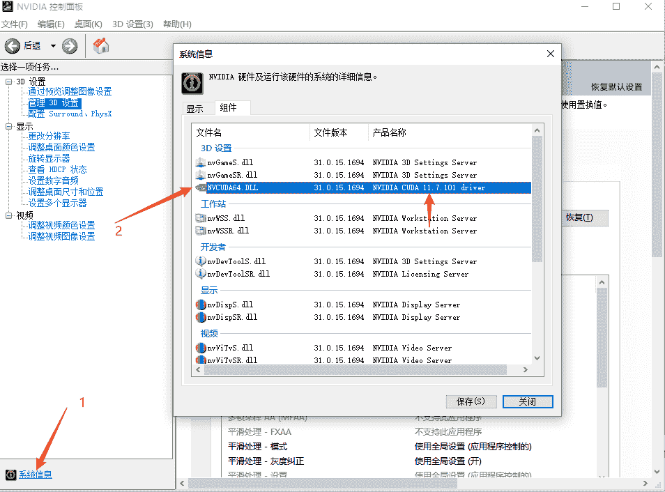

可以看到电脑的显示的是 NVIDIA CUDA 11.7.101 driver，所以要安装的 CUDA 版本不能超过 11.7。在下面的网址中找到对应的 CUDA 版本进行安装：

找到自己显卡合适的版本：

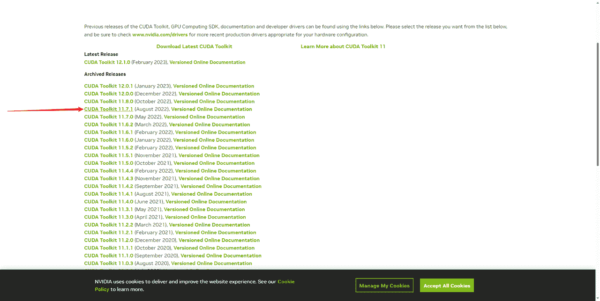

选择对应的系统：

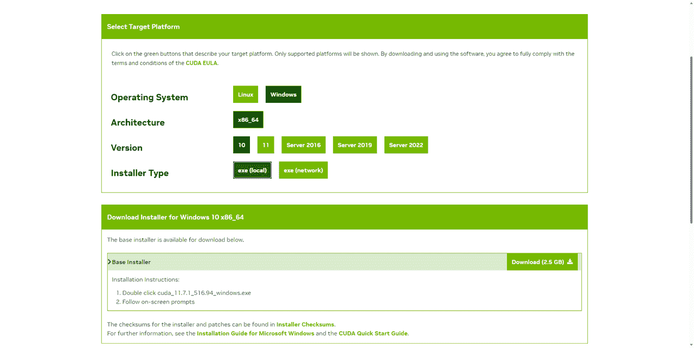

下载的程序可能需要解压

右键以管理员权限打开安装程序，直接选择精简安装就可以了

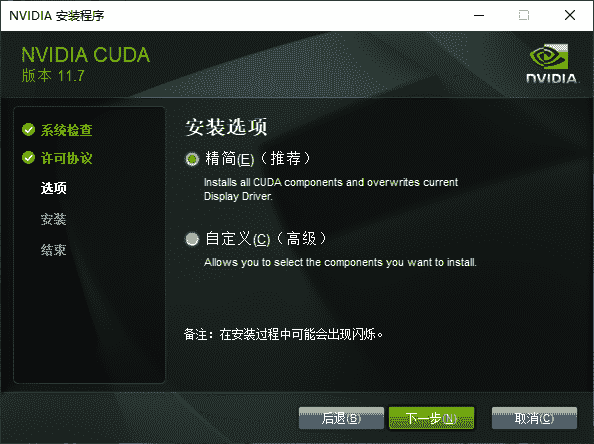

安装完成之后，可以在终端使用 nvcc --version  命令查看 CUDA 版本，来验证 CUDA 是否安装成功：

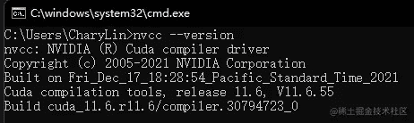

### 安装问题解决

出现CUDA安装程序失败的结果，可能有以下原因：

2、显卡驱动不是最新版，你可能使用的驱动精灵下载的兼容版本，需要上官网下载支持你系统版本最新的驱动。

1.  上官网查找合适的驱动，例如我的显卡是Geforce RTX 2060，我的系统是windows 11，那么就按下图选择，然后点击搜索

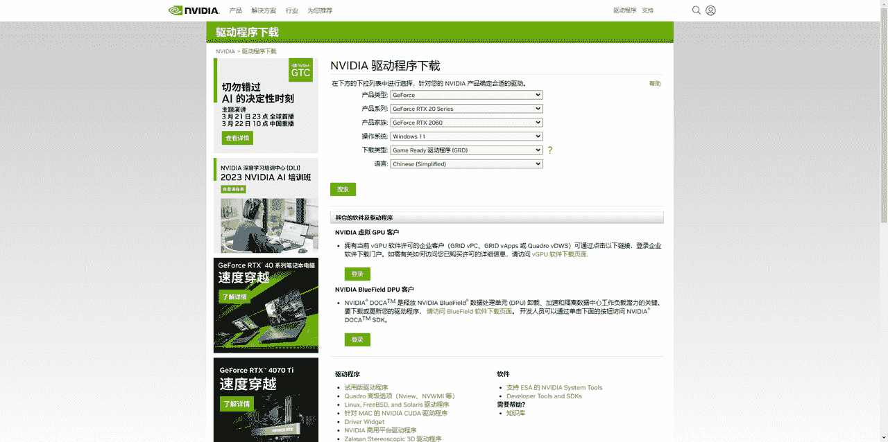

当页面跳转到合适的驱动下载页面后，点击下载即可，文件比较大，下载可能要很久

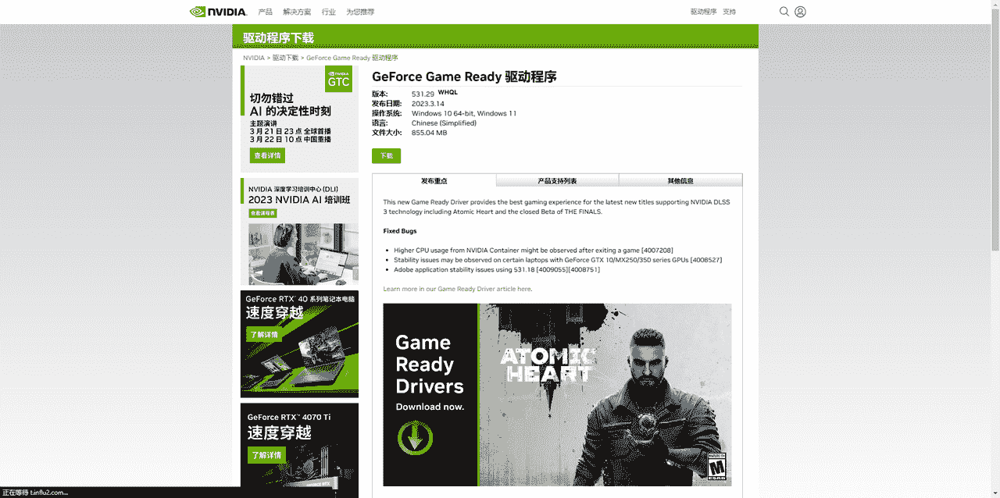

接着下载DDU清除所有显卡驱动，安装最新的驱动。然后再根据新的驱动的版本号，下载合适的CUDA版本，重新安装即可


[DDU v18.0.6.1_setup.exe](https://internal-api-drive-stream.feishu.cn/space/api/box/stream/download/all/XFkNbCsQqo0Y8JxwFOrcPquPn0c)

> 其实大多数情况是显卡驱动不是最新版，建议删掉所有显卡驱动文件，然后直接上官网下载CUDA安装包即可，这个安装包会同时安装显卡驱动

## B、CPU运算

如果你没有 Nvidia 显卡，也可以通过给 Stable Diffusion 指定运行参数 --use-cpu sd，让其使用 CPU 算力运行，但是非常不建议你这么做，CPU 算力跟 GPU 算力相比简直天差地别，可能 GPU 只需要 10 秒就能绘制完成，而 CPU 却要 10 分钟，这不是开玩笑的。另外，如果你的显卡内存不多，建议 4G 的显卡加上 --medvram 启动参数，2G 的显卡加上 --lowvram 启动参数。怎么配置启动参数我们后面说。

# 安装Stable Diffusion

以下有几个多个仓库，有各自的优缺点，可以按需选择：

| 类型 | 地址 | 备注 | 推荐值 |
| --- | --- | --- | --- |
| 官方 | https://github.com/CompVis/stable-diffusion | 官方发布，能最快获更新 | 不适合小白 |
| AUTOMATIC1111 | https://github.com/AUTOMATIC1111/stable-diffusion-webui | 封装可视化UI界面，是最火的，功能最多的版本 | 推荐 |
| sygil-webui | https://github.com/Sygil-Dev/sygil-webui |  |  |

此开源项目没有发布可执行的软件，所以我们需要将源代码下载到本地，然后来运行，以下有两种方法获得源代码：

## A、直接下载

> 此方法适合没有开发经历的非IT体验用户，缺点是此项目目前更新频率很快，会不定期修复一些bug或加入一些新功能。官方如有更新，更新较麻烦

打开网页 [AUTOMATIC1111](https://github.com/AUTOMATIC1111/stable-diffusion-webui) 的GitHub主页，点击绿色按钮后点击下载Zip压缩包

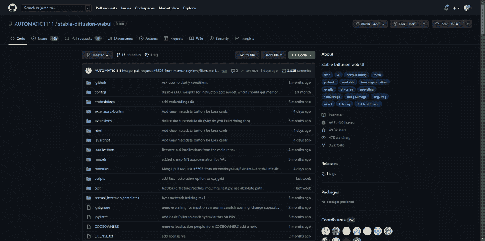

## B、克隆下载

如果你是有开发经验的人士，可以通过使用git的方式将源代码pull下来运行：

> 注意：此方法要提前配置好git和git[Window安装Git教程](https://id8ex69uxy.feishu.cn/wiki/wikcnmcxOnoWoatV2tAVyNt8o6c)ub的SSH，具体方法请看：

1.  先在本地建一个文件夹，然后进入文件夹中：

1.  打开终端，cd到这个目录

```
git clone git@github.com:AUTOMATIC1111/stable-diffusion-webui.git
```

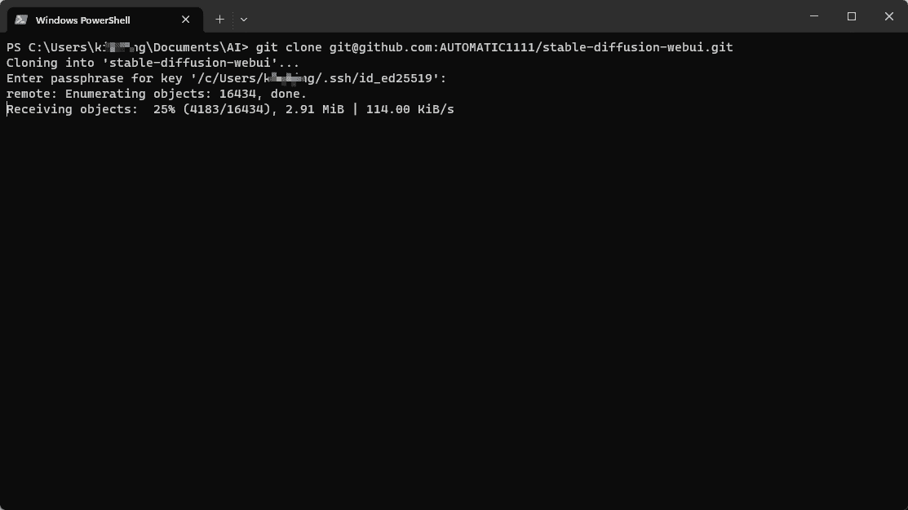

# 启动项目环境

## 下载程序包的运行教程

如果你是通过下载程序包来体验的，首先你需要将程序压缩包移动到一个合适的位置（例如我的文档，D盘之类的，保证有足够大的存储空间），然后解压压缩包。

1、解压后确认目录结构，就是这个文件夹下没有其他层级的文件夹就可以了

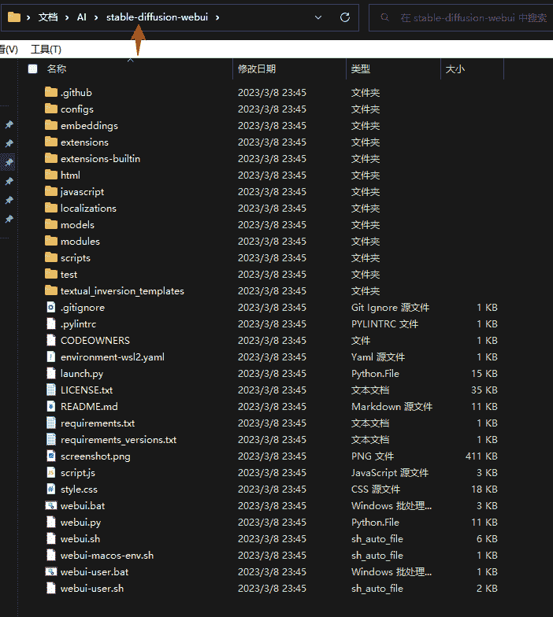

2、接着在安装配置好运行环境之后，直接运行工程下的 webui-user.bat 文件即可。首次启动会自动下载一些 Python 依赖库，以及项目需要用到的配置和模型文件（比如：v1-5-pruned-emaonly.safetensors，将近 4 个 G~），初始化一次之后，下次启动就快了。(此处建议开启科学，否则可能下载失败）

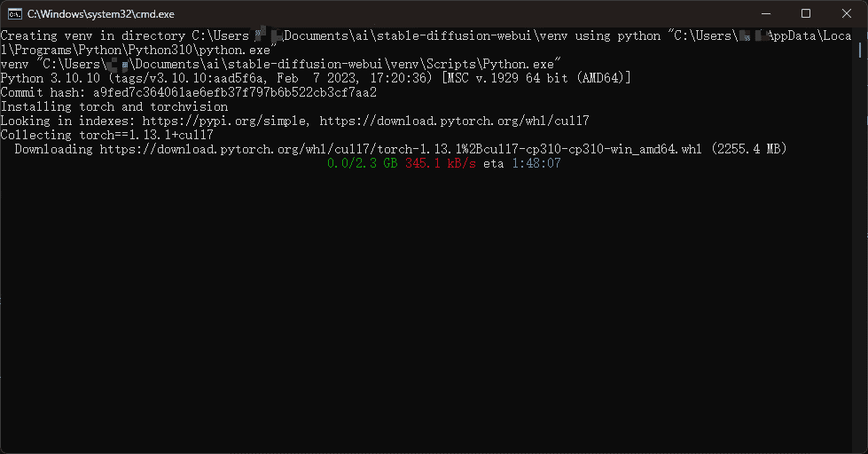

看到这个提示就说明成功运行起来了，打开网址就可以看到程序的运行界面了：

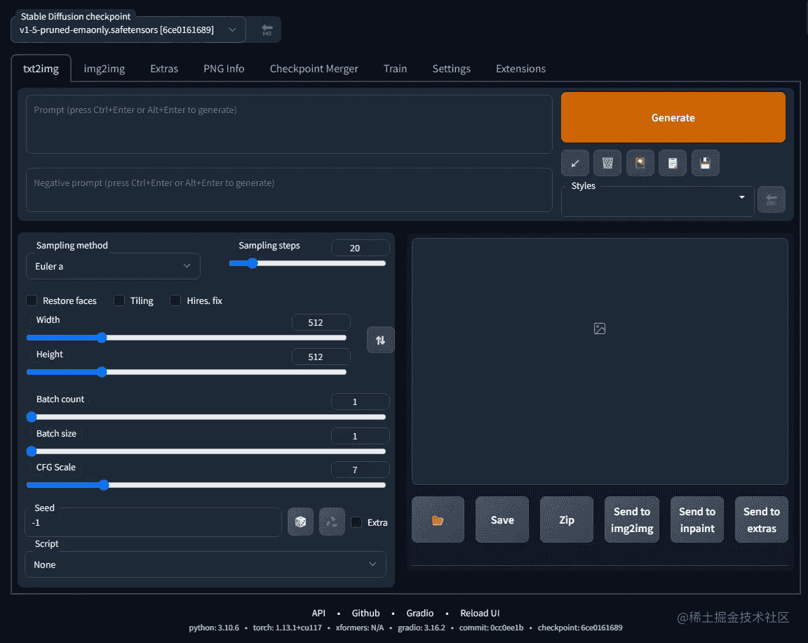

### 异常处理

如果出现下面提示，说明要需要升级pip版本，需要执行绿色的命令，鼠标拖动选择，然后右键，自动复制

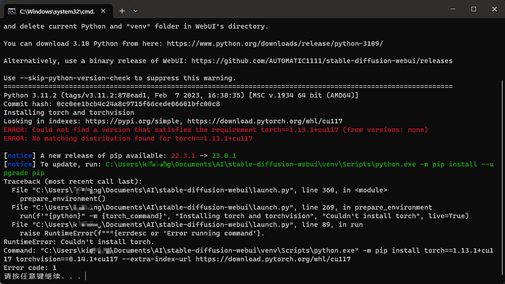

打开新的标签页，粘贴命令

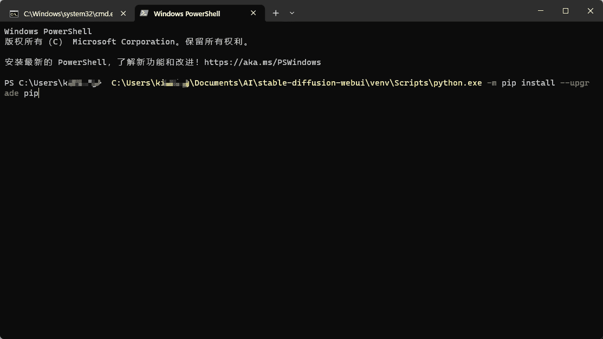

出现这样就代表升级成功，再次重新执行 webui-user.bat

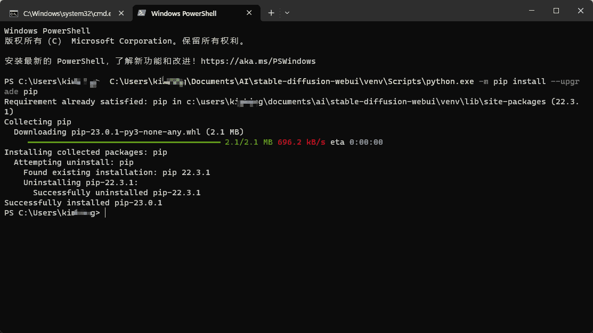

## 中文界面实现

Stable Diffusion Web的UI是英文页面，但是目前已有大佬完成了中文的补丁

以下有两种方法安装语言包：

A、**通过WebUI拓展进行安装**

1.  打开stable diffusion webui，进入"Extensions"选项卡

1.  点击"Install from URL"，注意"URL for extension's git repository"下方的输入框

1.  粘贴或输入本Git仓库地址https://github.com/VinsonLaro/stable-diffusion-webui-chinese

1.  点击下方的黄色按钮"Install"即可完成安装，然后重启WebUI(点击"Install from URL"左方的"Installed"，然后点击黄色按钮"Apply and restart UI"网页下方的"Reload UI"完成重启)

1.  点击"Settings"，左侧点击"User interface"界面，在界面里最下方的"Localization (requires restart)"，选择"Chinese-All"或者"Chinese-English"

1.  点击界面最上方的黄色按钮"Apply settings"，再点击右侧的"Reload UI"即可完成汉化

B、**直接复制翻译好的本地化模板**

1.  在任意目录下使用git clone https://github.com/VinsonLaro/stable-diffusion-webui-chinese

1.  进入下载好的文件夹,把"localizations"文件夹内的"Chinese-All.json"和"Chinese-English.json"复制到"stable-diffusion-webui\localizations"目录下

1.  点击"Settings"，左侧点击"User interface"界面，在界面里最下方的"Localization (requires restart)"，选择"Chinese-All"或者"Chinese-English"

1.  点击界面最上方的黄色按钮"Apply settings"，再点击右侧的"Reload UI"即可完成汉化

# 使用

stable-diffusion-webui 的功能很多，主要有如下 2 个：

+   文生图（text2img）：根据提示词（Prompt）的描述生成相应的图片。

+   图生图（img2img）：将一张图片根据提示词（Prompt）描述的特点生成另一张新的图片。

## 1、文生图（text2img）

在开始使用文生图之前，有必要了解以下几个参数的含义：

| **参数** | **说明** |
| --- | --- |
| Prompt | 提示词（正向），网友戏称魔咒 |
| Negative prompt | 消极的提示词（反向） |
| Width &amp; Height | 要生成的图片尺寸。尺寸越大，越耗性能，耗时越久。 |
| CFG scale | AI 对描述参数（Prompt）的倾向程度。值越小生成的图片越偏离你的描述，但越符合逻辑；值越大则生成的图片越符合你的描述，但可能不符合逻辑。 |
| Sampling method | 采样方法。有很多种，但只是采样算法上有差别，没有好坏之分，选用适合的即可。 |
| Sampling steps | 采样步长。太小的话采样的随机性会很高，太大的话采样的效率会很低，拒绝概率高(可以理解为没有采样到,采样的结果被舍弃了)。 |
| Seed | 随机数种子。生成每张图片时的随机种子，这个种子是用来作为确定扩散初始状态的基础。不懂的话，用随机的即可。 |

> 以下参考文章是对参数的解释：

> https://baijiahao.baidu.com/s?id=1758865024644276830&wfr=spider&for=pc

接下来我们来生成一张赛博朋克风格的猫咪图片，配置以下参数后，点击 "Generate" 即可：

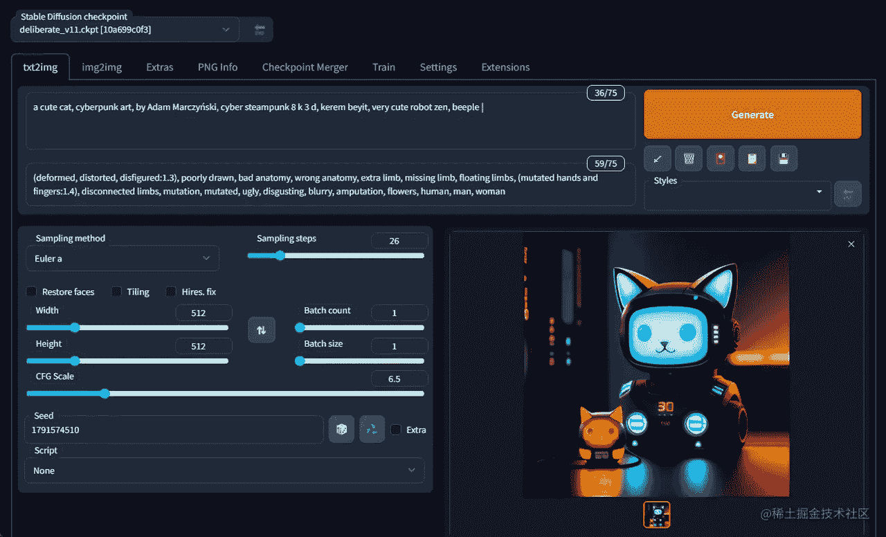

> 注：提示词（Prompt）越多，AI 绘图结果会更加精准，另外，目前中文提示词的效果不好，还得使用英文提示词。

2、图生文

# 模型文件

眼尖的你可能发现了，上面截图里左上角 Stable Diffusion checkpoint 的值怎么跟之前截图里的不一样？这是因为我换了一个模型文件，还记得前面提到那个将近 4 个 G 大小的模型文件（v1-5-pruned-emaonly.safetensors）吗？那是 stable-diffusion-webui 的默认模型文件，用这个模型文件生成出来的图片比较丑，因此我换了另一个模型文件。模型文件下载的网站几个，比较出名的就是 civitai，这上面共享的都是别人训练好的模型。

模型文件下载推荐网站 Civitai：

> 更多的模型网站：[🔧AI工具百宝箱（不定时更新）](https://chengchaungai.feishu.cn/wiki/SBF5wcoVgim5cJkL9evcdSxKnEd)

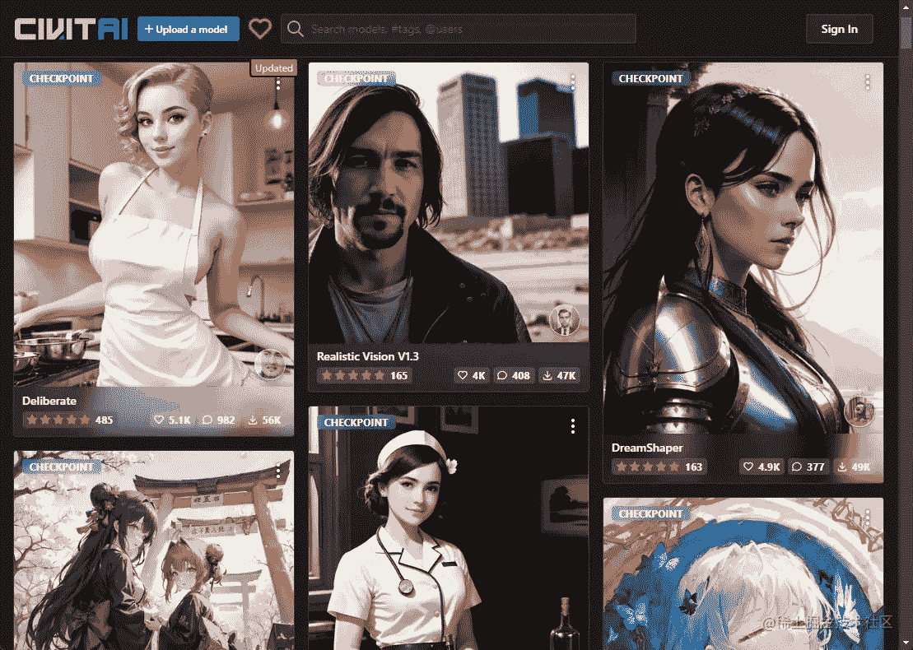

> 默认的 v1-5-pruned-emaonly：https://huggingface.co/runwayml/stable-diffusion-v1-5/tree/main

根据你要生成的图片风格（比如：动漫、风景），挑选合适的模型查看，前面那个文生图的例子，使用的就是这个 Deliberate 模型，直接点击 "Download Latest" 即可下载该模型文件。

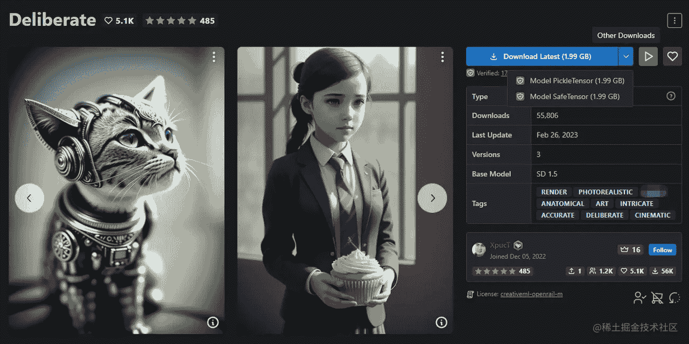

> 注：模型文件有 2 种格式，分别是 .ckpt（Model PickleTensor） 和 .safetensors（Model SafeTensor），据说 .safetensors 更安全，这两种格式 stable-diffusion-webui 都支持，随意下载一种即可。

将下载好的模型文件放到 stable-diffusion-webui\models\Stable-diffusion 目录下：

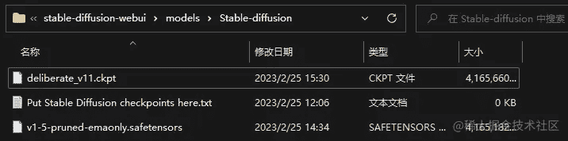

放置好模型文件之后，需要重启一下 stable-diffusion-webui（执行 webui-user.bat）才能识别到。

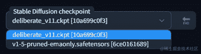

这些模型文件一般会附带一组效果图，点击任意一张，就可以看到生成该效果图的一些参数配置：

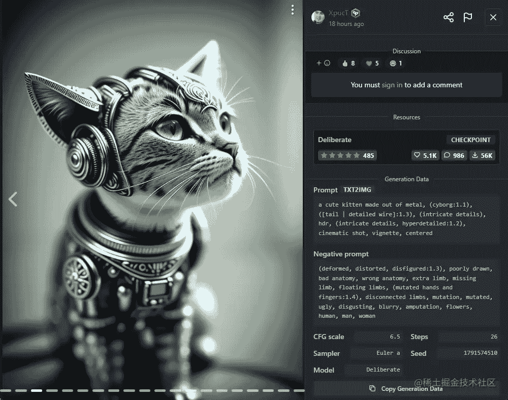

把这些参数配置到 stable-diffusion-webui 中，点击 "Generate" 就可以生成类似效果的图片了。

> 注：因为 AI 绘图带有随机性质，所以生成出来的图片跟效果图不一定完全一样。

文生图功能有很多东西可以发掘，你可以用它来生成世界上独一无二的图片，而要用好文生图功能，提示词（Prompt）是必须掌握的重中之重，它是有语法规则的，在此推荐两篇对 Prompt 详细说明的文章：

+   全网 Stable Diffusion Prompt 运用技巧：www.bilibili.com/read/cv1990…

+   Prompt 工具網站：www.accucrazy.com/prompt-tool…

# 工程配置

前面说到，stable-diffusion-webui 是可以配置启动参数的，这是官方的 wiki：

+   配置参数文档：github.com/AUTOMATIC11…

## 常用参数

这里列几个常用的参数说明一下：

| **参数** | **说明** |
| --- | --- |
| --listen | 默认启动绑定的 ip 是 127.0.0.1，只能是你自己电脑可以访问 webui，如果你想让同个局域网的人都可以访问的话，可以配置该参数（会自动绑定 0.0.0.0 ip）。 |
| --port xxx | 默认端口是 7860，如果想换个端口，可以配置该参数，例如：--port 8888。 |
| --gradio-auth username:password | 如果你希望给 webui 设置登录密码，可以配置该参数，例如：--gradio-auth GitLqr:123456。 |
| --use-cpu | 默认使用 GPU 算力（需要 Nvidia 显卡），如果没显卡，可以配置该参数，改用 CPU 算力。 |
| --medvram | 为低显存（比如：4G）启用模型优化，会牺牲一点速度。 |
| --lowvram | 为极低显存（比如：2G）启用模型优化，会牺牲很多速度。 |
| --autolaunch | 启动时自动打开浏览器访问 webui。 |

要配置这些参数很简单，打开 webui-user.bat，把你需要配置的参数添加到 COMMANDLINE_ARGS 后面即可：

```
@echo off

set PYTHON=
set GIT=
set VENV_DIR=
set COMMANDLINE_ARGS=--listen --port 8888 --gradio-auth GitLqr:123456 --autolaunch

call webui.bat
```

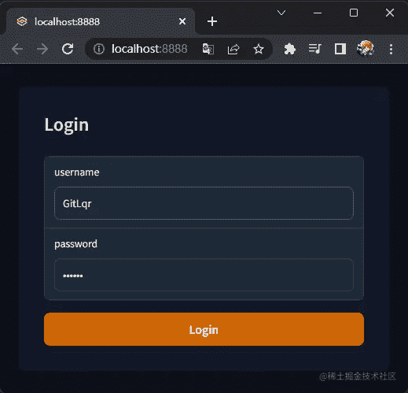

## API 接口服务

除了上述几个常用的参数外，还有一个特别的参数 --api，可以在启动 stable-diffusion-webui 的同时，启动一个接口服务，在 COMMANDLINE_ARGS 后面追加上 --api：

```
@echo off

set PYTHON=
set GIT=
set VENV_DIR=
set COMMANDLINE_ARGS=--listen --port 8888 --gradio-auth GitLqr:123456 --autolaunch --api

call webui.bat
复制代码
```

重启后在 url 后面加上 /docs 即可看到 api 请求说明文档：

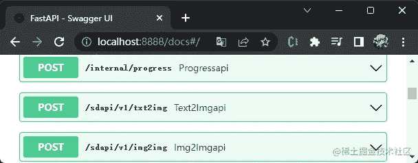

这样我们就可以通过编写程序的方式，使用文生图、图生图等功能了，关于接口传参格式等要求，参见官方 wiki：

+   官方 api 说明文档：github.com/AUTOMATIC11…

> 关注**公众号**，加入**AI****实战交流群**，掌握全面专业的**行业资讯**、**工具分享**、**变现指南**和**实战教程**，开启你的AI智慧之旅👇👇

联系微信**JUGO737Y****（备注来意）**


公众号：**橙创****AI**


**群聊二维码**：

