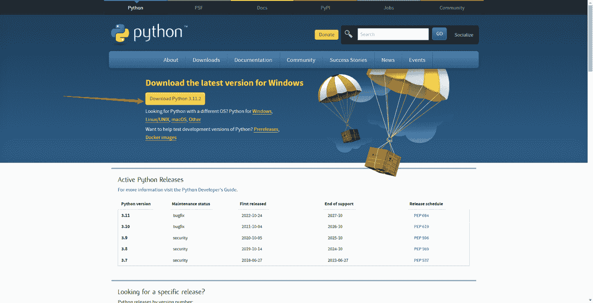
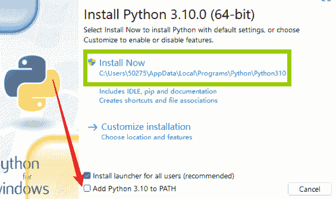
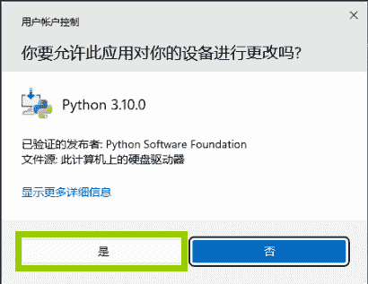
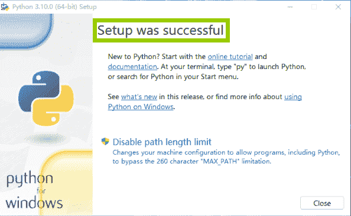
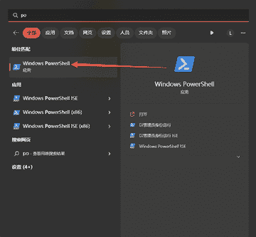
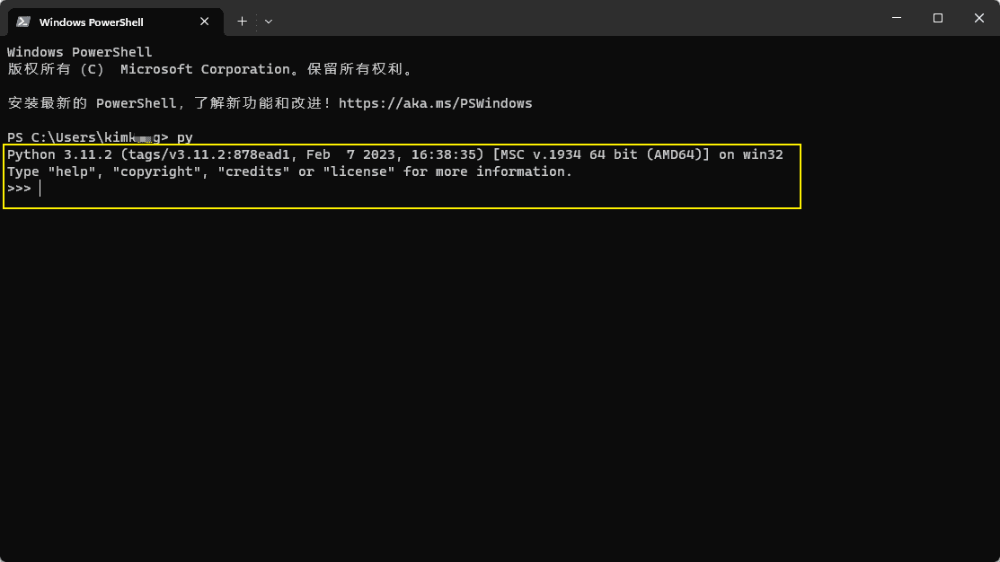
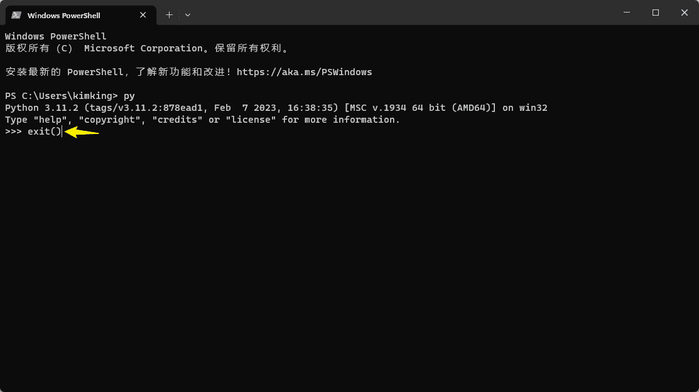

# Windows安装Python教程

> 来源：[https://chengchaungai.feishu.cn/docx/C3ynd5fMCogO56xTg0McTtvknlc](https://chengchaungai.feishu.cn/docx/C3ynd5fMCogO56xTg0McTtvknlc)

————**选择人工智能，链接无限未来**————

本文编辑:**JUGO** **  ****  **                                                         公众号：橙创AI

**进入👉 **[🍊橙创AI知识库（首页）](https://ix9q8jjj4ug.feishu.cn/wiki/DOsXwmRDaibJVUkDSHKcYbhmn0f)**获取更多A****IGC内****容👈**

> **查阅、整理和输出教程属实**[**不易**](https://ki6j1b0d92h.feishu.cn/wiki/wikcnOTLuqHXX6ZJ1oWEBGbd9zf?from=from_copylink)，觉得这篇教程对你有所帮助的话，不妨分享给更多需要的人呗😊

# 下载安装包

访问官网下载最新版Python

# 安装步骤

1.  双击打开安装程序（前面是名称，后面是版本号，不同时间版本不相同）

1.  打开程序第一步，一定勾选 Add python XXX to PATH，目的是添加到系统环境变量，防止程序报错

1.  如果出现类似下面的系统 "授权”对话框，同意即可

1.  接着一路默认设置，等待安装进度完成即可

# 开始使用

1.  通过 windows 搜索框，搜索powershell，点击打开

1.  打开后输入py，如果出现以下内容，说明成功安装

1.  使用exit()退出python，最小化powershell窗口（后面还需要用，所以不用关闭）

# 完成

至此python就成功安装到系统中，如果需要卸载，重新运行安装程序，选择uninstall即可卸载

> 关注**公众号**，加入**AI****实战交流群**，掌握全面专业的**行业资讯**、**工具分享**、**变现指南**和**实战教程**，开启你的AI智慧之旅👇👇

联系微信**JUGO737Y****（备注来意）**

公众号：**橙创****AI**

**群聊二维码**：

