# windows安装GIT教程

> 来源：[https://chengchaungai.feishu.cn/docx/RZNFdP9uAoaEgJxTTQ3cHI31nPb](https://chengchaungai.feishu.cn/docx/RZNFdP9uAoaEgJxTTQ3cHI31nPb)


————**选择人工智能，链接无限未来**————

本文编辑:**JUGO** **  ****  **                                                         公众号：橙创AI


**进入👉 **[🍊橙创AI知识库（首页）](https://ix9q8jjj4ug.feishu.cn/wiki/DOsXwmRDaibJVUkDSHKcYbhmn0f)**获取更多A****IGC内****容👈**

> **查阅、整理和输出教程属实**[**不易**](https://ki6j1b0d92h.feishu.cn/wiki/wikcnOTLuqHXX6ZJ1oWEBGbd9zf?from=from_copylink)，觉得这篇教程对你有所帮助的话，不妨分享给更多需要的人呗😊

# 下载安装包

访问官网下载最新版本的安装包（此处直接可跳到windows版本）：

点击下方链接下载发布的稳定版本

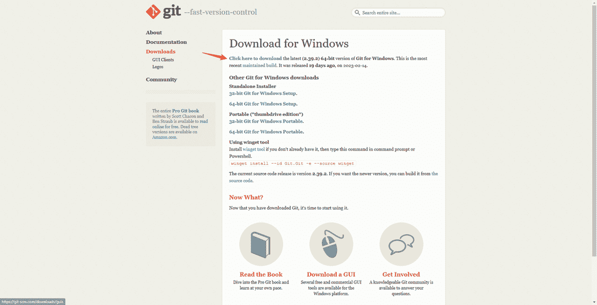

# 安装程序

1.  双击下载的安装程序开始安装（同理，后方为发布版本号，因时间不同可能不同，不影响）


1.  直接保持默认，下一步


1.  如果有需要，可以将安装目录修改至D盘（将C：改成 D：即可）

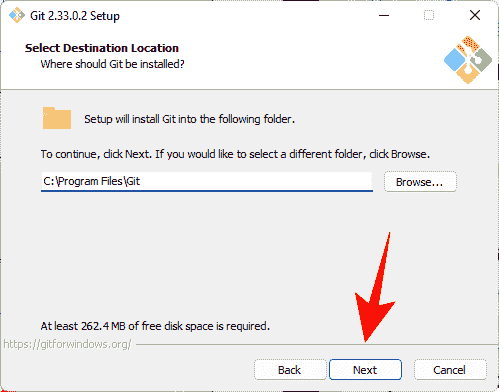

新版本可以将git bash作为windows的终端，可以勾选

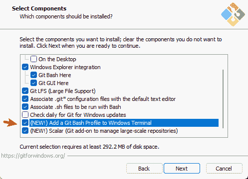

1.  后续的安装全部保持默认即可（都是些开发人员用的配置，感兴趣可以看这篇文章的解释：https://www.windows11.pro/5639.html），一路点下一步直到最后，然后点击完成；


# 使用

打开windows的powershell（打开方法请看[Windows安装Python教程](https://chengchaungai.feishu.cn/wiki/H6rpwB3LiizrGFktKqEcD9oknoc) ），输入git，如果出现下面内容说明安装成功

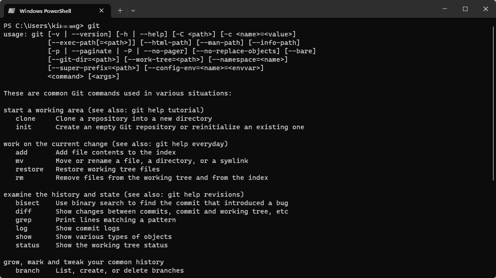

# 注册GitHub

GitHub是全球最出名的开源代码分享平台，我们要用到的AI绘画程序 Stable Diffusion 也是在这个平台开源分享代码。

# 配置SSH

如果需要向GitHub平台push或pull代码，就需要用到git和SSH。简单说，SSH是一种网络协议，用于计算机之间的加密登录。如果一个用户从本地计算机，使用SSH协议登录另一台远程计算机，我们就可以认为，这种登录是安全的，即使被中途截获，密码也不会泄露。因为我们是全新安装，所以那么直接开始生成密钥吧：

## 1、生成本地SSH key

1.  打开powershell，粘贴以下命令然后执行，其中 your_email@example.com 替换为你在GitHub注册的账号

```
ssh-keygen -t ed25519 -C &quot;your_email@example.com&quot;
```

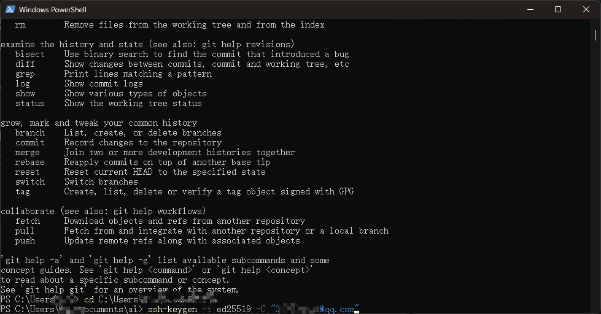

1.  直接回车，默认路径保存

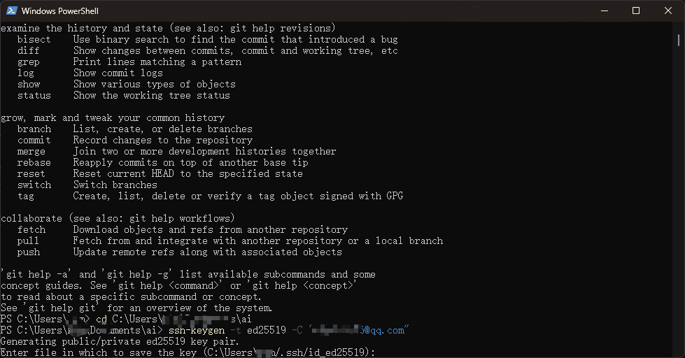

1.  接着是输入密码，如果不想可以留空，回车两次就生产了SSH key

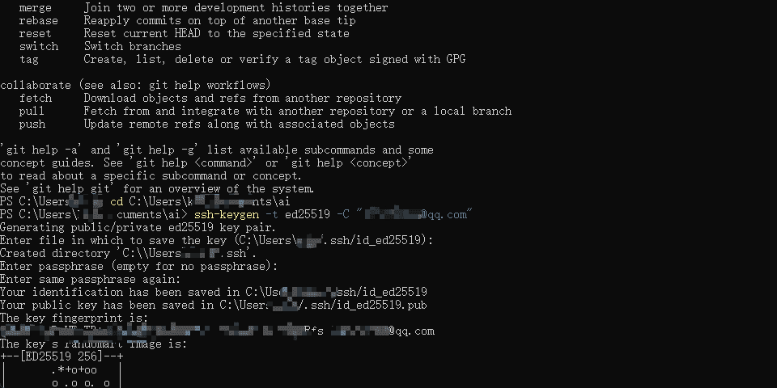

> 如果是连接GitHub账号，需要输入GitHub的账号密码

1.  复制路径C:\Users\***\.ssh，用文件夹打开， 然后右键后缀为.pub这个文件，选择打开方式，然后选择记事本

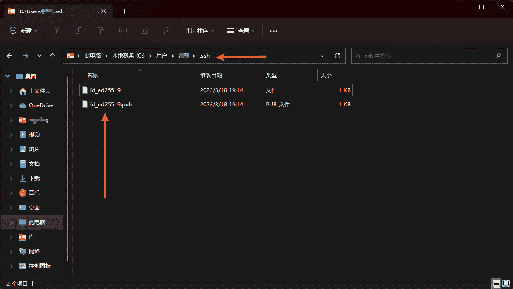

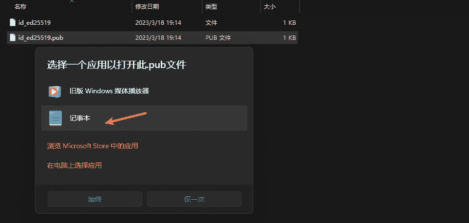

> Linux系统可以使用：cat ~/.ssh/id_ed25519.pub 命令

1.  这就是SSH key，全选复制


## 2、设置GitHub的SSH

登录GitHub，打开设置

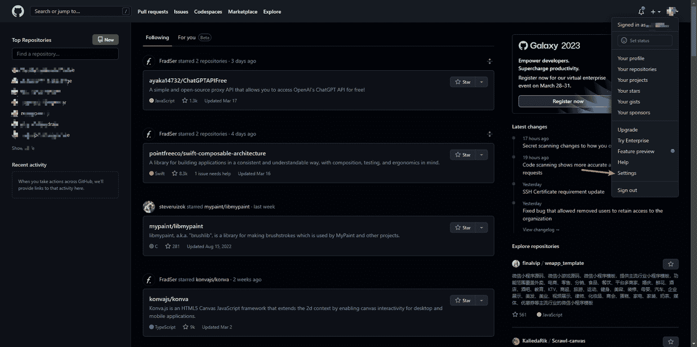

点击菜单SSH and GPG keys

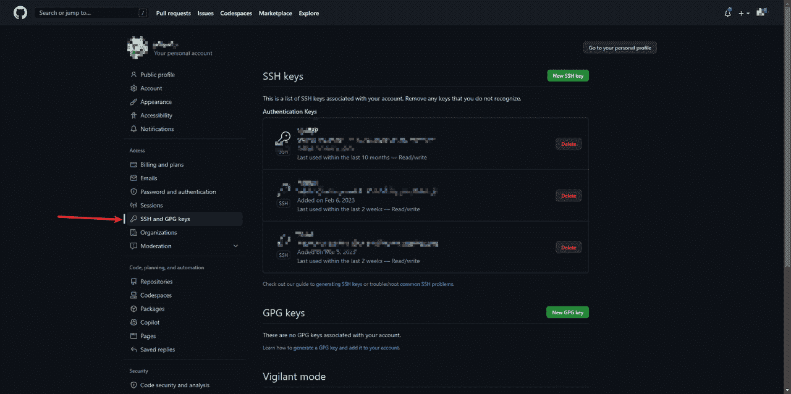

粘贴前面复制的SSH key，title可以随便取一个，保存即可

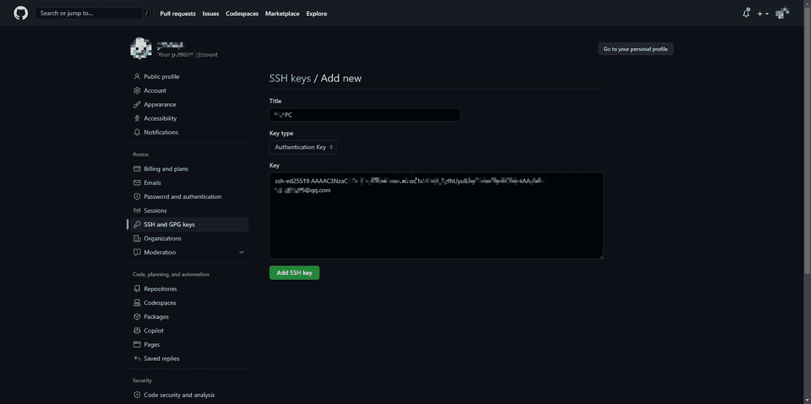

> 关注**公众号**，加入**AI****实战交流群**，掌握全面专业的**行业资讯**、**工具分享**、**变现指南**和**实战教程**，开启你的AI智慧之旅👇👇

联系微信**JUGO737Y****（备注来意）**


公众号：**橙创****AI**


**群聊二维码**：

