# 🤖ChatGPT基础入门

> 来源：[https://chengchaungai.feishu.cn/docx/SvCWdPGSloa3kZx7kPqcJ0yEnHb](https://chengchaungai.feishu.cn/docx/SvCWdPGSloa3kZx7kPqcJ0yEnHb)

————**选择人工智能，链接无限未来**————

本文编辑:**JUGO**

**进入👉 **[🍊橙创AI知识库（首页）](https://ix9q8jjj4ug.feishu.cn/wiki/DOsXwmRDaibJVUkDSHKcYbhmn0f)**获取更多AIGC内容👈**

# **一、差异对比**

说明：注册流程较为敏感，此处已删减

普通版和 Plus 版本差异化：

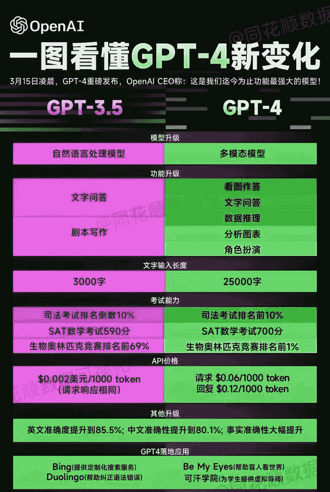

# **二、知识相关科普**

**ChatGPT**** 概念：**ChatGPT（全名：Chat Generative Pre-trained Transformer），美国 OpenAI 研发的聊天机器人程序 ，于 2022 年 11 月 30 日发布。ChatGPT 是人工智能技术驱动的自然语言处理工具，它能够通过理解和学习人类的语言来进行对话，还能根据聊天的上下文进行互动，真正像人类一样来聊天交流，甚至能完成撰写邮件、视频脚本、文案、翻译、代码，写论文 等任务。2023 年 1 月末，ChatGPT 的月活用户已突破 1 亿，成为史上增长最快的消费者应用。

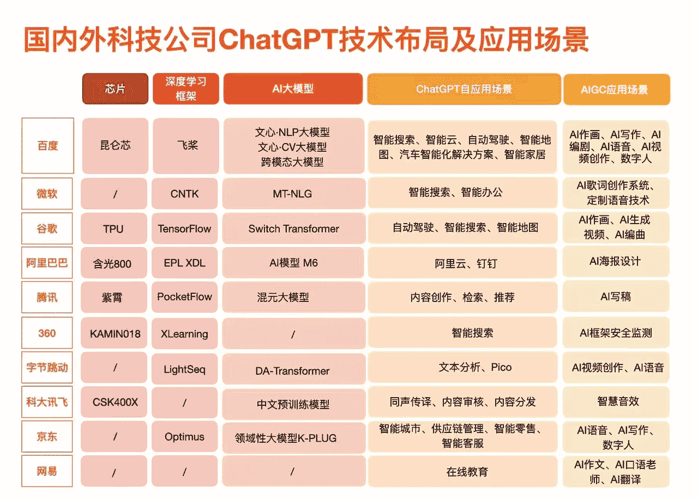

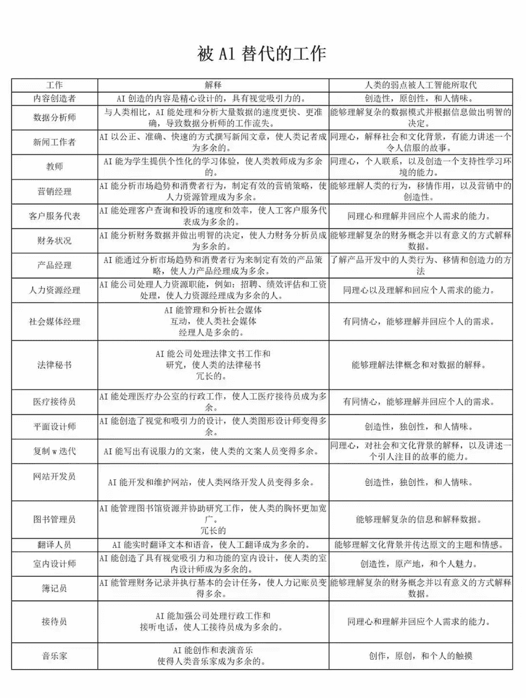

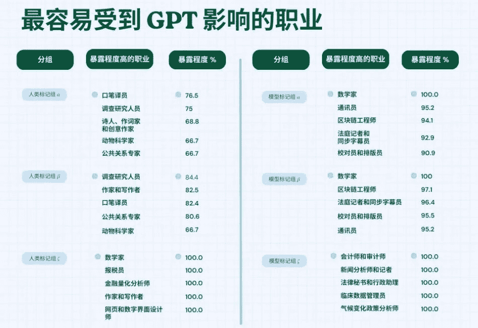

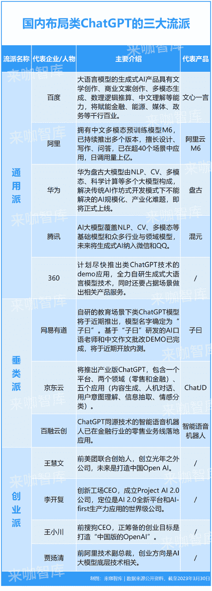

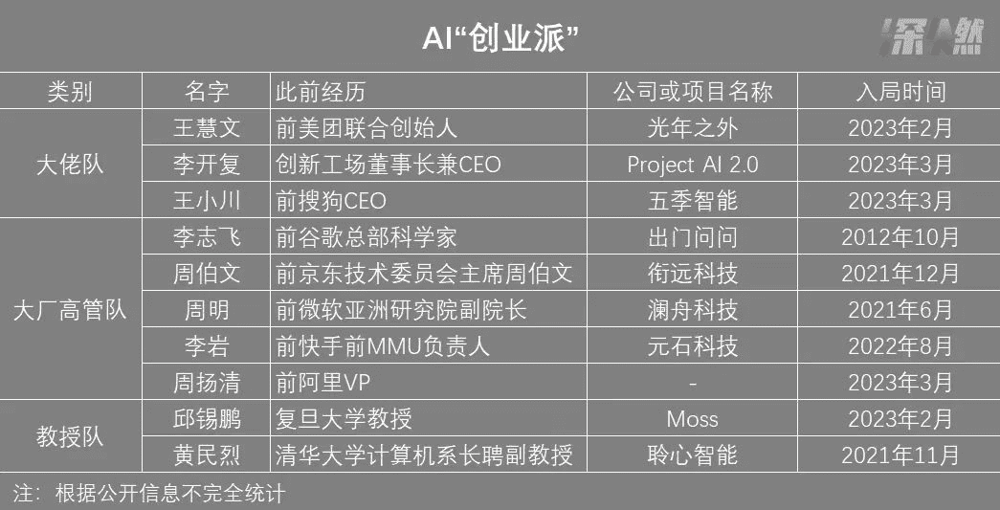

# 三、使用相关指南

相关PDF免费分享：

链接：[📕AI资料研报库（PDF）](https://chengchaungai.feishu.cn/wiki/JKIfwsioli0OzCk6ZmEcQf78nac)

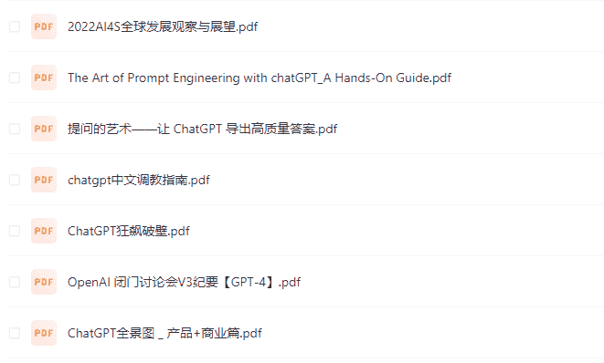

**OpenAI**** 官方提供的 ****ChatGPT**** 用法参考**

**ChatGPT**** 的提问技巧汇总：**[Gi](https://github.com/f/awesome-chatgpt-prompts#act-as-a-stand-up-comedian)**tHub - **f/awesome-chatgpt-prompts： This repo includes ChatGPT prompt curation to use ChatGPT better（浏览器翻译）

**ChatGPT**** 使用技巧提示：**https://quickref.me/chatgpt

[🤖ChatGPT中文角色预设提示词大全，让AI更懂你！](https://chengchaungai.feishu.cn/wiki/ZjVcwTI45iRlFpkByAocetOmnjL)** ****（建议收藏）**

在使用 ChatGPT 时，当你给的指令越精确，它的回答会越到位，举例来说，假如你要请它帮忙写文案，如果没给予指定情境与对象，它会不知道该如何回答的更加准确。

**一、写报告**

1、我现在正在 [报告的情境与目的]。我的简报主题是 [主题]，请提供 [数字] 种开头方式，要简单到 [目标族群] 能听懂，同时要足够能吸引人，让他们愿意专心听下去

我现在正在修台大的简报课，其中一项作业是要做一份让小学生能听懂的简报。我的简报主题是机会成本，请提供三种开头方式，要简单到小学生能听懂，同时要足够能吸引人，让他们愿意专心听下去

2、写出一篇有关 [知识] 的 [数字] 字研究报告，报告中需引述最新的研究，并引用专家观点

写出一篇有关自动驾驶的 300 字研究报告，报告中需引述最新的研究，并引用专家观点

3、你是 [某个主题] 的专家，请针对以下论述 [附上论述]，提出 [数字] 个反驳的论点，每个论点都要有佐证

你是大数据分析的专家，请针对以下论述「在数据分析中，越多数据越好」，提出 3 个反驳的论点，每个论点都要有佐证

4、你是 [某个主题] 的专家，请总结以下内容，并针对以下内容提出未来能进一步研究的方向 [附上内容]

你是金融科技专家，请总结以下内容，并针对以下内容提出未来能进一步研究的方向 [附上内容]

**二、资料整理**

1、给我 [数字] 篇，有关 [领域] 的文章。

给我 5 篇，有关 SEO 的文章。

2、用列点的方式总结出这篇文章的 [数字] 个重点：[附上文章内容/附上文章网址]。

用列点的方式总结出这篇文章的 5 个重点：[附上文章内容/附上文章网址]。

3、用列点的方式总结出 [数字] 个 [领域] 知识重点

用列点的方式总结出 10 个量子力学知识重点。

**三、简历与自传**

1、这份 [职位] 的简历，有哪边可以写更好？ 请以专业面试官的角度，提出具体改进建议。接着以你提出的建议来改写这段经历，改写时请维持列点的形式。[附上简历]

这份 UIUX 设计师的简历，有哪边可以写更好？ 请以专业面试官的角度，提出具体改进建议。接着以你提出的建议来改写这段经历，改写时请维持列点的形式。

2、改写以下简历，为每一点加上量化的数据，改写时请维持列点的形式。[附上简历]

3、把这段经历写得更精简一点，让别人可以马上看到重点，同时维持生动的描述。[附上经历]

4、为不同公司定制化撰写简历

我今天要申请[公司]的[职位]，改写以下经历，让我能更符合[公司]的企业文化。[附上经历]

我今天要申请 Google 的前端工程师，改写以下经历，让我能更符合 Google 的企业文化。[附上经历]

**四、准备面试**

1、你现在是[公司]的[职位]面试官，请分享在[职位]面试时最常会问的[数字]个问题。

你现在是 Google 的产品经理面试官，请分享在 Google 产品经理面试时最常会问的 5 个问题。

2、我针对 [问题] 的回答，有哪些可以改进的地方？ [附上回答]

我针对「你会如何排定不同产品功能优先顺序？」的回答，有哪些可以改进的地方？ [附上回答]

3、针对 [问题] 这个面试问题，请提供一些常见的追问面试题。

针对「你会如何排定不同产品功能优先顺序？」这个面试问题，请提供一些常见的追问面试题。

4、我在准备 [问题] 这个面试问题，请用 STAR 原则帮我回答这个问题。针对这个问题，我有的经历如下 [附上经历]

我在准备「请分享一个你在急迫的期限中完成专案的经验」这个面试问题，请用 STAR 原则帮我回答这个问题。针对这个问题，我有的经历如下 [附上经历]。

**五、程式**

1、你现在是一个 [程式语言] 专家，请帮我用 [程式语言] 写一个函式，它需要做到 [某个功能]

你现在是一个 JavaScript 专家，请帮我用 JavaScript 写一个函式，它需要做到 输入一个一维阵列，把这个一维阵列转换成二维阵列。同时我要能够自由地决定二维阵列中的子阵列长度是多少

2、你现在是一个 [程式语言] 专家，请告诉我以下的程式码在做什么。[附上程式码]

3、你现在是一个 Clean Code 专家，我有以下的程式码，请用更干净简洁的方式改写，让我的同事们可以更容易维护程式码。另外，也解释为什么你要这样重构，让我能把重构的方式的说明加到 Pull Request 当中。[附上程式码]

4、你现在是一个 [程式语言] 专家，我有一段程式码，我预期这段程式码可以 [做到某个功能]，只是它通过不了 [测试案例] 这个测试案例。请帮我找出我哪里写错了，以及用正确的方式改写。[附上程式码]

你现在是一个 python 专家，我有一段程式码，我预期这段程式码可以判断一个字串是不是镜像回文，只是它通过不了 aacdeedcc 这个测试案例。请帮我找出我哪里写错了，以及用正确的方式改写。[附上程式码]

5、你现在是一个 [程式语言] 专家，我有一段程式码 [附上程式码]，请帮我写一个测试，请至少提供五个测试案例，同时要包含到极端的状况，让我能够确定这段程式码的输出是正确的。

6、你现在是一个 Regex 专家，请帮我写一个 Regex ，它能够把 [需求]

你现在是一个 Regex 专家，请帮我写一个 Regex ，它能够把输入一个字串，把这个字串中的所有数字都取出来

**六、知识学习**

1、详细的说明 [填入想了解的知识]

详细的说明如何制造一台电脑

2、你扮演 [科目老师] 的角色， 我需要理解 [理论]。请用 [方式] 方式描述。

你扮演数学老师的角色， 我需要理解一元二次方程式。请用浅显易懂方式描述。

3、你是一个 [SEO] 专家，你要教我深度的 [SEO] 知识

你是一个 SEO 专家，你要教我深度的 SEO 知识。

4、教我 [二次方程式]，最后给我一个测验

教我 一元二次方程式，最后给我一个测验

**七、英语学习**

1、用 [中文/英文] 解释以下英文单字：[填入一个或多个单字]。请用表格的方式呈现，并且表格内须包含单字、词性、解释与例句。

用中文解释以下英文单字：apple， orange， doctor， car， run。请用表格的方式呈现，并且表格内须包含单字、词性、解释与例句。

2、解释英文单字 [英文单字]，并且给我 [数字] 个常用句子

解释英文单字 divest，并且给我 5 个常用句子。

3、英语对话

Can we have a conversation about 话题？

Can we have a conversation about machine learning?

4、校阅英文文法

Can you check the spelling and grammar in the following text? [附上英文文字]

5、英文作文修改与解释

校阅以下英文文章，并用表格的方式呈现，要有三个栏位，分别是原文、修正后的版本，以及用中文详解为什么要这样修改：附上英文文章

6、纠正文法和拼字错误

Please correct my grammar and spelling mistakes in the text above： 附上英文文字

Please correct my grammar and spelling mistakes in the text above: I love eat fooded

**八、工作生产力**

1、回覆 Email

你是一名 [职业]，我会给你一封电子邮件，你要回覆这封电子邮件。电子邮件：[附上内容]

你是一名产品经理，我会给你一封电子邮件，你要回覆这封电子邮件。电子邮件：[附上内容]

**九、写作帮手**

1、撰写标题

写出 数字 个有关 主题 的 社群平台 风格标题，要遵守以下规则：规则 1、规则 2、其他规则。

写出 5 个有关日本迪士尼旅游心得的 Instagram 风格标题，要遵守以下规则：标题不超过 20 字、标题要加上适当表情符号。

2、撰写文章大纲

提供 [某主题] 主题的文章大纲

提供美国留学主题的文章大纲

3、文章撰写

针对 [主题] 这个主题生成一篇文章

针对使用 ChatGPT 小诀窍这个主题生成一篇文章

4、产品文案

将以下产品关键字生成 数字 句的产品文案。产品关键字：附上关键字...

将以下产品关键字生成 10 句的产品文案。产品关键字：球鞋、春季最新款、多种颜色、适合慢跑

**十、日常生活**

1、食谱生成

提供给我一个食谱，食材包含 食材 1、食材 2、食材....

提供给我一个食谱，食材包含鸡腿肉、鸡蛋、起司。

2、提供食谱

请列出这份食谱的采买清单和步骤：数字 人份的 食谱。

请列出这份食谱的采买清单和步骤：1 人份的蕃茄炒蛋。

3、活动计划清单

你扮演一位专业的活动企划，请生成 活动 活动计划清单，包括重要任务和截止日期。

你扮演一位专业的活动企划，请生成运动会活动计划清单，包括重要任务和截止日期。

4、提供点子

提供 [数字] 个 [想法] 的点子

提供 5 个情人节的点子

5、旅游计划

生成一份 数字 天的 地点 旅游计划，交通工具是 交通工具.... 要遵守以下规则：填入规则

生成一份 5 天的东京旅游计画，交通工具是地铁和火车。要遵守以下规则：1。 地点要包含东京铁塔、富士山、迪士尼乐园 2。 需要包含交通如何乘坐 3。 一天不超过 3 个地点。

**十一****、有趣好玩**

1、写歌词

大家都说我写的歌词像 人名，但我最近有点没灵感，请帮我用 人名 的风格写一首歌。歌中包含的元素要 关键字....

大家都说我写的歌词像方文山，但我最近有点没灵感，请帮我用方文山的风格写一首歌。歌中包含的元素要有别离、思念、峰回路转。

2、写故事

写出一篇有关 故事想法，拥有 风格 风格的短篇故事

写出一篇有关工程师拯救这个世界的短篇故事

3、写 rap

你是现在最红的饶舌歌手，请创作一首 Rap，主题是 附上主题。

你是现在最红的饶舌歌手，请创作一首 Rap，主题是孤勇者。

**十二、角色扮演**

1、综合情境

你现在是一名 角色，你要针对我提出的问题提供建议。我的问题是：附上问题。

你现在是一名生涯教练，你要针对我提出的问题提供建议。我的问题是：我是否要出国念书？

2、面试官

你现在是一个 职位 面试官，而我是要应征 职位 的面试者。你需要遵守以下规则：1。 你只能问我有关 职位 的面试问题。2. 不需要写解释。3. 你需要向面试官一样等我回答问题，再提问下一个问题。我的第一句话是，你好。

你现在是一个产品经理面试官，而我是要应征产品经理的面试者。你需要遵守以下规则：

1.

你只能问我有关产品经理的面试问题。

2.

不需要写解释。

3.

你需要向面试官一样等我回答问题，再提问下一个问题。我的第一句话是，你好。

3、担任导游

你是一位导游，我会把我旅游的位置给你，你要推荐一个靠近我位置的地方。在某些情况下，我还会告诉您我想旅游地点的类型。你还会向我推荐靠近我的第一个位置的类似类型的地方。我的第一个需求是填入需求

你是一位导游，我会把我旅游的位置给你，你要推荐一个靠近我位置的地方。在某些情况下，我还会告诉您我想旅游地点的类型。你还会向我推荐靠近我的第一个位置的类似类型的地方。我的第一个需求是我在阿里山，我想参观博物馆。

#

# 四、投融资相关

## ChatGPT 杀疯了，两个月引爆千亿美金新赛道 | 钛媒体深度

## ChatGPT 热度狂飙 投资机会如何把握？

## 中信建投：ChatGPT 人工智能投资机遇

## AI 大战升级！一文看懂 ChatGPT 投资机会（附核心公司）

## ChatGPT 爆火，“硬核科技”怎么投？来听听专业投资者的观点

## 投研分享 |为什么看好 CHATGPT？

## 计算机头部公司AI领域目前进展情况.pdf

## 万字长文：一文看懂 GPT 风口，有哪些创业机会？

**【提供 ****ChatGPT** 营销服务，SOCi 获得 1.2 亿美元融资】

2023 年 3 月 7 日，数字自动化营销平台 SOCi 宣布获得 1.2 亿美元融资，本次由 JMI Equity 领投，Vertical Venture Partners、 Blossom Street Ventures 等跟投。

SOCi 将 OpenAI 的 ChatGPT 功能集成到评论回复工具中，以保证对用户评论的实时响应。通过 ChatGPT 回复的内容将不再是 “谢谢使用、下次再来”这种生硬死板的特定文案；而是更具个性化、幽默自由度非常高的内容，极大提升了与用户的互动性，从而提升营销效率提升商业转化率。

**ChatGPT**** 竞争对手 Anthropic 又**获得 3 亿美元融资，估值 41 亿美元

AIGC（人工智能生成内容）平台 Anthropic 宣布再次获得 3 亿美元融资，估值达到 41 亿美元。本次由 Spark Capital 领投，Salesforces 等参投。

值得一提的是，在今年 2 月 3 日谷歌曾向 Anthropic 投资了 3 亿美元，仅隔 1 个多月的时间再次获得 3 亿美元融资。

# **五、赚钱相关案例**

1.

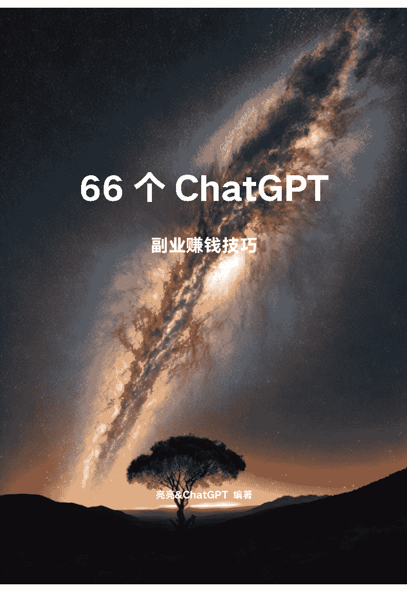

[66个ChatGPT副业赚钱技巧.docx](https://internal-api-drive-stream.feishu.cn/space/api/box/stream/download/all/IMD2bq2EcoSZlOxXV7qcc3nvn8b)

1.  感谢GPT让我买下了深圳的一个平方

1.  [说说这两个月靠GPT赚了多少钱](https://mp.weixin.qq.com/s?__biz=MzAxOTc1OTY4NA==&mid=2650860578&idx=1&sn=1bd23e1472c06f7c510a2a24417cd0da&chksm=80365b09b741d21fbc40bcee24ea78a7b96281330431efc4f1826a5081150563bcd16784ccaf&token=1689211294&lang=zh_CN#rd)

1.  可能是我的最后一篇稿子：怎么用 ChatGPT 发大财？

1.  月入数十万，他们靠“搬运 ChatGPT”大赚

1.  关于 AI 的 900+ 个项目，一口气看完【上】

1.  关于 AI 的 900+ 个项目，一口气看完【中】

1.  关于 AI 的 900+ 个项目，一口气看完【下】

1.  [「用 ChatGPT 搞钱年入百万！」各路](https://mp.weixin.qq.com/s/QlrpZ_tpue_EnhelwLfAcQ)博主发布生财之道，网友回呛：答辩的搬运工

1.  [注册 200 个账号，卖 5 万一套](https://mp.weixin.qq.com/s/xmZAYix3aDdMVQ4N2LiwZg)的系统，那些靠 ChatGPT 赚钱的人

1.  [ChatGPT 变现方法总结](https://m.okjike.com/originalPosts/638eb742ee30d55f8c25f176?s=eyJ1IjoiNWI3MmY4MmU2NDhkN2QwMDE3ZGI2YWMzIiwiZCI6MX0%3D)

1.  [仅 2 年时间，Copy.ai 的 ARR ](https://mp.weixin.qq.com/s/12zizCQftueNeIVtpv0k-A)达 1000 万美金用户突破 200 万

# 六、ChatGPT 赚钱风向标

## **【****ChatGPT**** 技能课】**

微博职场官方开始投放 ChatGPT 技能课，可以预见，在未来几个月，各种 ChatGPT 的应用课会层出不穷

除了 ChatGPT 基础课，可以结合行业开发更加细化的垂直细分课程。

## 【批量训练 ChatGPT】

批量训练 chatGPT 机器人，用 mj 制作美女图当做头像，通过 API 接入微信并制作小程序，批量管理账号，留两个人进行运营管理，遇到 chatGPT 解决不了的问题可以由人工介入解决。

## 【ChatGPT 小红书账号】

专门分享 chatgpt 问答的小红书号，三天达到千粉。

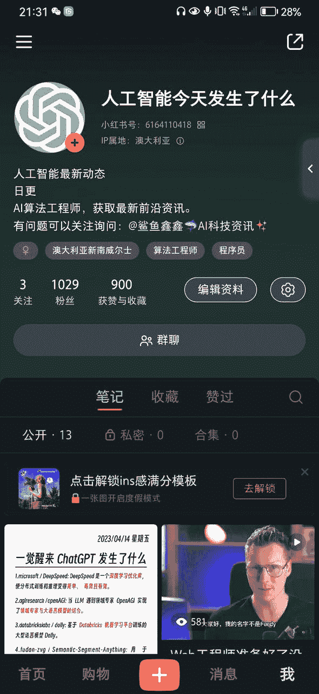

## **【****ChatGPT**** 抖音账号小说推文变现】**

AI 绘图+chatGPT 文案生成语音+剪映合成视频，可以推小说推文。

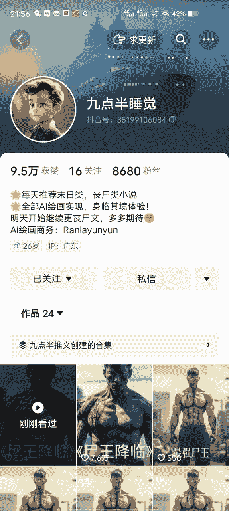

## 【AI 训练师成为热招岗位】

我在 Boss 直聘搜了一下，大量公司在招 AI 训练师的一个岗位！

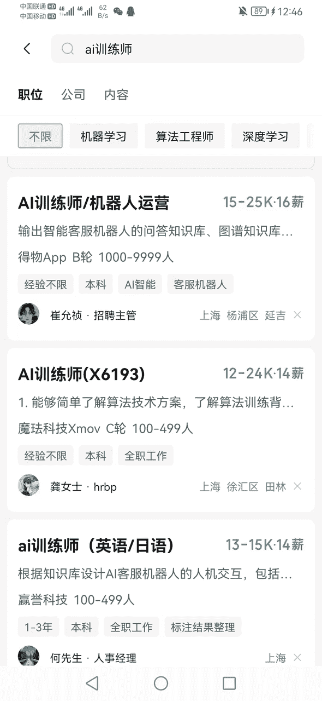

# 七、相关智能工具导航

## 北大团队开发 chatExcel

**优势：**主打用对话的形式实现 Excel 复杂操作（Chat-to-Excel），告别记函数、手动设置公式。

做好的成品，支持一键导出成标准 Excel 表格，连复制粘贴这道工序都省了。

而且不用注册、网页上就能用、不限使用次数，相当利好懒人和 Excel 小白。

**传送门：**https://chatexcel.com/

## ChatGPT 指令大全

传送门：[ChatGPT 指令大全](https://www.explainthis.io/zh-hant/chatgpt)

## ChatGPT 聊天导出工具

ChatGPT 聊天记录丢失，就像微信聊天记录丢失一样痛苦，养成定期保存的习惯，可以看看下面这个工具。

**传送门：**[https://github.com/pion](https://github.com/pionxzh/chatgpt-exporter)xzh/chatgpt-exporter

## ChatDOC 工具

**简介：**上传 PDF/Word 文档，Chat 一下，就能立刻得到文章摘要，重点总结，细节描述，数据分析，内容润色…还可以选择表格和文本，针对性提问，获得更准确的答案。ChatDOC 的优势在于，精准识别和解析 PDF 中的表格和段落，让 AI 回答都可以溯源至文档内容。后续还会支持图片、扫描件格式，以及多个文档交叉问答。点击即可免费使用。

**传送门：**https://chatdoc.com

## ChatPDF 工具

**简介：**基于 chatGPT 技术的在线应用 –通过它，可以让 ChatGPT 帮我们读 PDF 文档，提取关键内容

**传送门：**https://www.chatpdf.com/

PS：有个与 ChatPDF 功能相同，但是支持边用类似 ChatGPT 的聊天方式阅读，边对照原文：

**传送门：**https://www.pandagpt.io/

## ChatGPT 提示词工具

**传送门：**

https://www.aiprm.com/

https://newzone.top/chatgpt/

**谷歌查检版：**[ht](https://chrome.google.com/webstore/detail/aiprm-for-chatgpt/ojnbohmppadfgpejeebfnmnknjdlckgj?hl=en)tps://chrome.google.com/webstore/detail/aiprm-for-chatgpt/ojnbohmppadfgpejeebfnmnknjdlckgj?hl=en

**FlowGPT: **https://flowgpt.com/

## ChatGPT 提示语

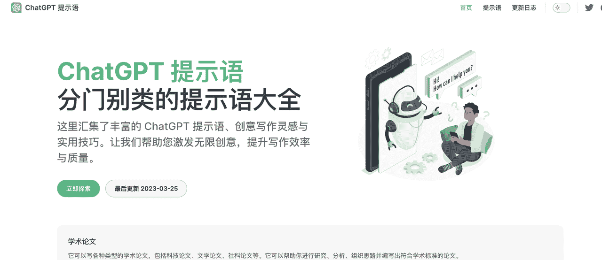

**简介：**分门别类的提示语大全，这里汇集了丰富的 ChatGPT 提示语、创意写作灵感与实用技巧。让我们帮助您激发无限创意，提升写作效率与质量。

**传送门：**https://prompts.fresns.cn/

## ChatGPT 调教指南

**中文的：**

链接一：[h](https://github.com/PlexPt/awesome-chatgpt-prompts-zh)ttps://github.com/PlexPt/awesome-chatgpt-prompts-zh

链接二：ChatGPT 中文调教指南 | ChatGPT 中文调教指南

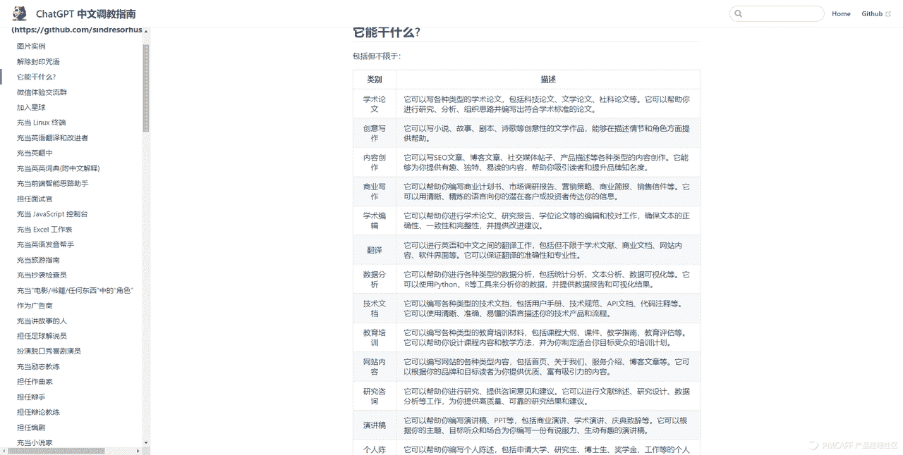

**英文的：**[https://github.com/f/awe](https://github.com/f/awesome-chatgpt-prompts)some-chatgpt-prompts

## New Bing 申请方法和流程

1.

[可以先下载 Edge 浏览器 dev 版本，地址如下：http](https://www.microsoftedgeinsider.com/en-us/download)s://www.microsoftedgeinsider.com/en-us/download

2.

开启魔法上网模式或者使用张良计；

3.

访问：https://www.bing.com/new，并登录你的微软账户（必须先有微软账户）；

4.

点击页面上的 “加入等待列表”，加入候选名单；

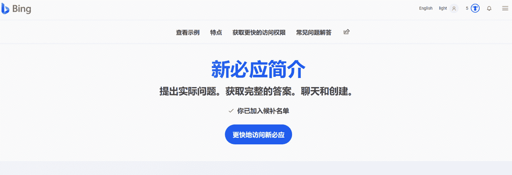

5.

等待微软批准通过后，即可预览新版 Bing。我个人的等待时长约 3-4 个工作日，通过申请后微软会发邮件通知您已取得测试资格。也可以按照官方的指引安装浏览器的 bing 插件和下载 bing 的移动端应用申请加速。

## New bing 桌面客户端

**传送门：**https://github.com/dice2o/BingGPT

•

无需安装 Microsoft Edge 或浏览器插件即可与新 Bing 聊天

•

将完整对话导出为 Markdown、PNG 或 PDF

•

自定义外观（主题和字体大小）

•

多平台

## **谷歌能 ****AI**** 工具 Bard**

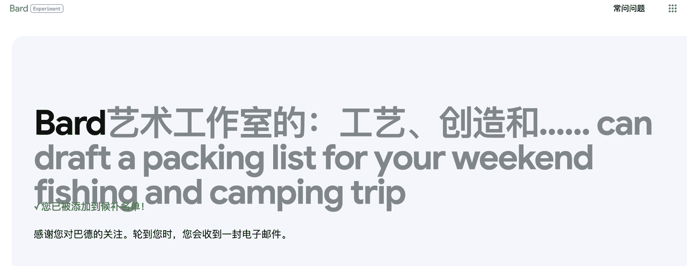

**简介：**Bard，是一款 Google 面向公众推出由 LaMDA 提供支持的实验性对话式 AI 服务，目前开放了测试申请，美国和英国用户可以加入候选名单，打开 Bard 官网即可测试申请，A 姐昨晚申请的，今天就通过了，不过目前 Bard 不支持中文，Bard 可以联网搜索，感兴趣的可以使用美国或者英国 IP 网络打开官网进行申请测试。

**申请地址传送门：**https://bard.google.com/

## Adobe Firefly

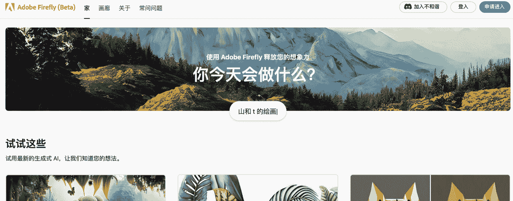

**简介：**Adobe Firefly，是 Adobe 推出的一个系列的人工智能工具，专注于图像生成和文本效果，旨在帮助创意专业人士和艺术家生成图像和艺术文字，目前首先推出了两款测试产品，第一款工具能够根据文本提示 prompt 创建图像（根据文字生成图像 AI 工具），并提供数百种风格可以对结果进行调整。另一个工具则根据提示为文字应用样式，不过这两款 AI 产品都需要申请进行测试，感兴趣的同学可以到官网申请测试。

**申请测试传送门：**https://firefly.adobe.com/

## ChatMind

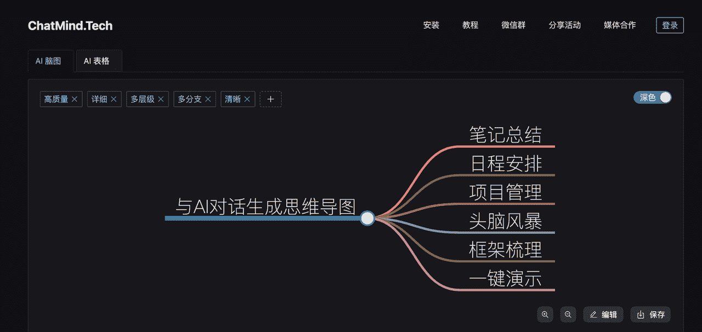

**简介：**ChatMind，是一款利用与 AI 的对话中生成和编辑思维导图的工具，支持上下文改写扩充对话，ChatMind AI 可用于多种场景，例如记笔记、日程安排、项目管理、头脑风暴、框架等等。既能帮助用户快速总结分析，又能源源不断地提供创作灵感，致力为用户提供最优质的智能化思维导图方案，专注于 AI 生成思维导图的效率工具。直接输入一句话/问题，AI 自动生成了一份完整的思维导图，而且支持在线编辑，支持图片、SVG 和 MarkDown 等等格式导出。

**传送门：**https://www.chatmind.tech/

## AI 深度导航

**简介：**深度网址导航是国内不错的导航分类平台，收录国内外各类型网站供网友检索，包括人工智能 AI 工具网址集合，人工智能领域工具包括聊天 AI、文章 AI、图片 AI、音频 AI、视频 AI、编程 AI、游戏 AI 等等 AI 工具，深度网址导航致力于为广大用户推荐各行各业优秀网站，国内外网站大全尽在深度导航。

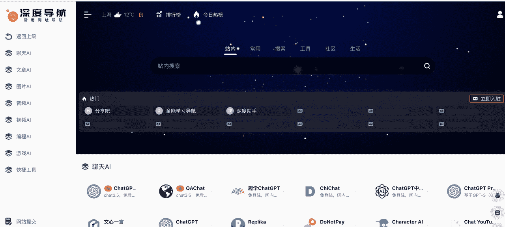

**传送门：**https://www.deepdh.com/ai

## AI Anything

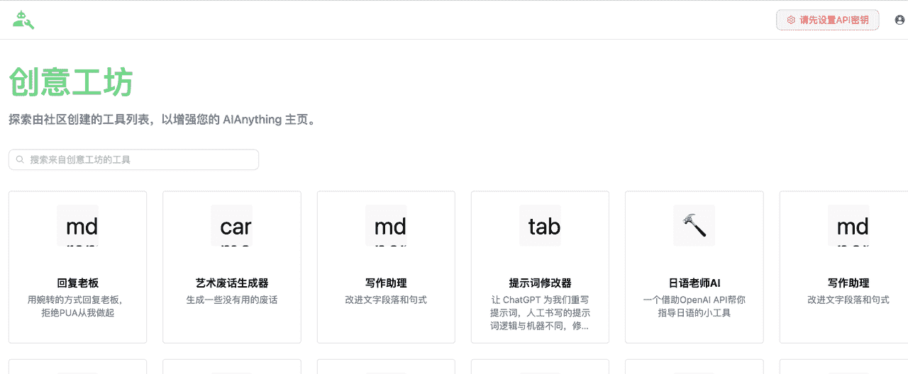

**简介：**网友投稿一个自己写的开源项目，MIT 协议，AI Anything-人人都能创建 GPT 工具，目前大部分 ChatGPT 相关的工具本质上就是调整 prompt，而 AI Anything 则让人人都可以快速创建 ChatGPT 小工具，只需要几秒即可创建一个 GPT 小工具， 100,000+ 图标可供使用，允许配置 AI 的角色，无需登录即可本地使用所有功能！

**功能简介：**

�� 几秒即可创建一个 GPT 小工具

�� 100,000+ 图标可供使用

�� 允许配置 AI 的角色！

⚙️ 不止一个输入框，如果愿意你可以创建无数个！

���� 支持模板插值，prompt 更加灵活

�� 干净的 UI，流畅的动画，支持夜间模式

⚡️ Nuxt3 驱动，就是快！

�� 多语言，当然！

☁️ 创意工坊，分享并发布！

�� 关联上下文，聊天模式交互

�� 无需登录即可本地使用所有功能！

**传送门：**https://aianything.netlify.app

## **人工智能工具集合**

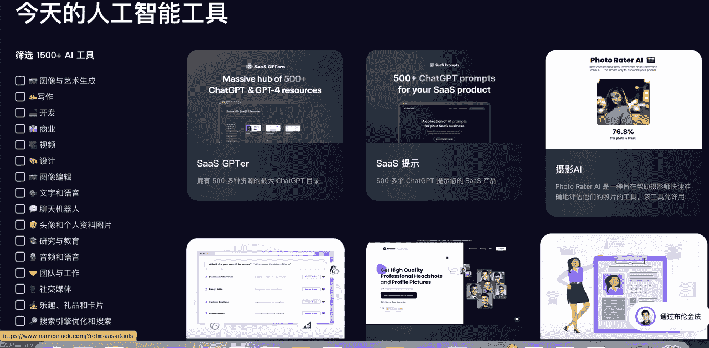

**简介：**SaaS AI Tools 是您获取新 AI 工具和每日 AI 新闻的来源，可帮助您将创造力提升到一个新的水平。

**SaaS ****AI**** Tools: **https://saasaitools.com/

**类似 ****AI**** 工具集合推荐：**https://www.futurepedia.io/

## 微信聊天的智能应答机器人 ChatGPT for Wechat

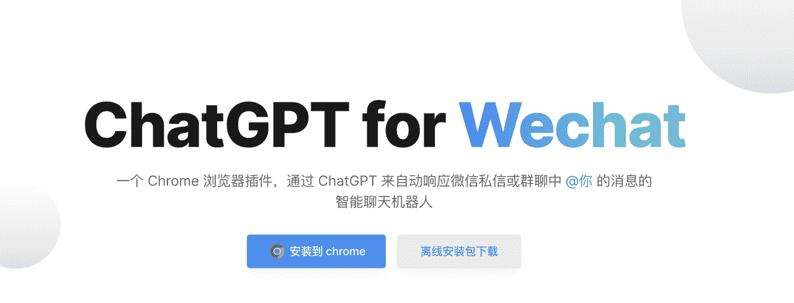

**群聊版：**https://chatgpt4wechat.aow.me/

**个人版：**https://chatgpt4filehelper.aow.me/

## ChatGPT 国内直连网站

•

https://loveycloud.cf/ 可以直连，响应速度很快，支持连续对话。界面简洁。

# **八、行业相关报告**

我用夸克网盘分享了「ChatGPT行业资料」，点击链接即可保存。打开「夸克APP」，无需下载在线播放视频，畅享原画5倍速，支持电视投屏。

链接：https://pan.quark.cn/s/bf81d7be313d

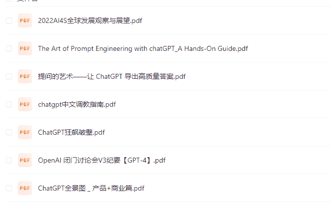

# 九**、各路观点论点**

## **ChatGPT**** 在 LinkedIn 上分享**

# **一篇帖子写道：“****AI** 不会取代你。一个使用 AI 的人将取代你”

> ChatGPT 不仅支持多轮对话，还具有以下特征：

> 1）可以主动承认自身错误。若用户指出其错误，模型会听取意见并优化答案。

> 2）ChatGPT 可以质疑不正确的问题。

> 3）ChatGPT 可以承认自身的无知，承认对专业技术的不了解。

> 这三点，很多人类都做不到。

#

> 针对部分人怀疑类 ChatGPT 工具的智能性：

> 说句实话啊，能放给大众的产品，都是低端产品，人家好不容易搞出来了好产品，为什么不自己用，甚至给 B 端客户用？真的好产品不一定在 C 端。甚至以后的内容平台，对内容创作者的需要都不会像现在这么重，因为平台自己掌握了内容生产工具，且不对外开放。作为 C 端用户，永远有信息差你不知道，以 C 端且大众都能接触到的视角评判真实的 AI 水准，那可能你的思维就局限了，从开发到大众商业化绝对是需要过程的。

## **360 科技董事长周鸿祎**

> 周鸿祎认为，以 ChatGPT 为代表的人工智能大模型技术的巨大跃升将掀起一场新的工业革命，我国理应迎头赶上，并建议打造中国的"微软+Open AI"组合引领大模型技术攻关。而在稍早前的 2 月初，360 也曾在投资者互动平台上表示：“计划尽快推出类 ChatGPT 技术的 demo 产品”。（两会发言）

## **科大讯飞董事长刘庆峰**

#

> 随着时间的推移，ChatGPT 将不仅仅是一个对话式的机器人，而会是给各行各业带来颠覆的人工智能助手，让每个人能站在人工智能的肩膀上发挥更大创造力。

>

## 华为创始人任正非

#

> 未来在 AI 大模型上会风起云涌，不只是微软一家。人工智能软件平台公司对人类社会的直接贡献可能不到 2%，98% 都是对工业社会、农业社会的促进，AI 服务普及需要 5G 的连接。 任正非说，华为只会做 AI 的底层算力平台，不会去碰应用平台。ChatGPT 对于华为的机会是什么？它会把计算撑大，把管道流量撑大，这样我们的产品就有市场需求。

>

## **科技部部长王志刚**

> **科技部部长王志****刚在首场“部长通道”上说，Chat**GPT 是个大模型、大计**算、很好的计算方法，同一**种原理，但做的质量还是不一样的。他打了个形象的比喻：“就像踢足球，都是射门，但是要做到像梅西那么好也不容易。”王志刚称，我们国家在这个领域研究有一些成果，希望中外企业在人工智能领域有更多好的成果。他同时强调：研究 ChatGPT 时要注意科技伦理，趋利避害。

>

## 新东方创始人俞敏洪

> 2023 年 3 月 17 日，2023 亚布力中国企业家论坛年会开幕，亚布力中国企业家论坛轮值主席，新东方教育科技集团董事长俞敏洪表示：还没玩过 Chatgpt 的企业家，没有资格谈世界高科技发展。

## **吴晓波财经频道**

> ChatGPT 会怎么样改变世界和中国？

## 润米咨询创始人刘润

> ChatGPT：一个人不管有多大的梦想，还是要有盖世武功

## 微软创始人比尔盖茨

#

> 比尔·盖茨最新分享：ChatGPT 的发展，不止于此

## 作家**王安忆**

#

> 在谈及 ChatGPT 对文学写作的影响时，王安忆称，用人工智能来创作文学可能会提高效率，但也会涉及抄袭；并认为 ChatGPT 无法取代作家，因为生活不会按照常理出牌。

## 作家余华

#

> 在谈及 ChatGPT 对文学写作的影响时，余华表示：ChatGPT 可能把小说写得很完美，但实际上内容非常平庸。当 ChatGPT 接近完美、没有缺点时，也就没有了优点；同时，许多伟大的文学作品都存在疏忽，人脑最可贵的就是犯错。

## 招商局集团总经理胡建华

#

> 2023 年 3 月 25 日，招商局集团有限公司总经理胡建华在中国发展高层论坛 2023 年年会会场表示，“ChatGPT 将对产业带来革命性的转变”，ChatGPT 可能会为未来的发展带来很多商业机会，也使产业链、供应链在冲突的过程中，虽然遇到了挑战，但是新产品、新产业、新业态永远都会在压力之下爆发出新的生机。

## **联通数科首席 ****AI**** 科学家廉士国博士**

#

> 对话全球前 2%顶尖科学家：深度解构“杀手级应用”ChatGPT

## **阿里巴巴创始人马云**

#

> 阿里巴巴创始人马云 3 **月 27 日在云谷，和校园长们**讨论了新一轮的技术变革对教育带来的挑战与机遇。马云说，ChatGPT 这一类技术已经对教育带来挑战，但是 ChatGPT 这一类技术只是 AI 时代的开始。大家要用人工智能去解决问题，而不是被人工智能所控制，虽然人的体力、脑力比不过机器，但机器只有“芯“，而人有“心”。

> 马云还说，工业时代是知识驱动，知识的竞争；数字时代，是智慧驱动，是创造力和想象力的竞争，是领导力、担当力、责任的竞争，是独立思考的竞争。

# 十、实际应用场景

## 1.各类场景接入（企业微信、飞书、钉钉、微信、小程序等）

1.  3 小时！开发 ChatGPT 微信小程序

1.  [企业微信接入 ChatGPT](https://github.com/fanchunke/chatgpt-wecom)

1.  花了半个小时基于 ChatGPT 搭建了一个微信机器人

1.  使用 OpenGPT（ChatGPT）搭建 QQ 机器人

1.  [【3 分钟制作 PPT】ChatGPT 搭配闪击 P](https://juejin.cn/post/7202984088185307191)PT 生成 PPT，你只需要输入一个标题

1.  [ChatGPT 接入飞书教程](https://www.bilibili.com/video/BV1aA411B7ya/?spm_id_from=333.337.search-card.all.click&vd_source=93310bee4d519f35bce25905cc4b6dab)

1.  [ChatGPT 接入 QQ 群](https://www.bilibili.com/video/BV1VG411M7vR/?spm_id_from=333.337.search-card.all.click&vd_source=93310bee4d519f35bce25905cc4b6dab)

1.  10 分钟教你搭建属于自己的 ChatGPT 微信机器人

**集成微信机器人**

微信机器人有开源方案可以选择，对技术比较熟悉的朋友可以在 github 上搜索 chatgpt 可以看到各种使用技巧，以及各种 Bot。这里不做过多介绍（友情提醒：使用微信集成 ChatGPT，内容会受到微信监管，有封号的风险，建议谨慎尝试）。

1.  ChatGPT 自动接入-微信/Telegram 电报群 二合一懒人版

1.  ChatGPT 优化用自动化操作 Excel，十倍提升你的工作效率

1.  [ChatGPT 搭配闪击 PPT ](https://www.bilibili.com/video/BV1oj411G7QV/?spm_id_from=333.337.search-card.all.click&vd_source=93310bee4d519f35bce25905cc4b6dabChat)三分钟生成 PPT，你只需要输入一个标题

1.  ChatGPT 帮你生成一篇论文具体步骤

1.  [谁说 chatGPT 只知道 21 年以前？赶紧让你的 c](https://www.bilibili.com/video/BV1GT411o7jt/?spm_id_from=333.337.search-card.all.click&vd_source=93310bee4d519f35bce25905cc4b6dab)hatgpt 联网！必装的一款插件+技巧

1.  使用 ChatGPT 制作一部视频

1.  10 分钟教你搭建属于自己的 ChatGPT 微信机器人

1.  微信公众号接入 ChatGPT 机器人的方法

## 2.教育行业应用

中小学教师 ChatGPT 的 23 种用法

如何利用 chatGPT 学英语？

## 3.**【****ChatGPT**+皮肤检测护理模型+图片识别+语音识别+主播语】

用户可通过拍照上传照片，使用 ChatGPT 皮肤检测护理模型和图片识别技术进行分析，给予用户针对性的肌肤护理建议。以上功能不仅可以帮助用户更好地了解自己的肌肤状况，还可以为商家提供有针对性的流量推广和收费方案，实现双赢。

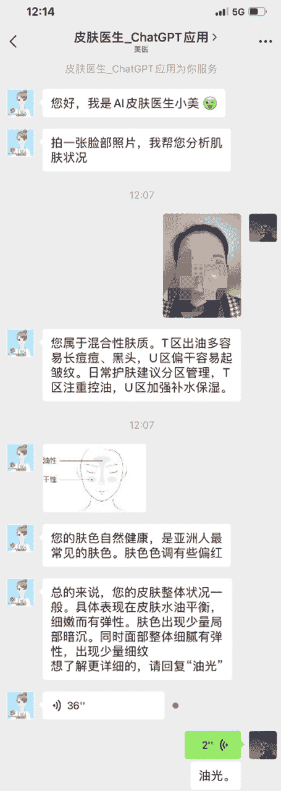

## **4.用 ****ChatGPT**** 写****书，台湾出版第一**本《ChatGPT 与 AI 绘画效率大师》

作者从零开始，11 天完成草稿，22 天后交稿

**传送门**：[22 天写完一本书](https://medium.com/dean-lin/%E9%9D%A0-chatgpt-%E6%88%91%E4%B8%80%E5%80%8B%E6%9C%88%E5%AF%AB%E5%AE%8C%E4%B8%80%E6%9C%AC%E6%9B%B8-%E5%85%A8%E5%8F%B0%E7%AC%AC%E4%B8%80%E6%9C%AC-chatgpt-%E6%87%89%E7%94%A8%E8%A7%A3%E6%9E%90%E5%B0%88%E6%9B%B8-56334fbb6bc8)

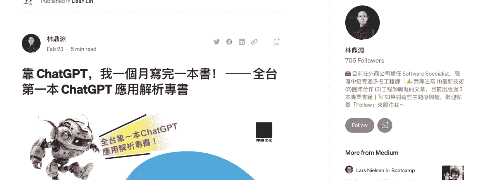

## **5.【****ChatGPT** 训练师，为企业定制专属的 ChatGPT】

根据产品和服务进行私人定制，比如： 公众号、小红书、朋友圈文案等。

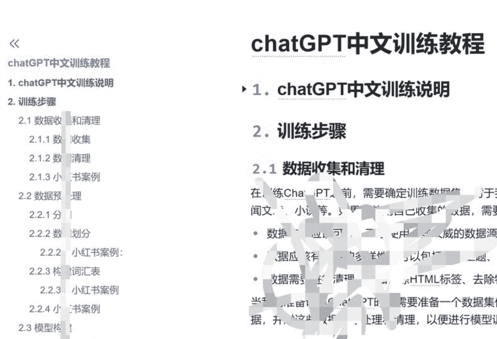

## 6.跨境电商领域

技术亲测：ChatGPT 在跨境电商行业可以干啥用？

## 7.咨询行业

ChatGPT 将彻底改变咨询行业

## 8.游戏行业

ChatGPT 做了一个二次元游戏！

# 延伸阅读：同类型的产品使用指南

## Claude

**简介：**Claude 是由 OpenAI 前副总裁 Dario Amodei 创立的公司 Anthropic 开发的一款基于文字对话的大语言模型（LLM）。与 ChatGPT 相比，Claude 最大的特点就是免费直接可用！

# 附注：常见 AI 领域名词解释

**AIGC：**AI Generated Content ，人工智能自动生成内容

**NLP****：**Natural Language Processing，自然语言处理

**LLM：**Large language model，大语言模型

**AGI：**Artificial general intelligence，通用人工智能

**Prompt：**提示词

**Fine-tuning：**模型调优

**ML：**Machine Learning，机器学习

**DL：**Deep Learning，深度学习

> **chatGPT**** 学习交流社群**

> 1.持续关注并更新 ChatGPT 的相关资讯动态，**研究报告，赚钱案例，常见问题**，永久免费在线查看，无收费内容，目标是成为最大的免费 ChatGPT 学习社群。

> 2.已建立社群聊聊 ChatGPT 发展及应用，没进群的可以加我微信拉你进群，提前了解最新学习内容，群满可加 ChatGPT研究爱好者微信 ID: JUGO737Y(备注: chatGPT)，已经在社群内的无需重复加入，暂无任何 ChatGPT 相关收费群、课程及服务，全部为公开公正免费整理汇总分享

> 3.关于文档负责人JUGO: 人工智能玩家，互联网流量观察家，曾就职于互联网大厂，现研究 AI 实战应用，努力成为最懂懂 AI 的运营人。

