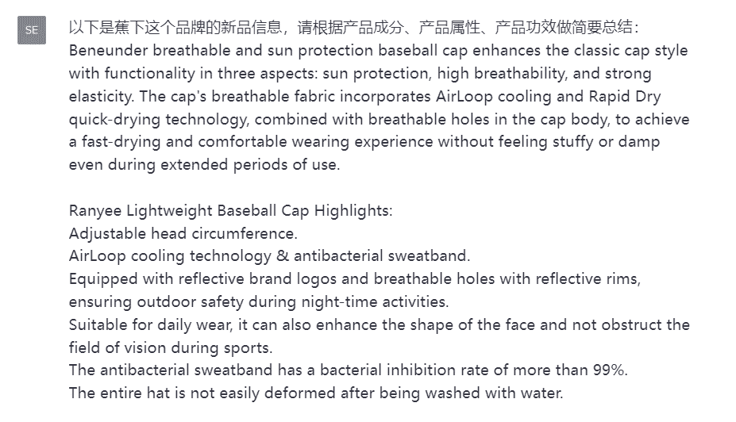
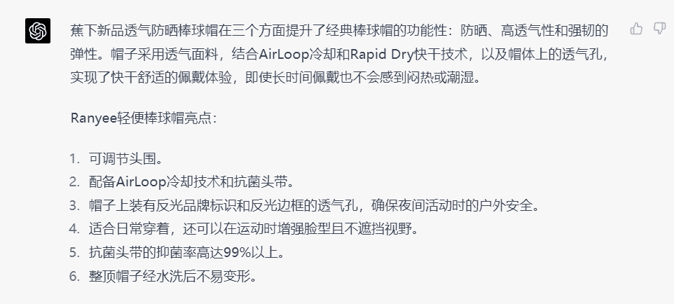
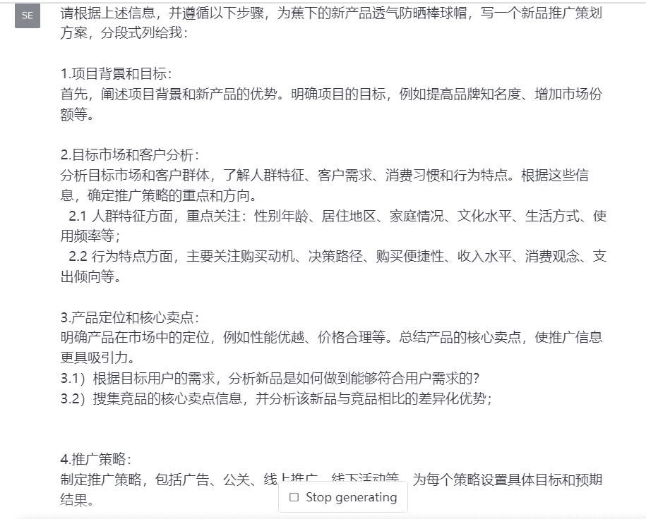
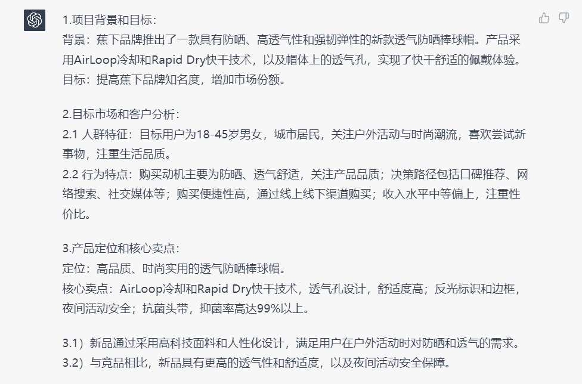
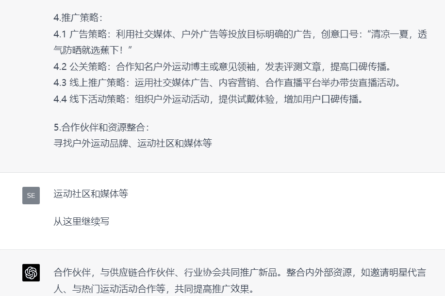
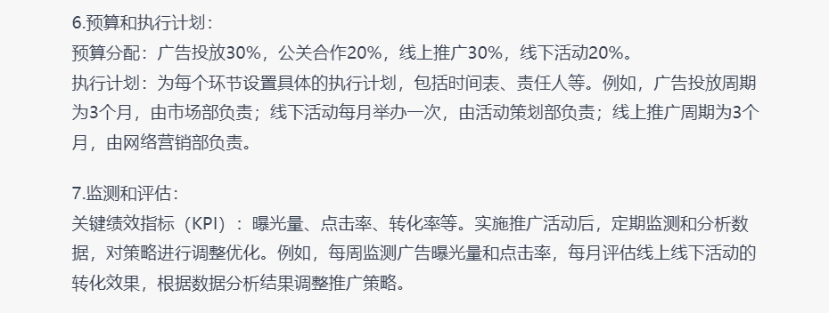

# 🥈用ChatGPT做新品上市推广方案策划

> 来源：[https://chengchaungai.feishu.cn/docx/RgKFdcQBCoCLWixpv72cXZTUnYd](https://chengchaungai.feishu.cn/docx/RgKFdcQBCoCLWixpv72cXZTUnYd)

————**选择人工智能，链接无限未来**————

本文编辑:**JUGO** **  ****  **                                                         👸号：橙创AI

**进入👉 **[🍊橙创AI知识库（首页）](https://ix9q8jjj4ug.feishu.cn/wiki/DOsXwmRDaibJVUkDSHKcYbhmn0f)**获取更多A****IGC内****容👈**

> **查阅、整理和输出教程属实**[**不易**](https://ki6j1b0d92h.feishu.cn/wiki/wikcnOTLuqHXX6ZJ1oWEBGbd9zf?from=from_copylink)，觉得这篇教程对你有所帮助的话，不妨分享给更多需要的人呗😊

该场景对应的关键词库(28个）：

品牌、产品信息、新品、成分、属性、功效、人群特征、客户分析、产品定位、核心卖点、推广策略、广告、公关、线上推广、线下活动、合作伙伴、资源整合、预算、执行计划、监测、评估、微调方案、价值主张、营销策略、热点话题、消费者、向往感、诱惑钩子

**提问模板（3个）：**

**第一步：输入品牌与产品信息**

**提问模板：**

1、你知道XXX品牌吗？→这个信息还不够全面，以下是我给你的补充信息：XX品牌是XXX（补充描述信息）

2、以下是XX品牌的新品信息，请根据产品成分、产品属性、产品功效（列举产品基础属性维度）做简要总结：

XXXXXX（补充新品信息）

**第二步：策划新品推广方案**

**提问模板：**

请根据上述信息，并遵循以下步骤，为XXX品牌的新产品XXX（名称）写一个新品推广策划方案，分段式列给我：

1.项目背景和目标：

阐述项目背景和新产品的优势。明确项目的目标，例如提高品牌知名度、增加市场份额等。

2.目标市场和客户分析：

分析目标市场和客户群体，了解人群特征、客户需求、消费习惯和行为特点。根据这些信息，确定推广策略的重点和方向。

2.1 人群特征方面，重点关注：性别年龄、居住地区、家庭情况、文化水平、生活方式、使用频率等；

2.2 行为特点方面，主要关注购买动机、决策路径、购买便捷性、收入水平、消费观念、支出倾向等。

3.产品定位和核心卖点：

明确产品在市场中的定位，例如性能优越、价格合理等。总结产品的核心卖点，使推广信息更具吸引力。

3.1）根据目标用户的需求，分析新品是如何做到能够符合用户需求的？

3.2）搜集竞品的核心卖点信息，并分析该新品与竞品相比的差异化优势；

4.推广策略：

制定推广策略，包括广告、公关、线上推广、线下活动等。为每个策略设置具体目标和预期结果。

4.1 广告策略：选择合适的广告媒体，如电视、广播、报纸、杂志等。设计吸引人的广告创意和口号。

4.2 公关策略：与媒体建立良好关系，组织新闻发布会、媒体试用等活动。利用口碑传播提高品牌形象。

4.3 线上推广策略：利用社交媒体、内容营销、搜索引擎优化（SEO）、付费搜索广告（SEM）等方式提高网络知名度。

4.4 线下活动策略：组织路演、体验活动、促销活动等，让潜在客户直接接触和体验产品。

5.合作伙伴和资源整合：

寻找潜在合作伙伴，如供应链合作伙伴、行业协会、媒体等。整合内外部资源，提高推广效果。

6.预算和执行计划：

根据推广策略制定预算，确保资源的合理分配。为每个环节设置具体的执行计划，包括时间表、责任人等。

7.监测和评估：

设定推广活动的关键绩效指标（KPI），如曝光量、点击率、转化率等。实施推广活动后，定期监测和分析数据，对策略进行调整优化。

**第三步：微调方案**

**提问模板：**

1、请针对《XXXX》（复制上面的标题）做以下调整：XXX（修改方向）

2、以上方案还不够有吸引力，请补充以下思考：

2.1）如何结合产品的某一卖点或者价值主张，引发公众的充分讨论，并引发主动传播的话题或者事件？

比如：价值观营销、和竞争对手打造相爱相杀的合作、结合目标用户关注的热点话题或反其道而行之？

2.2））如何对消费者的选择产生巨大的影响作用？

比如为产品打造极具吸引力和传播力的向往感，另一种是为产品包装出无法拒绝的诱惑钩子，比如新品试用、游戏探宝、为消费者打造特殊身份？

**案例：**

> 关注**👸号**，加入**AI****实战交流群**，掌握全面专业的**行业资讯**、**工具分享**、**变现指南**和**实战教程**，开启你的AI智慧之旅👇👇

联系🛰️**JUGO737Y****（备注来意）**

👸号：**橙创****AI**

**群聊二维码**：

