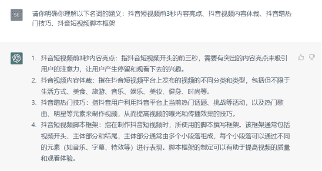
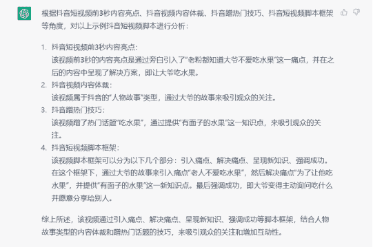
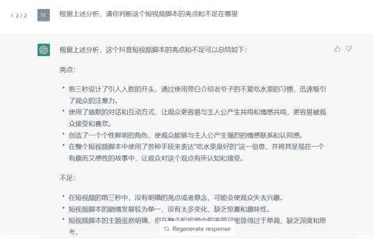
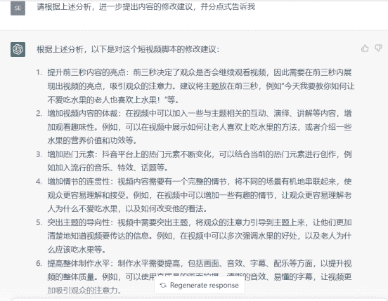
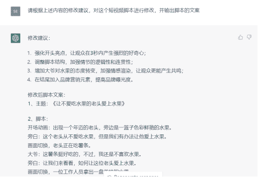
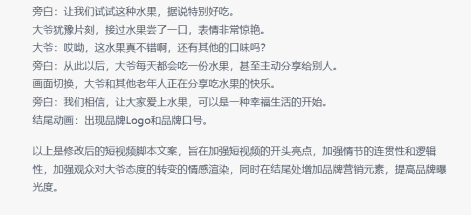

# 🥈用ChatGPT拆解爆款内容，输出成稿

> 来源：[https://chengchaungai.feishu.cn/docx/OwnkdJ4kcohIsexPxEdckilSnhg](https://chengchaungai.feishu.cn/docx/OwnkdJ4kcohIsexPxEdckilSnhg)

————**选择人工智能，链接无限未来**————

本文编辑:**JUGO** **  ****  **                                                         👸号：橙创AI

**进入👉 **[🍊橙创AI知识库（首页）](https://ix9q8jjj4ug.feishu.cn/wiki/DOsXwmRDaibJVUkDSHKcYbhmn0f)**获取更多A****IGC内****容👈**

> **查阅、整理和输出教程属实**[**不易**](https://ki6j1b0d92h.feishu.cn/wiki/wikcnOTLuqHXX6ZJ1oWEBGbd9zf?from=from_copylink)，觉得这篇教程对你有所帮助的话，不妨分享给更多需要的人呗😊

该场景对应的关键词库（11个）：

示例内容、爆款库、内容类型、拆解角度、亮点、不足、修改建议、文案、风格、文章、脚本

**提问模板（4个）：**

第一步：建立自己的爆款库，并选择其中1个爆款内容

**第二步：让****chatgpt**** 理解你拆解的角度**

**提问模板：**

1、请你明确你理解以下名词的涵义（列举拆解角度）：XXX、XXX、XXX

2、请你根据XXXX（列举拆解角度），分析以下XXXX（列举内容类型，例如文章/脚本）“”

示例：（这里把爆款内容复制进去对话框）

**第三步：让****ChatGPT** 提出内容的修改建议，并分点式给出答案

**提问模板：**

1、根据上述分析，请你判断这个XXXX（列举内容类型，例如文章/脚本）的亮点和不足在哪里

2、请根据上述分析，进一步提出内容的修改建议，并分点式告诉我

**第四步：要求****ChatGPT**** 以什么风格去做修改**

提问模板：

1、请根据上述内容的修改建议，对这个XXXX（列举内容类型，如脚本/文章）进行修改，并输出XXXX（列举内容类型，如脚本/文章）的文案

2、请将这个XXXX（列举内容类型，如脚本/文章）调整成XXX风格（适用于XX平台，或与某作者相近风格，例如用王家卫风格、金庸风格）

**案例：**

**第一步：确保****ChatGPT****理解你要拆解的角度：**

**第二步：输入短视频脚本并让****ChatGPT****开始拆解。**

**第三步：让****ChatGPT** 提出内容的修改建议，并分点式给出答案。

**第四步：要求****ChatGPT**** 以什么风格去做修改：**

> 关注**👸号**，加入**AI****实战交流群**，掌握全面专业的**行业资讯**、**工具分享**、**变现指南**和**实战教程**，开启你的AI智慧之旅👇👇

联系🛰️**JUGO737Y****（备注来意）**

👸号：**橙创****AI**

**群聊二维码**：

