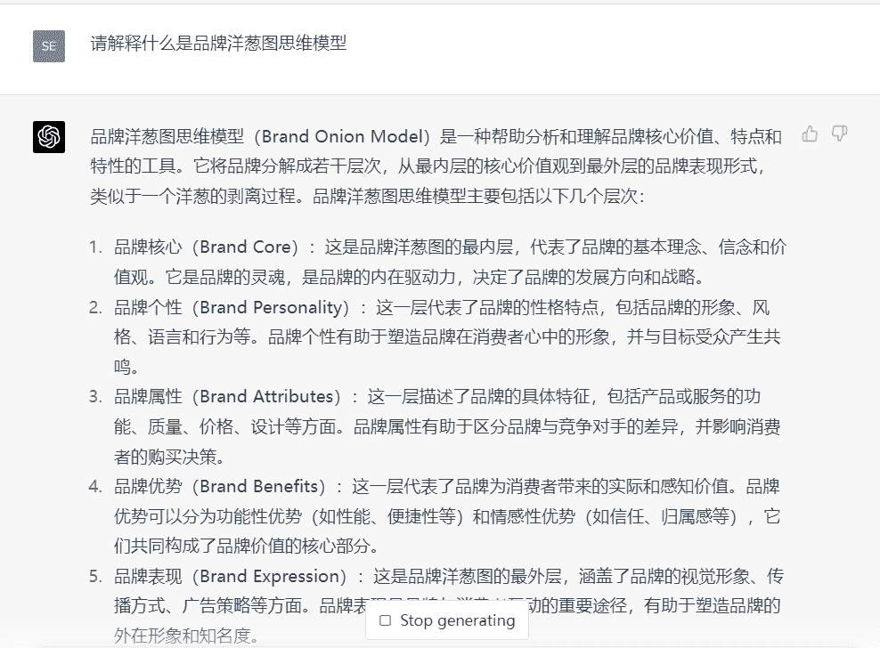
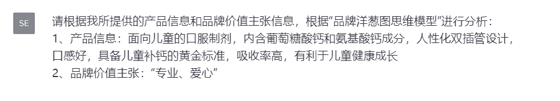
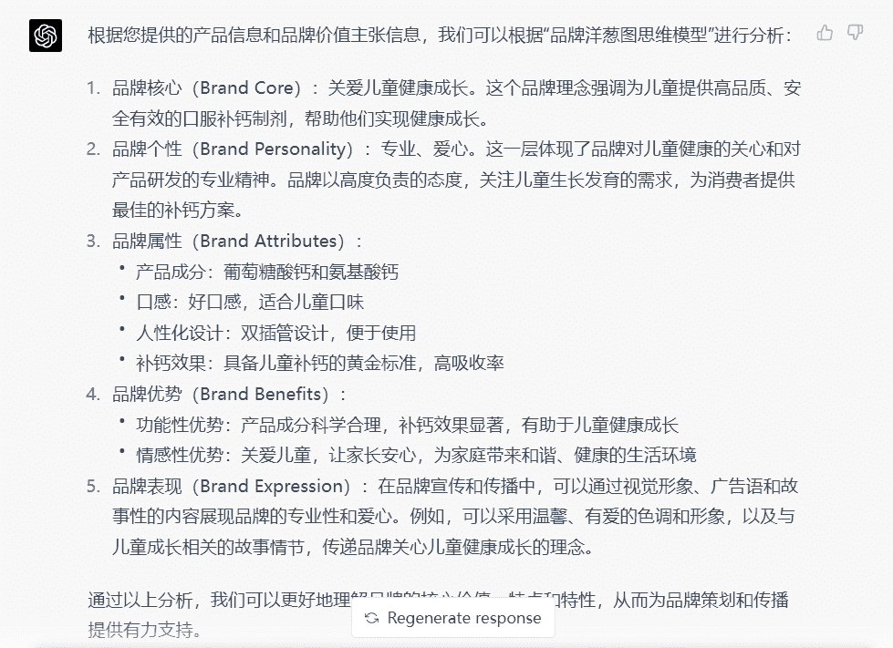
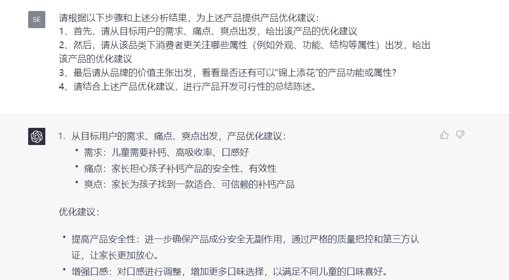
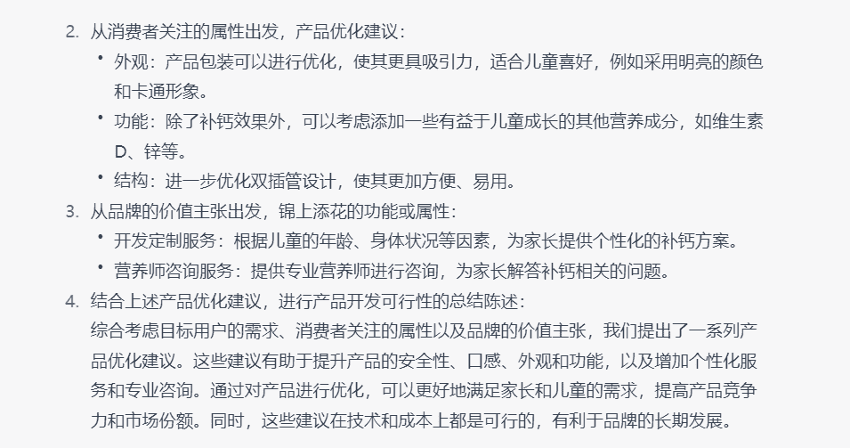

# 🥈用ChatGPT从品牌角度对产品提出升级建议

> 来源：[https://chengchaungai.feishu.cn/docx/STdzdJwQnoBqyFx1JJ1c64pvnHd](https://chengchaungai.feishu.cn/docx/STdzdJwQnoBqyFx1JJ1c64pvnHd)

————**选择人工智能，链接无限未来**————

本文编辑:**JUGO** **  ****  **                                                         公众号：橙创AI

**进入👉 **[🍊橙创AI知识库（首页）](https://ix9q8jjj4ug.feishu.cn/wiki/DOsXwmRDaibJVUkDSHKcYbhmn0f)**获取更多A****IGC内****容👈**

> **查阅、整理和输出教程属实**[**不易**](https://ki6j1b0d92h.feishu.cn/wiki/wikcnOTLuqHXX6ZJ1oWEBGbd9zf?from=from_copylink)，觉得这篇教程对你有所帮助的话，不妨分享给更多需要的人呗😊

该场景对应的关键词库（19个）：

品牌洋葱图思维模型、产品信息、人群、品类、属性、体验、差异化特征、功效、品牌价值主张、目标用户、需求、痛点、爽点、消费者、外观、功能、结构、产品优化建议、产品开发可行性。

**提问模板(3个）：**

**第一步：确保****ChatGPT****了解品牌洋葱图的概念。**

**提问模板：**

请解释什么是品牌洋葱图思维模型。

**第二步：输入你要从品牌方向去优化的产****品信息（****人群、**体验、属性、功效等）+品牌价值主张信息。

**提问模板：**

请根据我所提供的产品信息和品牌价值主张信息，根据“品牌洋葱图思维模型”进行分析：

1、产品信息：面向儿童（人群）的口服制剂（品类），内含葡萄糖酸钙和氨基酸钙成分，人性化双插管设计（属性），口感好（体验），具备儿童补钙的黄金标准，吸收率高（差异化特征），有利于儿童健康成长（功效）

2、品牌价值主张：“专业、爱心”

第三步：从品牌方向提出产品优化建议：

**提问模板：**

请根据以下步骤和上述分析结果，为上述产品提供产品优化建议：

1、首先，请从目标用户的需求、痛点、爽点出发，给出该产品的优化建议

2、然后，请从该品类下消费者更关注哪些属性（例如外观、功能、结构等属性）出发，给出该产品的优化建议

3、最后请从品牌的价值主张出发，看看是否还有可以“锦上添花”的产品功能或属性？

4、请结合上述产品优化建议，进行产品开发可行性的总结陈述。

**案例：**

> 关注**公众号**，加入**AI****实战交流群**，掌握全面专业的**行业资讯**、**工具分享**、**变现指南**和**实战教程**，开启你的AI智慧之旅👇👇

联系微信**JUGO737Y****（备注来意）**

公众号：**橙创****AI**

**群聊二维码**：

