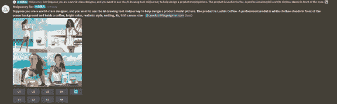
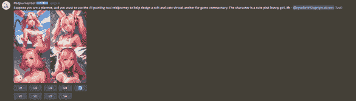
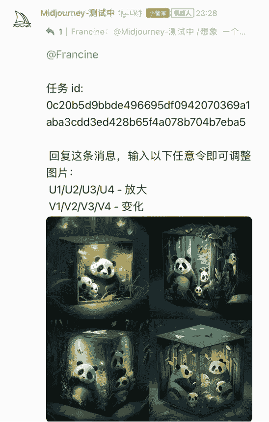
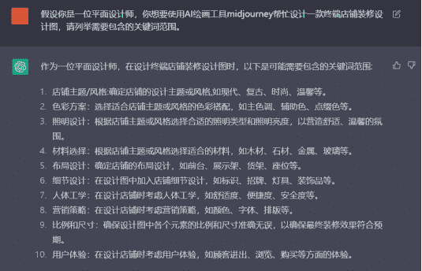
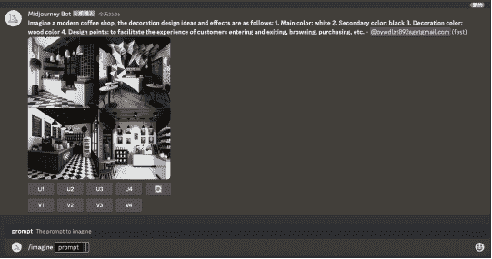

# 🥈用ChatGPT辅助生成创意营销图片素材

> 来源：[https://chengchaungai.feishu.cn/docx/ZYGNdUIYWoJlWWx9mKacGObGnlh](https://chengchaungai.feishu.cn/docx/ZYGNdUIYWoJlWWx9mKacGObGnlh)

————**选择人工智能，链接无限未来**————

本文编辑:**JUGO** **  ****  **                                                         公众号：橙创AI

**进入👉 **[🍊橙创AI知识库（首页）](https://ix9q8jjj4ug.feishu.cn/wiki/DOsXwmRDaibJVUkDSHKcYbhmn0f)**获取更多A****IGC内****容👈**

> **查阅、整理和输出教程属实**[**不易**](https://ki6j1b0d92h.feishu.cn/wiki/wikcnOTLuqHXX6ZJ1oWEBGbd9zf?from=from_copylink)，觉得这篇教程对你有所帮助的话，不妨分享给更多需要的人呗😊

1、营销素材对应的关键词库（3个）：

元素、风格、AI绘画工具midjourney

**提问模板：**

第一步，先预设场景，询问应该包含的关键词范围

假设你是一位世界一流水平的设计师，你想要使用AI绘画工具midjourney帮忙设计一款XXX，列举该场景需要用到的关键词范畴与示例。

第二步，按照推荐的关键词填充内容来输入到midjourney中，生成对应的图片。

按照逗号区隔不同描述词，用谷歌助手翻译成英文描述词，输入到midjourney中。

**举例：**

1、产品模特图场景对应的关键词库（10个）

产品类型、模特类型、模特姿势、背景颜色、背景图案、色彩搭配、绘画风格、表情细节、衣服细节、比例

产品模特图示范：

假设你是一位世界一流水平的设计师，你想要使用AI绘画工具midjourney帮忙设计一款产品模特图，产品是咖啡，身穿白色衣服的专业模特站在海洋背景前手持咖啡，明亮色彩，写实风格，面带微笑，8k，9:16画布尺寸。

**Midjourney效果如下：**

2、虚拟主播场景对应的关键词库（8个）：

虚拟主播、人设形象、场景主题和风格、主播表情细节、品牌形象、专业程度、高质量、视觉冲击力

**虚拟主播要求示范：**

举一个例子，如果要生成一个以游戏解说为主题的虚拟主播，关键词可以包括：

主题和风格：游戏解说、游戏攻略、游戏评测等。

人设和形象：可爱、萌系、游戏风格、卡通形象等。

假设你是一个策划，你想要使用AI绘画工具midjourney帮忙设计一款软萌可爱的闯关类游戏解说虚拟主播，人设形象是可爱粉色系兔女郎，8k

**Midjourney效果如下：**

3、产品包装图场景对应的关键词库（5个）：

产品特点、目标受众、外盒包装、包含元素、设计风格

产品包装图示范：

假设你是一位平面设计师，你想要使用AI绘画工具midjourney帮忙设计一款礼品的外盒包装，外盒包装画面是熊猫、竹林、光影，要求是魔幻风格，请列举关键词。

想象一个礼盒的包装盒，上面有可爱、圆滚滚、温顺、憨态可掬的熊猫，熊猫在一个静谧、神秘的竹林里，竹林里有魔幻、神秘、绚丽的光影，旁边还有蜜蜂、蝴蝶、蜻蜓、小鸟、花朵、小熊等，以突出礼盒中所包含的蜂蜜产品与自然的关联。

颜色要求选用简约、高级感的色彩，如黑白、金银、米色等，也可以选择少量向阳的色彩进行点缀，但要注意不要过于花哨。

**Midjourney效果如下：**

4、终端店铺设计图场景对应的关键词库（9个）

店铺类型、店铺面积、店铺位置、店铺外观、内部布局、装修风格、颜色搭配、陈列设计、氛围营造

风格+产品类型+品牌名+店铺+装修风格+设计要点

**终端店铺设计图示范：**

**问题输入1：**

假设你是一位平面设计师，你想要使用AI绘画工具midjourney帮忙设计一款终端店铺装修设计图，请列举需要包含的关键词范围。

问题输入2：谷歌翻译成英文后，输入midjourney

想象一个现代风的咖啡店店铺，装修设计思路和效果如下：

主色调：白色

辅助颜色：黑色

点缀颜色：木色

设计要点：方便顾客进出、浏览、购买等方面的体验

**Midjourney效果如下：**

> 关注**公众号**，加入**AI****实战交流群**，掌握全面专业的**行业资讯**、**工具分享**、**变现指南**和**实战教程**，开启你的AI智慧之旅👇👇

联系微信**JUGO737Y****（备注来意）**

公众号：**橙创****AI**

**群聊二维码**：

