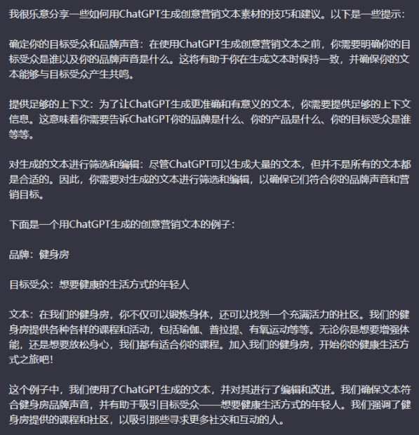
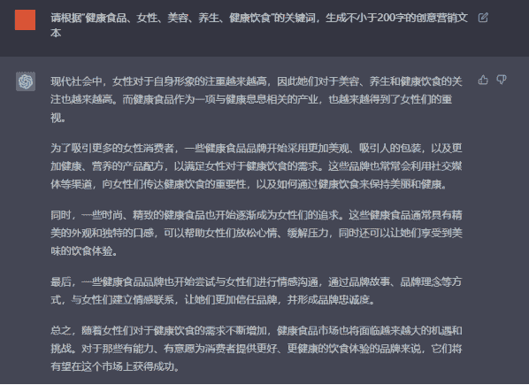
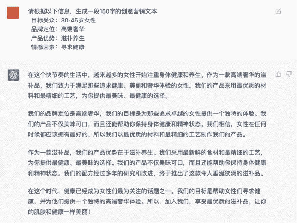
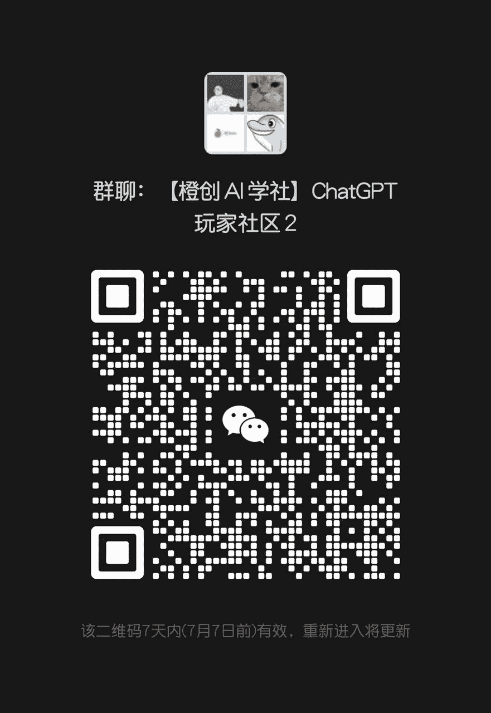

# 🥈用ChatGPT生成创意营销文本素材

> 来源：[https://chengchaungai.feishu.cn/docx/GfzXdkEJdontFXxdkQHcRlnCnZg](https://chengchaungai.feishu.cn/docx/GfzXdkEJdontFXxdkQHcRlnCnZg)

————**选择人工智能，链接无限未来**————

本文编辑:**JUGO** **  ****  **                                                         👸号：橙创AI

**进入👉 **[🍊橙创AI知识库（首页）](https://ix9q8jjj4ug.feishu.cn/wiki/DOsXwmRDaibJVUkDSHKcYbhmn0f)**获取更多A****IGC内****容👈**

> **查阅、整理和输出教程属实**[**不易**](https://ki6j1b0d92h.feishu.cn/wiki/wikcnOTLuqHXX6ZJ1oWEBGbd9zf?from=from_copylink)，觉得这篇教程对你有所帮助的话，不妨分享给更多需要的人呗😊

**该场景对应的关键词库（5个）：**

目标受众、品牌定位、产品优势、服务独特性、情感因素；例如：健康食品、女性、美容、养生、健康饮食。

**提问模板：**

1、你是世界一流的作家编剧，请告诉我，如何用chatGPT生成创意营销文本素材，并举个例子

2、请根据“XX、XX、XX、XX、XX”的关键词，生成不小于200字的创意营销文本

3、请根据以下信息，生成一段150字的创意营销文本

目标受众：XX-XX岁XX性

品牌定位：XXX

产品优势：XXX

情感因素：XXX

**举例：**

1、你是世界一流的作家编剧，请告诉我，如何用chatGPT生成创意营销文本素材，并举个例子

2、请根据“健康食品、女性、美容、养生、健康饮食”的关键词，生成不小于200字的创意营销文本。

3、请根据以下信息，生成一段150字的创意营销文本

目标受众：30-45岁女性

品牌定位：高端奢华

产品优势：滋补养生

情感因素：寻求健康

> 关注**👸号**，加入**AI****实战交流群**，掌握全面专业的**行业资讯**、**工具分享**、**变现指南**和**实战教程**，开启你的AI智慧之旅👇👇

联系🛰️**JUGO737Y****（备注来意）**

👸号：**橙创****AI**

**群聊二维码**：

