# 🎁【快速上手】Midjourney奶奶级注册教程（我奶看完都会了）

> 来源：[https://chengchaungai.feishu.cn/docx/MQS1d49Cjo1EhhxLYm8cTvsZnFd](https://chengchaungai.feishu.cn/docx/MQS1d49Cjo1EhhxLYm8cTvsZnFd)

#

————**选择人工智能，链接无限未来**————

本文编辑:**JUGO** **  ****  **                                                         👸号：橙创AI

**进入👉 **[🍊橙创AI知识库（首页）](https://ix9q8jjj4ug.feishu.cn/wiki/DOsXwmRDaibJVUkDSHKcYbhmn0f)**获取更多A****IGC内****容👈**

> **查阅、整理和输出教程属实**[**不易**](https://ki6j1b0d92h.feishu.cn/wiki/wikcnOTLuqHXX6ZJ1oWEBGbd9zf?from=from_copylink)，觉得这篇教程对你有所帮助的话，不妨分享给更多需要的人呗😊

## Midjourney是什么？

Midjourney是一款AI制图工具，只要关键字，就能通过AI算法生成相对应的图片，只需要不到一分钟。可以选择不同画家的艺术风格，例如安迪华荷、达芬奇、达利和毕加索等，还能识别特定镜头或摄影术语。下面就是一张AI生成的例图。

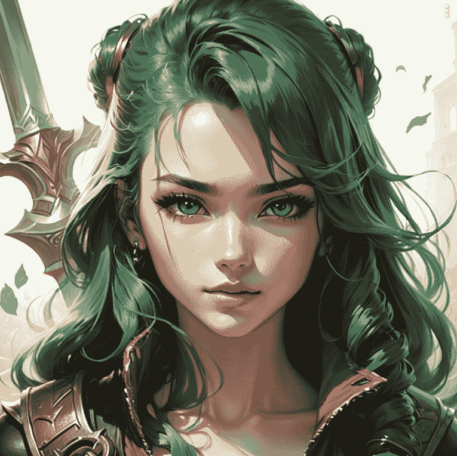

## 如何使用Midjourney？

使用 Midjourney 首先需要创建Discord账号，Midjourney和Discord的关系类似于小程序和🛰️的关系一样，也可以直接从Midjourney官网进入直接注册Discord账号。

### 注册账号（discord账号授权midjourney)

1、打开[**Midjourney官网**](https://www.midjourney.com)（需要外部环境，选择第二项Sign In（已有Discord账号的可以选择第一个）。

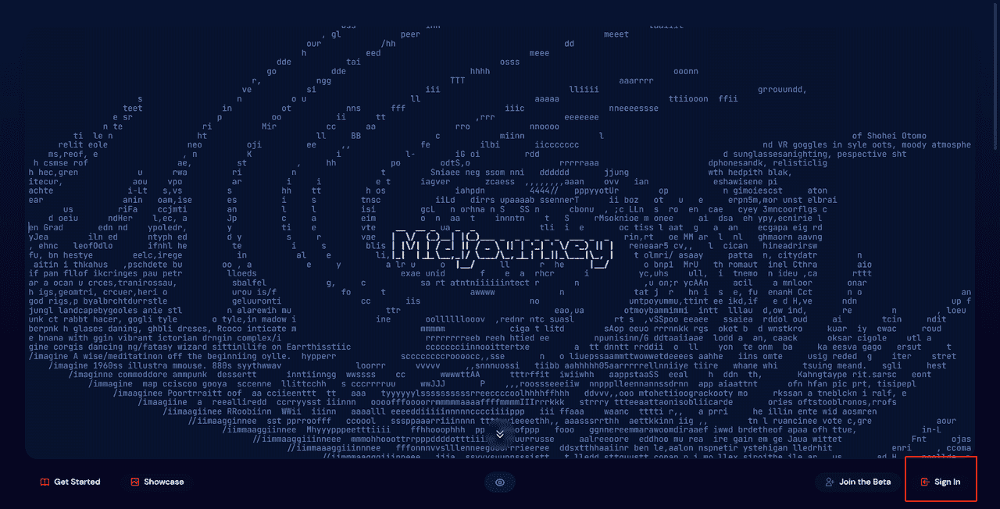

2、点击注册，使用常用的邮箱注册Discord账号，用户名、密码、出生年月都输入完之后点击继续（实测可用自己的🐧邮箱），通过人机验证和授权账号登录。

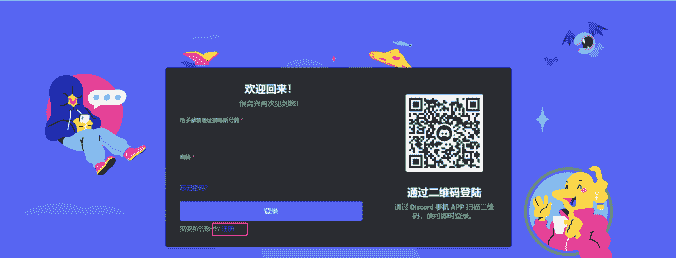

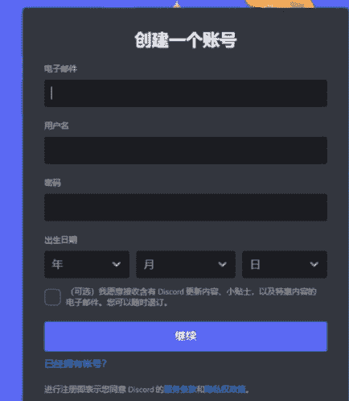

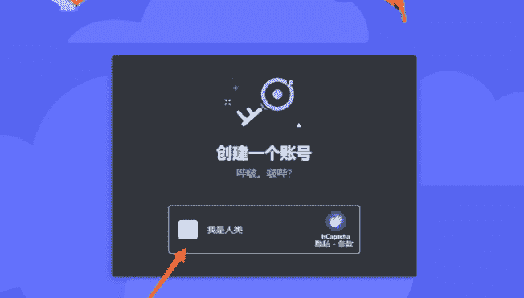

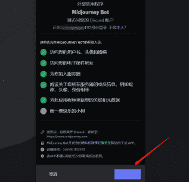

3、授权以后不要着急，先打开你的邮箱找到刚刚Discord给你发的验证邮件，点击激活授权一下就可以啦。

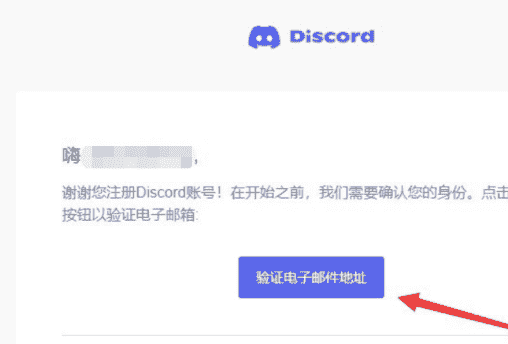

4、接下来进入正题，以网页版为例，首先需要加入Midjourney频道，如果直接登录Discord是没有这个频道的，所以需要重新从第1步开始，直到第2步，这个时候就不需要点击注册了，直接使用刚刚注册的邮箱以及密码登录，登录成功点击Join the Discord to start creating，然后点击接受邀请即可。

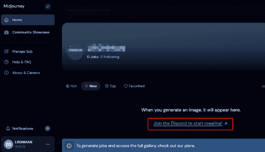

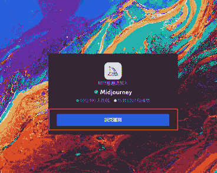

5、点击图标进入Midjourney频道， 选择频道栏#Newbies-xx，进入新手测试频道。

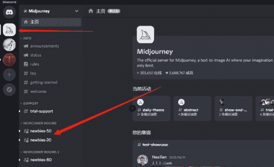

6、最后只需要在输入框输入/imagine+图片描述（prompt），就可以开启AI智能绘图之旅啦！如图，在prompt后输入想要画面的关键词（英文），回车发送。

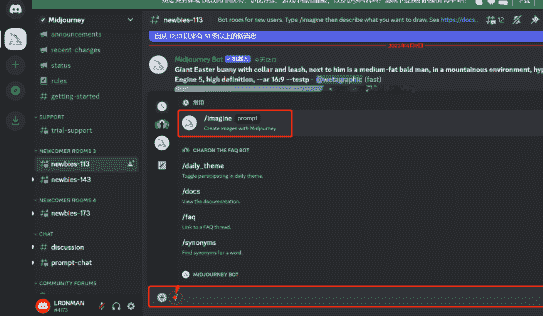

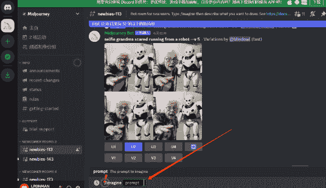

7、等待 Midjourney 机器人处理你的需求，通常需要一分钟左右的时间，生成四个基于你的文本描述的图片，同时会出现两排按钮，U是放大图片，U1\U2\U3\U4分别指的是放大四张图片中的某一张，V是采用图片的构图形式，重新生成，顺序参考如下图。

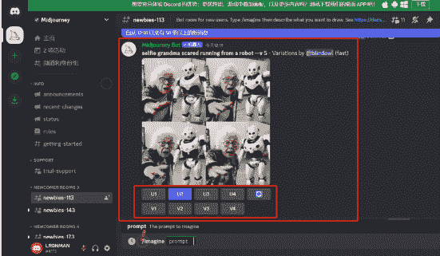

8、最后一步保存图片方法，点击生成图片，左下角在浏览器中打开, 在新页面中右键，选择图片另存为，即可保存到本地。

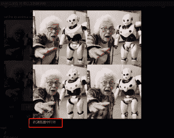

**好了，Midjourney基本操作流程**就是这样，到这里基本上注册环节就讲完了。

### 其他打开方式：

在 discord 使用 midjourney(bot)

https://discord.com/invite/xZ7phQEXzW

### 加载不出来，打不开 discord

大概率是样子断线或不稳定，最好的方法是掌握🪜的使用，或者直接召唤熟悉的程序员小哥哥现场教学。

# 体验过了想开会员？

#### 怎么买 midjourney ，买哪个？

看用途，浅尝辄止，试用就行（03/30已禁国内）。 但太浅了试不出来，或者看看官方频道就好了。

想入门，后续技能储备： $30/月 或 $24/月的年包。standard plan （3小时快速出图时间）

有钱，后续长期用的，或者不差钱直接年包 + 按需的 fast 包。 pro plan（6小时快速出图时间）

> 需要代开通或者成品号的小伙伴可以加我的🛰️：JUGO737Y

> 送Prompt教学以及各种MJ的使用小技巧

> 直接加JUGO737Y（24小时在线，备注：MJ账号）

## **Discord 使用类**

#### 还有多少次免费？

**/info**** 命令查看，**详情 link

#### 怎么自建服务器/好多人只想看自己信息

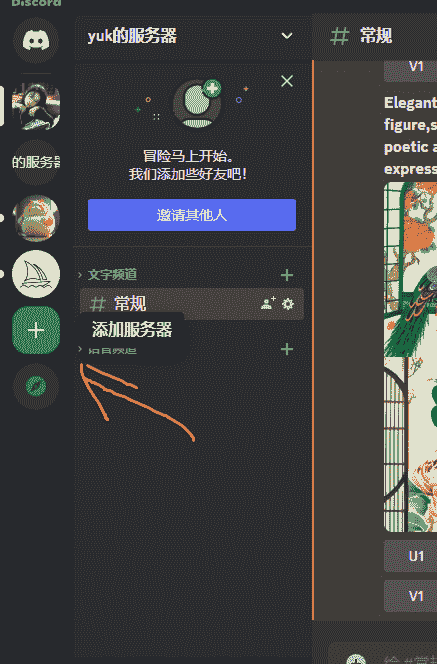

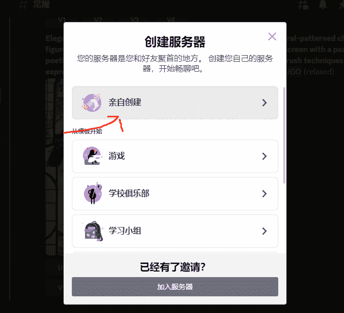

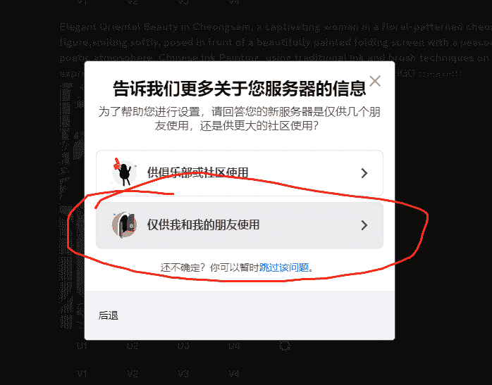

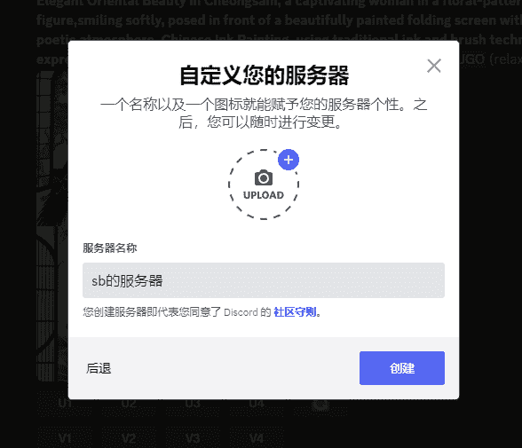

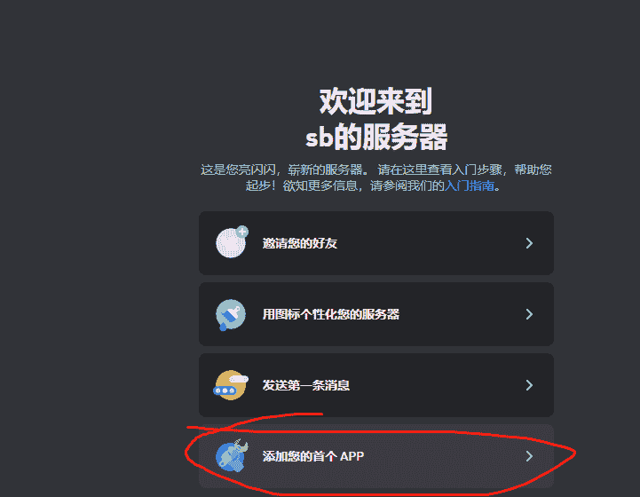

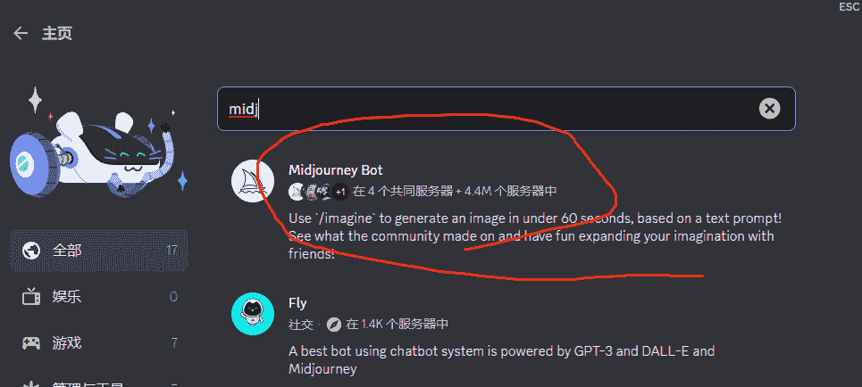

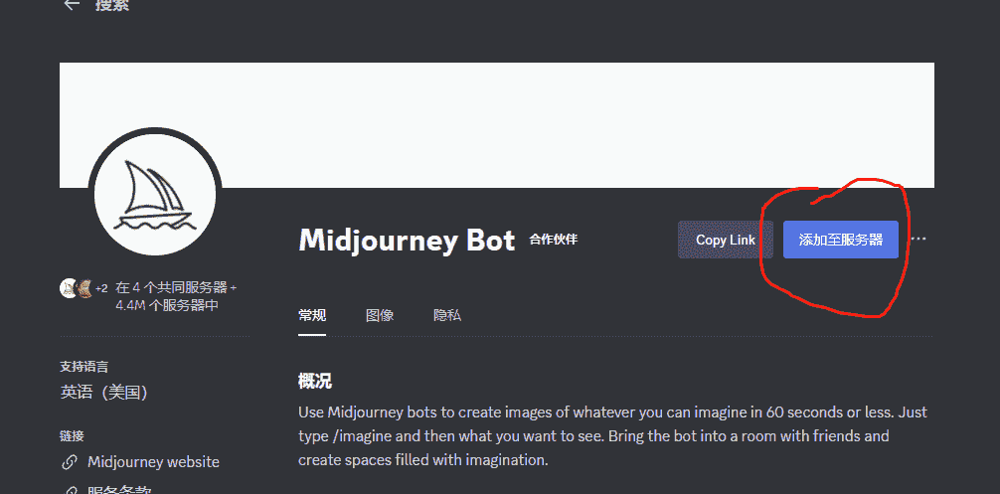

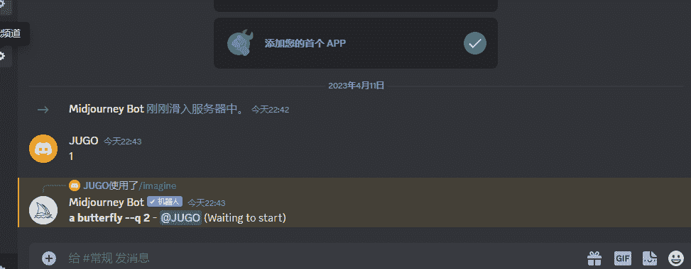

### mj每日主题

在 #daily_theme 频道可以组团玩儿主题化图片生成的练习，想了解今天是什么主题，可以看频道名字：右侧→ 小公告。 所有生成的图必需包含当日的关键词。

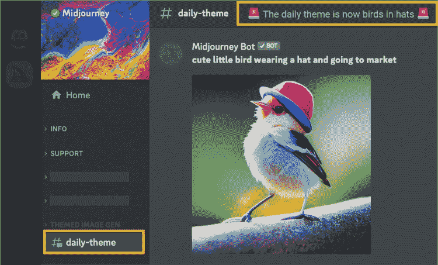

**关闭每日主题提醒**

**想避免被每日主题频道的通知**骚扰的话，可以用 /daily_theme 命令关闭频道通知。

> 关注**👸号**，加入**AI****实战交流群**，掌握全面专业的**行业资讯**、**工具分享**、**变现指南**和**实战教程**，开启你的AI智慧之旅👇👇

联系🛰️**JUGO737Y****（备注来意）**

👸号：**橙创****AI**

**群聊二维码**：

## 一些教程：

## [怎么用 Midjourney 快速设计一个 logo？](https://ix9q8jjj4ug.feishu.cn/docx/LcqkdHYAIopUNvxkzXscPRLDnjf)

## [chatGPT 常见问题及解决方法（解决98％的问题）](https://ix9q8jjj4ug.feishu.cn/docx/IQ73dpTrBoRYcPxD0Wxcbcubnth)

## [ChatGPT保姆级注册流程，包学包会](https://ix9q8jjj4ug.feishu.cn/docx/LA0edeqP3ovDvGximALci9HRnbf)